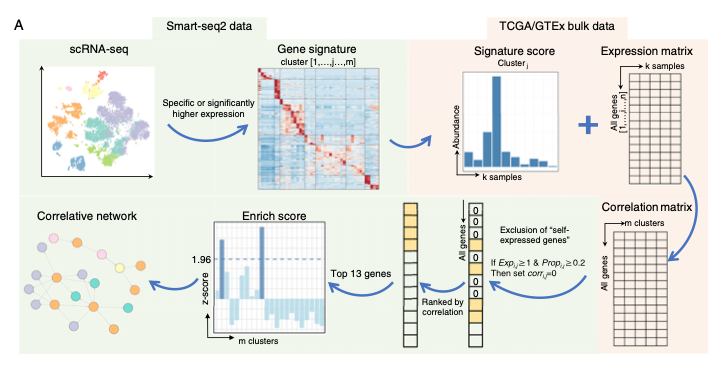

To infer cell–cell interaction networks in bulk RNA-seq data using single-cell signatures (`scBulkCCCI` workflow), compute the Spearman correlation matrix between cell-type abundance estimates across bulk samples, filter for high correlations, and visualize the network with `igraph` (static) and `networkD3` (interactive) \[1\]. `scBulkCCCI` and its raw Smart-seq2 datasets are not in this repository's lockfile; the workflow — correlation matrix from abundance estimates, igraph network construction, and node attribute mapping — runs on base R + `igraph`:

## Example

{fig-alt="Correlation Network of Bulk & Single-Cell Signatures DEMO" fig-align="center" width="70%"}

## Setup

-   System Requirements: Cross-platform (Linux/MacOS/Windows)

-   Programming language: R

-   Dependent packages: `igraph`; `RColorBrewer`

```{r packages setup, message=FALSE, warning=FALSE, output=FALSE}
suppressPackageStartupMessages({
  library(igraph); library(RColorBrewer)
})
```

```{r}
sessioninfo::session_info("attached")
```

## Data Preparation

Simulated per-cell-type abundance estimates for 18 cell types across 308 bulk tumour samples (Colorectal Cancer style). Pairwise Spearman correlations between cell abundances build the interaction network; edges above a correlation threshold (e.g. ρ > 0.45) form the network graph:

```{r load data}
suppressPackageStartupMessages({library(igraph); library(RColorBrewer)})
set.seed(45272)
n_sam <- 308
cell_types <- c(
  "PlasmaB-IgG", "NK-GZMK", "ILC3-SLC4A10", "Endothelium-CDH5",
  "Myofib-ACTA2", "CAF-FAP", "Mast-TPSAB1", "pDC-LILRA4",
  "cDC2-CD1C", "cDC1-BATF3", "Macro-NLRP3", "TAM-C1QC",
  "CD4-TCF7", "CD4-CXCR6", "CD8-GZMK", "CD8-CD6", "CD8-CD160"
)
n_ct <- length(cell_types)
abund <- matrix(runif(n_ct * n_sam, 0.01, 0.3), n_ct, n_sam,
                dimnames = list(cell_types, sprintf("S%03d", 1:n_sam)))
## plant correlated modules (myeloid-CAF, T-NK)
abund[c("Macro-NLRP3", "TAM-C1QC", "CAF-FAP"), ] <-
  abund[c("Macro-NLRP3", "TAM-C1QC", "CAF-FAP"), ] +
  rnorm(3 * n_sam, 0.3, 0.05)
abund[c("CD8-GZMK", "CD8-CD6", "NK-GZMK"), ] <-
  abund[c("CD8-GZMK", "CD8-CD6", "NK-GZMK"), ] +
  rnorm(3 * n_sam, 0.3, 0.05)

cor_mat <- cor(t(abund), method = "spearman")
diag(cor_mat) <- 0
th <- 0.45
edges_idx <- which(cor_mat > th & upper.tri(cor_mat), arr.ind = TRUE)
edge_df <- data.frame(
  specificSubtype = cell_types[edges_idx[, 1]],
  otherSubtype = cell_types[edges_idx[, 2]],
  weight = cor_mat[edges_idx]
)
```

## Visualization

### 1. Static Igraph Correlation Network

The reference's static network: nodes = cell types grouped by global cluster (Paired palette), edges = strong positive abundance correlation, vertex label size 0.75:

```{r}
#| label: fig-1.1ScBulkNetwork
#| fig-cap: "Correlative cell-cell interaction network from bulk abundance estimates (Spearman rho > 0.45): nodes coloured by global cluster (Paired palette), edges representing co-abundance across 308 colorectal cancer samples."
#| out.width: "85%"
#| fig-width: 7.5
#| fig-height: 7.5

nodes_df <- data.frame(
  node = cell_types,
  Global_Cluster = rep(c("Myeloid/Stromal", "Lymphoid", "Other"), length.out = n_ct)
)
g <- graph_from_data_frame(edge_df, directed = FALSE, vertices = nodes_df)
V(g)$label.cex <- 0.8
V(g)$label.color <- "black"
pal <- brewer.pal(n = max(3, length(unique(V(g)$Global_Cluster))), name = "Set2")
V(g)$color <- pal[as.numeric(as.factor(V(g)$Global_Cluster))]
V(g)$frame.color <- "white"

op <- par(mar = c(1, 1, 1, 1))
plot(g, vertex.size = 22, edge.width = E(g)$weight * 3,
     layout = layout_with_fr(g))
legend("topleft", legend = unique(V(g)$Global_Cluster), pch = 21,
       pt.bg = pal[seq_along(unique(V(g)$Global_Cluster))],
       col = "#777777", pt.cex = 1.8, cex = 0.8, bty = "n")
par(op)
```

### 2. Adjacency Heatmap of Correlated Cell Types

To check the network structure without layout artifacts, the raw correlation matrix thresholded at the same cutoff shows the two dense interaction modules directly:

```{r}
#| label: fig-2.1ScBulkAdjacency
#| fig-cap: "Thresholded abundance correlation matrix (rho > 0.45): the myeloid-stromal module and lymphoid module appear as distinct positive blocks, confirming the network edges."
#| out.width: "85%"
#| fig-width: 7
#| fig-height: 6

m <- cor_mat * (cor_mat > th)
pheatmap::pheatmap(m,
                   color = colorRampPalette(c("white", "#B2182B"))(64),
                   cluster_rows = TRUE, cluster_cols = TRUE,
                   border_color = "grey85",
                   fontsize = 8,
                   legend = TRUE,
                   breaks = seq(0, 1, length.out = 65),
                   main = "Cell-type abundance correlation (rho > 0.45)")
```

::: callout-tip
**Practice tips**

-   Use Spearman correlation over cell-type abundance estimates (`cor(t(abund), method = "spearman")`) — abundance scores are non-normal and bounded.
-   Filter edges by an absolute threshold (`rho > 0.45` here) before building the `igraph` object; an unfiltered correlation network is a hairball.
-   Assign vertex colours by functional module (`Global_Cluster`) using a discrete palette (`RColorBrewer::brewer.pal`) so connected components are visually distinct.
-   `layout_with_fr()` (Fruchterman-Reingold) places strongly correlated cell types close together naturally.
-   When static graphs crowd, export node/edge lists to `networkD3::forceNetwork()` for an interactive HTML widget, as the reference suggests.
:::

## Application

::: {#fig-ScBulkCcciApplications1}
{fig-alt="Correlation Network of Bulk & Single-Cell Signatures" fig-align="center" width="70%"}

Correlation network of bulk & single-cell signatures
:::

The single-cell signature + bulk correlation network applies to any cross-platform integration: scRNA-seq cell types vs bulk TCGA, single-cell pathway scores vs bulk immune deconvolution, or spatial spot signatures vs bulk tissue fractions — wherever single-cell resolution informs bulk composition.

## Reference

\[1\] Xiaofan Lu, et al. FigureYa: A Standardized Visualization Framework for Enhancing Biomedical Data Interpretation and Research Efficiency. iMetaMed. 2025. doi:10.1002/imm3.70005
