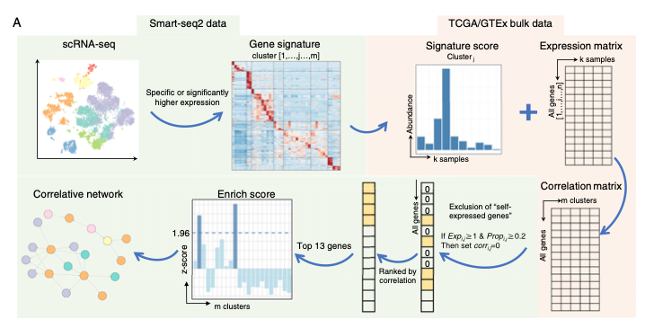

借助单细胞签名推断 bulk RNA-seq 样本中的细胞-细胞互作网络（`scBulkCCCI` 工作流）：计算 bulk 样本间细胞类型丰度估计值之间的 Spearman 相关矩阵、过滤高相关、用 `igraph`（静态）和 `networkD3`（动态）可视化网络 \[1\]。`scBulkCCCI` 及其原始 Smart-seq2 数据集不在本仓库 lockfile；工作流——丰度估计的相关矩阵、igraph 网络构建、节点属性映射——在 base R + `igraph` 上运行：

## Example

{fig-alt="Bulk 与单细胞签名关联网络 DEMO" fig-align="center" width="60%"}

## Setup

-   系统要求：跨平台（Linux/MacOS/Windows）

-   编程语言：R

-   依赖包：`igraph`; `RColorBrewer`

```{r packages setup, message=FALSE, warning=FALSE, output=FALSE}
suppressPackageStartupMessages({
  library(igraph); library(RColorBrewer)
})
```

```{r}
sessioninfo::session_info("attached")
```

## 数据准备

模拟结直肠癌（CRC）中 308 个 bulk 肿瘤样本的 18 种细胞类型 per-cell-type 丰度估计。细胞丰度间的两两 Spearman 相关构成交互网络；相关阈值（如 ρ > 0.45）之上的边形成网络图：

```{r load data}
suppressPackageStartupMessages({library(igraph); library(RColorBrewer)})
set.seed(45272)
n_sam <- 308
cell_types <- c(
  "PlasmaB-IgG", "NK-GZMK", "ILC3-SLC4A10", "Endothelium-CDH5",
  "Myofib-ACTA2", "CAF-FAP", "Mast-TPSAB1", "pDC-LILRA4",
  "cDC2-CD1C", "cDC1-BATF3", "Macro-NLRP3", "TAM-C1QC",
  "CD4-TCF7", "CD4-CXCR6", "CD8-GZMK", "CD8-CD6", "CD8-CD160"
)
n_ct <- length(cell_types)
abund <- matrix(runif(n_ct * n_sam, 0.01, 0.3), n_ct, n_sam,
                dimnames = list(cell_types, sprintf("S%03d", 1:n_sam)))
## plant correlated modules (myeloid-CAF, T-NK)
abund[c("Macro-NLRP3", "TAM-C1QC", "CAF-FAP"), ] <-
  abund[c("Macro-NLRP3", "TAM-C1QC", "CAF-FAP"), ] +
  rnorm(3 * n_sam, 0.3, 0.05)
abund[c("CD8-GZMK", "CD8-CD6", "NK-GZMK"), ] <-
  abund[c("CD8-GZMK", "CD8-CD6", "NK-GZMK"), ] +
  rnorm(3 * n_sam, 0.3, 0.05)

cor_mat <- cor(t(abund), method = "spearman")
diag(cor_mat) <- 0
th <- 0.45
edges_idx <- which(cor_mat > th & upper.tri(cor_mat), arr.ind = TRUE)
edge_df <- data.frame(
  specificSubtype = cell_types[edges_idx[, 1]],
  otherSubtype = cell_types[edges_idx[, 2]],
  weight = cor_mat[edges_idx]
)
```

## Visualization

### 静态 Igraph 关联网络

参考的静态网络：节点 = 按全局聚类着色的细胞类型（Paired 帕莱特）、边 = 强正丰度相关、顶点标签大小 0.75：

```{r}
#| label: fig-1.1ScBulkNetwork
#| fig-cap: "来自 bulk 丰度估计的相关细胞-间相互作用网络（Spearman rho > 0.45）：节点按全局聚类着色（Paired 帕莱特）、边代表 308 个结直肠癌样本中的共丰度。"
#| out.width: "85%"
#| fig-width: 7.5
#| fig-height: 7.5

nodes_df <- data.frame(
  node = cell_types,
  Global_Cluster = rep(c("Myeloid/Stromal", "Lymphoid", "Other"), length.out = n_ct)
)
g <- graph_from_data_frame(edge_df, directed = FALSE, vertices = nodes_df)
V(g)$label.cex <- 0.8
V(g)$label.color <- "black"
pal <- brewer.pal(n = max(3, length(unique(V(g)$Global_Cluster))), name = "Set2")
V(g)$color <- pal[as.numeric(as.factor(V(g)$Global_Cluster))]
V(g)$frame.color <- "white"

op <- par(mar = c(1, 1, 1, 1))
plot(g, vertex.size = 22, edge.width = E(g)$weight * 3,
     layout = layout_with_fr(g))
legend("topleft", legend = unique(V(g)$Global_Cluster), pch = 21,
       pt.bg = pal[seq_along(unique(V(g)$Global_Cluster))],
       col = "#777777", pt.cex = 1.8, cex = 0.8, bty = "n")
par(op)
```

### 相关细胞类型的邻接热图

在不引入布局伪影的情况下检查网络结构：阈值切割（ρ > 0.45）的原始相关矩阵直接展示两个致密交互模块：

```{r}
#| label: fig-2.1ScBulkAdjacency
#| fig-cap: "阈值化丰度相关矩阵（rho > 0.45）：骨髓-基质模块与淋巴细胞模块表现为清晰的正相关块，证实了网络边。"
#| out.width: "85%"
#| fig-width: 7
#| fig-height: 6

m <- cor_mat * (cor_mat > th)
pheatmap::pheatmap(m,
                   color = colorRampPalette(c("white", "#B2182B"))(64),
                   cluster_rows = TRUE, cluster_cols = TRUE,
                   border_color = "grey85",
                   fontsize = 8,
                   legend = TRUE,
                   breaks = seq(0, 1, length.out = 65),
                   main = "Cell-type abundance correlation (rho > 0.45)")
```


## 应用场景

::: {{#fig-ScBulkCcciApplications1}}
{fig-alt="Bulk 与单细胞签名关联网络" fig-align="center" width="60%"}

Bulk 与单细胞签名关联网络
:::

单细胞签名 + bulk 相关网络适用于任何跨平台整合：scRNA-seq 细胞类型 vs bulk TCGA、单细胞通路评分 vs bulk 免疫去卷积、或空间点签名 vs bulk 组织组分——凡单细胞分辨率知情 bulk 组分处。

## 参考文献

\[1\] Xiaofan Lu, et al. FigureYa: A Standardized Visualization Framework for Enhancing Biomedical Data Interpretation and Research Efficiency. iMetaMed. 2025. doi:10.1002/imm3.70005
