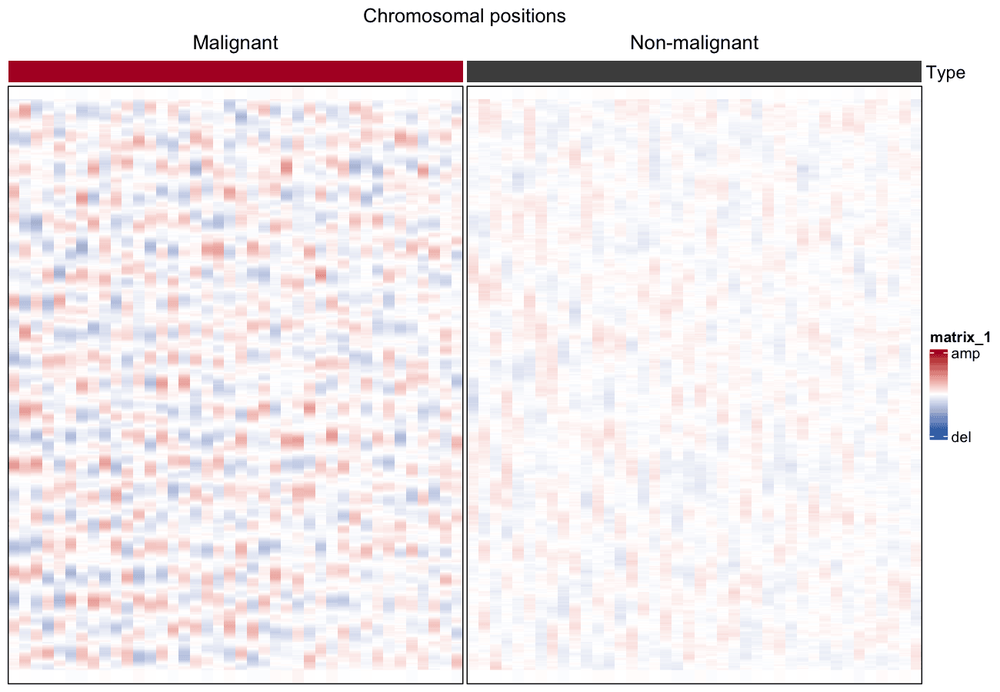

Large-scale copy-number aberrations can be **inferred from single-cell RNA-seq**: order genes by genomic position, smooth expression over 100-gene windows, median-centre every cell, and the residual waves are the CNV landscape \[1\]. Plotting cells (rows) against chromosomal positions (columns) separates malignant from non-malignant cells, with a per-cell CNV score as the ordering statistic.

## Example

{fig-alt="ScCnvPlot DEMO" fig-align="center" width="60%"}

## Setup

-   System Requirements: Cross-platform (Linux/MacOS/Windows)

-   Programming Language: R

-   Dependent packages: `ComplexHeatmap`; `circlize`; `data.table`; `dplyr`

```{r packages setup, message=FALSE, warning=FALSE, output=FALSE}
# Installing necessary packages
if (!requireNamespace("ComplexHeatmap", quietly = TRUE)) {
  BiocManager::install("ComplexHeatmap")
}
if (!requireNamespace("circlize", quietly = TRUE)) {
  install.packages("circlize")
}
if (!requireNamespace("data.table", quietly = TRUE)) {
  install.packages("data.table")
}
if (!requireNamespace("dplyr", quietly = TRUE)) {
  install.packages("dplyr")
}

# Load packages
library(ComplexHeatmap)
library(circlize)
library(data.table)
library(ggplot2)
library(dplyr)
```

```{r}
sessioninfo::session_info("attached")
```

## Data Preparation

The real input is a log2-TPM single-cell matrix with cell metadata (the reference uses GSE103322 HNSCC). We simulate 400 genes ordered along 22 chromosomes and 80 cells: 40 malignant cells carrying broad CNV waves and 40 non-malignant cells without them.

```{r load data, message=FALSE, warning=FALSE}
set.seed(1401)
n_chr <- 22; genes_per_chr <- 50; n_gene <- n_chr * genes_per_chr
n_mal <- 40; n_nor <- 40

gene_pos <- expand.grid(chr = seq_len(n_chr), idx = seq_len(genes_per_chr))
gene_pos <- gene_pos[order(gene_pos$chr, gene_pos$idx), ]
genes <- paste0("G", sprintf("%04d", seq_len(n_gene)))

cell_type <- factor(c(rep("Malignant", n_mal), rep("Non-malignant", n_nor)),
                    levels = c("Malignant", "Non-malignant"))
cells <- paste0(substr(cell_type, 1, 3), "_", sprintf("%03d", seq_len(2 * n_mal)))

expr <- matrix(rnorm(n_gene * length(cells), mean = 5, sd = 0.5),
               nrow = n_gene, dimnames = list(genes, cells))
## broad CNV waves in malignant cells: sinusoid per chromosome,
## amplitude and phase vary per cell
for (i in seq_len(n_mal)) {
  for (chr in seq_len(n_chr)) {
    amp   <- runif(1, 0.4, 1.0) * sample(c(-1, 1), 1)        # del or amp
    phase <- runif(1, 0, 2 * pi)
    idx   <- which(gene_pos$chr == chr)
    expr[idx, i] <- expr[idx, i] +
      amp * sin(seq_along(idx) / length(idx) * 2 * pi + phase)
  }
}

## gene ordering + centring + bounding (the reference recipe)
gene_order <- order(gene_pos$chr, gene_pos$idx)
expr <- expr[gene_order, ]
rela <- sweep(expr, 1, rowMeans(expr))
rela <- pmin(pmax(rela, -3), 3)
```

## Visualization

### 1. Run-Mean Smoothing (100-Gene Windows)

```{r}
#| label: fig-1.1SmoothedCNV
#| fig-cap: "CNV heatmap: cells (rows, malignant on top) x chromosomal positions (columns, chromosome boundaries ticked); smoothed over 100-gene windows."
#| out.width: "95%"
#| warning: false
#| message: false
#| fig-width: 10
#| fig-height: 6

smoothed <- rela
for (c_idx in seq_len(ncol(rela))) {
  smoothed[, c_idx] <- data.table::frollmean(rela[, c_idx], n = 50, align = "center")
}
smoothed[is.na(smoothed)] <- 0
## per-cell median re-centring after smoothing (Patel et al., 2014)
smoothed <- sweep(smoothed, 2, apply(smoothed, 2, median))

cnv_score <- colMeans(smoothed^2)
col_order <- order(cell_type, -cnv_score)

col_fun <- circlize::colorRamp2(c(-1.5, 0, 1.5), c("#2166AC", "white", "#B2182B"))
row_ha <- HeatmapAnnotation(
  df = data.frame(Type = cell_type[col_order],
                  `CNV score` = cnv_score[col_order]),
  col = list(Type = c(Malignant = "#B2182B", `Non-malignant` = "#4D4D4D")),
  annotation_name_side = "left")

chr_breaks <- cumsum(table(gene_pos$chr[gene_order]))[-n_chr]

Heatmap(smoothed[, col_order], name = "CNV",
        top_annotation = row_ha,
        col = col_fun,
        cluster_rows = FALSE, cluster_columns = FALSE,
        show_column_names = FALSE, show_row_names = FALSE,
        column_split = cell_type[col_order], column_gap = unit(1, "mm"),
        border = TRUE,
        heatmap_legend_param = list(at = c(-1.5, 0, 1.5),
                                    labels = c("del", "", "amp"))) |>
  draw(column_title = "Chromosomal positions")
```

### 2. Malignant vs Non-Malignant Separation by CNV Score

```{r}
#| label: fig-1.2CnvScore
#| fig-cap: "Per-cell CNV score separates malignant from non-malignant cells; the Wilcoxon p value is annotated."
#| out.width: "65%"
#| warning: false
#| message: false
#| fig-width: 6
#| fig-height: 4.5

score_df <- data.frame(type = cell_type, score = cnv_score)
p_w <- wilcox.test(score ~ type, data = score_df)$p.value

ggplot(score_df, aes(type, score, fill = type)) +
  geom_boxplot(outlier.shape = NA, width = 0.55) +
  geom_jitter(width = 0.1, size = 0.8, alpha = 0.5, show.legend = FALSE) +
  scale_fill_manual(values = c(Malignant = "#B2182B", `Non-malignant` = "#4D4D4D")) +
  labs(title = sprintf("CNV score (Wilcoxon %s)",
       ifelse(p_w < 0.001, "p < 0.001", sprintf("p = %.3f", p_w))),
       x = NULL, y = "CNV score", fill = NULL) +
  theme_classic(base_size = 11) +
  theme(legend.position = "none")
```

::: callout-tip
**Practice tips**

-   Filter out lowly expressed genes **before** inferring CNV — near-zero expression distorts the running mean and mutes the waves.
-   Centre per **cell** (median of all genes), not per gene: the waves are relative to each cell's baseline.
-   The CNV score doubles as a malignancy classifier — the reference workflow uses it to flag malignant cells that marker genes miss.
:::

### 3. Depth Ratio and B-Allele Frequency: The Two-Panel Call

A depth ratio alone cannot tell a 3-copy gain from a 2-copy gain with 50% normal contamination, and it cannot see copy-neutral loss of heterozygosity at all. The standard answer is a **second panel**: B-allele frequency (BAF). At a copy number of 2 heterozygosity gives BAF 0.5; at 3 copies the two allele bands split to 1/3 and 2/3; at 1 copy they collapse to 0 and 1 \[3,4\]. Reading BAF next to depth is what lets a caller separate "amplified" from "amplified + LOH", and it is the fastest visual check on any CNV segment.

```{r}
#| label: fig-3-1CnvBafPanel
#| fig-cap: "Paired depth-ratio and B-allele-frequency panels for three clones of one tumour (chr1, 1 Mb bins): clone A is diploid (log2 depth ratio 0, copy number 2, BAF at 0.5), clone B carries a 3-copy gain from 20-55 Mb (BAF bands at 1/3 and 2/3, dashed expectations), and clone C a single-copy loss from 20-90 Mb (BAF pushed to 0 and 1). Segments are drawn as red lines; the dashed blue lines are the expected BAF values, not a fit."
#| out.width: "100%"
#| warning: false
#| message: false
#| fig-width: 9
#| fig-height: 6.8

suppressPackageStartupMessages({
  library(ggplot2)
  library(dplyr)
  library(tibble)
  library(patchwork)
})

set.seed(43507)

## Three clones of one sample with a shared and two clone-specific events.
blocks <- data.frame(
  clone = c("clone A", "clone B", "clone C"),
  start = c(20, 20, 20),
  end   = c(90, 55, 90),
  cn    = c(2, 3, 1)
)

bins <- expand.grid(clone = c("clone A", "clone B", "clone C"),
                    pos = seq(10, 150, by = 1),
                    stringsAsFactors = FALSE) |>
  as_tibble() |>
  rowwise() |>
  mutate(cn = {
    hit <- blocks$cn[blocks$clone == clone & pos >= blocks$start &
                       pos < blocks$end]
    if (length(hit) == 0) 2 else hit[1]
  }) |>
  ungroup() |>
  mutate(
    log2r = log2(cn / 2) + rnorm(n(), 0, 0.07),
    ## BAF: at 2 copies heterozygotes sit at 0.5; at 3 copies the two allele
    ## bands split to 1/3 and 2/3; at 1 copy they collapse to 0 and 1.
    baf = case_when(
      cn == 2 ~ 0.5,
      cn == 3 ~ sample(c(1, 2) / 3, n(), replace = TRUE),
      cn == 1 ~ sample(c(0, 1), n(), replace = TRUE)
    ) + rnorm(n(), 0, 0.012)
  )

## Segments: one line per constant-copy-number run.
seg_lines <- bins |>
  group_by(clone) |>
  arrange(pos, .by_group = TRUE) |>
  mutate(cn_prev = lag(cn)) |>
  filter(is.na(cn_prev) | cn != cn_prev) |>
  mutate(xend = lead(pos, default = max(bins$pos) + 1),
         y = log2(cn / 2)) |>
  ungroup()

## The expected BAF bands for the two aberrant clones; drawn as expectations,
## not as a model fit, so the panel states what "should" happen.
baf_expect <- data.frame(
  clone = factor(rep(c("clone B", "clone C"), each = 2),
                 levels = c("clone A", "clone B", "clone C")),
  y = c(2 / 3, 1 / 3, 1, 0),
  x = c(20, 20, 20, 20),
  xend = c(55, 55, 90, 90)
)

p_depth <- ggplot(bins, aes(pos, log2r)) +
  geom_point(colour = "#7f7f7f", size = 0.22, alpha = 0.55) +
  geom_segment(data = seg_lines, aes(x = pos, xend = xend, y = y, yend = y),
               colour = "#b2182b", linewidth = 0.55) +
  geom_hline(yintercept = 0, colour = "#525252", linewidth = 0.25) +
  facet_wrap(~ clone, ncol = 1) +
  scale_y_continuous(breaks = log2(c(1, 2, 3) / 2), labels = c("1", "2", "3"),
                     limits = c(-1.3, 0.9),
                     name = "copy number\n(ticks placed on the log2-ratio scale)") +
  scale_x_continuous(expand = c(0, 0)) +
  labs(x = NULL) +
  theme_bw(base_size = 9) +
  theme(panel.grid.minor = element_blank(),
        strip.text = element_text(size = 7.6, face = "bold"),
        axis.text.x = element_blank(),
        plot.margin = margin(4, 5, 0, 5))

p_baf <- ggplot(bins, aes(pos, baf)) +
  geom_point(colour = "#7f7f7f", size = 0.22, alpha = 0.5) +
  geom_hline(yintercept = 0.5, colour = "#525252", linewidth = 0.25,
             linetype = "dashed") +
  geom_segment(data = baf_expect, aes(x = x, xend = xend, y = y, yend = y),
               linetype = "22", colour = "#2166ac", linewidth = 0.4) +
  facet_wrap(~ clone, ncol = 1) +
  scale_y_continuous(limits = c(0, 1), breaks = c(0, 0.5, 1)) +
  scale_x_continuous(expand = c(0, 0), breaks = seq(0, 150, 30)) +
  labs(x = "chromosome 1 position (Mb)", y = "B-allele frequency") +
  theme_bw(base_size = 9) +
  theme(panel.grid.minor = element_blank(),
        strip.text = element_text(size = 7.6, face = "bold", colour = "white"),
        plot.margin = margin(0, 5, 4, 5))

p_depth / p_baf + plot_layout(heights = c(1, 0.75))
```

::: callout-tip
**Practice tips**

-   Always pair depth with BAF when the data allow it. A depth-only CNV figure cannot distinguish whole-genome doubling from a focal high-level amplification, and cannot see copy-neutral LOH at all.
-   Keep the two panels on the same x axis and the same clone order — the pairing is the message.
-   Draw expected BAF bands (1/3, 2/3, 0, 1) as a separate visual layer from the observed points, labelled as expectation. Do not draw a fitted line through the BAF cloud; the cloud *is* multimodal and a fit would lie.
-   Show the segment calls as lines over the raw bins, and print the copy number in the y-axis labels (1/2/3) rather than the log2 value only; no reader should have to invert a logarithm to learn the call.
-   Declare the bin size: at 10 kb bins, allelic imbalance from a 5 Mb gain is invisible; at 5 Mb bins, a focal amplicon is.
:::

## Application

Inferred CNV landscapes are the standard quality control and malignancy call for tumour single-cell RNA-seq (HNSCC, melanoma, glioma). The heatmap is usually the first figure of a scRNA-seq tumour study.

## Reference

\[1\] Puram SV, Tirosh I, Parikh AS, et al. Single-cell transcriptomic analysis of primary and metastatic tumor ecosystems in head and neck cancer. Cell. 2017;171(7):1611-1624.e24. doi:10.1016/j.cell.2017.10.044

\[2\] Xiaofan Lu, et al. FigureYa: A Standardized Visualization Framework for Enhancing Biomedical Data Interpretation and Research Efficiency. iMetaMed. 2025. doi:10.1002/imm3.70005

\[3\] Van Loo P, Nilsen G, Nordgard SH, et al. Analyzing cancer samples with SNP arrays. Cancer Res. 2010;70(24):10153-10163. doi:10.1158/0008-5472.CAN-10-2512

\[4\] Gao R, Bai S, Henderson YC, et al. Delineating copy number and clonal substructure in human tumors from single-cell transcriptomes. Nat Biotechnol. 2021;39(5):599-608. doi:10.1038/s41587-020-00795-2
