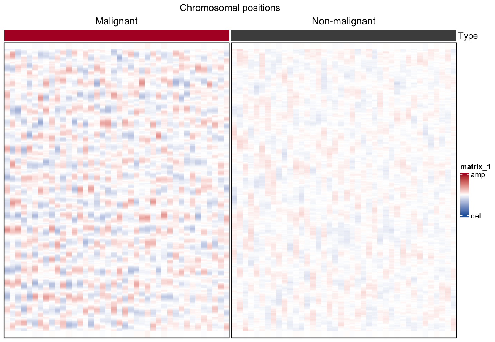

大尺度拷贝数 aberration 可以**从单细胞 RNA-seq 推断**：按基因组位置排序基因、在 100 基因窗口上平滑表达、对每个细胞做中位数中心化，剩余的波动就是 CNV 图景 \[1\]。把细胞（行）对染色体位置（列）铺开即可区分恶性与非恶性细胞，每细胞 CNV 评分用作排序统计量。

## Example

{fig-alt="ScCnvPlot DEMO" fig-align="center" width="60%"}

## Setup

-   系统要求：跨平台（Linux/MacOS/Windows）

-   编程语言：R

-   依赖包： `ComplexHeatmap`; `circlize`; `data.table`; `dplyr`

```{r packages setup, message=FALSE, warning=FALSE, output=FALSE}
# 安装必要的包
if (!requireNamespace("ComplexHeatmap", quietly = TRUE)) {
  BiocManager::install("ComplexHeatmap")
}
if (!requireNamespace("circlize", quietly = TRUE)) {
  install.packages("circlize")
}
if (!requireNamespace("data.table", quietly = TRUE)) {
  install.packages("data.table")
}
if (!requireNamespace("dplyr", quietly = TRUE)) {
  install.packages("dplyr")
}

# 加载包
library(ComplexHeatmap)
library(circlize)
library(data.table)
library(ggplot2)
library(dplyr)
```

```{r}
sessioninfo::session_info("attached")
```

## Data Preparation

真实输入是带细胞元数据的 log2-TPM 单细胞矩阵（参考数据为 GSE103322 HNSCC）。我们模拟按 22 条染色体排序的 400 个基因与 80 个细胞：40 个携带宽幅 CNV 波的恶性细胞和 40 个无波动的非恶性细胞。

```{r load data, message=FALSE, warning=FALSE}
set.seed(1401)
n_chr <- 22; genes_per_chr <- 50; n_gene <- n_chr * genes_per_chr
n_mal <- 40; n_nor <- 40

gene_pos <- expand.grid(chr = seq_len(n_chr), idx = seq_len(genes_per_chr))
gene_pos <- gene_pos[order(gene_pos$chr, gene_pos$idx), ]
genes <- paste0("G", sprintf("%04d", seq_len(n_gene)))

cell_type <- factor(c(rep("Malignant", n_mal), rep("Non-malignant", n_nor)),
                    levels = c("Malignant", "Non-malignant"))
cells <- paste0(substr(cell_type, 1, 3), "_", sprintf("%03d", seq_len(2 * n_mal)))

expr <- matrix(rnorm(n_gene * length(cells), mean = 5, sd = 0.5),
               nrow = n_gene, dimnames = list(genes, cells))
## broad CNV waves in malignant cells: sinusoid per chromosome,
## amplitude and phase vary per cell
for (i in seq_len(n_mal)) {
  for (chr in seq_len(n_chr)) {
    amp   <- runif(1, 0.4, 1.0) * sample(c(-1, 1), 1)        # del or amp
    phase <- runif(1, 0, 2 * pi)
    idx   <- which(gene_pos$chr == chr)
    expr[idx, i] <- expr[idx, i] +
      amp * sin(seq_along(idx) / length(idx) * 2 * pi + phase)
  }
}

## gene ordering + centring + bounding (the reference recipe)
gene_order <- order(gene_pos$chr, gene_pos$idx)
expr <- expr[gene_order, ]
rela <- sweep(expr, 1, rowMeans(expr))
rela <- pmin(pmax(rela, -3), 3)
```

## Visualization

### 1. 滑动均值平滑（100 基因窗口）

```{r}
#| label: fig-1.1SmoothedCNV
#| fig-cap: "CNV 热图：细胞（行，恶性在上）× 染色体位置（列，标注染色体边界）；100 基因窗口平滑。"
#| out.width: "95%"
#| warning: false
#| message: false
#| fig-width: 10
#| fig-height: 6

smoothed <- rela
for (c_idx in seq_len(ncol(rela))) {
  smoothed[, c_idx] <- data.table::frollmean(rela[, c_idx], n = 50, align = "center")
}
smoothed[is.na(smoothed)] <- 0
## per-cell median re-centring after smoothing (Patel et al., 2014)
smoothed <- sweep(smoothed, 2, apply(smoothed, 2, median))

cnv_score <- colMeans(smoothed^2)
col_order <- order(cell_type, -cnv_score)

col_fun <- circlize::colorRamp2(c(-1.5, 0, 1.5), c("#2166AC", "white", "#B2182B"))
row_ha <- HeatmapAnnotation(
  df = data.frame(Type = cell_type[col_order],
                  `CNV score` = cnv_score[col_order]),
  col = list(Type = c(Malignant = "#B2182B", `Non-malignant` = "#4D4D4D")),
  annotation_name_side = "left")

chr_breaks <- cumsum(table(gene_pos$chr[gene_order]))[-n_chr]

Heatmap(smoothed[, col_order], name = "CNV",
        top_annotation = row_ha,
        col = col_fun,
        cluster_rows = FALSE, cluster_columns = FALSE,
        show_column_names = FALSE, show_row_names = FALSE,
        column_split = cell_type[col_order], column_gap = unit(1, "mm"),
        border = TRUE,
        heatmap_legend_param = list(at = c(-1.5, 0, 1.5),
                                    labels = c("del", "", "amp"))) |>
  draw(column_title = "Chromosomal positions")
```

### 2. 依 CNV 评分区分恶性与非恶性

```{r}
#| label: fig-1.2CnvScore
#| fig-cap: "每细胞 CNV 评分区分恶性与非恶性细胞；标注 Wilcoxon p 值。"
#| out.width: "65%"
#| warning: false
#| message: false
#| fig-width: 6
#| fig-height: 4.5

score_df <- data.frame(type = cell_type, score = cnv_score)
p_w <- wilcox.test(score ~ type, data = score_df)$p.value

ggplot(score_df, aes(type, score, fill = type)) +
  geom_boxplot(outlier.shape = NA, width = 0.55) +
  geom_jitter(width = 0.1, size = 0.8, alpha = 0.5, show.legend = FALSE) +
  scale_fill_manual(values = c(Malignant = "#B2182B", `Non-malignant` = "#4D4D4D")) +
  labs(title = sprintf("CNV score (Wilcoxon %s)",
       ifelse(p_w < 0.001, "p < 0.001", sprintf("p = %.3f", p_w))),
       x = NULL, y = "CNV score", fill = NULL) +
  theme_classic(base_size = 11) +
  theme(legend.position = "none")
```

::: callout-tip
**Practice tips**

-   推断 CNV 前先**过滤低表达基因**——近零表达会扭曲滑动均值、削弱波动。
-   按**细胞**（全部基因的中位数）中心化，而非按基因：波形是相对每个细胞基线的。
-   CNV 评分兼作恶性判定——参考工作流用它标记 marker 基因漏掉的恶性细胞。
:::

## Application

推断 CNV 图景是肿瘤单细胞 RNA-seq（HNSCC、黑色素瘤、胶质瘤）的标准质控与恶性判定；热图通常是 scRNA-seq 肿瘤研究的第一张图。

## Reference

\[1\] Puram SV, Tirosh I, Parikh AS, et al. Single-cell transcriptomic analysis of primary and metastatic tumor ecosystems in head and neck cancer. Cell. 2017;171(7):1611-1624.e24. doi:10.1016/j.cell.2017.10.044

\[2\] Xiaofan Lu, et al. FigureYa: A Standardized Visualization Framework for Enhancing Biomedical Data Interpretation and Research Efficiency. iMetaMed. 2025. doi:10.1002/imm3.70005
