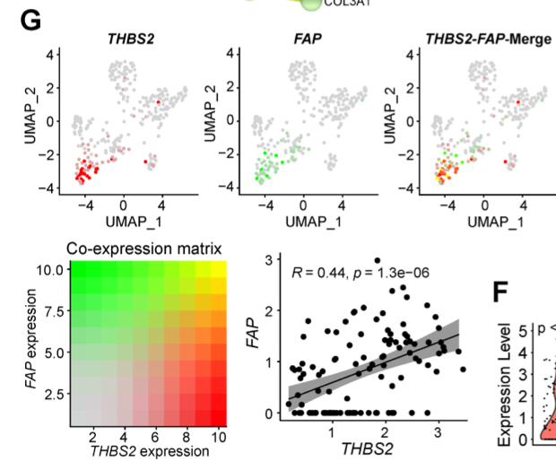

A two-colour **merge map** shows where two genes are co-expressed in a single-cell embedding, mimicking an immunofluorescence merge: gene A in red, gene B in green, and cells co-expressing both turn yellow — so a rare double-positive population is visible without a separate co-expression histogram \[1\]. The reference also pairs it with a co-expression matrix and a Pearson correlation among the marker-positive cells. All of it runs in-page on a simulated embedding:

## Example

{fig-alt="Single-Cell Co-Expression Merge Map DEMO" fig-align="center" width="75%"}

## Setup

-   System Requirements: Cross-platform (Linux/MacOS/Windows)

-   Programming language: R

-   Dependent packages: `ggplot2`; `patchwork`

```{r packages setup, message=FALSE, warning=FALSE, output=FALSE}
suppressPackageStartupMessages({
  library(ggplot2); library(patchwork)
})
```

```{r}
sessioninfo::session_info("attached")
```

## Data Preparation

1600 cells with a UMAP-like embedding; gene A (`THBS2`) marks one fibroblast subgroup, gene B (`FAP`) marks fibroblasts broadly, and a **minor double-positive population** co-expresses both — the configuration the reference highlights as "only a minority co-express high THBS2 and FAP". Expression values are continuous so the merge ramps rather than being a binary colour switch:

```{r load data}
suppressPackageStartupMessages({library(ggplot2); library(patchwork)})
set.seed(49301)
n <- 1600
grp <- sample(c("Fibroblast", "Endothelial", "T cell", "Myeloid"), n, TRUE,
              prob = c(0.45, 0.2, 0.2, 0.15))
## THBS2: only a fibroblast subset; FAP: most fibroblasts
thbs2_pos <- grp == "Fibroblast" & runif(n) < 0.35
fap_pos <- grp == "Fibroblast" & runif(n) < 0.75

gA <- ifelse(thbs2_pos, rgamma(n, 6, 1), rgamma(n, 1.1, 3))
gB <- ifelse(fap_pos, rgamma(n, 6, 1), rgamma(n, 1.1, 3))
gA <- gA / max(gA); gB <- gB / max(gB)

emb <- data.frame(
  UMAP1 = rnorm(n, match(grp, c("Fibroblast", "Endothelial", "T cell", "Myeloid")) * 2.4, 1.1),
  UMAP2 = rnorm(n, cos(match(grp, c("Fibroblast", "Endothelial", "T cell", "Myeloid"))) * 2.2, 1.1),
  cell_type = grp, A = gA, B = gB)
emb$double_pos <- emb$A > 0.25 & emb$B > 0.25
table(emb$cell_type, emb$double_pos)
```

## Visualization

### 1. The Two-Colour Merge Map

The reference's central panel: one scatter where each cell's colour is `rgb()`-blended — red channel from gene A, green from gene B — so single-positive cells are pure red or green and double-positives are yellow. The three single-channel panels sit alongside it, as in the reference's Fig. 5G:

```{r}
#| label: fig-1.1ScCoexprMerge
#| fig-cap: "Single-cell co-expression merge map: gene A alone (red), gene B alone (green), and the merged view where double-positive cells blend to yellow — only a minority of fibroblasts co-express both markers."
#| out.width: "100%"
#| fig-width: 11
#| fig-height: 4

pA <- ggplot(emb, aes(UMAP1, UMAP2, colour = A)) +
  geom_point(size = 0.7) +
  scale_colour_gradient(low = "grey90", high = "#D7191C", limits = c(0, 1)) +
  labs(title = "THBS2 (A)", colour = NULL) +
  theme_bw(base_size = 10) + theme(panel.grid = element_blank(),
                                   legend.key.height = unit(0.5, "cm"))

pB <- ggplot(emb, aes(UMAP1, UMAP2, colour = B)) +
  geom_point(size = 0.7) +
  scale_colour_gradient(low = "grey90", high = "#1A9641", limits = c(0, 1)) +
  labs(title = "FAP (B)", colour = NULL) +
  theme_bw(base_size = 10) + theme(panel.grid = element_blank(),
                                   legend.key.height = unit(0.5, "cm"))

emb$merge_col <- rgb(emb$A, emb$B, 0)
pM <- ggplot(emb, aes(UMAP1, UMAP2)) +
  geom_point(colour = emb$merge_col, size = 0.7) +
  labs(title = "merge (A red / B green)") +
  theme_bw(base_size = 10) + theme(panel.grid = element_blank())

pA + pB + pM
```

### 2. Co-Expression Matrix and Correlation

The reference's lower panels: a 2×2 co-expression matrix (high-A/high-B vs the rest) and the Pearson correlation among marker-positive cells only, reporting the strength class (strong ≥ 0.8, moderate 0.5-0.8, weak 0.3-0.5, none < 0.3):

```{r}
#| label: fig-2.1ScCoexprMatrix
#| fig-cap: "Co-expression summary: left, the 2x2 high/low matrix counts showing most cells are single-positive; right, the Pearson correlation of A vs B among marker-positive fibroblasts with its strength class annotated."
#| out.width: "92%"
#| fig-width: 9
#| fig-height: 4.6

hiA <- emb$A > 0.25; hiB <- emb$B > 0.25
mtx <- table(factor(hiA, c(FALSE, TRUE)), factor(hiB, c(FALSE, TRUE)))
dimnames(mtx) <- list(A = c("A low", "A high"), B = c("B low", "B high"))

sel <- emb$A > 0.1 | emb$B > 0.1
pear <- cor(emb$A[sel], emb$B[sel], method = "pearson")
class_lab <- if (pear >= 0.8) "strong" else if (pear >= 0.5) "moderate" else
  if (pear >= 0.3) "weak" else "no correlation"

op <- par(mfrow = c(1, 2), mar = c(4.2, 4.4, 3.4, 1))
m2 <- log10(mtx + 1)
image(1:2, 1:2, t(m2[2:1, ]), col = colorRampPalette(c("white", "#B2182B"))(64),
      axes = FALSE, xlab = "B expression", ylab = "A expression",
      main = "Co-expression matrix (log10 n)")
axis(1, 1:2, c("B low", "B high")); axis(2, 1:2, c("A high", "A low"))
for (i in 1:2) for (j in 1:2)
  text(j, 3 - i, mtx[i, j], cex = 1.1, col = ifelse(mtx[i, j] > 200, "white", "grey15"))
box()

plot(emb$A[sel], emb$B[sel], pch = 19, cex = 0.5,
     col = ifelse(emb$double_pos[sel], "#B8860B", "grey65"),
     xlab = "A (THBS2)", ylab = "B (FAP)",
     main = sprintf("Pearson r = %.2f (%s)", pear, class_lab))
abline(lm(emb$B[sel] ~ emb$A[sel]), col = "#D7191C", lwd = 1.6)
par(op)
```

::: callout-tip
**Practice tips**

-   Build the merge colour with `rgb(A, B, 0)` on values scaled to [0, 1] per gene; averaging raw expression makes the blend depend on sequencing depth rather than biology.
-   Keep the three panels (A-alone, B-alone, merge) side by side — the merge alone cannot be decoded without the single-channel references.
-   Compute the correlation **among marker-positive cells only**; including all cells inflates r because the negatives cluster at zero.
-   State the correlation-strength classes explicitly (≥0.8 strong, 0.5-0.8 moderate, 0.3-0.5 weak, <0.3 none) rather than leaving "correlated" undefined.
-   A log-scaled co-expression matrix count is far more readable than raw counts when one quadrant dominates.
:::

## Application

::: {#fig-ScCoexprApplications1}
{fig-alt="Single-Cell Co-Expression Merge Map" fig-align="center" width="75%"}

Single-cell co-expression merge map
:::

The two-colour merge map applies to any double-marker question: CAF subtype co-expression, T-cell exhaustion marker pairs, or ligand-receptor co-expression in spatial data.

## Reference

\[1\] Xiaofan Lu, et al. FigureYa: A Standardized Visualization Framework for Enhancing Biomedical Data Interpretation and Research Efficiency. iMetaMed. 2025. doi:10.1002/imm3.70005
