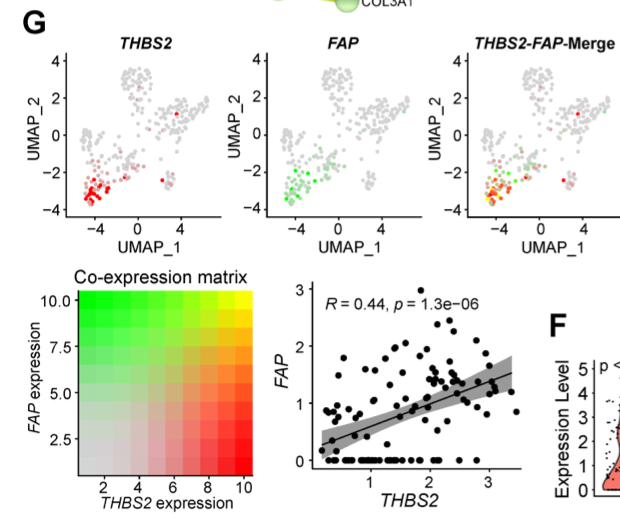

双色**合并图**在单细胞嵌入上展示两个基因的共表达位置，模仿免疫荧光 merge：基因 A 红、基因 B 绿、共表达两者的细胞变黄——因此罕见的双阳性群体无需单独的共表达直方图即可见 \[\1\]。参考还配以共表达矩阵与标记阳性细胞间的 Pearson 相关。全部在页内对模拟嵌入运行：

## Example

{fig-alt="单细胞共表达合并图 DEMO" fig-align="center" width="60%"}

## Setup

-   系统要求：跨平台（Linux/MacOS/Windows）

-   编程语言：R

-   依赖包：`ggplot2`; `patchwork`

```{r packages setup, message=FALSE, warning=FALSE, output=FALSE}
suppressPackageStartupMessages({
  library(ggplot2); library(patchwork)
})
```

```{r}
sessioninfo::session_info("attached")
```

## 数据准备

1600 个细胞的 UMAP 式嵌入；基因 A（`THBS2`）标记一个成纤维细胞亚群、基因 B（`FAP`）广泛标记成纤维细胞、并有一个**次要双阳性群体**共表达两者——即参考强调的"只有少数共表达高 THBS2 与 FAP"构型。表达值为连续量，使合并呈渐变而非二值换色：

```{r load data}
suppressPackageStartupMessages({library(ggplot2); library(patchwork)})
set.seed(49301)
n <- 1600
grp <- sample(c("Fibroblast", "Endothelial", "T cell", "Myeloid"), n, TRUE,
              prob = c(0.45, 0.2, 0.2, 0.15))
## THBS2: only a fibroblast subset; FAP: most fibroblasts
thbs2_pos <- grp == "Fibroblast" & runif(n) < 0.35
fap_pos <- grp == "Fibroblast" & runif(n) < 0.75

gA <- ifelse(thbs2_pos, rgamma(n, 6, 1), rgamma(n, 1.1, 3))
gB <- ifelse(fap_pos, rgamma(n, 6, 1), rgamma(n, 1.1, 3))
gA <- gA / max(gA); gB <- gB / max(gB)

emb <- data.frame(
  UMAP1 = rnorm(n, match(grp, c("Fibroblast", "Endothelial", "T cell", "Myeloid")) * 2.4, 1.1),
  UMAP2 = rnorm(n, cos(match(grp, c("Fibroblast", "Endothelial", "T cell", "Myeloid"))) * 2.2, 1.1),
  cell_type = grp, A = gA, B = gB)
emb$double_pos <- emb$A > 0.25 & emb$B > 0.25
table(emb$cell_type, emb$double_pos)
```

## Visualization

### 双色合并图

参考的中心面板：一张散点、每格颜色由 `rgb()` 混合——红通道来自基因 A、绿来自基因 B——因此单阳性细胞为纯红或纯绿、双阳性为黄。三个单通道面板与参考 Fig. 5G 一致地并排：

```{r}
#| label: fig-1.1ScCoexprMerge
#| fig-cap: "单细胞共表达合并图：仅基因 A（红）、仅基因 B（绿）、以及双阳性细胞混合为黄色的合并视图——只有少数成纤维细胞共表达两个标记。"
#| out.width: "100%"
#| fig-width: 11
#| fig-height: 4

pA <- ggplot(emb, aes(UMAP1, UMAP2, colour = A)) +
  geom_point(size = 0.7) +
  scale_colour_gradient(low = "grey90", high = "#D7191C", limits = c(0, 1)) +
  labs(title = "THBS2 (A)", colour = NULL) +
  theme_bw(base_size = 10) + theme(panel.grid = element_blank(),
                                   legend.key.height = unit(0.5, "cm"))

pB <- ggplot(emb, aes(UMAP1, UMAP2, colour = B)) +
  geom_point(size = 0.7) +
  scale_colour_gradient(low = "grey90", high = "#1A9641", limits = c(0, 1)) +
  labs(title = "FAP (B)", colour = NULL) +
  theme_bw(base_size = 10) + theme(panel.grid = element_blank(),
                                   legend.key.height = unit(0.5, "cm"))

emb$merge_col <- rgb(emb$A, emb$B, 0)
pM <- ggplot(emb, aes(UMAP1, UMAP2)) +
  geom_point(colour = emb$merge_col, size = 0.7) +
  labs(title = "merge (A red / B green)") +
  theme_bw(base_size = 10) + theme(panel.grid = element_blank())

pA + pB + pM
```

### 共表达矩阵与相关

参考的下方面板：2×2 共表达矩阵（高 A/高 B vs 其余）与仅标记阳性细胞间的 Pearson 相关，并报告强度等级（强 ≥ 0.8、中 0.5-0.8、弱 0.3-0.5、无 < 0.3）：

```{r}
#| label: fig-2.1ScCoexprMatrix
#| fig-cap: "共表达汇总：左，2×2 高/低矩阵计数显示多数细胞为单阳性；右，标记阳性成纤维细胞间 A vs B 的 Pearson 相关并标注强度等级。"
#| out.width: "92%"
#| fig-width: 9
#| fig-height: 4.6

hiA <- emb$A > 0.25; hiB <- emb$B > 0.25
mtx <- table(factor(hiA, c(FALSE, TRUE)), factor(hiB, c(FALSE, TRUE)))
dimnames(mtx) <- list(A = c("A low", "A high"), B = c("B low", "B high"))

sel <- emb$A > 0.1 | emb$B > 0.1
pear <- cor(emb$A[sel], emb$B[sel], method = "pearson")
class_lab <- if (pear >= 0.8) "strong" else if (pear >= 0.5) "moderate" else
  if (pear >= 0.3) "weak" else "no correlation"

op <- par(mfrow = c(1, 2), mar = c(4.2, 4.4, 3.4, 1))
m2 <- log10(mtx + 1)
image(1:2, 1:2, t(m2[2:1, ]), col = colorRampPalette(c("white", "#B2182B"))(64),
      axes = FALSE, xlab = "B expression", ylab = "A expression",
      main = "Co-expression matrix (log10 n)")
axis(1, 1:2, c("B low", "B high")); axis(2, 1:2, c("A high", "A low"))
for (i in 1:2) for (j in 1:2)
  text(j, 3 - i, mtx[i, j], cex = 1.1, col = ifelse(mtx[i, j] > 200, "white", "grey15"))
box()

plot(emb$A[sel], emb$B[sel], pch = 19, cex = 0.5,
     col = ifelse(emb$double_pos[sel], "#B8860B", "grey65"),
     xlab = "A (THBS2)", ylab = "B (FAP)",
     main = sprintf("Pearson r = %.2f (%s)", pear, class_lab))
abline(lm(emb$B[sel] ~ emb$A[sel]), col = "#D7191C", lwd = 1.6)
par(op)
```


## 应用场景

::: {{#fig-ScCoexprApplications1}}
{fig-alt="单细胞共表达合并图" fig-align="center" width="60%"}

单细胞共表达合并图
:::

双色合并图适用于任何双标记问题：CAF 亚型共表达、T 细胞耗竭标记对、或空间数据中的配体-受体共表达。

## 参考文献

\[1\] Xiaofan Lu, et al. FigureYa: A Standardized Visualization Framework for Enhancing Biomedical Data Interpretation and Research Efficiency. iMetaMed. 2025. doi:10.1002/imm3.70005
