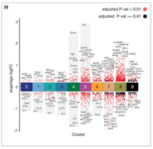

The reference's marker-gene strip plot shows every cluster's DEGs as a jittered column of points on the avg-log2FC axis: **blue for down-regulated, red for up**, black for non-significant, a dark-grey band behind each cluster spanning its observed range, a coloured cluster bar at FC = 0, and the top genes labelled with `geom_text_repel()` \[1\]. Seurat's PBMC pipeline produces the input; Seurat is not in this repository's lockfile, so the marker table is simulated directly — the ggplot2 rendering (rect bands, jitter, repel labels, cluster bar) is the reference's:

## Example

{fig-alt="Per-Cluster DEG Strip Plot DEMO" fig-align="center" width="80%"}

## Setup

-   System Requirements: Cross-platform (Linux/MacOS/Windows)

-   Programming language: R

-   Dependent packages: `ggplot2`; `ggrepel`; `dplyr`

```{r packages setup, message=FALSE, warning=FALSE, output=FALSE}
suppressPackageStartupMessages({
  library(ggplot2); library(dplyr); library(ggrepel)
})
```

```{r}
sessioninfo::session_info("attached")
```

## Data Preparation

A `FindAllMarkers()`-shaped table for 9 simulated PBMC-like clusters: gene, cluster, avg_log2FC, p_val_adj. 9 real PBMC marker genes are planted at their known clusters so the repel labels name recognisable genes (CCR7 for naive T, S100A8/A9 for monocytes, CD79A for B, GZMB for NK...), plus ~180 background markers per the usual distribution. The cutoff step (`p_val_adj < 0.05 & abs(log2FC) > 0.5`) and the Up/Down × significance factor definitions are the reference's:

```{r load data}
suppressPackageStartupMessages({library(ggplot2); library(dplyr); library(ggrepel)})
set.seed(40235)
n_cl <- 9
planted <- data.frame(
  gene = c("CCR7", "S100A8", "S100A9", "CD79A", "MS4A1", "GZMB", "GNLY",
           "FCER1A", "PPBP", "CD3D", "LYZ", "NKG7"),
  cluster = c(0, 1, 1, 3, 3, 6, 6, 7, 8, 0, 1, 6),
  avg_log2FC = c(2.4, 7.1, 6.8, 7.3, 6.9, 5.9, 5.5, 8.0, 14.0, 1.3, 6.5, 4.8))
mk <- function(cl) {
  n_up <- sample(90:120, 1); n_down <- sample(30:50, 1)
  data.frame(gene = sprintf("G%d_%03d", cl, seq_len(n_up + n_down)),
             cluster = cl,
             avg_log2FC = c(rnorm(n_up, 1.1, 1.1), rnorm(n_down, -1.0, 0.7)))
}
pbmc.markers <- rbind(
  planted,
  do.call(rbind, lapply(0:(n_cl - 1), mk)))
pbmc.markers <- pbmc.markers %>%
  mutate(p_val_adj = ifelse(abs(avg_log2FC) > 1.5, runif(n(), 0, 0.01),
                            runif(n(), 0.01, 0.6)))
pbmc.markers <- subset(pbmc.markers, p_val_adj < 0.05 & abs(avg_log2FC) > 0.5)
pbmc.markers$threshold <- as.factor(ifelse(pbmc.markers$avg_log2FC > 0, "Up", "Down"))
pbmc.markers$adj_p_signi <- as.factor(ifelse(pbmc.markers$p_val_adj < 0.01, "Highly", "Lowly"))
pbmc.markers$thr_signi <- paste0(pbmc.markers$threshold, "_", pbmc.markers$adj_p_signi)
pbmc.markers$cluster <- as.numeric(as.vector(pbmc.markers$cluster))

## top-5 up / down genes per cluster for labelling
top_up <- pbmc.markers %>% subset(threshold %in% "Up" & gene %in% planted$gene) %>%
  group_by(cluster) %>% top_n(n = 3, wt = avg_log2FC) %>% as.data.frame()
top_down <- pbmc.markers %>% subset(threshold %in% "Down" & gene %in% planted$gene) %>%
  group_by(cluster) %>% top_n(n = -3, wt = avg_log2FC) %>% as.data.frame()
top_label <- rbind(top_up, top_down)

## grey band behind each cluster: observed range +/- 0.2
background_position <- pbmc.markers %>%
  group_by(cluster) %>%
  summarise(Min = min(avg_log2FC) - 0.2, Max = max(avg_log2FC) + 0.2) %>%
  as.data.frame()
background_position$start <- background_position$cluster - 0.4
background_position$end <- background_position$cluster + 0.4
## coloured cluster bar at FC = 0
cluster_bar_position <- background_position
cluster_bar_position$start <- cluster_bar_position$cluster - 0.5
cluster_bar_position$end <- cluster_bar_position$cluster + 0.5
cluster_bar_position$cluster <- factor(cluster_bar_position$cluster,
                                       levels = as.character(0:(n_cl - 1)))
```

## Visualization

### 1. The Full Reference Layout

Grey range bands, jittered points in the four Up/Down × significance colours, top-gene repel labels sharing the jitter's seed (so labels sit on their points), and the coloured cluster bar drawn **last** so it sits on top at FC = 0:

```{r}
#| label: fig-1.1ScDegStrips
#| fig-cap: "Per-cluster DEG strip plot: red = up-regulated (dark red = adj p<0.01), blue = down-regulated, black = non-significant direction; grey bands span each cluster's observed log2FC range, top-5 up/down genes are labelled, and the coloured bar marks cluster identity at FC = 0."
#| out.width: "100%"
#| fig-width: 9
#| fig-height: 6

cols_thr_signi <- c("Up_Highly" = "#d7301f",
                    "Down_Highly" = "#225ea8",
                    "Up_Lowly" = "black",
                    "Down_Lowly" = "black")
cols_cluster <- setNames(c("#35978f", "#8dd3c7", "#ffffb3", "#bebada",
                           "#fb8072", "#80b1d3", "#fdb462", "#b3de69", "#fccde5"),
                         as.character(0:(n_cl - 1)))

p <- ggplot() +
  geom_rect(data = background_position,
            aes(xmin = start, xmax = end, ymin = Min, ymax = Max),
            fill = "#525252", alpha = 0.1) +
  geom_jitter(data = pbmc.markers,
              aes(x = cluster, y = avg_log2FC, colour = thr_signi),
              size = 1, position = position_jitter(seed = 1)) +
  scale_color_manual(values = cols_thr_signi) +
  scale_x_continuous(limits = c(-0.5, max(pbmc.markers$cluster) + 0.5),
                     breaks = seq(0, max(pbmc.markers$cluster), 1)) +
  geom_text_repel(data = top_label,
                  aes(x = cluster, y = avg_log2FC, label = gene),
                  position = position_jitter(seed = 1), show.legend = FALSE,
                  size = 2.8, min.segment.length = 0, seed = 1,
                  box.padding = unit(0.9, "lines"), max.overlaps = 20) +
  geom_rect(data = cluster_bar_position,
            aes(xmin = start, xmax = end, ymin = -0.4, ymax = 0.4, fill = cluster),
            color = "black", alpha = 1, show.legend = FALSE) +
  scale_fill_manual(values = cols_cluster) +
  labs(x = "Cluster", y = "average log2FC") +
  theme_bw()
plot1 <- p + theme(panel.grid.minor = element_blank(),
                   panel.grid.major = element_blank(),
                   axis.text.y = element_text(colour = "black", size = 12),
                   panel.border = element_blank(),
                   axis.ticks.x = element_blank(),
                   axis.line.y = element_line(colour = "black"))
plot1
```

### 2. Same Plot, Cell-Type-Annotated

The reference relabels clusters with cell types after marker inspection; the same figure with the cluster bar carrying type names in the axis labels turns the numeric axis into biology:

```{r}
#| label: fig-2.1ScDegCelltypes
#| fig-cap: "DEG strip plot with cluster numbers replaced by cell-type names on the x axis: the planted PBMC markers (CCR7, S100A8, CD79A, GZMB, FCER1A, PPBP) land in their canonical clusters."
#| out.width: "100%"
#| fig-width: 9
#| fig-height: 6

celltype_names <- c("Naive T", "Mono", "T", "B", "T", "Mono", "NK", "DC", "Platelet")
plot1 + scale_x_continuous(
  limits = c(-0.5, max(pbmc.markers$cluster) + 0.5),
  breaks = seq(0, max(pbmc.markers$cluster), 1),
  labels = paste0(seq(0, max(pbmc.markers$cluster)), "\n", celltype_names)) +
  theme(axis.text.x = element_text(size = 9))
```

::: callout-tip
**Practice tips**

-   Share one `position_jitter(seed = ...)` between the points and the repel labels — with different seeds the labels detach from the points they name, and reviewers cannot verify a call.
-   Draw the grey range bands **before** the points and the cluster bar **after** everything: the bar at FC = 0 is the figure's anchor and must never be overplotted.
-   Define significance on the *adjusted* p-value, not the raw one — with thousands of markers the raw threshold floods the plot with black points that carry no message.
-   The 0.5 log2FC cutoff is a starting point: tune it so each cluster keeps a readable number of markers (the reference iterated by looking at `table(markers$cluster)`).
-   Label a curated subset (named markers + top hits), not every significant gene: at marker-table density, repel labels with zero padding collide into unreadable strings.
:::

## Application

::: {#fig-ScDegApplications1}
{fig-alt="Per-Cluster DEG Strip Plot" fig-align="center" width="80%"}

Per-cluster DEG strip plot
:::

Any grouped effect-size table reads this way: cluster markers from any differential pipeline, per-subtype bulk DEGs, or CRISPR screen log-fold-changes grouped by target class — wherever each group's up/down distribution wants to be scanned at a glance with a few landmarks named.

## Reference

\[1\] Xiaofan Lu, et al. FigureYa: A Standardized Visualization Framework for Enhancing Biomedical Data Interpretation and Research Efficiency. iMetaMed. 2025. doi:10.1002/imm3.70005
