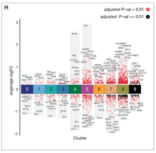

参考的 marker 基因条带点图把每个簇的 DEG 画成 avg-log2FC 轴上的抖动点列：**下调蓝色、上调红色**、非显著黑色，每簇背后一条跨越观测范围的深灰带、FC = 0 处一条彩色簇条、top 基因用 `geom_text_repel()` 标注 \[1\]。输入由 Seurat 的 PBMC 管线产出；Seurat 不在本仓库 lockfile 中，故直接模拟 marker 表——ggplot2 渲染（rect 底带、抖动、repel 标签、簇条）是参考的：

## Example

{fig-alt="逐簇 DEG 条带点图 DEMO" fig-align="center" width="60%"}

## Setup

-   系统要求：跨平台（Linux/MacOS/Windows）

-   编程语言：R

-   依赖包：`ggplot2`; `ggrepel`; `dplyr`

```{r packages setup, message=FALSE, warning=FALSE, output=FALSE}
suppressPackageStartupMessages({
  library(ggplot2); library(dplyr); library(ggrepel)
})
```

```{r}
sessioninfo::session_info("attached")
```

## 数据准备

9 个模拟 PBMC 样簇的 `FindAllMarkers()` 形状表：基因、簇、avg_log2FC、p_val_adj。9 个真实 PBMC marker 按已知簇植入（CCR7→初始 T、S100A8/A9→单核、CD79A→B、GZMB→NK……），另加每簇 ~180 个背景 marker。截断步骤（`p_val_adj < 0.05 & abs(log2FC) > 0.5`）与 Up/Down × 显著性因子定义均为参考的：

```{r load data}
suppressPackageStartupMessages({library(ggplot2); library(dplyr); library(ggrepel)})
set.seed(40235)
n_cl <- 9
planted <- data.frame(
  gene = c("CCR7", "S100A8", "S100A9", "CD79A", "MS4A1", "GZMB", "GNLY",
           "FCER1A", "PPBP", "CD3D", "LYZ", "NKG7"),
  cluster = c(0, 1, 1, 3, 3, 6, 6, 7, 8, 0, 1, 6),
  avg_log2FC = c(2.4, 7.1, 6.8, 7.3, 6.9, 5.9, 5.5, 8.0, 14.0, 1.3, 6.5, 4.8))
mk <- function(cl) {
  n_up <- sample(90:120, 1); n_down <- sample(30:50, 1)
  data.frame(gene = sprintf("G%d_%03d", cl, seq_len(n_up + n_down)),
             cluster = cl,
             avg_log2FC = c(rnorm(n_up, 1.1, 1.1), rnorm(n_down, -1.0, 0.7)))
}
pbmc.markers <- rbind(
  planted,
  do.call(rbind, lapply(0:(n_cl - 1), mk)))
pbmc.markers <- pbmc.markers %>%
  mutate(p_val_adj = ifelse(abs(avg_log2FC) > 1.5, runif(n(), 0, 0.01),
                            runif(n(), 0.01, 0.6)))
pbmc.markers <- subset(pbmc.markers, p_val_adj < 0.05 & abs(avg_log2FC) > 0.5)
pbmc.markers$threshold <- as.factor(ifelse(pbmc.markers$avg_log2FC > 0, "Up", "Down"))
pbmc.markers$adj_p_signi <- as.factor(ifelse(pbmc.markers$p_val_adj < 0.01, "Highly", "Lowly"))
pbmc.markers$thr_signi <- paste0(pbmc.markers$threshold, "_", pbmc.markers$adj_p_signi)
pbmc.markers$cluster <- as.numeric(as.vector(pbmc.markers$cluster))

## top-5 up / down genes per cluster for labelling
top_up <- pbmc.markers %>% subset(threshold %in% "Up" & gene %in% planted$gene) %>%
  group_by(cluster) %>% top_n(n = 3, wt = avg_log2FC) %>% as.data.frame()
top_down <- pbmc.markers %>% subset(threshold %in% "Down" & gene %in% planted$gene) %>%
  group_by(cluster) %>% top_n(n = -3, wt = avg_log2FC) %>% as.data.frame()
top_label <- rbind(top_up, top_down)

## grey band behind each cluster: observed range +/- 0.2
background_position <- pbmc.markers %>%
  group_by(cluster) %>%
  summarise(Min = min(avg_log2FC) - 0.2, Max = max(avg_log2FC) + 0.2) %>%
  as.data.frame()
background_position$start <- background_position$cluster - 0.4
background_position$end <- background_position$cluster + 0.4
## coloured cluster bar at FC = 0
cluster_bar_position <- background_position
cluster_bar_position$start <- cluster_bar_position$cluster - 0.5
cluster_bar_position$end <- cluster_bar_position$cluster + 0.5
cluster_bar_position$cluster <- factor(cluster_bar_position$cluster,
                                       levels = as.character(0:(n_cl - 1)))
```

## Visualization

### 完整参考版式

灰色范围底带、四色 Up/Down × 显著性抖动点、共享抖动种子（标签与点对齐）的 top 基因 repel 标注、最后画的彩色簇条叠在 FC = 0 上：

```{r}
#| label: fig-1.1ScDegStrips
#| fig-cap: "逐簇 DEG 条带点图：红色 = 上调（深红 = adj p<0.01）、蓝色 = 下调、黑色 = 不显著方向；灰带跨越每簇 log2FC 观测范围、top 基因带标注、彩色条标记 FC = 0 处的簇身份。"
#| out.width: "100%"
#| fig-width: 9
#| fig-height: 6

cols_thr_signi <- c("Up_Highly" = "#d7301f",
                    "Down_Highly" = "#225ea8",
                    "Up_Lowly" = "black",
                    "Down_Lowly" = "black")
cols_cluster <- setNames(c("#35978f", "#8dd3c7", "#ffffb3", "#bebada",
                           "#fb8072", "#80b1d3", "#fdb462", "#b3de69", "#fccde5"),
                         as.character(0:(n_cl - 1)))

p <- ggplot() +
  geom_rect(data = background_position,
            aes(xmin = start, xmax = end, ymin = Min, ymax = Max),
            fill = "#525252", alpha = 0.1) +
  geom_jitter(data = pbmc.markers,
              aes(x = cluster, y = avg_log2FC, colour = thr_signi),
              size = 1, position = position_jitter(seed = 1)) +
  scale_color_manual(values = cols_thr_signi) +
  scale_x_continuous(limits = c(-0.5, max(pbmc.markers$cluster) + 0.5),
                     breaks = seq(0, max(pbmc.markers$cluster), 1)) +
  geom_text_repel(data = top_label,
                  aes(x = cluster, y = avg_log2FC, label = gene),
                  position = position_jitter(seed = 1), show.legend = FALSE,
                  size = 2.8, min.segment.length = 0, seed = 1,
                  box.padding = unit(0.9, "lines"), max.overlaps = 20) +
  geom_rect(data = cluster_bar_position,
            aes(xmin = start, xmax = end, ymin = -0.4, ymax = 0.4, fill = cluster),
            color = "black", alpha = 1, show.legend = FALSE) +
  scale_fill_manual(values = cols_cluster) +
  labs(x = "Cluster", y = "average log2FC") +
  theme_bw()
plot1 <- p + theme(panel.grid.minor = element_blank(),
                   panel.grid.major = element_blank(),
                   axis.text.y = element_text(colour = "black", size = 12),
                   panel.border = element_blank(),
                   axis.ticks.x = element_blank(),
                   axis.line.y = element_line(colour = "black"))
plot1
```

### 同一张图，细胞类型标注

参考在 marker 检查后把簇重命名为细胞类型；同一张图让簇条直接携带类型名，数值轴变成生物学：

```{r}
#| label: fig-2.1ScDegCelltypes
#| fig-cap: "x 轴簇号替换为细胞类型名的 DEG 条带图：植入的 PBMC marker（CCR7、S100A8、CD79A、GZMB、FCER1A、PPBP）落回各自经典簇。"
#| out.width: "100%"
#| fig-width: 9
#| fig-height: 6

celltype_names <- c("Naive T", "Mono", "T", "B", "T", "Mono", "NK", "DC", "Platelet")
plot1 + scale_x_continuous(
  limits = c(-0.5, max(pbmc.markers$cluster) + 0.5),
  breaks = seq(0, max(pbmc.markers$cluster), 1),
  labels = paste0(seq(0, max(pbmc.markers$cluster)), "\n", celltype_names)) +
  theme(axis.text.x = element_text(size = 9))
```


## 应用场景

::: {{#fig-ScDegApplications1}}
{fig-alt="逐簇 DEG 条带点图" fig-align="center" width="60%"}

逐簇 DEG 条带点图
:::

任何分组效应量表都能这样读：任一差异管线的簇 marker、逐亚型 bulk DEG、或按靶点分类的 CRISPR 筛选 log 倍数变化——凡各组的上下调分布需要一眼扫读并点名几个地标处。

## 参考文献

\[1\] Xiaofan Lu, et al. FigureYa: A Standardized Visualization Framework for Enhancing Biomedical Data Interpretation and Research Efficiency. iMetaMed. 2025. doi:10.1002/imm3.70005
