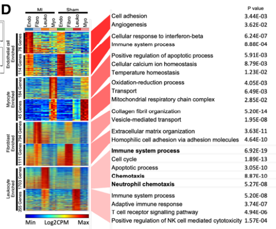

For a two-condition single-cell experiment (the reference uses IFN-stimulated vs control PBMC), the deliverable is a heatmap of **marker-gene average expression** where rows are genes grouped by the cell type that owns them (white gap lines between types), columns are `CellType_Condition` blocks with one gap separating the conditions, and the ramp runs blue→green→red on row-scaled averages \[1\]. Seurat's `AverageExpression()` produces the matrix; the matrix is simulated here (Seurat is not in this lockfile) and the ordering logic — the part that actually makes the figure read — is reproduced exactly:

## Example

{fig-alt="Cell-Type x Condition Marker Heatmap DEMO" fig-align="center" width="80%"}

## Setup

-   System Requirements: Cross-platform (Linux/MacOS/Windows)

-   Programming language: R

-   Dependent packages: `pheatmap`; `ggplot2`

```{r packages setup, message=FALSE, warning=FALSE, output=FALSE}
suppressPackageStartupMessages({
  library(pheatmap); library(ggplot2)
})
```

```{r}
sessioninfo::session_info("attached")
```

## Data Preparation

Eight cell types × two conditions (CTRL/STIM). Each type owns 12-20 marker genes whose average expression peaks in its own type; a subset of markers additionally responds to stimulation (raised in STIM only) so the condition split carries information beyond the type structure. The column order (`CellType_CTRL, DC_CTRL, ..., CellType_STIM, ...`) and the row grouping (`celltype_CTRL then celltype_STIM` per type) follow the reference's loops:

```{r load data}
suppressPackageStartupMessages({library(pheatmap); library(ggplot2)})
set.seed(41243)
celltype <- c("B_cell", "DC", "Eryth", "Monocyte", "NK", "Mk", "pDC", "T_cell")
group <- c("CTRL", "STIM")
marker_list <- lapply(celltype, function(ct) sprintf("%s_marker%02d", ct, seq_len(14)))
names(marker_list) <- celltype
select_gene <- unlist(marker_list)

## average expression: own-type markers high, others low; STIM lifts a third of them
## background: every marker has a low baseline everywhere...
AveExpression <- matrix(rnorm(length(select_gene) * length(celltype) * 2, 2.2, 0.35),
                        length(select_gene), length(celltype) * 2,
                        dimnames = list(select_gene,
                                        as.vector(t(outer(celltype, group, paste, sep = "_")))))
## ...own-type columns carry the high expression, a third of markers respond to STIM
for (ct in celltype) {
  for (g in group) {
    colname <- paste0(ct, "_", g)
    stim_boost <- if (g == "STIM") sample(c(0, 1.2), length(marker_list[[ct]]),
           replace = TRUE, prob = c(0.67, 0.33)) else 0
    AveExpression[marker_list[[ct]], colname] <-
      AveExpression[marker_list[[ct]], colname] + 4 + stim_boost
  }
}
## column order: all celltypes CTRL first, then STIM (reference's celltype_group_all)
celltype_group_all <- as.vector(sapply(group, function(g) paste(celltype, g, sep = "_")))
plot_df <- AveExpression[, celltype_group_all]
## row order: for each celltype, its CTRL-block genes then STIM-block genes
## (here one row block per celltype, same as the reference's group_celltype_all)
plot_df <- do.call(rbind, lapply(celltype, function(ct) plot_df[marker_list[[ct]], ]))
```

## Visualization

### 1. The Reference Heatmap: Gaps Instead of Dendrograms

Row-scaled averages, `cluster_rows = FALSE` / `cluster_cols = FALSE` — the ordering is carried entirely by the two index vectors — with `gaps_row` after each cell type's gene block and one `gaps_col` between the CTRL and STIM halves. The ramp replaces `colorRamps::blue2green2red` (not in this lockfile) with `colorRampPalette`:

```{r}
#| label: fig-1.1ScMarkerGroupHeatmap
#| fig-cap: "Marker average-expression heatmap for 8 cell types x CTRL/STIM: rows grouped by owning cell type (gaps between types), columns ordered CellType_CTRL | CellType_STIM with one gap between conditions; row-scaled, blue-green-red ramp."
#| out.width: "95%"
#| fig-width: 8.5
#| fig-height: 8

marker_num <- table(rep(celltype, sapply(marker_list, length)))
gaps_row_num <- cumsum(marker_num)[-length(marker_num)]
bks <- seq(-2.1, 2.1, by = 0.01)
hmcols <- colorRampPalette(c("blue", "green", "red"))(length(bks) - 1)
pheatmap(plot_df,
         cluster_cols = FALSE, cluster_rows = FALSE,
         show_colnames = TRUE, show_rownames = FALSE,
         color = hmcols,
         border_color = "white",
         gaps_row = gaps_row_num,
         gaps_col = length(celltype),
         breaks = bks, scale = "row",
         legend_breaks = seq(-2, 2, 1),
         fontsize_col = 7.5)
```

### 2. Reading Order Check: Row-Means by Block

The figure's story ("each type's markers peak in its own columns; STIM shifts a subset") is auditable as block means — a compact numeric companion that also catches an accidental row-order bug, which is the most common way this figure goes wrong:

```{r}
#| label: fig-2.1ScMarkerBlockMeans
#| fig-cap: "Block means of the row-scaled heatmap (8 cell types x CTRL/STIM columns): the mean of each type's marker block is highest in its own columns, with the STIM column shifted where stimulation acts — the numeric check behind the heatmap's visual pattern."
#| out.width: "85%"
#| fig-width: 5.5
#| fig-height: 4.8

plotdata_sc <- t(scale(t(plot_df)))
## 8 rows (marker blocks) x 16 columns: mean of each type's rows within each column block
block_means <- t(sapply(celltype, function(ct) {
  colMeans(plotdata_sc[marker_list[[ct]], , drop = FALSE])
}))
rownames(block_means) <- celltype
bm_df <- data.frame(type = rep(rownames(block_means), ncol(block_means)),
                    col = rep(colnames(block_means), each = nrow(block_means)),
                    value = as.vector(block_means))
ggplot(bm_df, aes(col, factor(type, levels = rev(rownames(block_means))),
                fill = value)) +
  geom_tile(colour = "white") +
  geom_text(aes(label = sprintf("%.1f", value),
                colour = value > 1), size = 2.6, show.legend = FALSE) +
  scale_colour_manual(values = c(`TRUE` = "white", `FALSE` = "grey25")) +
  scale_fill_gradient2(low = "#2166AC", mid = "white", high = "#B2182B",
                       midpoint = 0, limits = c(-2, 3)) +
  labs(x = NULL, y = NULL, fill = "row-scaled
mean",
       title = "Row-scaled marker means by block") +
  theme_bw(base_size = 9.5) +
  theme(axis.text.x = element_text(angle = 90, size = 6.5, vjust = 0.5),
        panel.grid = element_blank())
```

::: callout-tip
**Practice tips**

-   Disable clustering and let the two index vectors order the figure — a dendrogram would interleave cell types and destroy the block gaps that carry the reading.
-   `gaps_row` takes **cumulative** counts (drop the last one) and `gaps_col` a single position: off-by-one gaps land inside a block instead of between blocks.
-   `scale = "row"` is what makes 14-marker and 40-marker blocks comparable; without it the type with the highest absolute expression dominates the ramp.
-   Replace `colorRamps::blue2green2red(N)` with `colorRampPalette(c("blue","green","red"))(N)` — same ramp, no extra dependency.
-   Verify the ordering numerically (block means): a scrambled row order looks plausible to the eye and only the numbers expose it.
:::

## Application

::: {#fig-ScMarkerHeatmapApplications1}
{fig-alt="Cell-Type x Condition Marker Heatmap" fig-align="center" width="80%"}

Cell-type x condition marker heatmap
:::

The grouped-blocks layout fits any average-expression matrix with two crossed factors: cell type × patient group, subtype × treatment arm, or region × timepoint in spatial studies — wherever "which rows belong to which block" is part of the message.

## Reference

\[1\] Xiaofan Lu, et al. FigureYa: A Standardized Visualization Framework for Enhancing Biomedical Data Interpretation and Research Efficiency. iMetaMed. 2025. doi:10.1002/imm3.70005
