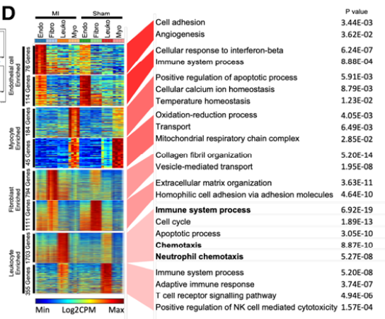

对双条件单细胞实验（参考用 IFN 刺激 vs 对照 PBMC），交付物是 **marker 基因平均表达**热图：行是按所属细胞类型分组的基因（类型间白色间隙线）、列是 `CellType_Condition` 块（条件间一道间隙）、色带在行标度均值上跑蓝→绿→红 \[1\]。Seurat 的 `AverageExpression()` 产出矩阵；此处直接模拟矩阵（Seurat 不在本 lockfile）并精确复现排序逻辑——真正让这张图可读的部分：

## Example

{fig-alt="细胞类型 × 条件 marker 热图 DEMO" fig-align="center" width="60%"}

## Setup

-   系统要求：跨平台（Linux/MacOS/Windows）

-   编程语言：R

-   依赖包：`pheatmap`; `ggplot2`

```{r packages setup, message=FALSE, warning=FALSE, output=FALSE}
suppressPackageStartupMessages({
  library(pheatmap); library(ggplot2)
})
```

```{r}
sessioninfo::session_info("attached")
```

## 数据准备

八个细胞类型 × 两条件（CTRL/STIM）。每个类型拥有 12-20 个 marker 基因、其平均表达在自己的类型中达到峰值；部分 marker 额外对刺激有响应（仅在 STIM 升高），使条件分割携带类型结构之外的信息。列序（`CellType_CTRL, DC_CTRL, ..., CellType_STIM, ...`）与行分组（每类型先 CTRL 后 STIM）严格按参考的循环：

```{r load data}
suppressPackageStartupMessages({library(pheatmap); library(ggplot2)})
set.seed(41243)
celltype <- c("B_cell", "DC", "Eryth", "Monocyte", "NK", "Mk", "pDC", "T_cell")
group <- c("CTRL", "STIM")
marker_list <- lapply(celltype, function(ct) sprintf("%s_marker%02d", ct, seq_len(14)))
names(marker_list) <- celltype
select_gene <- unlist(marker_list)

## average expression: own-type markers high, others low; STIM lifts a third of them
## background: every marker has a low baseline everywhere...
AveExpression <- matrix(rnorm(length(select_gene) * length(celltype) * 2, 2.2, 0.35),
                        length(select_gene), length(celltype) * 2,
                        dimnames = list(select_gene,
                                        as.vector(t(outer(celltype, group, paste, sep = "_")))))
## ...own-type columns carry the high expression, a third of markers respond to STIM
for (ct in celltype) {
  for (g in group) {
    colname <- paste0(ct, "_", g)
    stim_boost <- if (g == "STIM") sample(c(0, 1.2), length(marker_list[[ct]]),
           replace = TRUE, prob = c(0.67, 0.33)) else 0
    AveExpression[marker_list[[ct]], colname] <-
      AveExpression[marker_list[[ct]], colname] + 4 + stim_boost
  }
}
## column order: all celltypes CTRL first, then STIM (reference's celltype_group_all)
celltype_group_all <- as.vector(sapply(group, function(g) paste(celltype, g, sep = "_")))
plot_df <- AveExpression[, celltype_group_all]
## row order: for each celltype, its CTRL-block genes then STIM-block genes
## (here one row block per celltype, same as the reference's group_celltype_all)
plot_df <- do.call(rbind, lapply(celltype, function(ct) plot_df[marker_list[[ct]], ]))
```

## Visualization

### 参考热图：用间隙替代树状图

行标度均值、`cluster_rows = FALSE` / `cluster_cols = FALSE`——排序完全由两个索引向量承载——`gaps_row` 在每个类型基因块之后、`gaps_col` 在 CTRL 与 STIM 半区之间。色带用 `colorRampPalette` 替代 `colorRamps::blue2green2red`（不在此 lockfile）：

```{r}
#| label: fig-1.1ScMarkerGroupHeatmap
#| fig-cap: "8 细胞类型 × CTRL/STIM 的 marker 平均表达热图：行按所属类型分块（类型间间隙）、列排成 CellType_CTRL | CellType_STIM 且条件间一道间隙；行标度、蓝绿红色带。"
#| out.width: "95%"
#| fig-width: 8.5
#| fig-height: 8

marker_num <- table(rep(celltype, sapply(marker_list, length)))
gaps_row_num <- cumsum(marker_num)[-length(marker_num)]
bks <- seq(-2.1, 2.1, by = 0.01)
hmcols <- colorRampPalette(c("blue", "green", "red"))(length(bks) - 1)
pheatmap(plot_df,
         cluster_cols = FALSE, cluster_rows = FALSE,
         show_colnames = TRUE, show_rownames = FALSE,
         color = hmcols,
         border_color = "white",
         gaps_row = gaps_row_num,
         gaps_col = length(celltype),
         breaks = bks, scale = "row",
         legend_breaks = seq(-2, 2, 1),
         fontsize_col = 7.5)
```

### 阅读顺序核查：分块行均值

图的故事（"每类型的 marker 在自己的列达到峰值；STIM 移动其中一个子集"）可以用分块均值审计——一个紧凑的数字伴随物，也能抓住意外搞错行序的 bug（这张图最常见的翻车方式）：

```{r}
#| label: fig-2.1ScMarkerBlockMeans
#| fig-cap: "行标度热图的分块均值（8 细胞类型 × CTRL/STIM 列）：每个类型的 marker 块均值在自己的两列最高、STIM 列在刺激起作用处发生位移——热图视觉模式背后的数字核查。"
#| out.width: "85%"
#| fig-width: 5.5
#| fig-height: 4.8

plotdata_sc <- t(scale(t(plot_df)))
## 8 rows (marker blocks) x 16 columns: mean of each type's rows within each column block
block_means <- t(sapply(celltype, function(ct) {
  colMeans(plotdata_sc[marker_list[[ct]], , drop = FALSE])
}))
rownames(block_means) <- celltype
bm_df <- data.frame(type = rep(rownames(block_means), ncol(block_means)),
                    col = rep(colnames(block_means), each = nrow(block_means)),
                    value = as.vector(block_means))
ggplot(bm_df, aes(col, factor(type, levels = rev(rownames(block_means))),
                fill = value)) +
  geom_tile(colour = "white") +
  geom_text(aes(label = sprintf("%.1f", value),
                colour = value > 1), size = 2.6, show.legend = FALSE) +
  scale_colour_manual(values = c(`TRUE` = "white", `FALSE` = "grey25")) +
  scale_fill_gradient2(low = "#2166AC", mid = "white", high = "#B2182B",
                       midpoint = 0, limits = c(-2, 3)) +
  labs(x = NULL, y = NULL, fill = "row-scaled
mean",
       title = "Row-scaled marker means by block") +
  theme_bw(base_size = 9.5) +
  theme(axis.text.x = element_text(angle = 90, size = 6.5, vjust = 0.5),
        panel.grid = element_blank())
```


## 应用场景

::: {{#fig-ScMarkerApplications1}}
{fig-alt="细胞类型 × 条件 marker 热图" fig-align="center" width="60%"}

细胞类型 × 条件 marker 热图
:::

分组块版式适用于任何带两个交叉因子的平均表达矩阵：细胞类型 × 病人组、亚型 × 治疗臂、或空转研究的区域 × 时间点——凡"哪些行属于哪个块"是信息的一部分处。

## 参考文献

\[1\] Xiaofan Lu, et al. FigureYa: A Standardized Visualization Framework for Enhancing Biomedical Data Interpretation and Research Efficiency. iMetaMed. 2025. doi:10.1002/imm3.70005
