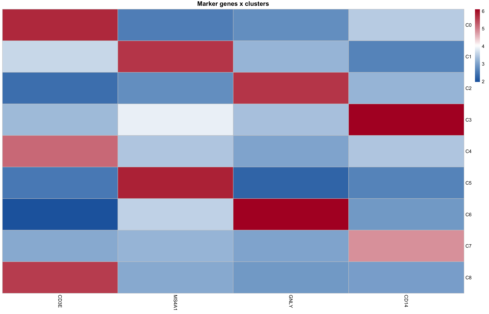

参考的三层组合图把**簇身份、组织偏好和标记表达**放在一张图中：(B1) 逐簇标记表达的分面棒棒糖、(B2) 逐簇组织偏好的 100% 堆叠条、(B3) 标记基因 × 簇的 pheatmap \[1\]。参考用 Seurat；本教程**直接模拟逐簇矩阵**（绕过 Seurat）并以 ggplot2 + pheatmap 复现全部三层：

## Example

{fig-alt="单细胞标记三联组合图 DEMO" fig-align="center" width="60%"}

## Setup

-   系统要求：跨平台（Linux/MacOS/Windows）

-   编程语言：R

-   依赖包：`ggplot2`; `pheatmap`; `patchwork`; `ggplotify`; `scales`

```{r packages setup, message=FALSE, warning=FALSE, output=FALSE}
suppressPackageStartupMessages({
  library(ggplot2)
  library(pheatmap)
  library(patchwork)
  library(ggplotify)
})
```

```{r}
sessioninfo::session_info("attached")
```

## 数据准备

9 个模拟簇 × 4 个谱系标记（T 细胞、B 细胞、NK、单核）× 5 个组织位点。矩阵 `AveExpr`（标记 × 簇）与 `TissueCount`（簇 × 组织）是 Seurat `AverageExpression()` 和 `table()` 上游产出——此处直接模拟以绕过 Seurat 依赖：

```{r load data}
set.seed(22401)
n_clus <- 9
markers <- c("CD3E", "MS4A1", "GNLY", "CD14")
tissues <- c("nLung", "tLung", "tB", "mLN", "mBrain")
AveExpr <- matrix(rnorm(n_clus * 4, 3, 0.5), n_clus, 4,
                  dimnames = list(paste0("C", 0:(n_clus - 1)), markers))
dominant <- c(1, 2, 3, 4, 1, 2, 3, 4, 1)
for (i in seq_len(n_clus)) AveExpr[i, dominant[i]] <- AveExpr[i, dominant[i]] + 2.5
TissueCount <- matrix(rmultinom(n_clus, 50, rep(0.2, 5)), n_clus, 5, byrow = TRUE,
                      dimnames = list(paste0("C", 0:(n_clus - 1)), tissues))
```

## Visualization

### 分面棒棒糖 + 堆叠条 + pheatmap

组合图：逐簇标记表达的分面棒棒糖（每簇一个主导标记）、逐簇组织偏好的 100% 堆叠条、以及标记基因 × 簇的带块结构 pheatmap：

```{r}
#| label: fig-1.1ScMarker
#| fig-cap: "9 个模拟簇的单细胞标记组合图：逐簇标记表达的分面棒棒糖（上）、逐簇组织偏好的 100% 堆叠条（中）与标记基因 × 簇的带块结构 pheatmap（下）。"
#| out.width: "88%"
#| warning: false
#| message: false
#| fig-width: 10
#| fig-height: 10.5

ave_long <- do.call(rbind, lapply(seq_along(markers), function(j)
  data.frame(cluster = rownames(AveExpr), marker = markers[j],
             expr = AveExpr[, j], facet = paste0("Cluster ", 0:(n_clus - 1)))))
ave_long$facet <- factor(ave_long$facet, levels = paste0("Cluster ", 0:(n_clus - 1)))
ave_long$marker <- factor(ave_long$marker, levels = markers)  # match Panel C column order
ave_long$cluster_f <- factor(ave_long$cluster, levels = rownames(AveExpr))

## Panel A: 3x3 faceted lollipop (no empty grid slot), dots tinted by marker
p1 <- ggplot(ave_long, aes(marker, expr)) +
  geom_hline(yintercept = 0, colour = "grey85", linewidth = 0.3) +
  geom_segment(aes(xend = marker, y = 0, yend = expr), linewidth = 0.5, colour = "grey60") +
  geom_point(aes(fill = marker), shape = 21, size = 2.6, colour = "grey25", stroke = 0.4) +
  facet_wrap(~facet, ncol = 3) +
  scale_fill_manual(values = c(CD3E = "#E64B35", MS4A1 = "#4DBBD5",
                               GNLY = "#00A087", CD14 = "#3C5488"), guide = "none") +
  labs(x = NULL, y = "Mean expression", title = "Marker expression per cluster") +
  theme_classic(base_size = 10) +
  theme(axis.text.x = element_text(angle = 45, hjust = 1, size = 7),
        strip.background = element_blank(),
        strip.text = element_text(face = "bold"))

tc_df <- as.data.frame(TissueCount)
tc_df$cluster <- rownames(TissueCount)
tc_long <- reshape(tc_df, direction = "long", varying = 1:5, idvar = "cluster",
                   timevar = "tissue", times = tissues, v.names = "count")
tc_long$cluster_f <- factor(tc_long$cluster, levels = rownames(TissueCount))

## Panel B: keep cluster labels on the x axis so bars map back to Panel A/C
p2 <- ggplot(tc_long, aes(cluster_f, count, fill = tissue)) +
  geom_bar(stat = "identity", position = "fill", width = 0.72) +
  scale_y_continuous(labels = scales::percent, expand = c(0, 0)) +
  scale_fill_brewer(palette = "Set3") +
  labs(x = "Cluster", y = "Tissue proportion", title = "Tissue preference per cluster", fill = NULL) +
  theme_classic(base_size = 10) +
  theme(axis.text.x = element_text(size = 8),
        legend.key.size = ggplot2::unit(0.35, "cm"),
        legend.text = element_text(size = 8),
        legend.margin = ggplot2::margin(0, 0, 0, 0))

## Panel C: taller heatmap, readable row labels
pheatmap(AveExpr, scale = "none", color = colorRampPalette(c("#2166AC", "white", "#B2182B"))(64),
         cluster_rows = FALSE, cluster_cols = FALSE,
         fontsize_row = 9, fontsize_col = 10,
         main = "Marker genes x clusters", border_color = "grey80", silent = TRUE) |>
  ggplotify::as.ggplot() -> ph

p1 / p2 / ph + plot_layout(heights = c(3.2, 1.0, 1.5))
```

## 应用场景

::: {#fig-ScMarkerApplications1}
{fig-alt="单细胞标记组合图" fig-align="center" width="60%"}

单细胞标记组合图
:::

三层组合图适用于任何单细胞注释：簇身份 + 组织来源 + 标记表达、或亚型 + 治疗臂 + 通路活性。

## 参考文献

\[1\] Xiaofan Lu, et al. FigureYa: A Standardized Visualization Framework for Enhancing Biomedical Data Interpretation and Research Efficiency. iMetaMed. 2025. doi:10.1002/imm3.70005

\[2\] Zhang L, et al. single-cell roadmap of colorectal liver metastasis. Nat Commun. <https://www.nature.com/articles/s41467-020-18760-x>