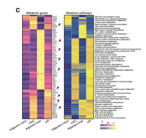

`scMetabolism` scores every cell for metabolic pathway activity by **rank-based gene-set scoring** (VISION/AUCell style: for each cell, look at the genes' expression ranks and reward sets concentrated near the top) over ~100 KEGG metabolism gene sets, then the reference visualizes median pathway score per cell type next to the average expression of the pathway's druggable genes \[1\]. `scMetabolism`/Seurat are not in this repository's lockfile; the rank-scoring kernel is implemented in-page (~15 lines, vectorized) and the two-panel heatmap — median pathway score per cell type plus average druggable-gene expression — runs on pheatmap:

## Example

{fig-alt="Single-Cell Metabolic Activity DEMO" fig-align="center" width="70%"}

## Setup

-   System Requirements: Cross-platform (Linux/MacOS/Windows)

-   Programming language: R

-   Dependent packages: `pheatmap`; `ggplot2`

```{r packages setup, message=FALSE, warning=FALSE, output=FALSE}
suppressPackageStartupMessages({
  library(pheatmap); library(ggplot2)
})
```

```{r}
sessioninfo::session_info("attached")
```

## Data Preparation

2000 simulated cells across 6 macrophage/T-cell populations, 800 genes. Five "KEGG-metabolism"-style pathways (glycolysis, OXPHOS, fatty-acid oxidation, glutamine metabolism, pentose phosphate) get planted activity differences: MRC1+CCL18+-like macrophages score high on glycolysis and fatty-acid oxidation, cytotoxic T cells on OXPHOS. Each pathway's gene set is a KEGG-style 40-80-gene list; the scoring kernel is rank-based, exactly the VISION/AUCell arithmetic scMetabolism wraps:

```{r load data}
suppressPackageStartupMessages({library(pheatmap); library(ggplot2)})
set.seed(44269)
n_cell <- 2000
celltypes <- c("MRC1+ macrophage", "Classical monocyte", "CD8 T cell",
               "CD4 T cell", "NK cell", "Fibroblast")
ct <- sample(celltypes, n_cell, TRUE, prob = c(0.25, 0.15, 0.2, 0.15, 0.1, 0.15))
genes <- sprintf("G%04d", 1:800)
expr <- matrix(rexp(n_cell * length(genes), 0.5), n_cell, length(genes),
               dimnames = list(seq_len(n_cell), genes))
## pathway gene sets and planted per-type activity
sets <- list(
  Glycolysis = 1:60, OXPHOS = 61:140, `Fatty acid oxidation` = 141:200,
  `Glutamine metabolism` = 201:250, `Pentose phosphate` = 251:300)
hot <- list(`MRC1+ macrophage` = c(Glycolysis = 1.4, `Fatty acid oxidation` = 1.6),
            `Classical monocyte` = c(Glycolysis = 0.7, `Glutamine metabolism` = 0.9),
            `CD8 T cell` = c(OXPHOS = 1.2), `NK cell` = c(OXPHOS = 1.0),
            `CD4 T cell` = c(`Pentose phosphate` = 0.6),
            Fibroblast = c(`Fatty acid oxidation` = 0.8))
for (p in names(sets)) {
  for (ctp in names(hot)) {
    boost <- hot[[ctp]][p]
    if (!is.na(boost) && boost > 0) {
      idx <- ct == ctp
      expr[idx, sets[[p]]] <- expr[idx, sets[[p]]] + boost
    }
  }
}
## rank-based (AUCell/VISION-style) pathway score: per cell, rank genes,
## average the ranks of the pathway's genes, invert to [0, 1]
rank_score <- function(e, set) {
  rk <- t(apply(e, 1, rank))
  1 - (rowMeans(rk[, set, drop = FALSE]) - (length(set) + 1) / 2) /
    (ncol(e) - (length(set) + 1) / 2)
}
scores <- sapply(sets, function(st) rank_score(expr, st))
scores <- pmin(pmax(scores, 0), 1)
```

## Visualization

### 1. Median Pathway Score per Cell Type

The reference's Fig. 4c left half: one heatmap, pathways as rows, cell types as columns, cell = median score across that type's cells — the glycolytic macrophage block and the OXPHOS T-cell block read directly:

```{r}
#| label: fig-1.1ScMetabolism
#| fig-cap: "Median metabolic pathway score per cell type (rank-based, 0-1): MRC1+ macrophages peak on glycolysis and fatty-acid oxidation, CD8/NK cells on OXPHOS — the planted programme structure."
#| out.width: "80%"
#| fig-width: 7
#| fig-height: 4.6

med <- t(sapply(celltypes, function(ctp)
  apply(scores[ct == ctp, , drop = FALSE], 2, median)))
pheatmap(med,
         color = colorRampPalette(c("#2166AC", "white", "#B2182B"))(64),
         cluster_rows = FALSE, cluster_cols = FALSE,
         border_color = "white",
         display_numbers = TRUE, number_format = "%.2f",
         fontsize_number = 8, number_color = "black",
         cellwidth = 52, cellheight = 26,
         legend = TRUE,
         main = "median pathway score")
```

### 2. Average Expression of the Druggable Genes

The reference's right half: for the top pathway's genes (the "potentially druggable" set the reference highlights in red), the average expression per cell type — so the score's story is anchored to named, targetable genes:

```{r}
#| label: fig-2.1ScMetabolismGenes
#| fig-cap: "Average expression of the fatty-acid-oxidation pathway's druggable genes per cell type (top 10 by MRC1+ macrophage expression): the macrophage column leads, anchoring the pathway-score block of the previous heatmap to named targets."
#| out.width: "80%"
#| fig-width: 7
#| fig-height: 5.6

fa_genes <- sprintf("G%04d", sets[["Fatty acid oxidation"]])
avg_by_ct <- t(sapply(celltypes, function(ctp)
  colMeans(expr[ct == ctp, fa_genes, drop = FALSE])))
top10 <- order(colMeans(avg_by_ct[which(rownames(avg_by_ct) ==
                                          "MRC1+ macrophage"), , drop = FALSE]),
               decreasing = TRUE)[1:10]
gd <- avg_by_ct[, top10]
gd <- t(scale(t(gd)))
gd <- pmin(pmax(gd, -2), 2)
colnames(gd) <- sprintf("%s (druggable)", colnames(gd))
pheatmap(gd,
         color = colorRampPalette(c("#2166AC", "white", "#B2182B"))(64),
         cluster_rows = FALSE, cluster_cols = FALSE,
         border_color = "white",
         fontsize_col = 7,
         cellwidth = 30, cellheight = 24,
         main = "FAO pathway genes: mean expression (z)")
```

::: callout-tip
**Practice tips**

-   Rank-based scoring (VISION/AUCell arithmetic) is **normalization-free**: it depends only on within-cell gene order, so simulated and real cohorts are comparable without depth correction.
-   Median, not mean, per cell type — pathway score distributions are skewed by stressed subpopulations, and the median is what the reference reports.
-   Keep the pathway gene sets fixed (KEGG metabolism as shipped by scMetabolism); inventing per-analysis sets turns the method into a bespoke signature hunt.
-   Pair every score heatmap with the member-gene expression heatmap: a high score whose genes show no expression pattern is a scoring artefact, not biology.
-   Plot the cell-type column order consistently between the two panels — the side-by-side reading is the whole point of the reference's Fig. 4c.
:::

## Application

::: {#fig-ScMetabolismApplications1}
{fig-alt="Single-Cell Metabolic Activity" fig-align="center" width="70%"}

Single-cell metabolic activity
:::

The rank-score + gene-expression pair extends to any per-cell signature family: interferon-stimulated genes, hypoxia, EMT programs — wherever single-cell metabolic or programmatic activity needs to be attributed to cell types and anchored to targetable genes.

## Reference

\[1\] Xiaofan Lu, et al. FigureYa: A Standardized Visualization Framework for Enhancing Biomedical Data Interpretation and Research Efficiency. iMetaMed. 2025. doi:10.1002/imm3.70005
