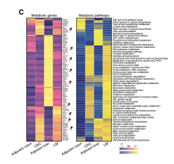

`scMetabolism` 用**基于秩的基因集打分**（VISION/AUCell 式：每细胞看基因表达秩、奖励集中在顶部的集合）对每细胞约 100 个 KEGG 代谢通路评分，参考将逐细胞类型的通路中位评分与通路可成药基因的平均表达并排画成热图 \[\1\]。`scMetabolism`/Seurat 不在本仓库 lockfile——秩打分内核在页内实现（约 15 行、向量化）——中位通路评分 + 平均可成药基因表达的双面板热图在 pheatmap 上运行：

## Example

{fig-alt="单细胞代谢活性 DEMO" fig-align="center" width="60%"}

## Setup

-   系统要求：跨平台（Linux/MacOS/Windows）

-   编程语言：R

-   依赖包：`pheatmap`; `ggplot2`

```{r packages setup, message=FALSE, warning=FALSE, output=FALSE}
suppressPackageStartupMessages({
  library(pheatmap); library(ggplot2)
})
```

```{r}
sessioninfo::session_info("attached")
```

## 数据准备

2000 个模拟细胞分 6 个巨噬/T 细胞群体、800 个基因。五个"KEGG 代谢"式通路（糖酵解、氧化磷酸化、脂肪酸氧化、谷氨酰胺代谢、戊糖磷酸）获得植入活性差异：MRC1+CCL18+ 样巨噬细胞在糖酵解与脂肪酸氧化高分、细胞毒性 T 细胞在氧化磷酸化高分。通路基因集为 KEGG 式 40-80 基因清单；打分内核基于秩，即 scMetabolism 包装的 VISION/AUCell 算术：

```{r load data}
suppressPackageStartupMessages({library(pheatmap); library(ggplot2)})
set.seed(44269)
n_cell <- 2000
celltypes <- c("MRC1+ macrophage", "Classical monocyte", "CD8 T cell",
               "CD4 T cell", "NK cell", "Fibroblast")
ct <- sample(celltypes, n_cell, TRUE, prob = c(0.25, 0.15, 0.2, 0.15, 0.1, 0.15))
genes <- sprintf("G%04d", 1:800)
expr <- matrix(rexp(n_cell * length(genes), 0.5), n_cell, length(genes),
               dimnames = list(seq_len(n_cell), genes))
## pathway gene sets and planted per-type activity
sets <- list(
  Glycolysis = 1:60, OXPHOS = 61:140, `Fatty acid oxidation` = 141:200,
  `Glutamine metabolism` = 201:250, `Pentose phosphate` = 251:300)
hot <- list(`MRC1+ macrophage` = c(Glycolysis = 1.4, `Fatty acid oxidation` = 1.6),
            `Classical monocyte` = c(Glycolysis = 0.7, `Glutamine metabolism` = 0.9),
            `CD8 T cell` = c(OXPHOS = 1.2), `NK cell` = c(OXPHOS = 1.0),
            `CD4 T cell` = c(`Pentose phosphate` = 0.6),
            Fibroblast = c(`Fatty acid oxidation` = 0.8))
for (p in names(sets)) {
  for (ctp in names(hot)) {
    boost <- hot[[ctp]][p]
    if (!is.na(boost) && boost > 0) {
      idx <- ct == ctp
      expr[idx, sets[[p]]] <- expr[idx, sets[[p]]] + boost
    }
  }
}
## rank-based (AUCell/VISION-style) pathway score: per cell, rank genes,
## average the ranks of the pathway's genes, invert to [0, 1]
rank_score <- function(e, set) {
  rk <- t(apply(e, 1, rank))
  1 - (rowMeans(rk[, set, drop = FALSE]) - (length(set) + 1) / 2) /
    (ncol(e) - (length(set) + 1) / 2)
}
scores <- sapply(sets, function(st) rank_score(expr, st))
scores <- pmin(pmax(scores, 0), 1)
```

## Visualization

### 逐细胞类型的通路中位评分

参考的 Fig. 4c 左半：一张热图、通路为行、细胞类型为列、格 = 该类型细胞的中位评分——糖酵解巨噬细胞块与 OXPHOS T 细胞块直接可读：

```{r}
#| label: fig-1.1ScMetabolism
#| fig-cap: "逐细胞类型的代谢通路中位评分（基于秩、0-1）：MRC1+ 巨噬细胞在糖酵解与脂肪酸氧化达峰、CD8/NK 细胞在氧化磷酸化达峰——即植入的程序结构。"
#| out.width: "80%"
#| fig-width: 7
#| fig-height: 4.6

med <- t(sapply(celltypes, function(ctp)
  apply(scores[ct == ctp, , drop = FALSE], 2, median)))
pheatmap(med,
         color = colorRampPalette(c("#2166AC", "white", "#B2182B"))(64),
         cluster_rows = FALSE, cluster_cols = FALSE,
         border_color = "white",
         display_numbers = TRUE, number_format = "%.2f",
         fontsize_number = 8, number_color = "black",
         cellwidth = 52, cellheight = 26,
         legend = TRUE,
         main = "median pathway score")
```

### 可成药基因的平均表达

参考的右半：对顶部通路的基因（参考红标"潜在可成药"集合）、逐细胞类型的平均表达——让评分的故事锚定在有名有姓的可靶向基因上：

```{r}
#| label: fig-2.1ScMetabolismGenes
#| fig-cap: "脂肪酸氧化通路可成药基因逐细胞类型的平均表达（按 MRC1+ 巨噬细胞表达取前 10）：巨噬细胞列领先，把前一热图的通路评分块锚定到具体的可靶向基因。"
#| out.width: "80%"
#| fig-width: 7
#| fig-height: 5.6

fa_genes <- sprintf("G%04d", sets[["Fatty acid oxidation"]])
avg_by_ct <- t(sapply(celltypes, function(ctp)
  colMeans(expr[ct == ctp, fa_genes, drop = FALSE])))
top10 <- order(colMeans(avg_by_ct[which(rownames(avg_by_ct) ==
                                          "MRC1+ macrophage"), , drop = FALSE]),
               decreasing = TRUE)[1:10]
gd <- avg_by_ct[, top10]
gd <- t(scale(t(gd)))
gd <- pmin(pmax(gd, -2), 2)
colnames(gd) <- sprintf("%s (druggable)", colnames(gd))
pheatmap(gd,
         color = colorRampPalette(c("#2166AC", "white", "#B2182B"))(64),
         cluster_rows = FALSE, cluster_cols = FALSE,
         border_color = "white",
         fontsize_col = 7,
         cellwidth = 30, cellheight = 24,
         main = "FAO pathway genes: mean expression (z)")
```


## 应用场景

::: {{#fig-ScMetabolismApplications1}}
{fig-alt="单细胞代谢活性" fig-align="center" width="60%"}

单细胞代谢活性
:::

秩评分 + 基因表达配对可扩展到任何逐细胞签名家族：干扰素刺激基因、缺氧、EMT 程序——凡单细胞代谢或程序活性需要归因到细胞类型并锚定到可靶向基因处。

## 参考文献

\[1\] Xiaofan Lu, et al. FigureYa: A Standardized Visualization Framework for Enhancing Biomedical Data Interpretation and Research Efficiency. iMetaMed. 2025. doi:10.1002/imm3.70005
