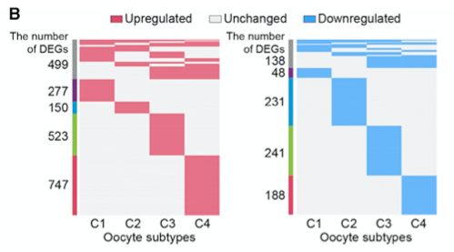

When a differential-expression table spans several cell subtypes, the conventional dot plot buries the structure. The reference renders the DEG membership as a **binary heatmap** per direction — one row per gene, one column per subtype, tile filled only where the gene is a subtype DEG — with a left annotation strip classifying genes as subtype-specific (C1/C2/C3/C4) or shared by ≥2 subtypes ("other"), and up- vs down-regulated genes in separate plots sized to the same height \[1\]. Seurat's `FindAllMarkers` produces the reference input; Seurat is not in this repository's lockfile, so the DEG table is simulated directly and the pipeline (`dcast` → order → annotate → two pheatmaps) runs on plain dplyr + pheatmap:

## Example

{fig-alt="Per-Subtype DEG Binary Heatmaps DEMO" fig-align="center" width="65%"}

## Setup

-   System Requirements: Cross-platform (Linux/MacOS/Windows)

-   Programming language: R

-   Dependent packages: `pheatmap`; `dplyr`; `reshape2`

```{r packages setup, message=FALSE, warning=FALSE, output=FALSE}
suppressPackageStartupMessages({
  library(pheatmap); library(dplyr)
})
```

```{r}
sessioninfo::session_info("attached")
```

## Data Preparation

A `degData` table in the shape `FindAllMarkers()` returns: gene, subtype (C1-C4), direction (O = up in old, Y = up in young — the reference compares aged vs young oocytes per subtype). 85 genes: 25 shared by 2-4 subtypes and 15 subtype-specific per subtype, so the "shared" annotation has content:

```{r load data}
suppressPackageStartupMessages({
  library(pheatmap); library(dplyr); library(reshape2)
})
set.seed(39232)
subtypes <- paste0("C", 1:4)
## shared genes appear in 2-3 subtypes; specific genes in exactly one
mk <- function(n, subs) {
  do.call(rbind, lapply(seq_len(n), function(i) {
    ss <- sample(subs, size = sample(length(subs) - 1, 1) + 1)
    data.frame(gene = sprintf("DEG%03d", i), subtype = ss)
  }))
}
shared <- mk(25, subtypes)
spec <- do.call(rbind, lapply(subtypes, function(s)
  data.frame(gene = sprintf("DEG%03d", 25 + which(s == subtypes) * 15 + seq_len(15)),
             subtype = s)))
degData <- rbind(shared, spec)
degData$cluster <- ifelse(degData$subtype %in% c("C1", "C2"), "O", "Y")
degData <- degData[!duplicated(degData[, c("gene", "subtype")]), ]
head(degData)
```

## Visualization

### 1. Reshape and Classify: Shared vs Subtype-Specific

`dcast` the long table into a gene × subtype membership matrix, order rows by how many subtypes a gene hits (shared genes float to the top), and derive the left-strip annotation: `count < 3` → subtype-specific label, otherwise "other" — exactly the grey-bar logic of the reference:

```{r}
#| label: fig-1.1ScRankReshape
#| fig-cap: "DEG membership matrix after dcast and ordering: rows sorted by the number of subtypes a gene is DE in, with the shared/specific annotation shown as the left strip of the subsequent heatmaps."
#| out.width: "95%"
#| fig-width: 5.5
#| fig-height: 6.5

heatData <- dcast(degData[, c("subtype", "gene", "cluster")], gene ~ subtype)
heatData <- heatData %>%
  mutate(count = rowSums(is.na(heatData[, subtypes]))) %>%   # count = subtypes WITHOUT the gene
  arrange(count, across(all_of(subtypes)))
## reference logic: a gene missing from < 3 subtypes (i.e. DE in >= 2) is "shared",
## otherwise it belongs to the single subtype that carries it
heatAnnot <- data.frame(number = case_when(
  heatData$count < 3 ~ "shared",
  !is.na(heatData$C1) ~ "C1",
  !is.na(heatData$C2) ~ "C2",
  !is.na(heatData$C3) ~ "C3",
  !is.na(heatData$C4) ~ "C4"
), row.names = heatData$gene)
annot_cols <- list(number = setNames(
  c("darkblue", "steelblue", "lightgreen", "red3", "grey"),
  c(paste0("C", 1:4), "shared")))
## membership previews for this check figure
memb <- 0 + !is.na(heatData[, subtypes])
rownames(memb) <- heatData$gene
pheatmap(memb, cellwidth = 26, cellheight = 3.3, border_color = NA,
         cluster_rows = FALSE, cluster_cols = FALSE,
         show_rownames = FALSE, legend = FALSE,
         color = c("grey97", "grey45"),
         annotation_row = heatAnnot,
         annotation_colors = annot_cols,
         main = "All DEGs: membership by subtype")
```

### 2. Up-Regulated Genes (Direction "O")

Genes flagged up in the old/first direction in **at least one** subtype and never in the opposite direction, one binary tile per subtype membership, equal-height tiles via `cellheight`:

```{r}
#| label: fig-2.1ScRankUp
#| fig-cap: "Binary heatmap of up-regulated (direction O) DEGs per subtype: filled tile = the gene is a DEG of that subtype; left strip marks subtype-specific vs shared DEGs."
#| out.width: "95%"
#| fig-width: 5.5
#| fig-height: 6.5

phData <- 0 + (heatData[rowSums(heatData[subtypes] == "O", na.rm = TRUE) > 0 &
                        rowSums(heatData[subtypes] == "Y", na.rm = TRUE) == 0,
                      subtypes] == "O")
phData[is.na(phData)] <- 0
rownames(phData) <- heatData$gene[rowSums(heatData[subtypes] == "O", na.rm = TRUE) > 0 &
                                  rowSums(heatData[subtypes] == "Y", na.rm = TRUE) == 0]
pheatmap(phData, cellwidth = 30, cellheight = 8.5, border_color = NA,
         cluster_rows = FALSE, cluster_cols = FALSE,
         show_rownames = FALSE, legend = FALSE,
         color = c("grey97", "lightcoral"),
         annotation_row = heatAnnot[rownames(phData), , drop = FALSE],
         annotation_colors = annot_cols,
         main = sprintf("Up-regulated DEGs (n = %d)", nrow(phData)))
```

### 3. Down-Regulated Genes (Direction "Y") at the Same Height

The mirror heatmap for the young/down direction; `cellheight` is rescaled so both plots render the **same physical height**, which is what makes the gene-count contrast readable at a glance:

```{r}
#| label: fig-3.1ScRankDown
#| fig-cap: "Binary heatmap of down-regulated (direction Y) DEGs, drawn at the same physical height as the up-regulated plot: the visibly sparser fill quantifies the direction asymmetry."
#| out.width: "95%"
#| fig-width: 5.5
#| fig-height: 6.5

phData2 <- 0 + (heatData[rowSums(heatData[subtypes] == "Y", na.rm = TRUE) > 0 &
                         rowSums(heatData[subtypes] == "O", na.rm = TRUE) == 0,
                       subtypes] == "Y")
phData2[is.na(phData2)] <- 0
rownames(phData2) <- heatData$gene[rowSums(heatData[subtypes] == "Y", na.rm = TRUE) > 0 &
                                   rowSums(heatData[subtypes] == "O", na.rm = TRUE) == 0]
## match the physical height of the up plot
ch <- nrow(phData) * 8.5 / max(nrow(phData2), 1)
pheatmap(phData2, cellwidth = 30, cellheight = ch, border_color = NA,
         cluster_rows = FALSE, cluster_cols = FALSE,
         show_rownames = FALSE, legend = FALSE,
         color = c("grey97", "cornflowerblue"),
         annotation_row = heatAnnot[rownames(phData2), , drop = FALSE],
         annotation_colors = annot_cols,
         main = sprintf("Down-regulated DEGs (n = %d)", nrow(phData2)))
```

::: callout-tip
**Practice tips**

-   Keep row order identical between the up and down heatmaps (derive both from the same ordered `heatData`) — otherwise the shared/specific strip cannot be compared across directions.
-   Equal physical height is the point: rescale `cellheight` per plot (`nrow_up * h_up / nrow_down`) so the fill density contrast is honest.
-   `grey97` (not pure white) for the empty tiles keeps the plot area visible against a white page while still reading as "no".
-   Mind what `count` counts: it is the number of subtypes **without** the gene, so `count < 3` (DE in ≥ 2 subtypes) is the "shared" branch — put it first in the `case_when`.
-   Run this per comparison (old vs young, responder vs non-responder...) rather than mixing directions in one heatmap — direction is the story, subtype is the x axis.
:::

## Application

::: {#fig-ScRankHeatmapApplications1}
{fig-alt="Per-Subtype DEG Binary Heatmaps" fig-align="center" width="65%"}

Per-subtype DEG binary heatmaps
:::

Any "membership of items across categories" table reads this way: pathway hits per tumour subtype, enriched motifs per cell type, or drug-response flags per lineage — wherever a long tidy table wants to become a scannable binary grid.

## Reference

\[1\] Xiaofan Lu, et al. FigureYa: A Standardized Visualization Framework for Enhancing Biomedical Data Interpretation and Research Efficiency. iMetaMed. 2025. doi:10.1002/imm3.70005
