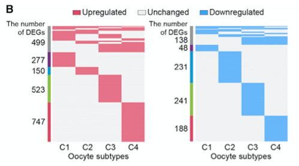

当差异表达表横跨多个细胞亚型时，常规点图会埋没结构。参考文档把 DEG 成员关系画成**每个方向一张的二值热图**——每行一个基因、每列一个亚型、基因属于该亚型 DEG 时填充——左侧注释条把基因分为亚型特异（C1-C4）或 ≥2 亚型共享，上调与下调基因分成两张等高的图 \[1\]。参考输入来自 Seurat 的 `FindAllMarkers`；Seurat 不在本仓库 lockfile 中，故直接模拟 DEG 表、管线（`dcast` → 排序 → 注释 → 两张 pheatmap）在朴素 dplyr + pheatmap 上运行：

## Example

{fig-alt="逐亚型 DEG 二值热图 DEMO" fig-align="center" width="60%"}

## Setup

-   系统要求：跨平台（Linux/MacOS/Windows）

-   编程语言：R

-   依赖包：`pheatmap`; `dplyr`; `reshape2`

```{r packages setup, message=FALSE, warning=FALSE, output=FALSE}
suppressPackageStartupMessages({
  library(pheatmap); library(dplyr)
})
```

```{r}
sessioninfo::session_info("attached")
```

## 数据准备

`FindAllMarkers()` 返回形状的 `degData` 表：基因、亚型（C1-C4）、方向（O = old 中上调、Y = young 中上调——参考比较的是各亚型的年老 vs 年轻卵母细胞）。85 个基因：25 个由 2-4 个亚型共享、每亚型 15 个特异，"共享"注释条因此有内容：

```{r load data}
suppressPackageStartupMessages({
  library(pheatmap); library(dplyr); library(reshape2)
})
set.seed(39232)
subtypes <- paste0("C", 1:4)
## shared genes appear in 2-3 subtypes; specific genes in exactly one
mk <- function(n, subs) {
  do.call(rbind, lapply(seq_len(n), function(i) {
    ss <- sample(subs, size = sample(length(subs) - 1, 1) + 1)
    data.frame(gene = sprintf("DEG%03d", i), subtype = ss)
  }))
}
shared <- mk(25, subtypes)
spec <- do.call(rbind, lapply(subtypes, function(s)
  data.frame(gene = sprintf("DEG%03d", 25 + which(s == subtypes) * 15 + seq_len(15)),
             subtype = s)))
degData <- rbind(shared, spec)
degData$cluster <- ifelse(degData$subtype %in% c("C1", "C2"), "O", "Y")
degData <- degData[!duplicated(degData[, c("gene", "subtype")]), ]
head(degData)
```

## Visualization

### 重塑与分类：共享 vs 亚型特异

`dcast` 把长表转成 基因 × 亚型 成员矩阵，按基因命中的亚型数排行（共享基因浮到顶部），导出左侧注释条：`count < 3` → 亚型特异标签、否则 "shared"——即参考的灰条逻辑：

```{r}
#| label: fig-1.1ScRankReshape
#| fig-cap: "dcast 与排序后的 DEG 成员矩阵：按基因命中的亚型数排行、共享/特异注释作为后续热图的左侧色条。"
#| out.width: "95%"
#| fig-width: 5.5
#| fig-height: 6.5

heatData <- dcast(degData[, c("subtype", "gene", "cluster")], gene ~ subtype)
heatData <- heatData %>%
  mutate(count = rowSums(is.na(heatData[, subtypes]))) %>%   # count = subtypes WITHOUT the gene
  arrange(count, across(all_of(subtypes)))
## reference logic: a gene missing from < 3 subtypes (i.e. DE in >= 2) is "shared",
## otherwise it belongs to the single subtype that carries it
heatAnnot <- data.frame(number = case_when(
  heatData$count < 3 ~ "shared",
  !is.na(heatData$C1) ~ "C1",
  !is.na(heatData$C2) ~ "C2",
  !is.na(heatData$C3) ~ "C3",
  !is.na(heatData$C4) ~ "C4"
), row.names = heatData$gene)
annot_cols <- list(number = setNames(
  c("darkblue", "steelblue", "lightgreen", "red3", "grey"),
  c(paste0("C", 1:4), "shared")))
## membership previews for this check figure
memb <- 0 + !is.na(heatData[, subtypes])
rownames(memb) <- heatData$gene
pheatmap(memb, cellwidth = 26, cellheight = 3.3, border_color = NA,
         cluster_rows = FALSE, cluster_cols = FALSE,
         show_rownames = FALSE, legend = FALSE,
         color = c("grey97", "grey45"),
         annotation_row = heatAnnot,
         annotation_colors = annot_cols,
         main = "All DEGs: membership by subtype")
```

### 上调基因（方向 O）

在**至少一个**亚型的 old/第一方向上调、且从不在相反方向上调的基因，每个亚型成员一个二值瓦片，`cellheight` 等高瓦片：

```{r}
#| label: fig-2.1ScRankUp
#| fig-cap: "上调（方向 O）DEG 的二值热图：填充瓦片 = 该基因是该亚型的 DEG；左侧色条标记亚型特异 vs 共享。"
#| out.width: "95%"
#| fig-width: 5.5
#| fig-height: 6.5

phData <- 0 + (heatData[rowSums(heatData[subtypes] == "O", na.rm = TRUE) > 0 &
                        rowSums(heatData[subtypes] == "Y", na.rm = TRUE) == 0,
                      subtypes] == "O")
phData[is.na(phData)] <- 0
rownames(phData) <- heatData$gene[rowSums(heatData[subtypes] == "O", na.rm = TRUE) > 0 &
                                  rowSums(heatData[subtypes] == "Y", na.rm = TRUE) == 0]
pheatmap(phData, cellwidth = 30, cellheight = 8.5, border_color = NA,
         cluster_rows = FALSE, cluster_cols = FALSE,
         show_rownames = FALSE, legend = FALSE,
         color = c("grey97", "lightcoral"),
         annotation_row = heatAnnot[rownames(phData), , drop = FALSE],
         annotation_colors = annot_cols,
         main = sprintf("Up-regulated DEGs (n = %d)", nrow(phData)))
```

### 下调基因（方向 Y）等高呈现

young/下调方向的镜像热图；`cellheight` 重新标定使两图**物理高度相同**——这正是让基因数对比一眼可读的关键：

```{r}
#| label: fig-3.1ScRankDown
#| fig-cap: "下调（方向 Y）DEG 的二值热图、与上调图同高：填充密度差量化方向不对称性。"
#| out.width: "95%"
#| fig-width: 5.5
#| fig-height: 6.5

phData2 <- 0 + (heatData[rowSums(heatData[subtypes] == "Y", na.rm = TRUE) > 0 &
                         rowSums(heatData[subtypes] == "O", na.rm = TRUE) == 0,
                       subtypes] == "Y")
phData2[is.na(phData2)] <- 0
rownames(phData2) <- heatData$gene[rowSums(heatData[subtypes] == "Y", na.rm = TRUE) > 0 &
                                   rowSums(heatData[subtypes] == "O", na.rm = TRUE) == 0]
## match the physical height of the up plot
ch <- nrow(phData) * 8.5 / max(nrow(phData2), 1)
pheatmap(phData2, cellwidth = 30, cellheight = ch, border_color = NA,
         cluster_rows = FALSE, cluster_cols = FALSE,
         show_rownames = FALSE, legend = FALSE,
         color = c("grey97", "cornflowerblue"),
         annotation_row = heatAnnot[rownames(phData2), , drop = FALSE],
         annotation_colors = annot_cols,
         main = sprintf("Down-regulated DEGs (n = %d)", nrow(phData2)))
```


## 应用场景

::: {{#fig-ScRankHeatmapApplications1}}
{fig-alt="逐亚型 DEG 二值热图" fig-align="center" width="60%"}

逐亚型 DEG 二值热图
:::

任何"条目 × 类别"的成员表都能这样读：每肿瘤亚型的通路命中、每细胞类型的 motif 富集、或每谱系的药物响应标记——凡长表想变成可扫读二值网格处。

## 参考文献

\[1\] Xiaofan Lu, et al. FigureYa: A Standardized Visualization Framework for Enhancing Biomedical Data Interpretation and Research Efficiency. iMetaMed. 2025. doi:10.1002/imm3.70005
