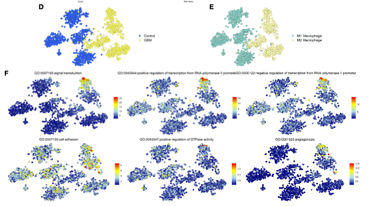

A t-SNE embedding is only as informative as the layers painted on it: the reference walks through grouping cells by patient, by diagnosis, and by a rule-based macrophage M1/M2 call, then overlays **six GO pathway scores** with a gradient so the embedding tells a molecular story \[1\]. Seurat's `DimPlot`/`FeaturePlot` drive the reference; Seurat is far too heavy for this repository's lockfile, so this tutorial computes the t-SNE with `Rtsne` (in the lockfile) and paints every layer with plain ggplot2 — the layout, colour choices and reading order are the reference's:

## Example

{fig-alt="t-SNE Metadata and Pathway-Score Overlays DEMO" fig-align="center" width="85%"}

## Setup

-   System Requirements: Cross-platform (Linux/MacOS/Windows)

-   Programming language: R

-   Dependent packages: `Rtsne`; `ggplot2`; `patchwork`; `RColorBrewer`

```{r packages setup, message=FALSE, warning=FALSE, output=FALSE}
suppressPackageStartupMessages({
  library(RColorBrewer)
})
```

```{r}
sessioninfo::session_info("attached")
```

## Data Preparation

1500 simulated cells from 4 patients (2 control, 2 GBM-like), 400 genes, three macrophage states with planted marker programmes. Pathway scores use the mean-of-log-expression signature average (the arithmetic a signature scorer applies) for six "GO"-like gene sets, each active in a specific cell state so the gradient panels are interpretable:

```{r load data}
suppressPackageStartupMessages({
  library(Rtsne); library(ggplot2); library(patchwork); library(RColorBrewer)
})
set.seed(39231)
n_pat <- 4; n_cell <- 1500; n_gene <- 400
pats <- c("Ctrl1", "Ctrl2", "GBM1", "GBM2")
cell_pat <- rep(pats, each = n_cell / n_pat)
diagnosis <- ifelse(grepl("Ctrl", cell_pat), "Control", "GBM")

states <- sample(c("Microglia", "M1-like", "M2-like"), n_cell, TRUE,
                 prob = c(0.4, 0.3, 0.3))
genes <- sprintf("G%03d", 1:n_gene)
expr <- matrix(rnorm(n_cell * n_gene, 2, 0.5), n_cell, n_gene,
               dimnames = list(paste0(cell_pat, "_", 1:n_cell), genes))
## planted state programmes
prog <- list(Microglia = 1:40, `M1-like` = 41:80, `M2-like` = 81:120)
for (st in names(prog)) {
  idx <- states == st
  expr[idx, prog[[st]]] <- expr[idx, prog[[st]]] + 2.2
}
## run t-SNE on the top-variable genes
varg <- order(apply(expr, 2, var), decreasing = TRUE)[1:100]
ts <- Rtsne(expr[, varg], dims = 2, perplexity = 30, pca = TRUE)
emb <- as.data.frame(ts$Y)
colnames(emb) <- c("tSNE1", "tSNE2")
emb$patient <- cell_pat
emb$diagnosis <- diagnosis
emb$state <- states

## six pathway signatures with state-specific activity
gosets <- list(GO_signal      = 1:40,
               GO_transcription = 41:80,
               GO_adhesion    = 81:120,
               GO_apoptosis   = 121:160,
               GO_GTPase      = 161:200,
               GO_angio       = 201:240)
for (nm in names(gosets)) {
  emb[[nm]] <- rowMeans(expr[, gosets[[nm]]])
}
```

## Visualization

### 1. Grouping Layers: Patient, Diagnosis, Cell State

The three metadata readings of the same embedding: colour by patient (which case a cell came from), by diagnosis (the Ctrl|GBM split the patient colours hint at), and by cell state — the reference's rule-based M1/M2 call becomes the simulated `state` label here:

```{r}
#| label: fig-1.1ScScoreGroups
#| fig-cap: "The same t-SNE embedding coloured three ways: by patient (Ctrl left, GBM right), by diagnosis (2 colours), and by cell state; the state layer is the one that explains the structure."
#| out.width: "100%"
#| fig-width: 10.5
#| fig-height: 3.6

base <- ggplot(emb, aes(tSNE1, tSNE2)) +
  theme_bw(base_size = 10) +
  theme(panel.grid = element_blank())
p1 <- base + geom_point(aes(colour = patient), size = 0.6, alpha = 0.85) +
  scale_colour_brewer(palette = "Set1") + labs(title = "Patient_ID", colour = NULL)
p2 <- base + geom_point(aes(colour = diagnosis), size = 0.6, alpha = 0.85,
                        shape = ifelse(emb$diagnosis == "Control", 16, 1)) +
  scale_colour_manual(values = c(Control = "royalblue3", GBM = "yellow3")) +
  labs(title = "Diagnosis", colour = NULL)
p3 <- base + geom_point(aes(colour = state), size = 0.6, alpha = 0.85) +
  scale_colour_manual(values = c(Microglia = "grey55", `M1-like` = "paleturquoise3",
                                 `M2-like` = "khaki3")) +
  labs(title = "Cell state", colour = NULL)
p1 + p2 + p3
```

### 2. Gradient Pathway Scores on the Embedding

The reference's FeaturePlot: one panel per pathway score, points coloured on a reversed RdYlBu ramp. Each simulated signature lights up the cell state that carries it — the "which programme is where" readout that group colours cannot give:

```{r}
#| label: fig-2.1ScScoreFeatures
#| fig-cap: "Six pathway scores overlaid on the t-SNE embedding with a reversed RdYlBu gradient: each planted signature (signal transduction, transcription, adhesion, apoptosis, GTPase, angiogenesis) highlights a distinct cell state."
#| out.width: "100%"
#| fig-width: 10.5
#| fig-height: 7
ramp <- colorRampPalette(rev(brewer.pal(n = 7, name = "RdYlBu")))(100)
plots <- lapply(names(gosets), function(nm) {
  ggplot(emb, aes(tSNE1, tSNE2, colour = .data[[nm]])) +
    geom_point(size = 0.6, alpha = 0.9) +
    scale_colour_gradientn(colours = ramp) +
    labs(title = gsub("_", " ", nm), colour = "score") +
    theme_bw(base_size = 10) + theme(panel.grid = element_blank())
})
wrap_plots(plots, ncol = 3)
```

::: callout-tip
**Practice tips**

-   Overlay the *same* embedding in every panel and only change the colour channel — side-by-side panels that re-run the embedding (new seeds) cannot be compared panel to panel.
-   Read the metadata panels in order patient → diagnosis → state: the patient layer reveals batch structure that would otherwise be mistaken for a biological gradient.
-   Signature scores from mean-of-log-expression are shift-sensitive; score the same gene set once and reuse it everywhere rather than re-computing per panel.
-   Keep point size tiny (0.5-0.8) on dense embeddings — size is the fastest way to hide the gradient you are trying to show.
-   Perplexity 30 with ≥1000 cells is a sane default; always state it, since t-SNE geometry — and therefore every overlaid gradient — changes with it.
:::

## Application

::: {#fig-ScScoreApplications1}
{fig-alt="t-SNE Metadata and Pathway-Score Overlays" fig-align="center" width="85%"}

t-SNE metadata and pathway-score overlays
:::

The overlay recipe transfers to any embedding: UMAP of an atlas, PCA of bulk cohorts, or spatial coordinates in an ST slide — anywhere a categorical layer (who/what) plus a continuous layer (how much) together tell the story.

## Reference

\[1\] Xiaofan Lu, et al. FigureYa: A Standardized Visualization Framework for Enhancing Biomedical Data Interpretation and Research Efficiency. iMetaMed. 2025. doi:10.1002/imm3.70005
