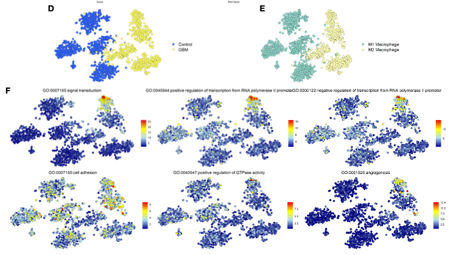

t-SNE 嵌入的信息量取决于叠加的图层：参考文档依次按病人、诊断、规则判定的 M1/M2 巨噬细胞着色，再叠加**六个 GO 通路评分**的渐变色，让嵌入图讲出分子故事 \[1\]。参考用 Seurat 的 `DimPlot`/`FeaturePlot`；Seurat 远超本仓库 lockfile 的承载能力，本教程用 `Rtsne`（已入锁）计算 t-SNE、用朴素 ggplot2 叠加全部图层——版式、配色与阅读顺序均为参考的：

## Example

{fig-alt="t-SNE 元数据与通路评分叠加 DEMO" fig-align="center" width="60%"}

## Setup

-   系统要求：跨平台（Linux/MacOS/Windows）

-   编程语言：R

-   依赖包：`Rtsne`; `ggplot2`; `patchwork`; `RColorBrewer`

```{r packages setup, message=FALSE, warning=FALSE, output=FALSE}
suppressPackageStartupMessages({
  library(RColorBrewer)
})
```

```{r}
sessioninfo::session_info("attached")
```

## 数据准备

来自 4 位病人（2 对照、2 GBM 样）的 1500 个模拟细胞、400 个基因、三种巨噬细胞状态带植入的 marker 程序。通路评分用 log 表达均值型 signature 平均（签名评分器的算术内核）计算六套"GO"基因集，每个签名在特定细胞状态下活跃、渐变面板因此可解读：

```{r load data}
suppressPackageStartupMessages({
  library(Rtsne); library(ggplot2); library(patchwork); library(RColorBrewer)
})
set.seed(39231)
n_pat <- 4; n_cell <- 1500; n_gene <- 400
pats <- c("Ctrl1", "Ctrl2", "GBM1", "GBM2")
cell_pat <- rep(pats, each = n_cell / n_pat)
diagnosis <- ifelse(grepl("Ctrl", cell_pat), "Control", "GBM")

states <- sample(c("Microglia", "M1-like", "M2-like"), n_cell, TRUE,
                 prob = c(0.4, 0.3, 0.3))
genes <- sprintf("G%03d", 1:n_gene)
expr <- matrix(rnorm(n_cell * n_gene, 2, 0.5), n_cell, n_gene,
               dimnames = list(paste0(cell_pat, "_", 1:n_cell), genes))
## planted state programmes
prog <- list(Microglia = 1:40, `M1-like` = 41:80, `M2-like` = 81:120)
for (st in names(prog)) {
  idx <- states == st
  expr[idx, prog[[st]]] <- expr[idx, prog[[st]]] + 2.2
}
## run t-SNE on the top-variable genes
varg <- order(apply(expr, 2, var), decreasing = TRUE)[1:100]
ts <- Rtsne(expr[, varg], dims = 2, perplexity = 30, pca = TRUE)
emb <- as.data.frame(ts$Y)
colnames(emb) <- c("tSNE1", "tSNE2")
emb$patient <- cell_pat
emb$diagnosis <- diagnosis
emb$state <- states

## six pathway signatures with state-specific activity
gosets <- list(GO_signal      = 1:40,
               GO_transcription = 41:80,
               GO_adhesion    = 81:120,
               GO_apoptosis   = 121:160,
               GO_GTPase      = 161:200,
               GO_angio       = 201:240)
for (nm in names(gosets)) {
  emb[[nm]] <- rowMeans(expr[, gosets[[nm]]])
}
```

## Visualization

### 分组图层：病人、诊断、细胞状态

同一嵌入的三种元数据读法：按病人着色（细胞来自哪个案例）、按诊断着色（病人色暗示的 Ctrl|GBM 分裂）、按细胞状态着色——参考的规则判定 M1/M2 在此即模拟的 `state` 标签：

```{r}
#| label: fig-1.1ScScoreGroups
#| fig-cap: "同一 t-SNE 嵌入按三种方式着色：按病人（Ctrl 在左、GBM 在右）、按诊断（两色）、按细胞状态；状态层才是解释结构的那个。"
#| out.width: "100%"
#| fig-width: 10.5
#| fig-height: 3.6

base <- ggplot(emb, aes(tSNE1, tSNE2)) +
  theme_bw(base_size = 10) +
  theme(panel.grid = element_blank())
p1 <- base + geom_point(aes(colour = patient), size = 0.6, alpha = 0.85) +
  scale_colour_brewer(palette = "Set1") + labs(title = "Patient_ID", colour = NULL)
p2 <- base + geom_point(aes(colour = diagnosis), size = 0.6, alpha = 0.85,
                        shape = ifelse(emb$diagnosis == "Control", 16, 1)) +
  scale_colour_manual(values = c(Control = "royalblue3", GBM = "yellow3")) +
  labs(title = "Diagnosis", colour = NULL)
p3 <- base + geom_point(aes(colour = state), size = 0.6, alpha = 0.85) +
  scale_colour_manual(values = c(Microglia = "grey55", `M1-like` = "paleturquoise3",
                                 `M2-like` = "khaki3")) +
  labs(title = "Cell state", colour = NULL)
p1 + p2 + p3
```

### 嵌入图上的渐变通路评分

参考的 FeaturePlot：每个通路评分一个面板、点按反转 RdYlBu 色带着色。每个模拟签名点亮携带它的细胞状态——分组颜色给不出的"哪个程序在哪里"读法：

```{r}
#| label: fig-2.1ScScoreFeatures
#| fig-cap: "六个通路评分以反转 RdYlBu 渐变叠加在 t-SNE 嵌入上：每个植入签名（信号转导、转录、黏附、凋亡、GTPase、血管生成）点亮一个不同的细胞状态。"
#| out.width: "100%"
#| fig-width: 10.5
#| fig-height: 7
ramp <- colorRampPalette(rev(brewer.pal(n = 7, name = "RdYlBu")))(100)
plots <- lapply(names(gosets), function(nm) {
  ggplot(emb, aes(tSNE1, tSNE2, colour = .data[[nm]])) +
    geom_point(size = 0.6, alpha = 0.9) +
    scale_colour_gradientn(colours = ramp) +
    labs(title = gsub("_", " ", nm), colour = "score") +
    theme_bw(base_size = 10) + theme(panel.grid = element_blank())
})
wrap_plots(plots, ncol = 3)
```


## 应用场景

::: {{#fig-ScScoreApplications1}}
{fig-alt="t-SNE 元数据与通路评分叠加" fig-align="center" width="60%"}

t-SNE 元数据与通路评分叠加
:::

叠加配方适用于任何嵌入：图谱的 UMAP、bulk 队列的 PCA、或 ST 切片的空转坐标——凡"分类层（谁/是什么）+ 连续层（多少）"合起来讲故事的地方。

## 参考文献

\[1\] Xiaofan Lu, et al. FigureYa: A Standardized Visualization Framework for Enhancing Biomedical Data Interpretation and Research Efficiency. iMetaMed. 2025. doi:10.1002/imm3.70005
