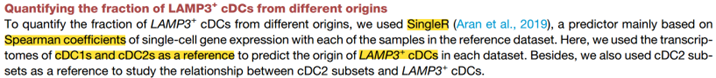

The reference's Fig. S5D: within LAMP3+ dendritic cells, the **fraction derived from each conventional subset (cDC2 vs cDC1)** is compared across cancer types with a Kruskal–Wallis test — a compositional question asked per sample, then aggregated by group \[1\]. The per-sample fraction computation and the group comparison boxplots run in-page on simulated per-sample compositions:

## Example

{fig-alt="Cell-Subset Fraction Comparisons Across Cohorts DEMO" fig-align="center" width="70%"}

## Setup

-   System Requirements: Cross-platform (Linux/MacOS/Windows)

-   Programming language: R

-   Dependent packages: `ggplot2`; `ggpubr`

```{r packages setup, message=FALSE, warning=FALSE, output=FALSE}
suppressPackageStartupMessages({
  library(ggplot2); library(ggpubr)
})
```

```{r}
sessioninfo::session_info("attached")
```

## Data Preparation

180 tumour samples from 6 cancer types, each with LAMP3+ cDC counts split by putative origin (cDC2-derived, cDC1-derived, other). Planted pattern: cDC2-derived LAMP3+ cDCs dominate in most cancers, but one cancer type (LUAD) harbours a distinctly cDC1-derived population:

```{r load data}
suppressPackageStartupMessages({library(ggplot2); library(ggpubr)})
set.seed(51315)
cancers <- c("BRCA", "COAD", "HNSC", "LUAD", "SKCM", "STAD")
n_per <- 30
sam_df <- do.call(rbind, lapply(cancers, function(cc) {
  n_tot <- round(runif(n_per, 15, 120))
  ## LUAD: much larger cDC1-derived share
  p_cdc2 <- if (cc == "LUAD") runif(n_per, 0.25, 0.55) else runif(n_per, 0.55, 0.9)
  n_cdc2 <- round(n_tot * p_cdc2)
  n_cdc1 <- round((n_tot - n_cdc2) * runif(n_per, 0.55, 0.9))
  data.frame(sample = sprintf("%s_%02d", cc, 1:n_per),
             cancer = cc, total = n_tot,
             cdc2 = n_cdc2, cdc1 = n_cdc1)
}))
sam_df$frac_cdc2 <- sam_df$cdc2 / sam_df$total
sam_df$cancer <- factor(sam_df$cancer, levels = cancers)
kw <- kruskal.test(frac_cdc2 ~ cancer, data = sam_df)
```

## Visualization

### 1. Per-Sample Fraction by Cancer Type

The reference's boxplot: one point per sample (the fraction of LAMP3+ cDCs derived from cDC2), grouped by cancer type, with the Kruskal–Wallis p and per-sample counts as the size channel:

```{r}
#| label: fig-1.1SinglerFraction
#| fig-cap: "Fraction of LAMP3+ cDCs derived from the cDC2 subset, per tumour sample, across six cancer types: cDC2-derived cells dominate in most cancers while LUAD carries a distinctly lower fraction (Kruskal-Wallis p annotated); point size encodes the number of LAMP3+ cDCs in that sample."
#| out.width: "85%"
#| fig-width: 7.5
#| fig-height: 5.4

ggplot(sam_df, aes(cancer, frac_cdc2, fill = cancer)) +
  geom_boxplot(outlier.shape = NA, alpha = 0.55, width = 0.6) +
  geom_point(shape = 21, aes(size = total), alpha = 0.8,
             position = position_jitter(width = 0.14), colour = "grey20") +
  scale_fill_brewer(palette = "Set2", guide = "none") +
  scale_size_continuous(range = c(0.6, 3.6), name = "LAMP3+ cDCs") +
  labs(x = NULL, y = "cDC2-derived fraction of LAMP3+ cDCs",
       title = sprintf("Kruskal-Wallis p = %s", format.pval(kw$p.value, digits = 2))) +
  theme_bw(base_size = 11) +
  theme(panel.grid.minor = element_blank(),
        axis.text.x = element_text(angle = 30, hjust = 1))
```

### 2. Pooled Composition Per Cancer Type

Boxplots summarise the spread; the pooled composition answers "what is the typical origin" for each cancer — stacked with the sample-size caveat stated in the caption, since pooling hides the per-sample variance the boxplot shows:

```{r}
#| label: fig-2.1SinglerFractionStack
#| fig-cap: "Pooled origin composition of LAMP3+ cDCs per cancer type (100% stacked): cDC2-derived dominates everywhere, with LUAD's larger cDC1-derived share visible; pooled bars are shown alongside the per-sample spread in the previous panel, not as a replacement for it."
#| out.width: "85%"
#| fig-width: 7.5
#| fig-height: 4.8

pool <- aggregate(cbind(cdc2, cdc1, other = total - cdc2 - cdc1) ~ cancer,
                  data = sam_df, FUN = sum)
long <- data.frame(cancer = rep(pool$cancer, 3),
                   origin = rep(c("cDC2-derived", "cDC1-derived", "Other"),
                                each = nrow(pool)),
                   n = c(pool$cdc2, pool$cdc1, pool$other))
long$cancer <- factor(long$cancer, levels = cancers)
long$origin <- factor(long$origin, levels = c("cDC2-derived", "cDC1-derived", "Other"))
ggplot(long, aes(cancer, n, fill = origin)) +
  geom_col(position = "fill", width = 0.7, colour = "white") +
  scale_fill_manual(values = c(`cDC2-derived` = "#377EB8", `cDC1-derived` = "#E41A1C",
                               Other = "grey75"), name = NULL) +
  labs(x = NULL, y = "pooled proportion") +
  theme_bw(base_size = 11) +
  theme(panel.grid = element_blank(), legend.position = "top",
        axis.text.x = element_text(angle = 30, hjust = 1))
```

::: callout-tip
**Practice tips**

-   Compute the fraction **per sample** first, then compare groups — pooling counts across samples reduces the effective sample size to the number of cancers and inflates every p value.
-   Include the per-sample cell count as a size channel: a sample with 15 LAMP3+ cells cannot support a fraction estimate the way one with 120 can.
-   Kruskal–Wallis tests the whole set of groups at once; follow with pairwise Wilcoxon + BH only for the comparisons the hypothesis names, not all 15 pairs.
-   Show the pooled composition as a companion, never as a substitute: pooling hides the per-sample variance that the boxplot exists to display.
-   State the origin-assignment rule (score argmax, marker threshold, or cluster label) — the fraction's meaning depends entirely on it.
:::

## Application

::: {#fig-SinglerFractionApplications1}
{fig-alt="Cell-Subset Fraction Comparisons Across Cohorts" fig-align="center" width="70%"}

Cell-subset fraction comparisons across cohorts
:::

Per-sample fraction comparisons apply to any compositional single-cell question: origin fractions of a state across cancers, Treg/Teff ratios by tissue, or macrophage subset shares by treatment arm.

## Reference

\[1\] Xiaofan Lu, et al. FigureYa: A Standardized Visualization Framework for Enhancing Biomedical Data Interpretation and Research Efficiency. iMetaMed. 2025. doi:10.1002/imm3.70005
