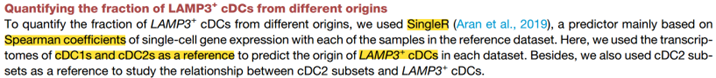

参考的 Fig. S5D：在 LAMP3+ 树突状细胞内，**来自每个常规亚群（cDC2 vs cDC1）的比例**跨癌种用 Kruskal–Wallis 检验比较——这是逐样本的组合学问题、再按组聚合 \[\1\]。逐样本比例计算与组间比较箱线图在页内对模拟的逐样本组成运行：

## Example

{fig-alt="跨队列的细胞亚群比例比较 DEMO" fig-align="center" width="60%"}

## Setup

-   系统要求：跨平台（Linux/MacOS/Windows）

-   编程语言：R

-   依赖包：`ggplot2`; `ggpubr`

```{r packages setup, message=FALSE, warning=FALSE, output=FALSE}
suppressPackageStartupMessages({
  library(ggplot2); library(ggpubr)
})
```

```{r}
sessioninfo::session_info("attached")
```

## 数据准备

来自 6 个癌种的 180 个肿瘤样本，各带按推定来源（cDC2 来源、cDC1 来源、其他）拆分的 LAMP3+ cDC 计数。植入模式：cDC2 来源的 LAMP3+ cDC 在多数癌症中主导、但一个癌种（LUAD）携带明显 cDC1 来源的群体：

```{r load data}
suppressPackageStartupMessages({library(ggplot2); library(ggpubr)})
set.seed(51315)
cancers <- c("BRCA", "COAD", "HNSC", "LUAD", "SKCM", "STAD")
n_per <- 30
sam_df <- do.call(rbind, lapply(cancers, function(cc) {
  n_tot <- round(runif(n_per, 15, 120))
  ## LUAD: much larger cDC1-derived share
  p_cdc2 <- if (cc == "LUAD") runif(n_per, 0.25, 0.55) else runif(n_per, 0.55, 0.9)
  n_cdc2 <- round(n_tot * p_cdc2)
  n_cdc1 <- round((n_tot - n_cdc2) * runif(n_per, 0.55, 0.9))
  data.frame(sample = sprintf("%s_%02d", cc, 1:n_per),
             cancer = cc, total = n_tot,
             cdc2 = n_cdc2, cdc1 = n_cdc1)
}))
sam_df$frac_cdc2 <- sam_df$cdc2 / sam_df$total
sam_df$cancer <- factor(sam_df$cancer, levels = cancers)
kw <- kruskal.test(frac_cdc2 ~ cancer, data = sam_df)
```

## Visualization

### 逐癌种的逐样本比例

参考的箱线图：每样本一点（LAMP3+ cDC 中来自 cDC2 的比例）、按癌种分组、标注 Kruskal–Wallis p、样本计数作为 size 通道：

```{r}
#| label: fig-1.1SinglerFraction
#| fig-cap: "六个癌种中每肿瘤样本来自 cDC2 亚群的 LAMP3+ cDC 比例：多数癌症中 cDC2 来源细胞主导、而 LUAD 携带明显更低的分数（标注 Kruskal-Wallis p）；点大小编码该样本的 LAMP3+ cDC 数量。"
#| out.width: "85%"
#| fig-width: 7.5
#| fig-height: 5.4

ggplot(sam_df, aes(cancer, frac_cdc2, fill = cancer)) +
  geom_boxplot(outlier.shape = NA, alpha = 0.55, width = 0.6) +
  geom_point(shape = 21, aes(size = total), alpha = 0.8,
             position = position_jitter(width = 0.14), colour = "grey20") +
  scale_fill_brewer(palette = "Set2", guide = "none") +
  scale_size_continuous(range = c(0.6, 3.6), name = "LAMP3+ cDCs") +
  labs(x = NULL, y = "cDC2-derived fraction of LAMP3+ cDCs",
       title = sprintf("Kruskal-Wallis p = %s", format.pval(kw$p.value, digits = 2))) +
  theme_bw(base_size = 11) +
  theme(panel.grid.minor = element_blank(),
        axis.text.x = element_text(angle = 30, hjust = 1))
```

### 逐癌种的合并组成

箱线图展示离散度；合并组成回答"每个癌种的典型来源"——堆叠并在图注中说明样本量限制，因为合并隐藏了箱线图展示的逐样本方差：

```{r}
#| label: fig-2.1SinglerFractionStack
#| fig-cap: "逐癌种的 LAMP3+ cDC 来源合并组成（100% 堆叠）：cDC2 来源处处主导、LUAD 的较大 cDC1 来源份额可见；合并柱与前面的逐样本离散度并列展示、而非替代。"
#| out.width: "85%"
#| fig-width: 7.5
#| fig-height: 4.8

pool <- aggregate(cbind(cdc2, cdc1, other = total - cdc2 - cdc1) ~ cancer,
                  data = sam_df, FUN = sum)
long <- data.frame(cancer = rep(pool$cancer, 3),
                   origin = rep(c("cDC2-derived", "cDC1-derived", "Other"),
                                each = nrow(pool)),
                   n = c(pool$cdc2, pool$cdc1, pool$other))
long$cancer <- factor(long$cancer, levels = cancers)
long$origin <- factor(long$origin, levels = c("cDC2-derived", "cDC1-derived", "Other"))
ggplot(long, aes(cancer, n, fill = origin)) +
  geom_col(position = "fill", width = 0.7, colour = "white") +
  scale_fill_manual(values = c(`cDC2-derived` = "#377EB8", `cDC1-derived` = "#E41A1C",
                               Other = "grey75"), name = NULL) +
  labs(x = NULL, y = "pooled proportion") +
  theme_bw(base_size = 11) +
  theme(panel.grid = element_blank(), legend.position = "top",
        axis.text.x = element_text(angle = 30, hjust = 1))
```


## 应用场景

::: {{#fig-SinglerFractionApplications1}}
{fig-alt="跨队列的细胞亚群比例比较" fig-align="center" width="60%"}

跨队列的细胞亚群比例比较
:::

逐样本比例比较适用于任何组合学单细胞问题：某状态跨癌种的来源比例、组织间 Treg/Teff 比、或治疗臂间巨噬细胞亚群份额。

## 参考文献

\[1\] Xiaofan Lu, et al. FigureYa: A Standardized Visualization Framework for Enhancing Biomedical Data Interpretation and Research Efficiency. iMetaMed. 2025. doi:10.1002/imm3.70005
