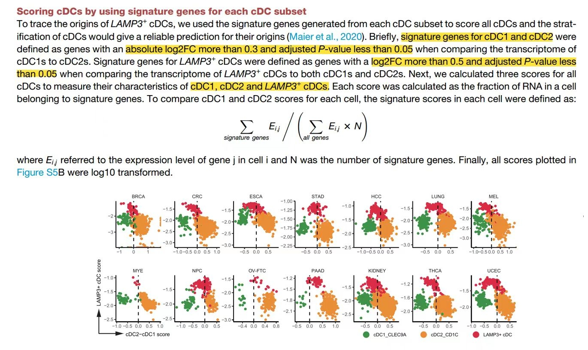

The reference's Fig. S5B stratifies conventional dendritic cells by **three subset signature scores** (cDC1, cDC2, LAMP3+ cDC): each cell gets a score per signature, and the argmax assigns it to a subset — so cells whose scores disagree with their cluster identity are visible as a re-classification \[1\]. Signature scoring is re-implemented in-page (per-cell z-scaled mean over each signature's genes) and the per-cell score scatter plus assignment bar are rendered with ggplot2:

## Example

{fig-alt="Signature-Score Stratification of Single Cells DEMO" fig-align="center" width="70%"}

## Setup

-   System Requirements: Cross-platform (Linux/MacOS/Windows)

-   Programming language: R

-   Dependent packages: `ggplot2`; `patchwork`

```{r packages setup, message=FALSE, warning=FALSE, output=FALSE}
suppressPackageStartupMessages({
  library(ggplot2); library(patchwork)
})
```

```{r}
sessioninfo::session_info("attached")
```

## Data Preparation

900 dendritic cells from three clusters (cDC1, cDC2, LAMP3+) × 60 genes; each cluster has a 12-15 gene signature. A minority of cells are planted as **mislabeled** (they carry another subset's signature) — the population the score-based stratification should reveal:

```{r load data}
suppressPackageStartupMessages({library(ggplot2); library(patchwork)})
set.seed(51314)
n <- 900
subset <- rep(c("cDC1", "cDC2", "LAMP3+"), each = 300)
genes <- sprintf("G%02d", 1:60)
sig <- list(cDC1 = genes[1:14], cDC2 = genes[15:29], `LAMP3+` = genes[30:44])

expr <- matrix(rnorm(length(genes) * n, 5, 1), length(genes), n,
               dimnames = list(genes, sprintf("C%03d", 1:n)))
for (s in names(sig)) {
  idx <- subset == s
  expr[sig[[s]], idx] <- expr[sig[[s]], idx] + 2.0
}
## 8% mislabeled cells: give them a foreign signature instead
mis <- sample(n, round(0.08 * n))
for (j in mis) {
  other <- setdiff(names(sig), subset[j])[1]
  expr[sig[[other]], j] <- expr[sig[[other]], j] + 2.4
}

## per-cell signature score = mean z-score over the signature's genes
zexpr <- t(scale(t(expr)))
score <- sapply(sig, function(g) colMeans(zexpr[g, , drop = FALSE]))
assign <- colnames(score)[apply(score, 1, which.max)]
df <- data.frame(cell = colnames(expr), cluster = subset,
                 score, assigned = factor(assign, levels = names(sig)),
                 check.names = FALSE)
```

## Visualization

### 1. Per-Cell Score Scatter With Assignment

The reference's stratifying panel: each cell positioned by two of its three scores, coloured by its **score-based assignment** — the three blobs are the subsets, the off-diagonal strays are the mislabeled minority:

```{r}
#| label: fig-1.1SinglerScore
#| fig-cap: "Signature-score stratification of 900 dendritic cells: cells are placed by their cDC1 vs cDC2 signature score and coloured by the argmax assignment, so the three subsets separate into three regions and the planted mislabeled cells fall into the wrong region."
#| out.width: "85%"
#| fig-width: 7.5
#| fig-height: 6

ggplot(df, aes(cDC1, cDC2, colour = assigned)) +
  geom_point(size = 0.9, alpha = 0.8) +
  scale_colour_manual(values = c(cDC1 = "#E41A1C", cDC2 = "#377EB8",
                                 `LAMP3+` = "#4DAF4A"), name = "assigned subset") +
  labs(x = "cDC1 signature score", y = "cDC2 signature score") +
  theme_bw(base_size = 11) +
  theme(panel.grid.minor = element_blank())
```

### 2. Agreement Between Cluster and Score Assignment

The reference's implicit question — do the scores reproduce the clustering? — as a confusion matrix of original cluster vs score-based assignment, plus the per-cluster score profile:

```{r}
#| label: fig-2.1SinglerScoreAgree
#| fig-cap: "Agreement between the original clusters and the score-based assignment: the diagonal dominates, and the off-diagonal cells are the planted mislabeled minority; the right panel shows the mean score profile per cluster, the evidence behind the assignment."
#| out.width: "100%"
#| fig-width: 10
#| fig-height: 4.6

cm <- table(df$cluster, df$assigned)
op <- par(mfrow = c(1, 2), mar = c(4.4, 4.4, 3.2, 1))
image(1:3, 1:3, t(cm[3:1, ]), col = colorRampPalette(c("white", "#08519C"))(64),
      axes = FALSE, xlab = "score-assigned", ylab = "original cluster",
      main = sprintf("agreement (%d/%d)", sum(diag(cm)), sum(cm)))
axis(1, 1:3, levels(df$assigned)); axis(2, 1:3, rev(rownames(cm)))
for (i in 1:3) for (j in 1:3)
  text(j, 4 - i, cm[i, j], cex = 1.1,
       col = ifelse(cm[i, j] > 100, "white", "grey15"))
box()

sc_cols <- c("cDC1", "cDC2", "LAMP3+")
prof <- data.frame(cluster = levels(factor(df$cluster)), stringsAsFactors = FALSE)
for (sc in sc_cols) prof[[sc]] <- as.numeric(tapply(df[[sc]], df$cluster, mean))
m <- as.matrix(prof[, -1]); rownames(m) <- prof$cluster
image(1:3, 1:3, t(m[3:1, , drop = FALSE]),
      col = colorRampPalette(c("#2166AC", "white", "#B2182B"))(64),
      axes = FALSE, xlab = "signature", ylab = "cluster",
      main = "mean score profile")
axis(1, 1:3, colnames(m)); axis(2, 1:3, rev(rownames(m)))
for (i in 1:3) for (j in 1:3)
  text(j, 4 - i, sprintf("%.2f", m[i, j]), cex = 0.85,
       col = ifelse(abs(m[i, j]) > 0.9, "white", "grey15"))
box()
par(op)
```

::: callout-tip
**Practice tips**

-   Score each cell against **every** candidate signature and take the argmax — a single "is it cDC2?" threshold cannot distinguish "not cDC2" from "clearly cDC1".
-   z-score genes per cell before averaging, so highly expressed markers do not dominate the score; the signature's own genes must be internally comparable.
-   Inspect the confusion matrix, not just the scatter: high diagonal agreement validates the clustering, off-diagonal cells are either mislabeled clusters or genuine intermediate states.
-   Report the score profile per cluster — a cluster whose profile peaks on the "wrong" signature deserves a second look at its marker genes.
-   Keep signature sizes comparable (12-15 genes here); a 50-gene signature will out-score a 10-gene one purely by variance averaging.
:::

## Application

::: {#fig-SinglerScoreApplications1}
{fig-alt="Signature-Score Stratification of Single Cells" fig-align="center" width="70%"}

Signature-score stratification of single cells
:::

Score-based stratification applies to any single-cell subtyping question: cDC subset assignment, exhausted vs effector T-cell states, or macrophage M1/M2 spectrum — wherever cluster identity needs an orthogonal signature-based second opinion.

## Reference

\[1\] Xiaofan Lu, et al. FigureYa: A Standardized Visualization Framework for Enhancing Biomedical Data Interpretation and Research Efficiency. iMetaMed. 2025. doi:10.1002/imm3.70005
