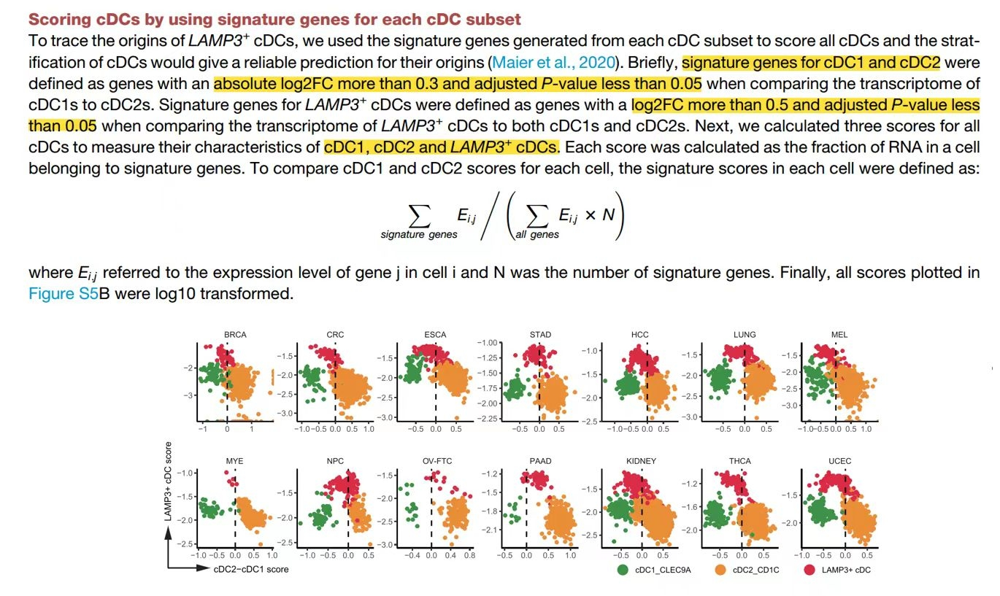

参考的 Fig. S5B 按**三个亚群签名评分**（cDC1、cDC2、LAMP3+ cDC）对传统树突状细胞分层：每个细胞获得每签名的评分、argmax 将其分配给一个亚型——因此评分与簇身份不一致的细胞会作为重分类可见 \[\1\]。签名评分在页内重实现（对每签名的基因做逐细胞 z 标度均值）、评分散点与分配柱状图用 ggplot2 渲染：

## Example

{fig-alt="签名评分的细胞分层 DEMO" fig-align="center" width="60%"}

## Setup

-   系统要求：跨平台（Linux/MacOS/Windows）

-   编程语言：R

-   依赖包：`ggplot2`; `patchwork`

```{r packages setup, message=FALSE, warning=FALSE, output=FALSE}
suppressPackageStartupMessages({
  library(ggplot2); library(patchwork)
})
```

```{r}
sessioninfo::session_info("attached")
```

## 数据准备

来自三个簇（cDC1、cDC2、LAMP3+）的 900 个树突状细胞 × 60 个基因；每簇有一个 12-15 基因的签名。少数细胞被植入为**错标**（携带其他亚型的签名）——基于评分的分层应揭示这一群体：

```{r load data}
suppressPackageStartupMessages({library(ggplot2); library(patchwork)})
set.seed(51314)
n <- 900
subset <- rep(c("cDC1", "cDC2", "LAMP3+"), each = 300)
genes <- sprintf("G%02d", 1:60)
sig <- list(cDC1 = genes[1:14], cDC2 = genes[15:29], `LAMP3+` = genes[30:44])

expr <- matrix(rnorm(length(genes) * n, 5, 1), length(genes), n,
               dimnames = list(genes, sprintf("C%03d", 1:n)))
for (s in names(sig)) {
  idx <- subset == s
  expr[sig[[s]], idx] <- expr[sig[[s]], idx] + 2.0
}
## 8% mislabeled cells: give them a foreign signature instead
mis <- sample(n, round(0.08 * n))
for (j in mis) {
  other <- setdiff(names(sig), subset[j])[1]
  expr[sig[[other]], j] <- expr[sig[[other]], j] + 2.4
}

## per-cell signature score = mean z-score over the signature's genes
zexpr <- t(scale(t(expr)))
score <- sapply(sig, function(g) colMeans(zexpr[g, , drop = FALSE]))
assign <- colnames(score)[apply(score, 1, which.max)]
df <- data.frame(cell = colnames(expr), cluster = subset,
                 score, assigned = factor(assign, levels = names(sig)),
                 check.names = FALSE)
```

## Visualization

### 逐细胞评分散点与分配

参考的分层面板：每个细胞由其三个评分中的两个定位、按**基于评分的分配**着色——三个团块是亚型、偏离对角线的散点是错标的少数：

```{r}
#| label: fig-1.1SinglerScore
#| fig-cap: "900 个树突状细胞的签名评分分层：细胞按 cDC1 vs cDC2 签名评分定位、按 argmax 分配着色，三个亚型分离为三个区域、植入的错标细胞落入错误区域。"
#| out.width: "85%"
#| fig-width: 7.5
#| fig-height: 6

ggplot(df, aes(cDC1, cDC2, colour = assigned)) +
  geom_point(size = 0.9, alpha = 0.8) +
  scale_colour_manual(values = c(cDC1 = "#E41A1C", cDC2 = "#377EB8",
                                 `LAMP3+` = "#4DAF4A"), name = "assigned subset") +
  labs(x = "cDC1 signature score", y = "cDC2 signature score") +
  theme_bw(base_size = 11) +
  theme(panel.grid.minor = element_blank())
```

### 簇与评分分配的一致性

参考的隐含问题——评分能否复现聚类？——呈现为原簇 vs 评分分配的混淆矩阵，加逐簇评分 profile：

```{r}
#| label: fig-2.1SinglerScoreAgree
#| fig-cap: "原始簇与基于评分的分配的一致性：对角线主导、非对角线为植入的错标少数；右面板展示每簇的平均评分 profile，即分配的证据。"
#| out.width: "100%"
#| fig-width: 10
#| fig-height: 4.6

cm <- table(df$cluster, df$assigned)
op <- par(mfrow = c(1, 2), mar = c(4.4, 4.4, 3.2, 1))
image(1:3, 1:3, t(cm[3:1, ]), col = colorRampPalette(c("white", "#08519C"))(64),
      axes = FALSE, xlab = "score-assigned", ylab = "original cluster",
      main = sprintf("agreement (%d/%d)", sum(diag(cm)), sum(cm)))
axis(1, 1:3, levels(df$assigned)); axis(2, 1:3, rev(rownames(cm)))
for (i in 1:3) for (j in 1:3)
  text(j, 4 - i, cm[i, j], cex = 1.1,
       col = ifelse(cm[i, j] > 100, "white", "grey15"))
box()

sc_cols <- c("cDC1", "cDC2", "LAMP3+")
prof <- data.frame(cluster = levels(factor(df$cluster)), stringsAsFactors = FALSE)
for (sc in sc_cols) prof[[sc]] <- as.numeric(tapply(df[[sc]], df$cluster, mean))
m <- as.matrix(prof[, -1]); rownames(m) <- prof$cluster
image(1:3, 1:3, t(m[3:1, , drop = FALSE]),
      col = colorRampPalette(c("#2166AC", "white", "#B2182B"))(64),
      axes = FALSE, xlab = "signature", ylab = "cluster",
      main = "mean score profile")
axis(1, 1:3, colnames(m)); axis(2, 1:3, rev(rownames(m)))
for (i in 1:3) for (j in 1:3)
  text(j, 4 - i, sprintf("%.2f", m[i, j]), cex = 0.85,
       col = ifelse(abs(m[i, j]) > 0.9, "white", "grey15"))
box()
par(op)
```


## 应用场景

::: {{#fig-SinglerScoreApplications1}}
{fig-alt="签名评分的细胞分层" fig-align="center" width="60%"}

签名评分的细胞分层
:::

基于评分的分层适用于任何单细胞分型问题：cDC 亚群分配、耗竭 vs 效应 T 状态、或巨噬细胞 M1/M2 谱——凡簇身份需要正交的签名第二次意见处。

## 参考文献

\[1\] Xiaofan Lu, et al. FigureYa: A Standardized Visualization Framework for Enhancing Biomedical Data Interpretation and Research Efficiency. iMetaMed. 2025. doi:10.1002/imm3.70005
