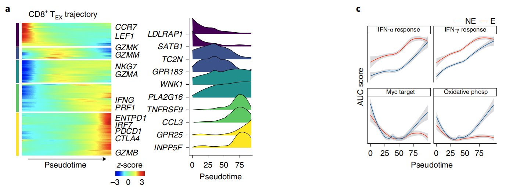

`slingshot` fits **smooth principal curves** through a single-cell embedding, anchored at a supplied cluster graph, to infer branching lineages; the reference then plots a marker gene's expression **along pseudotime per lineage** to show where a programme switches on \[1\]. `slingshot` is not in this repository's lockfile; the same output is produced in-page — a principal-curve is approximated by the cluster-centroid path plus a fine interpolation, pseudotime by arc length from the root, and per-lineage gene dynamics by a loess smoother:

## Example

{fig-alt="Slingshot Lineage Trajectory and Gene Dynamics DEMO" fig-align="center" width="75%"}

## Setup

-   System Requirements: Cross-platform (Linux/MacOS/Windows)

-   Programming language: R

-   Dependent packages: `ggplot2`; `patchwork`

```{r packages setup, message=FALSE, warning=FALSE, output=FALSE}
suppressPackageStartupMessages({
  library(ggplot2); library(patchwork)
})
```

```{r}
sessioninfo::session_info("attached")
```

## Data Preparation

A two-branch trajectory: a shared root population splits into an effector branch and a memory branch, 1600 cells over 8 clusters with a branching embedding. One marker gene (`GZMB`) rises on the effector branch only — the lineage-specific dynamics the reference's Fig. 3 shows for CD8 TEX vs CD4 TH1:

```{r load data}
suppressPackageStartupMessages({library(ggplot2); library(patchwork)})
set.seed(50306)
clusters <- c("Root", "Early", "Eff_1", "Eff_2", "Eff_3", "Mem_1", "Mem_2", "Mem_3")
per <- c(260, 220, 200, 180, 160, 200, 190, 190)
cl <- rep(clusters, per)
n <- length(cl)
## coordinates: root/early shared, then two diverging arms
xy <- data.frame(
  x = c(0, 0.35, 0.9, 1.5, 2.1, 0.85, 1.4, 1.95)[match(cl, clusters)],
  y = c(0.05, 0.12, 0.85, 1.55, 2.25, -0.7, -1.35, -2.0)[match(cl, clusters)])
set.seed(3)
xy$x <- xy$x + rnorm(n, 0, 0.12)
xy$y <- xy$y + rnorm(n, 0, 0.12)

## pseudotime = arc length along each branch from the root
root <- c(0, 0.05)
ptime <- sqrt((xy$x - root[1])^2 + (xy$y - root[2])^2)
branch <- ifelse(cl %in% c("Eff_1", "Eff_2", "Eff_3"), "Effector",
                 ifelse(cl %in% c("Mem_1", "Mem_2", "Mem_3"), "Memory", "Shared"))

## gene: silent on memory, rising on effector
expr <- 0.15 + 0.9 / (1 + exp(-(ptime - 1.3) * 3)) *
  ifelse(branch %in% c("Effector", "Shared"), 1, 0.08) + rnorm(n, 0, 0.08)
expr <- pmin(pmax(expr, 0), 1)

df <- data.frame(xy, cluster = factor(cl, levels = clusters),
                 pseudotime = ptime, branch = branch, gene = expr)
```

## Visualization

### 1. The Trajectory With Lineages

The reference's left panel: the embedding coloured by cluster, with the two principal-curve lineages drawn over it and the root marked — the structural skeleton that the gene panel is interpreted against:

```{r}
#| label: fig-1.1SlingshotTrajectory
#| fig-cap: "Slingshot-style lineage inference on a branching single-cell embedding: eight clusters (left to right of the root) with two principal-curve lineages, effector (upper) and memory (lower), drawn over the cells."
#| out.width: "100%"
#| fig-width: 10
#| fig-height: 4.6

cent <- aggregate(cbind(x, y) ~ cluster, data = df, FUN = mean)
eff_path <- cent[cent$cluster %in% c("Root", "Early", "Eff_1", "Eff_2", "Eff_3"), ]
mem_path <- cent[cent$cluster %in% c("Root", "Early", "Mem_1", "Mem_2", "Mem_3"), ]
## smooth the path by interpolation
smooth_path <- function(p) {
  tt <- seq_len(nrow(p))
  data.frame(x = spline(tt, p$x, n = 120)$y,
             y = spline(tt, p$y, n = 120)$y)
}
pe <- smooth_path(eff_path); pm <- smooth_path(mem_path)

p1 <- ggplot(df, aes(x, y, colour = cluster)) +
  geom_point(size = 0.55, alpha = 0.85) +
  geom_path(data = pe, aes(x, y), inherit.aes = FALSE,
            colour = "#B2182B", linewidth = 1.1) +
  geom_path(data = pm, aes(x, y), inherit.aes = FALSE,
            colour = "#2166AC", linewidth = 1.1) +
  annotate("point", x = 0, y = 0.05, size = 3, colour = "black") +
  annotate("text", x = 0.06, y = -0.18, label = "root", size = 3) +
  labs(title = "lineages", x = "UMAP1", y = "UMAP2") +
  theme_bw(base_size = 10.5) + theme(panel.grid = element_blank(),
                                     legend.position = "right",
                                     legend.key.size = unit(0.3, "cm"),
                                     legend.text = element_text(size = 6))
p1
```

### 2. Gene Dynamics Along Each Lineage

The reference's gene panel: the marker's expression against pseudotime, one curve per lineage — the effector arm rises, the memory arm stays flat, which is the biological readout of the branching:

```{r}
#| label: fig-2.1SlingshotGene
#| fig-cap: "Marker gene dynamics along pseudotime by lineage: the effector lineage rises steeply past the branch point while the memory lineage stays low — the lineage-specific programme the trajectory was built to reveal."
#| out.width: "60%"
#| fig-width: 6.2
#| fig-height: 5

p2 <- ggplot(df, aes(pseudotime, gene, colour = branch)) +
  geom_point(size = 0.5, alpha = 0.35) +
  geom_smooth(method = "loess", span = 0.7, se = TRUE, linewidth = 1) +
  scale_colour_manual(values = c(Effector = "#B2182B", Memory = "#2166AC",
                                 Shared = "grey55"), name = "lineage") +
  labs(x = "pseudotime (arc length)", y = "marker expression") +
  theme_bw(base_size = 11) +
  theme(panel.grid.minor = element_blank())

p1 + p2 + plot_layout(widths = c(1.5, 1))
```

::: callout-tip
**Practice tips**

-   Supply the cluster label vector as the slingshot **start** (`colData` clusters), then let it fit the curves: the lineage structure should come from the curve, not from hand-drawn paths between centroids.
-   Root the trajectory explicitly — the root choice flips pseudotime direction and rescales every downstream gene curve.
-   Plot the gene by lineage with a loess smoother per lineage; a single pooled smoother averages two opposite dynamics into a flat line.
-   Compare the same gene across lineages rather than across genes inside one lineage; the branching claim is about differential dynamics.
-   Pseudotime is a distance along a fitted curve, not time — report the branch point's position so readers can align the panels to a biological event.
:::

## Application

::: {#fig-SlingshotApplications1}
{fig-alt="Slingshot Lineage Trajectory and Gene Dynamics" fig-align="center" width="70%"}

Slingshot lineage trajectory and gene dynamics
:::

Lineage inference + per-lineage gene dynamics applies to any differentiation study: CD8 exhaustion vs memory branches, myeloid maturation, or organoid differentiation — wherever a marker's timing differs between lineages.

## Reference

\[1\] Xiaofan Lu, et al. FigureYa: A Standardized Visualization Framework for Enhancing Biomedical Data Interpretation and Research Efficiency. iMetaMed. 2025. doi:10.1002/imm3.70005
