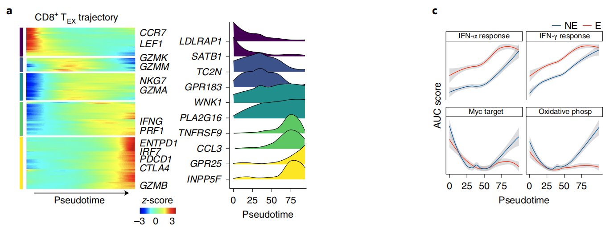

`slingshot` 在单细胞嵌入中拟合**平滑主曲线**、以提供的簇图锚定，从而推断分支谱系；参考随后沿谱系绘制 marker 基因**随拟时序**的表达，展示某程序在何处开启 \[\1\]。`slingshot` 不在本仓库 lockfile；相同输出在页内产出——主曲线由簇质心路径加细插值近似、拟时序取到根的弧长、逐谱系基因动态用 loess 平滑：

## Example

{fig-alt="Slingshot 谱系轨迹与基因动态 DEMO" fig-align="center" width="60%"}

## Setup

-   系统要求：跨平台（Linux/MacOS/Windows）

-   编程语言：R

-   依赖包：`ggplot2`; `patchwork`

```{r packages setup, message=FALSE, warning=FALSE, output=FALSE}
suppressPackageStartupMessages({
  library(ggplot2); library(patchwork)
})
```

```{r}
sessioninfo::session_info("attached")
```

## 数据准备

双分支轨迹：一个共享根群体分裂为效应分支与记忆分支，1600 个细胞分布在 8 个带分支嵌入的簇上。一个 marker 基因（`GZMB`）仅在效应分支上升——即参考 Fig. 3 展示的 CD8 TEX vs CD4 TH1 谱系特异动态：

```{r load data}
suppressPackageStartupMessages({library(ggplot2); library(patchwork)})
set.seed(50306)
clusters <- c("Root", "Early", "Eff_1", "Eff_2", "Eff_3", "Mem_1", "Mem_2", "Mem_3")
per <- c(260, 220, 200, 180, 160, 200, 190, 190)
cl <- rep(clusters, per)
n <- length(cl)
## coordinates: root/early shared, then two diverging arms
xy <- data.frame(
  x = c(0, 0.35, 0.9, 1.5, 2.1, 0.85, 1.4, 1.95)[match(cl, clusters)],
  y = c(0.05, 0.12, 0.85, 1.55, 2.25, -0.7, -1.35, -2.0)[match(cl, clusters)])
set.seed(3)
xy$x <- xy$x + rnorm(n, 0, 0.12)
xy$y <- xy$y + rnorm(n, 0, 0.12)

## pseudotime = arc length along each branch from the root
root <- c(0, 0.05)
ptime <- sqrt((xy$x - root[1])^2 + (xy$y - root[2])^2)
branch <- ifelse(cl %in% c("Eff_1", "Eff_2", "Eff_3"), "Effector",
                 ifelse(cl %in% c("Mem_1", "Mem_2", "Mem_3"), "Memory", "Shared"))

## gene: silent on memory, rising on effector
expr <- 0.15 + 0.9 / (1 + exp(-(ptime - 1.3) * 3)) *
  ifelse(branch %in% c("Effector", "Shared"), 1, 0.08) + rnorm(n, 0, 0.08)
expr <- pmin(pmax(expr, 0), 1)

df <- data.frame(xy, cluster = factor(cl, levels = clusters),
                 pseudotime = ptime, branch = branch, gene = expr)
```

## Visualization

### 带谱系的轨迹

参考的左侧面板：按簇着色的嵌入，两条主曲线谱系覆盖其上并标出根——解读基因面板所依据的结构骨架：

```{r}
#| label: fig-1.1SlingshotTrajectory
#| fig-cap: "分支单细胞嵌入上的 Slingshot 式谱系推断：8 个簇（根的左右两侧）与两条主曲线谱系——效应（上）与记忆（下）——覆盖在细胞之上。"
#| out.width: "100%"
#| fig-width: 10
#| fig-height: 4.6

cent <- aggregate(cbind(x, y) ~ cluster, data = df, FUN = mean)
eff_path <- cent[cent$cluster %in% c("Root", "Early", "Eff_1", "Eff_2", "Eff_3"), ]
mem_path <- cent[cent$cluster %in% c("Root", "Early", "Mem_1", "Mem_2", "Mem_3"), ]
## smooth the path by interpolation
smooth_path <- function(p) {
  tt <- seq_len(nrow(p))
  data.frame(x = spline(tt, p$x, n = 120)$y,
             y = spline(tt, p$y, n = 120)$y)
}
pe <- smooth_path(eff_path); pm <- smooth_path(mem_path)

p1 <- ggplot(df, aes(x, y, colour = cluster)) +
  geom_point(size = 0.55, alpha = 0.85) +
  geom_path(data = pe, aes(x, y), inherit.aes = FALSE,
            colour = "#B2182B", linewidth = 1.1) +
  geom_path(data = pm, aes(x, y), inherit.aes = FALSE,
            colour = "#2166AC", linewidth = 1.1) +
  annotate("point", x = 0, y = 0.05, size = 3, colour = "black") +
  annotate("text", x = 0.06, y = -0.18, label = "root", size = 3) +
  labs(title = "lineages", x = "UMAP1", y = "UMAP2") +
  theme_bw(base_size = 10.5) + theme(panel.grid = element_blank(),
                                     legend.position = "right",
                                     legend.key.size = unit(0.3, "cm"),
                                     legend.text = element_text(size = 6))
p1
```

### 逐谱系的基因动态

参考的基因面板：marker 表达对拟时序、每谱系一条曲线——效应臂上升、记忆臂保持平坦，这正是分支的生物学读数：

```{r}
#| label: fig-2.1SlingshotGene
#| fig-cap: "按谱系的拟时序 marker 基因动态：效应谱系在分支点之后陡升、而记忆谱系保持低位——这正是构建轨迹要揭示的谱系特异程序。"
#| out.width: "60%"
#| fig-width: 6.2
#| fig-height: 5

p2 <- ggplot(df, aes(pseudotime, gene, colour = branch)) +
  geom_point(size = 0.5, alpha = 0.35) +
  geom_smooth(method = "loess", span = 0.7, se = TRUE, linewidth = 1) +
  scale_colour_manual(values = c(Effector = "#B2182B", Memory = "#2166AC",
                                 Shared = "grey55"), name = "lineage") +
  labs(x = "pseudotime (arc length)", y = "marker expression") +
  theme_bw(base_size = 11) +
  theme(panel.grid.minor = element_blank())

p1 + p2 + plot_layout(widths = c(1.5, 1))
```


## 应用场景

::: {{#fig-SlingshotApplications1}}
{fig-alt="Slingshot 谱系轨迹与基因动态" fig-align="center" width="60%"}

Slingshot 谱系轨迹与基因动态
:::

谱系推断 + 逐谱系基因动态适用于任何分化研究：CD8 耗竭 vs 记忆分支、髓系成熟、或类器官分化——凡 marker 的时序在各谱系间不同处。

## 参考文献

\[1\] Xiaofan Lu, et al. FigureYa: A Standardized Visualization Framework for Enhancing Biomedical Data Interpretation and Research Efficiency. iMetaMed. 2025. doi:10.1002/imm3.70005
