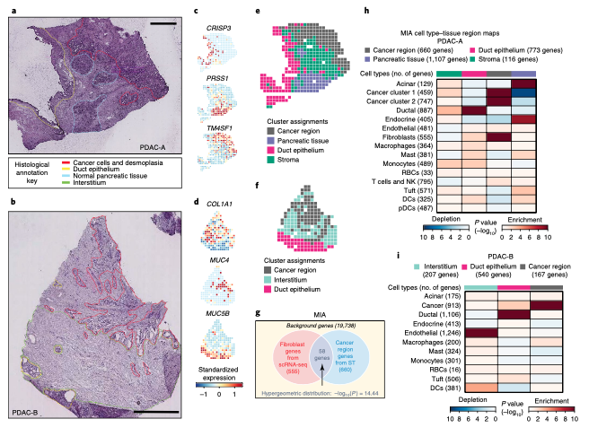

MIA (multimodal intersection analysis) localizes single-cell types into spatial-transcriptome regions: take the marker genes of each scRNA-seq cell type and of each ST histological region, and test their overlap with a **hypergeometric tail** — significant excess = enrichment (red, the cell type lives there), significant deficit = depletion (blue) \[1\]. The reference runs the pipeline in Seurat on the PDAC-A/B data; Seurat is not in this repository's lockfile, so the marker-gene sets for 10 cell types × 4 ST regions are simulated from a shared background with planted co-localization, and the MIA statistic — implemented **correctly** here (the reference's snippet intersects two scalars, always yielding length 1) — is rendered as the reference's red/blue heatmap with region counts:

## Example

{fig-alt="MIA Spatial Enrichment Map DEMO" fig-align="center" width="75%"}

## Setup

-   System Requirements: Cross-platform (Linux/MacOS/Windows)

-   Programming language: R

-   Dependent packages: `ComplexHeatmap`; `circlize`; `grid`

```{r packages setup, message=FALSE, warning=FALSE, output=FALSE}
suppressPackageStartupMessages({
  library(ComplexHeatmap); library(circlize)
})
```

```{r}
sessioninfo::session_info("attached")
```

## Data Preparation

A 19738-gene background (the reference's number). Ten cell types get marker sets (100-900 genes each) with planted spatial preferences — cancer clones into the tumour region, fibroblasts into stroma, acinar cells into normal pancreas — and four ST regions get their own marker sets drawn to overlap the matching cell-type sets substantially and the others barely. Both directions of the cross-tab are therefore decodable:

```{r load data}
suppressPackageStartupMessages({library(ComplexHeatmap); library(circlize)})
set.seed(40239)
bg <- 19738
universe <- sprintf("GENE%05d", 1:bg)
sc_types <- c("Acinar cells", "Ductal cells", "Cancer clone A", "Cancer clone B",
              "Fibroblasts", "Macrophages", "T cells & NK", "mDCs", "Mast cells",
              "Endothelial cells")
st_regions <- c("Cancer region", "Stromal region", "Normal acinar", "Ductal region")
## which ST region each cell type prefers (the biology being recovered)
pref <- c(Acinar = "Normal acinar", Ductal = "Ductal region",
          `Cancer A` = "Cancer region", `Cancer B` = "Cancer region",
          Fibroblast = "Stromal region", Macrophage = "Stromal region",
          `T&NK` = "Cancer region", mDCs = "Stromal region",
          Mast = "Stromal region", Endothelial = "Cancer region")
pref_map <- c("Acinar cells" = "Normal acinar", "Ductal cells" = "Ductal region",
              "Cancer clone A" = "Cancer region", "Cancer clone B" = "Cancer region",
              "Fibroblasts" = "Stromal region", "Macrophages" = "Stromal region",
              "T cells & NK" = "Cancer region", "mDCs" = "Stromal region",
              "Mast cells" = "Stromal region", "Endothelial cells" = "Cancer region")
sc_markers <- lapply(sc_types, function(ct) {
  n <- sample(150:800, 1)
  base <- sample(universe, n)
  ## overlap with the preferred region's markers is planted below
  list(genes = base, pref = pref_map[[ct]])
})
names(sc_markers) <- sc_types
st_markers <- lapply(st_regions, function(rg) {
  own <- sample(universe, sample(400:900, 1))
  ## pull 35-45% of each preferring cell type's markers into this region
  contrib <- lapply(sc_markers[unlist(pref_map) == rg], function(cm)
    sample(cm$genes, round(length(cm$genes) * runif(1, 0.35, 0.45))))
  unique(c(own, unlist(contrib)))
})
names(st_markers) <- st_regions
```

## Visualization

### 1. The MIA Statistic, Computed Correctly

For each cell type × region pair: overlap `k = length(intersect(sc_genes, st_genes))`, and the enrichment tail `p = phyper(k - 1, st_size, bg - st_size, sc_size, lower.tail = FALSE)` — the probability of seeing ≥ k shared genes under random marker draws. `-log10(p)` is signed by the direction (overlap above vs below expectation) to get the red/blue encoding. The reference's snippet computes `length(intersect(gene_l, gene_st_l))` on two **scalars** (always 1) — the single most important thing to fix when porting:

```{r}
#| label: fig-1.1MiaMap
#| fig-cap: "MIA map: -log10 hypergeometric p for every cell type (rows, with marker-set sizes) x ST region (columns, with sizes); red = enriched overlap, blue = depleted. Each cell type lights up in its preferred region, with fibroblasts/macrophages into stroma and both cancer clones into the cancer region."
#| out.width: "90%"
#| fig-width: 8.5
#| fig-height: 6

mia <- function(sc_genes, st_genes, background) {
  k <- length(intersect(sc_genes, st_genes))
  n_st <- length(st_genes); n_sc <- length(sc_genes)
  p_over <- phyper(k - 1, n_st, background - n_st, n_sc, lower.tail = FALSE)
  p_under <- phyper(k, n_st, background - n_st, n_sc, lower.tail = TRUE)
  expected <- n_st * n_sc / background
  if (k >= expected) -log10(p_over) else -log10(p_under) * -1
}
mat <- matrix(NA, length(sc_types), length(st_regions),
              dimnames = list(
                sprintf("%s (%d)", sc_types, sapply(sc_markers, function(x) length(x$genes))),
                sprintf("%s (%d)", st_regions, sapply(st_markers, length))))
for (i in seq_along(sc_types)) {
  for (j in seq_along(st_regions)) {
    mat[i, j] <- mia(sc_markers[[i]]$genes, st_markers[[j]], bg)
  }
}
cap <- 25
mat_cap <- pmax(pmin(mat, cap), -cap)
col_fun <- colorRamp2(c(-cap, 0, cap), c("#1B4584", "white", "#660621"))
col_annot <- columnAnnotation(
  Region = st_regions,
  col = list(Region = c("Cancer region" = "#E42A88", "Stromal region" = "#666666",
                        "Normal acinar" = "#189D77", "Ductal region" = "#766FB1")),
  show_legend = FALSE)
Heatmap(mat_cap, name = "-log10(p)",
        col = col_fun,
        top_annotation = col_annot,
        cluster_rows = FALSE, cluster_columns = FALSE,
        rect_gp = grid::gpar(col = "black", lwd = 1),
        row_names_side = "left",
        column_names_gp = grid::gpar(fontsize = 9),
        row_names_gp = grid::gpar(fontsize = 8.5),
        heatmap_legend_param = list(title = "MIA\nscore"))
```

### 2. Raw Overlap Counts as the Column Bar

The reference also prints the marker-set sizes next to the map so a reader can sanity-check the statistics; here the overlap counts themselves are shown as an annotation row — pairs with large overlap but small sets are the interesting edges:

```{r}
#| label: fig-2.1MiaOverlaps
#| fig-cap: "Raw overlap counts between cell-type and region marker sets (annotated on the same layout): the planted biology shows as large overlaps on the diagonal, while statistics in the MIA map weight these by set sizes."
#| out.width: "90%"
#| fig-width: 8.5
#| fig-height: 6

ov <- matrix(NA, length(sc_types), length(st_regions),
             dimnames = dimnames(mat))
for (i in seq_along(sc_types)) {
  for (j in seq_along(st_regions)) {
    ov[i, j] <- length(intersect(sc_markers[[i]]$genes, st_markers[[j]]))
  }
}
ov_cap <- pmin(ov, 250)
Heatmap(ov_cap, name = "overlap\ngenes",
        col = colorRamp2(c(0, 125, 250), c("white", "#fee0d2", "#67000d")),
        top_annotation = col_annot,
        cluster_rows = FALSE, cluster_columns = FALSE,
        rect_gp = grid::gpar(col = "black", lwd = 1),
        row_names_side = "left",
        column_names_gp = grid::gpar(fontsize = 9),
        row_names_gp = grid::gpar(fontsize = 8.5),
        layer_fun = function(j, i, x, y, w, h, fill) {
          v <- ov[cbind(as.numeric(i), as.numeric(j))]
          gp <- grid::gpar(fontsize = 7,
                           col = ifelse(v > 180, "white", "black"))
          grid::grid.text(v, x, y, gp = gp)
        })
```

::: callout-tip
**Practice tips**

-   Compute the overlap on the **gene sets**, never on their lengths: `length(intersect(a, b))`, with `a` and `b` character vectors. Intersecting `length(a)` with `length(b)` is always 1 — the reference's own snippet contains this bug, so port the logic, not the code.
-   Use the hypergeometric **upper tail** (`phyper(k - 1, ..., lower.tail = FALSE)`) for enrichment and mirror it with the lower tail for depletion; sign the score by comparing `k` to its expectation `n_st * n_sc / background`.
-   Cap `-log10(p)` symmetrically (± 25 here): one astronomically depleted pair compresses every enriched tile into the white band.
-   Show the set sizes next to the labels (the "(n=...)" convention): a red tile from a 40-gene set is weaker evidence than one from 900.
-   The background size (19738 genes in the reference) must be the universe both marker sets were *selected from* — an inflated background deflates every p-value.
:::

## Application

::: {#fig-SpatialPlotApplications1}
{fig-alt="MIA Spatial Enrichment Map" fig-align="center" width="75%"}

MIA spatial enrichment map
:::

The hypergeometric overlap map applies anywhere two classification systems share a gene universe: single-cell types vs bulk deconvolution clusters, proteomics compartments vs transcriptomics modules, or eQTL tissue enrichment vs GWAS loci — MIA is just Fisher's exact test wearing spatial clothes.

## Reference

\[1\] Xiaofan Lu, et al. FigureYa: A Standardized Visualization Framework for Enhancing Biomedical Data Interpretation and Research Efficiency. iMetaMed. 2025. doi:10.1002/imm3.70005
