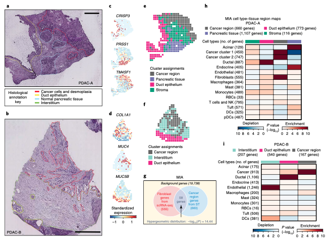

MIA（multimodal intersection analysis）把单细胞类型定位到空转区域：取每个 scRNA-seq 细胞类型与每个 ST 组织学区域的 marker 基因、用**超几何尾**检验其交集——显著超出 = 富集（红，该细胞类型在此）、显著不足 = 缺失（蓝）\[1\]。参考管线在 Seurat 上跑 PDAC-A/B 数据；Seurat 不在本仓库 lockfile 中，故从共享背景模拟 10 细胞类型 × 4 ST 区域的 marker 集合（植入共定位），MIA 统计量在此**正确实现**（参考代码片段对两个标量取交集、恒为长度 1），并按参考的 红蓝热图 + 区域计数 渲染：

## Example

{fig-alt="MIA 空间富集图 DEMO" fig-align="center" width="60%"}

## Setup

-   系统要求：跨平台（Linux/MacOS/Windows）

-   编程语言：R

-   依赖包：`ComplexHeatmap`; `circlize`; `grid`

```{r packages setup, message=FALSE, warning=FALSE, output=FALSE}
suppressPackageStartupMessages({
  library(ComplexHeatmap); library(circlize)
})
```

```{r}
sessioninfo::session_info("attached")
```

## 数据准备

19738 基因背景（参考的数字）。十个细胞类型各取 marker 集（100-900 基因）并植入空间偏好——cancer clone 进入肿瘤区、成纤维细胞进入基质、腺泡细胞进入正常胰腺——四个 ST 区域的 marker 集与匹配细胞类型大量重叠、与其他 barely。交叉表的两个方向因此都可解读：

```{r load data}
suppressPackageStartupMessages({library(ComplexHeatmap); library(circlize)})
set.seed(40239)
bg <- 19738
universe <- sprintf("GENE%05d", 1:bg)
sc_types <- c("Acinar cells", "Ductal cells", "Cancer clone A", "Cancer clone B",
              "Fibroblasts", "Macrophages", "T cells & NK", "mDCs", "Mast cells",
              "Endothelial cells")
st_regions <- c("Cancer region", "Stromal region", "Normal acinar", "Ductal region")
## which ST region each cell type prefers (the biology being recovered)
pref <- c(Acinar = "Normal acinar", Ductal = "Ductal region",
          `Cancer A` = "Cancer region", `Cancer B` = "Cancer region",
          Fibroblast = "Stromal region", Macrophage = "Stromal region",
          `T&NK` = "Cancer region", mDCs = "Stromal region",
          Mast = "Stromal region", Endothelial = "Cancer region")
pref_map <- c("Acinar cells" = "Normal acinar", "Ductal cells" = "Ductal region",
              "Cancer clone A" = "Cancer region", "Cancer clone B" = "Cancer region",
              "Fibroblasts" = "Stromal region", "Macrophages" = "Stromal region",
              "T cells & NK" = "Cancer region", "mDCs" = "Stromal region",
              "Mast cells" = "Stromal region", "Endothelial cells" = "Cancer region")
sc_markers <- lapply(sc_types, function(ct) {
  n <- sample(150:800, 1)
  base <- sample(universe, n)
  ## overlap with the preferred region's markers is planted below
  list(genes = base, pref = pref_map[[ct]])
})
names(sc_markers) <- sc_types
st_markers <- lapply(st_regions, function(rg) {
  own <- sample(universe, sample(400:900, 1))
  ## pull 35-45% of each preferring cell type's markers into this region
  contrib <- lapply(sc_markers[unlist(pref_map) == rg], function(cm)
    sample(cm$genes, round(length(cm$genes) * runif(1, 0.35, 0.45))))
  unique(c(own, unlist(contrib)))
})
names(st_markers) <- st_regions
```

## Visualization

### MIA 统计量（正确计算）

每个细胞类型 × 区域对：交集 `k = length(intersect(sc_genes, st_genes))`、富集尾 `p = phyper(k - 1, st_size, bg - st_size, sc_size, lower.tail = FALSE)`——随机抽取下看到 ≥ k 个共享基因的概率。`-log10(p)` 按方向（交集高于/低于期望）定符号，得到红蓝编码。参考片段对两个**标量**算 `length(intersect(gene_l, gene_st_l))`（恒为 1）——移植时最需要修的一处：

```{r}
#| label: fig-1.1MiaMap
#| fig-cap: "MIA 图：每个细胞类型（行，带 marker 集大小）× ST 区域（列，带大小）的 -log10 超几何 p；红 = 富集、蓝 = 缺失。每个细胞类型在其偏好区域点亮，成纤维/巨噬进入基质、两个 cancer clone 进入肿瘤区。"
#| out.width: "90%"
#| fig-width: 8.5
#| fig-height: 6

mia <- function(sc_genes, st_genes, background) {
  k <- length(intersect(sc_genes, st_genes))
  n_st <- length(st_genes); n_sc <- length(sc_genes)
  p_over <- phyper(k - 1, n_st, background - n_st, n_sc, lower.tail = FALSE)
  p_under <- phyper(k, n_st, background - n_st, n_sc, lower.tail = TRUE)
  expected <- n_st * n_sc / background
  if (k >= expected) -log10(p_over) else -log10(p_under) * -1
}
mat <- matrix(NA, length(sc_types), length(st_regions),
              dimnames = list(
                sprintf("%s (%d)", sc_types, sapply(sc_markers, function(x) length(x$genes))),
                sprintf("%s (%d)", st_regions, sapply(st_markers, length))))
for (i in seq_along(sc_types)) {
  for (j in seq_along(st_regions)) {
    mat[i, j] <- mia(sc_markers[[i]]$genes, st_markers[[j]], bg)
  }
}
cap <- 25
mat_cap <- pmax(pmin(mat, cap), -cap)
col_fun <- colorRamp2(c(-cap, 0, cap), c("#1B4584", "white", "#660621"))
col_annot <- columnAnnotation(
  Region = st_regions,
  col = list(Region = c("Cancer region" = "#E42A88", "Stromal region" = "#666666",
                        "Normal acinar" = "#189D77", "Ductal region" = "#766FB1")),
  show_legend = FALSE)
Heatmap(mat_cap, name = "-log10(p)",
        col = col_fun,
        top_annotation = col_annot,
        cluster_rows = FALSE, cluster_columns = FALSE,
        rect_gp = grid::gpar(col = "black", lwd = 1),
        row_names_side = "left",
        column_names_gp = grid::gpar(fontsize = 9),
        row_names_gp = grid::gpar(fontsize = 8.5),
        heatmap_legend_param = list(title = "MIA\nscore"))
```

### 原始交集计数作为对照图

参考同时在图旁印出 marker 集大小供读者核对统计；此处把交集计数本身作为同版式注释行——大交集但小集合的对是值得注意的边缘：

```{r}
#| label: fig-2.1MiaOverlaps
#| fig-cap: "细胞类型与区域 marker 集的原始交集计数（同版式注释）：植入的生物学表现为对角线上的大交集，而 MIA 图中的统计量按集合大小加权。"
#| out.width: "90%"
#| fig-width: 8.5
#| fig-height: 6

ov <- matrix(NA, length(sc_types), length(st_regions),
             dimnames = dimnames(mat))
for (i in seq_along(sc_types)) {
  for (j in seq_along(st_regions)) {
    ov[i, j] <- length(intersect(sc_markers[[i]]$genes, st_markers[[j]]))
  }
}
ov_cap <- pmin(ov, 250)
Heatmap(ov_cap, name = "overlap\ngenes",
        col = colorRamp2(c(0, 125, 250), c("white", "#fee0d2", "#67000d")),
        top_annotation = col_annot,
        cluster_rows = FALSE, cluster_columns = FALSE,
        rect_gp = grid::gpar(col = "black", lwd = 1),
        row_names_side = "left",
        column_names_gp = grid::gpar(fontsize = 9),
        row_names_gp = grid::gpar(fontsize = 8.5),
        layer_fun = function(j, i, x, y, w, h, fill) {
          v <- ov[cbind(as.numeric(i), as.numeric(j))]
          gp <- grid::gpar(fontsize = 7,
                           col = ifelse(v > 180, "white", "black"))
          grid::grid.text(v, x, y, gp = gp)
        })
```


## 应用场景

::: {{#fig-SpatialPlotApplications1}}
{fig-alt="MIA 空间富集图" fig-align="center" width="60%"}

MIA 空间富集图
:::

超几何交集图适用于任何共享基因宇宙的两套分类：单细胞类型 vs bulk 去卷积簇、蛋白组区室 vs 转录组模块、或 eQTL 组织富集 vs GWAS 位点——MIA 只是穿了空间外衣的 Fisher 精确检验。

## 参考文献

\[1\] Xiaofan Lu, et al. FigureYa: A Standardized Visualization Framework for Enhancing Biomedical Data Interpretation and Research Efficiency. iMetaMed. 2025. doi:10.1002/imm3.70005
