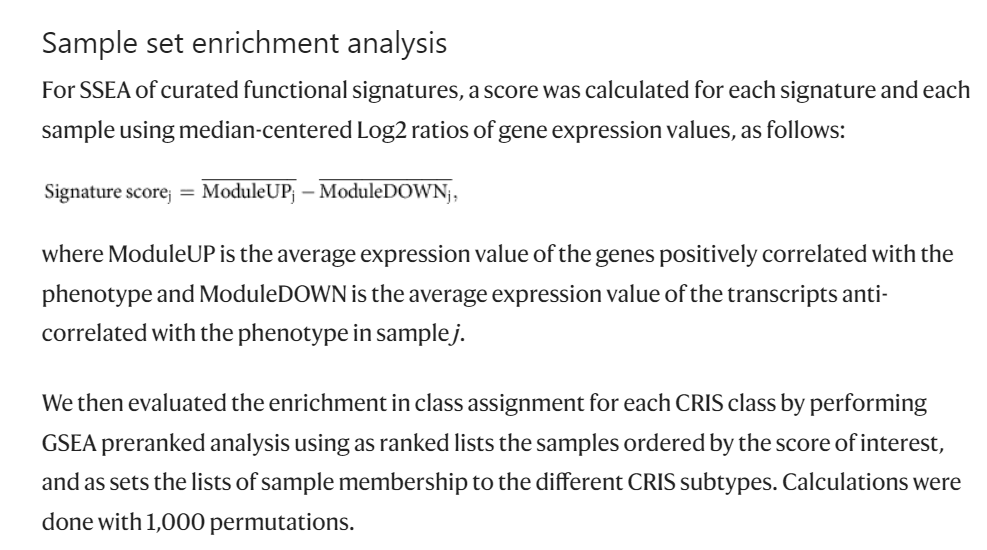

**Subtype Set Enrichment Analysis (SSEA)** extends GSVA to the subtype level: for each pathway and each molecular subtype, the pathway's gene set is scored against the subtype's mean expression profile, yielding a subtype-specific enrichment score per pathway — visualised as a radar chart where each spoke is a pathway and each polygon is a subtype \[1\]. GSVA is in the lockfile; the per-subtype enrichment scores are computed from the GSVA output, and the radar chart is re-implemented in-page with ggplot2 `coord_polar` (the reference's `fmsb` radar is a dependency-free equivalent):

## Example

{fig-alt="Subtype Set Enrichment Analysis Radar DEMO" fig-align="center" width="70%"}

## Setup

-   System Requirements: Cross-platform (Linux/MacOS/Windows)

-   Programming language: R

-   Dependent packages: `GSVA`; `ggplot2`

```{r packages setup, message=FALSE, warning=FALSE, output=FALSE}
suppressPackageStartupMessages({
  library(GSVA); library(ggplot2)
})
```

```{r}
sessioninfo::session_info("attached")
```

## Data Preparation

200 samples across 3 molecular subtypes (S1/S2/S3) × 8 KEGG-style pathways with a planted per-subtype pathway signature: S1 is glycolysis-high and OXPHOS-low, S2 is OXPHOS-high and fatty-acid-high, S3 is glutamine-metabolism- and TCA-cycle-high. GSVA scores are computed per sample, then aggregated to per-subtype means:

```{r load data}
suppressPackageStartupMessages({library(GSVA); library(ggplot2)})
set.seed(52322)
n <- 200; n_gene <- 400
sub_assign <- rep(c("S1", "S2", "S3"), c(70, 65, 65))
genes <- sprintf("G%03d", 1:n_gene)
expr <- matrix(rnorm(n_gene * n, 6, 1), n_gene, n,
               dimnames = list(genes, sprintf("S%03d", seq_len(n))))

pathways <- list(
  Glycolysis = sprintf("G%03d", 1:40),
  OXPHOS = sprintf("G%03d", 41:80),
  `Fatty acid oxidation` = sprintf("G%03d", 81:120),
  `Glutamine metabolism` = sprintf("G%03d", 121:160),
  `Pentose phosphate` = sprintf("G%03d", 161:200),
  `TCA cycle` = sprintf("G%03d", 201:240),
  `Serine synthesis` = sprintf("G%03d", 241:280),
  `Nucleotide synthesis` = sprintf("G%03d", 281:320)
)
## planted pathway activity per subtype
boost <- list(
  S1 = c(Glycolysis = 1.5, `Pentose phosphate` = 0.6),
  S2 = c(OXPHOS = 1.3, `Fatty acid oxidation` = 1.1),
  S3 = c(`Glutamine metabolism` = 0.8, `TCA cycle` = 0.7)
)
for (st in names(boost)) {
  idx <- sub_assign == st
  for (pw in names(boost[[st]])) {
    expr[pathways[[pw]], idx] <- expr[pathways[[pw]], idx] + boost[[st]][pw]
  }
}
```

## Visualization

### 1. SSEA Radar Chart

The reference's radar: pathways as spokes, subtypes as coloured polygons, scores scaled with a single global min–max so spoke length reflects absolute score magnitude (a per-pathway rescale would inflate near-zero pathways to the rim):

```{r}
#| label: fig-1.1SseaRadar
#| fig-cap: "SSEA radar chart: 8 metabolic pathways as spokes, three molecular subtypes as coloured polygons, scores globally scaled to [0, 1]; S1 peaks on Glycolysis (second: Pentose phosphate), S2 on OXPHOS and Fatty-acid oxidation, S3 on Glutamine metabolism and TCA cycle."
#| out.width: "70%"
#| fig-width: 8
#| fig-height: 6

gsva_out <- as.matrix(gsva(gsvaParam(expr, pathways)))

## per-subtype mean enrichment score (rows of gsva_out are gene sets,
## columns are samples -> rowMeans averages each pathway over the
## subtype's samples), scaled with one global min–max to [0, 1]
sse <- t(sapply(unique(sub_assign), function(st)
  rowMeans(gsva_out[, sub_assign == st, drop = FALSE])))
sse_norm <- t((sse - min(sse)) / (max(sse) - min(sse) + 1e-8))

sse_df <- as.data.frame(sse_norm)
sse_df$pathway <- rownames(sse_norm)
sse_long <- reshape(sse_df, direction = "long",
                    varying = colnames(sse_df)[1:3],
                    times = colnames(sse_df)[1:3],
                    v.names = "score", idvar = "pathway",
                    timevar = "subtype")
sse_long$pathway <- factor(sse_long$pathway, levels = rownames(sse_norm))

ggplot(sse_long, aes(pathway, score, colour = subtype, group = subtype)) +
  geom_polygon(aes(fill = subtype), alpha = 0.12, linewidth = 0) +
  geom_line(linewidth = 0.9) +
  geom_point(size = 2.2) +
  coord_polar(start = 0) +
  scale_colour_manual(values = c(S1 = "#E41A1C", S2 = "#377EB8", S3 = "#4DAF4A"),
                      name = "Subtype") +
  scale_fill_manual(values = c(S1 = "#E41A1C", S2 = "#377EB8", S3 = "#4DAF4A"),
                    guide = "none") +
  labs(x = NULL, y = NULL) +
  theme_minimal(base_size = 11) +
  theme(axis.text.y = element_text(size = 8.5),
        panel.grid.minor = element_blank(),
        axis.text.x = element_text(size = 9))
```

### 2. Heatmap Companion: Raw SSE Scores

The radar chart is intuitive but hard to read precisely; the companion heatmap shows the raw (unnormalised) mean enrichment scores with cell_fun number printing:

```{r}
#| label: fig-2.1SseaHeatmap
#| fig-cap: "Raw mean GSVA enrichment scores per subtype x pathway (the unnormalised companion to the radar): S1 is Glycolysis-high, S2 is OXPHOS/Fatty-acid-high, S3 is Glutamine/TCA-high; printed numbers give exact values."
#| out.width: "90%"
#| fig-width: 7.5
#| fig-height: 5.6

pheatmap::pheatmap(sse,
                   color = colorRampPalette(c("#74ADD1", "white", "#F46D43"))(64),
                   number_color = "grey15",
                   cluster_rows = FALSE, cluster_cols = FALSE,
                   display_numbers = TRUE, number_format = "%.2f",
                   fontsize_number = 8.5,
                   border_color = "white",
                   legend = TRUE,
                   main = "Mean GSVA enrichment score per subtype")
```

::: callout-tip
**Practice tips**
-   Use the **per-subtype mean GSVA score** rather than per-sample scores for the radar — aggregating first makes the polygon smooth and the between-subtype contrast crisp.
-   Scale the radar with a **single global min–max**, not per pathway — per-pathway rescaling drives every pathway's winner to the rim and inflates near-zero scores into apparent maxima. Report the raw scores in the companion heatmap.
-   The radar chart is for communication; the companion heatmap is for precision. Report both.
-   Include 6-10 pathways per radar; more than 12 makes the polygon unreadable.
-   Keep the pathway spoke order fixed across all subtypes in a figure — rearranging spokes per subtype makes polygons incomparable.
:::

## Application

::: {#fig-SseaApplications1}
{fig-alt="Subtype Set Enrichment Analysis Radar" fig-align="center" width="70%"}

Subtype set enrichment analysis radar
:::

SSEA radar charts apply to any multi-subtype pathway comparison: metabolic subtypes, immune microenvironment states, or drug-response signatures.

## Reference

\[1\] Xiaofan Lu, et al. FigureYa: A Standardized Visualization Framework for Enhancing Biomedical Data Interpretation and Research Efficiency. iMetaMed. 2025. doi:10.1002/imm3.70005
