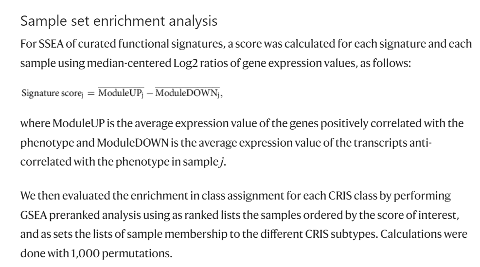

**亚型集富集分析（SSEA）**把 GSVA 扩展到亚型层面：对每条通路和每个分子亚型，将该通路的基因集对亚型的平均表达谱打分，得到每条通路的亚型特异性富集分数——以雷达图呈现，每根轴是一条通路、每个多边形是一个亚型 \[1\]。GSVA 在 lockfile 中；亚型特异性富集分数由 GSVA 输出计算，雷达图在页内用 ggplot2 `coord_polar` 重实现（参考的 `fmsb` 雷达是等价的零依赖画法）：

## Example

{fig-alt="亚型集富集分析雷达图 DEMO" fig-align="center" width="70%"}

## Setup

-   系统要求：跨平台（Linux/MacOS/Windows）

-   编程语言：R

-   依赖包：`GSVA`; `ggplot2`

```{r packages setup, message=FALSE, warning=FALSE, output=FALSE}
suppressPackageStartupMessages({
  library(GSVA); library(ggplot2)
})
```

```{r}
sessioninfo::session_info("attached")
```

## 数据准备

200 个样本、3 个分子亚型（S1/S2/S3）× 8 条 KEGG 风格通路，植入亚型特异的通路信号：S1 糖酵解高、氧化磷酸化低，S2 氧化磷酸化与脂肪酸氧化高，S3 谷氨酰胺代谢与 TCA 循环高。GSVA 逐样本打分后聚合为亚型均值：

```{r load data}
suppressPackageStartupMessages({library(GSVA); library(ggplot2)})
set.seed(52322)
n <- 200; n_gene <- 400
sub_assign <- rep(c("S1", "S2", "S3"), c(70, 65, 65))
genes <- sprintf("G%03d", 1:n_gene)
expr <- matrix(rnorm(n_gene * n, 6, 1), n_gene, n,
               dimnames = list(genes, sprintf("S%03d", seq_len(n))))

pathways <- list(
  Glycolysis = sprintf("G%03d", 1:40),
  OXPHOS = sprintf("G%03d", 41:80),
  `Fatty acid oxidation` = sprintf("G%03d", 81:120),
  `Glutamine metabolism` = sprintf("G%03d", 121:160),
  `Pentose phosphate` = sprintf("G%03d", 161:200),
  `TCA cycle` = sprintf("G%03d", 201:240),
  `Serine synthesis` = sprintf("G%03d", 241:280),
  `Nucleotide synthesis` = sprintf("G%03d", 281:320)
)
## planted pathway activity per subtype
boost <- list(
  S1 = c(Glycolysis = 1.5, `Pentose phosphate` = 0.6),
  S2 = c(OXPHOS = 1.3, `Fatty acid oxidation` = 1.1),
  S3 = c(`Glutamine metabolism` = 0.8, `TCA cycle` = 0.7)
)
for (st in names(boost)) {
  idx <- sub_assign == st
  for (pw in names(boost[[st]])) {
    expr[pathways[[pw]], idx] <- expr[pathways[[pw]], idx] + boost[[st]][pw]
  }
}
```

## Visualization

### 1. SSEA 雷达图

参考图的雷达：通路为轴、亚型为彩色多边形，分数用单一全局 min–max 缩放，使轴长反映绝对分数大小（逐通路重缩放会把近零通路膨胀到外圈）：

```{r}
#| label: fig-1.1SseaRadar
#| fig-cap: "SSEA 雷达图：8 条代谢通路为轴、3 个分子亚型为彩色多边形，分数全局缩放到 [0, 1]；S1 峰值在 Glycolysis（其次 Pentose phosphate），S2 在 OXPHOS 与 Fatty-acid oxidation，S3 在 Glutamine metabolism 与 TCA cycle。"
#| out.width: "70%"
#| fig-width: 8
#| fig-height: 6

gsva_out <- as.matrix(gsva(gsvaParam(expr, pathways)))

## per-subtype mean enrichment score (rows of gsva_out are gene sets,
## columns are samples -> rowMeans averages each pathway over the
## subtype's samples), scaled with one global min–max to [0, 1]
sse <- t(sapply(unique(sub_assign), function(st)
  rowMeans(gsva_out[, sub_assign == st, drop = FALSE])))
sse_norm <- t((sse - min(sse)) / (max(sse) - min(sse) + 1e-8))

sse_df <- as.data.frame(sse_norm)
sse_df$pathway <- rownames(sse_norm)
sse_long <- reshape(sse_df, direction = "long",
                    varying = colnames(sse_df)[1:3],
                    times = colnames(sse_df)[1:3],
                    v.names = "score", idvar = "pathway",
                    timevar = "subtype")
sse_long$pathway <- factor(sse_long$pathway, levels = rownames(sse_norm))

ggplot(sse_long, aes(pathway, score, colour = subtype, group = subtype)) +
  geom_polygon(aes(fill = subtype), alpha = 0.12, linewidth = 0) +
  geom_line(linewidth = 0.9) +
  geom_point(size = 2.2) +
  coord_polar(start = 0) +
  scale_colour_manual(values = c(S1 = "#E41A1C", S2 = "#377EB8", S3 = "#4DAF4A"),
                      name = "Subtype") +
  scale_fill_manual(values = c(S1 = "#E41A1C", S2 = "#377EB8", S3 = "#4DAF4A"),
                    guide = "none") +
  labs(x = NULL, y = NULL) +
  theme_minimal(base_size = 11) +
  theme(axis.text.y = element_text(size = 8.5),
        panel.grid.minor = element_blank(),
        axis.text.x = element_text(size = 9))
```

### 2. 热图补充：原始 SSE 分数

雷达图直观但难以精确读数；补充热图展示未缩放的亚型均值富集分数并打印数值：

```{r}
#| label: fig-2.1SseaHeatmap
#| fig-cap: "亚型 x 通路的原始 GSVA 均值富集分数（雷达图的未缩放补充）：S1 糖酵解高，S2 OXPHOS/脂肪酸氧化高，S3 谷氨酰胺/TCA 高；打印数值给出精确值。"
#| out.width: "90%"
#| fig-width: 7.5
#| fig-height: 5.6

pheatmap::pheatmap(sse,
                   color = colorRampPalette(c("#74ADD1", "white", "#F46D43"))(64),
                   number_color = "grey15",
                   cluster_rows = FALSE, cluster_cols = FALSE,
                   display_numbers = TRUE, number_format = "%.2f",
                   fontsize_number = 8.5,
                   border_color = "white",
                   legend = TRUE,
                   main = "Mean GSVA enrichment score per subtype")
```

::: callout-tip
**实践要点**
-   雷达图使用**亚型均值 GSVA 分数**而非逐样本分数——先聚合让多边形平滑、亚型间对比更清晰。
-   雷达图用**单一全局 min–max** 缩放，不要逐通路缩放——逐通路缩放会把每条通路的赢家推到外圈，把近零分数膨胀成表观峰值。原始分数报告在补充热图中。
-   雷达图用于交流，补充热图用于精确读数。两者都报告。
-   每张雷达 6-10 条通路；超过 12 条多边形会变得不可读。
-   所有亚型保持固定的通路轴顺序——逐亚型重排轴会让多边形失去可比性。
:::

## 应用场景

::: {#fig-SseaApplications1}
{fig-alt="亚型集富集分析雷达图" fig-align="center" width="70%"}

亚型集富集分析雷达图
:::

SSEA 雷达图适用于任何多亚型通路比较：代谢亚型、免疫微环境状态、或药物应答签名。

## 参考文献

\[1\] Xiaofan Lu, et al. FigureYa: A Standardized Visualization Framework for Enhancing Biomedical Data Interpretation and Research Efficiency. iMetaMed. 2025. doi:10.1002/imm3.70005
