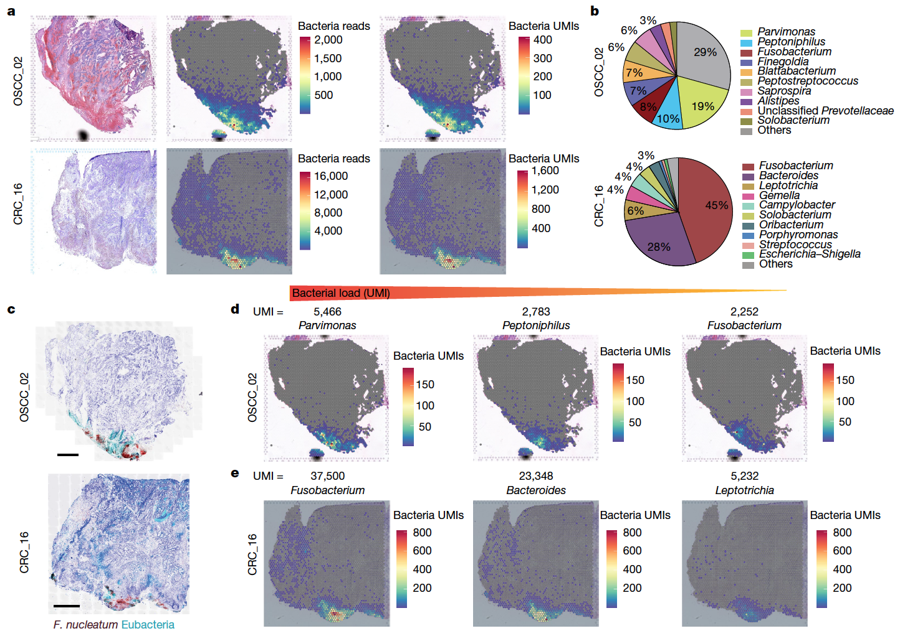

The reference visualizes **microbial UMIs detected by PathSeq** in spatial transcriptomics (Visium) data: each spatial spot is coloured by the microbial read count, overlaid on the H&E-stained tissue morphology to show which histological regions harbour bacteria \[1\]. PathSeq and Seurat are not in this repository's lockfile; the microbial UMI matrix is simulated across spatial coordinates with planted tissue-region specificity, and the spatial scatter + region-summary heatmap run on ggplot2:

## Example

{fig-alt="Spatial Transcriptomics Microbial UMI Heatmap DEMO" fig-align="center" width="70%"}

## Setup

-   System Requirements: Cross-platform (Linux/MacOS/Windows)

-   Programming language: R

-   Dependent packages: `ggplot2`; `patchwork`

```{r packages setup, message=FALSE, warning=FALSE, output=FALSE}
suppressPackageStartupMessages({
  library(ggplot2); library(patchwork)
})
```

```{r}
sessioninfo::session_info("attached")
```

## Data Preparation

A 78×128 Visium-style spot grid over a simulated tissue section, annotated into three histological regions (tumour nest, stroma, normal epithelium). Microbial UMIs (E. coli, S. aureus, B. fragilis) are planted with region-specific abundance — E. coli concentrates in tumour nests, B. fragilis in stroma:

```{r load data}
suppressPackageStartupMessages({library(ggplot2); library(patchwork)})
set.seed(52323)
rows <- 1:78; cols <- 1:128
spots <- expand.grid(row = rows, col = cols)
spots$spot <- sprintf("spot_r%03d_c%03d", spots$row, spots$col)
spots$x <- spots$col * 0.65
spots$y <- spots$row * 0.65
## tissue regions: tumour nests are circles, stroma fills the gaps
spots$region <- ifelse(
  (spots$x > 12 & spots$x < 28 & spots$y > 8 & spots$y < 24) |
  (spots$x > 45 & spots$x < 62 & spots$y > 20 & spots$y < 38),
  "Tumour nest", "Stroma")
spots$region[spots$y < 6] <- "Normal epithelium"

microbes <- c("E. coli", "S. aureus", "B. fragilis")
base_rates <- list(`Tumour nest` = c(`E. coli` = 25, `S. aureus` = 2, `B. fragilis` = 1),
                   Stroma = c(`E. coli` = 1, `S. aureus` = 2, `B. fragilis` = 6),
                   `Normal epithelium` = c(`E. coli` = 0.3, `S. aureus` = 0.4, `B. fragilis` = 0.3))
umi <- t(sapply(spots$region, function(rg)
  sapply(microbes, function(m) rpois(1, base_rates[[rg]][[m]]))))
spots$Ecoli <- umi[, 1]
spots$Saureus <- umi[, 2]
spots$Bfragilis <- umi[, 3]
spots$total_microbial <- rowSums(umi)
```

## Visualization

### 1. Spatial Scatter of Total Microbial UMIs

The reference's main panel: each spatial spot coloured by total microbial UMI count with the region boundaries visible — the tumour-nest regions light up:

```{r}
#| label: fig-1.1StPathseqSpatial
#| fig-cap: "Spatial distribution of total microbial UMIs across the Visium spot grid: tumour-nest regions (high E. coli abundance) show elevated microbial counts compared to stroma and normal epithelium."
#| out.width: "90%"
#| fig-width: 8.5
#| fig-height: 6

ggplot(spots, aes(x, y, colour = total_microbial)) +
  geom_point(size = 2.2) +
  scale_colour_viridis_c(option = "magma", trans = "sqrt",
                         name = "total\nmicrobial UMI") +
  coord_fixed() +
  labs(x = NULL, y = NULL, title = "Total microbial UMIs per spot") +
  theme_bw(base_size = 11) +
  theme(axis.text = element_blank(),
        axis.ticks = element_blank(),
        panel.grid = element_blank())
```

### 2. Region-Specific Microbial Species Breakdown

The reference's region-level comparison: median microbial UMI per species per histological region, showing E. coli enriched in tumour nests and B. fragilis in stroma:

```{r}
#| label: fig-2.1StPathseqRegion
#| fig-cap: "Median microbial UMI per species per histological region: E. coli is enriched in tumour nests, B. fragilis in stroma, and both are near-zero in normal epithelium — the region-specific pattern the spatial scatter visualises."
#| out.width: "80%"
#| fig-width: 7
#| fig-height: 5

region_summary <- do.call(rbind, lapply(unique(spots$region), function(rg) {
  idx <- spots$region == rg
  data.frame(region = rg,
             microbe = microbes,
             median_umi = sapply(microbes, function(m) median(umi[idx, m])))
}))
ggplot(region_summary, aes(microbe, region, fill = median_umi)) +
  geom_tile(colour = "white") +
  geom_text(aes(label = sprintf("%.0f", median_umi)),
            colour = ifelse(region_summary$median_umi > 10, "grey15", "white"),
            size = 3.2) +
  scale_fill_viridis_c(option = "magma", trans = "sqrt", name = "median\nUMI") +
  labs(x = NULL, y = NULL) +
  theme_bw(base_size = 11) +
  theme(axis.text.x = element_text(angle = 25, hjust = 1))
```

::: callout-tip
**Practice tips**
-   Overlay microbial UMIs on the **actual spatial coordinates** — the tissue-morphology context is what distinguishes real signal from ambient contamination.
-   Use sqrt or log transformation for the colour scale; microbial UMIs are heavily right-skewed and a linear scale hides the regional contrast.
-   Annotate histological regions independently (pathologist annotation or tissue-mask segmentation) — correlating microbial signal with regions defined by the same data is circular.
-   Report per-species breakdowns; total microbial load alone cannot distinguish E. coli enrichment from B. fragilis depletion.
-   Apply PathSeq's background-filter thresholds before reporting; unfiltered microbial calls in low-biomass tissue are frequently ambient contamination.
:::

## Application

::: {#fig-StPathseqApplications1}
{fig-alt="Spatial Transcriptomics Microbial UMI Heatmap" fig-align="center" width="70%"}

Spatial transcriptomics microbial UMI heatmap
:::

Spatial microbial heatmaps apply to any PathSeq-analysed Visium cohort: colorectal cancer tissue, inflammatory bowel disease biopsies, or infection-model spatial datasets.

## Reference

\[1\] Xiaofan Lu, et al. FigureYa: A Standardized Visualization Framework for Enhancing Biomedical Data Interpretation and Research Efficiency. iMetaMed. 2025. doi:10.1002/imm3.70005
