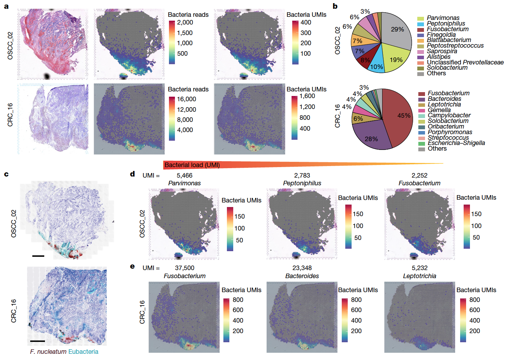

参考图展示空间转录组（Visium）数据中 **PathSeq 检出的微生物 UMI**：每个空间点按微生物 read 数着色，叠加在 H&E 染色组织形态上，显示哪些组织学区域携带细菌 \[1\]。PathSeq 与 Seurat 不在本仓库 lockfile；微生物 UMI 矩阵在空间坐标上模拟并植入组织区域特异性，空间散点 + 区域汇总热图在 ggplot2 上运行：

## Example

{fig-alt="空间转录组微生物 UMI 热图 DEMO" fig-align="center" width="70%"}

## Setup

-   系统要求：跨平台（Linux/MacOS/Windows）

-   编程语言：R

-   依赖包：`ggplot2`; `patchwork`

```{r packages setup, message=FALSE, warning=FALSE, output=FALSE}
suppressPackageStartupMessages({
  library(ggplot2); library(patchwork)
})
```

```{r}
sessioninfo::session_info("attached")
```

## 数据准备

78×128 的 Visium 风格空间点网格覆盖模拟组织切片，注释为三个组织学区域（肿瘤巢、基质、正常上皮）。微生物 UMI（E. coli、S. aureus、B. fragilis）按区域特异丰度植入——E. coli 富集于肿瘤巢、B. fragilis 富集于基质：

```{r load data}
suppressPackageStartupMessages({library(ggplot2); library(patchwork)})
set.seed(52323)
rows <- 1:78; cols <- 1:128
spots <- expand.grid(row = rows, col = cols)
spots$spot <- sprintf("spot_r%03d_c%03d", spots$row, spots$col)
spots$x <- spots$col * 0.65
spots$y <- spots$row * 0.65
## tissue regions: tumour nests are circles, stroma fills the gaps
spots$region <- ifelse(
  (spots$x > 12 & spots$x < 28 & spots$y > 8 & spots$y < 24) |
  (spots$x > 45 & spots$x < 62 & spots$y > 20 & spots$y < 38),
  "Tumour nest", "Stroma")
spots$region[spots$y < 6] <- "Normal epithelium"

microbes <- c("E. coli", "S. aureus", "B. fragilis")
base_rates <- list(`Tumour nest` = c(`E. coli` = 25, `S. aureus` = 2, `B. fragilis` = 1),
                   Stroma = c(`E. coli` = 1, `S. aureus` = 2, `B. fragilis` = 6),
                   `Normal epithelium` = c(`E. coli` = 0.3, `S. aureus` = 0.4, `B. fragilis` = 0.3))
umi <- t(sapply(spots$region, function(rg)
  sapply(microbes, function(m) rpois(1, base_rates[[rg]][[m]]))))
spots$Ecoli <- umi[, 1]
spots$Saureus <- umi[, 2]
spots$Bfragilis <- umi[, 3]
spots$total_microbial <- rowSums(umi)
```

## Visualization

### 1. 微生物 UMI 总数的空间散点

参考图主面板：每个空间点按微生物 UMI 总数着色并可见区域边界——肿瘤巢区域亮起：

```{r}
#| label: fig-1.1StPathseqSpatial
#| fig-cap: "Visium 空间点网格上微生物 UMI 总数的空间分布：肿瘤巢区域（E. coli 丰度高）的微生物计数显著高于基质与正常上皮。"
#| out.width: "90%"
#| fig-width: 8.5
#| fig-height: 6

ggplot(spots, aes(x, y, colour = total_microbial)) +
  geom_point(size = 2.2) +
  scale_colour_viridis_c(option = "magma", trans = "sqrt",
                         name = "total\nmicrobial UMI") +
  coord_fixed() +
  labs(x = NULL, y = NULL, title = "Total microbial UMIs per spot") +
  theme_bw(base_size = 11) +
  theme(axis.text = element_blank(),
        axis.ticks = element_blank(),
        panel.grid = element_blank())
```

### 2. 区域特异的微生物物种分解

参考图的区域级比较：每个物种在每个组织学区域的微生物 UMI 中位数，显示 E. coli 富集于肿瘤巢、B. fragilis 富集于基质：

```{r}
#| label: fig-2.1StPathseqRegion
#| fig-cap: "每个物种在各组织学区域的微生物 UMI 中位数：E. coli 富集于肿瘤巢，B. fragilis 富集于基质，两者在正常上皮中接近零——这正是空间散点所呈现的区域特异模式。"
#| out.width: "80%"
#| fig-width: 7
#| fig-height: 5

region_summary <- do.call(rbind, lapply(unique(spots$region), function(rg) {
  idx <- spots$region == rg
  data.frame(region = rg,
             microbe = microbes,
             median_umi = sapply(microbes, function(m) median(umi[idx, m])))
}))
ggplot(region_summary, aes(microbe, region, fill = median_umi)) +
  geom_tile(colour = "white") +
  geom_text(aes(label = sprintf("%.0f", median_umi)),
            colour = ifelse(region_summary$median_umi > 10, "grey15", "white"),
            size = 3.2) +
  scale_fill_viridis_c(option = "magma", trans = "sqrt", name = "median\nUMI") +
  labs(x = NULL, y = NULL) +
  theme_bw(base_size = 11) +
  theme(axis.text.x = element_text(angle = 25, hjust = 1))
```

::: callout-tip
**实践要点**
-   将微生物 UMI 叠加在**真实空间坐标**上——组织形态学背景是区分真实信号与环境污染的关键。
-   颜色标度用 sqrt 或 log 变换；微生物 UMI 高度右偏，线性标度会掩盖区域对比。
-   组织学区域独立注释（病理标注或组织掩膜分割）——用同一份数据定义区域再关联微生物信号是循环论证。
-   报告逐物种分解；仅看微生物总负荷无法区分 E. coli 富集与 B. fragilis 缺失。
-   报告前应用 PathSeq 的背景过滤阈值；低生物量组织中的未过滤微生物调用常常是环境污染。
:::

## 应用场景

::: {#fig-StPathseqApplications1}
{fig-alt="空间转录组微生物 UMI 热图" fig-align="center" width="70%"}

空间转录组微生物 UMI 热图
:::

空间微生物热图适用于任何 PathSeq 分析的 Visium 队列：结直肠癌组织、炎症性肠病活检、或感染模型空间数据集。

## 参考文献

\[1\] Xiaofan Lu, et al. FigureYa: A Standardized Visualization Framework for Enhancing Biomedical Data Interpretation and Research Efficiency. iMetaMed. 2025. doi:10.1002/imm3.70005
