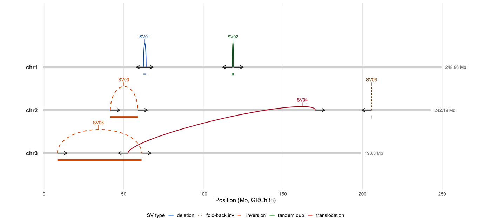

A structural variant (SV) has no coordinate of its own: it is a **junction** between two genomic positions, possibly on different chromosomes, with an orientation and a copy-number consequence. That is why SVs are drawn as arcs — a breakend is an arc endpoint, an inversion is an arc that flips, a translocation is an arc between two chromosomes — and it is why an SV figure that only lists start/end coordinates hides the one thing that matters.

This tutorial rebuilds the arc layout of **asgart**, **Ribbon**, **LINX** and **ReConPlot** \[1-4\] in ggplot2: chromosome ideogram tracks, arcs coloured and patterned by SV type, a read-support panel, and a carrier matrix across samples.

## Example

{fig-alt="Structural Variant Plot DEMO" fig-align="center" width="85%"}

A structural variant arc plot on three chromosomes (GRCh38, Mb): six variants drawn as arcs between their breakends, coloured by SV type, with inverted variants dashed, arrowheads on each chromosome bar marking the breakend directions, and the translocation crossing the gap between chromosome tracks. Colour by type is what separates an inversion from a duplication that has the same endpoints.

## Setup

-   System Requirements: Cross-platform (Linux/MacOS/Windows)

-   Programming language: R

-   Dependent packages: `ggplot2`; `dplyr`; `tidyr`; `patchwork`; `scales`; `ggrepel`

```{r packages setup, message=FALSE, warning=FALSE, output=FALSE}
if (!requireNamespace("ggplot2", quietly = TRUE)) install.packages("ggplot2")
if (!requireNamespace("dplyr", quietly = TRUE)) install.packages("dplyr")
if (!requireNamespace("tidyr", quietly = TRUE)) install.packages("tidyr")
if (!requireNamespace("patchwork", quietly = TRUE)) install.packages("patchwork")
if (!requireNamespace("scales", quietly = TRUE)) install.packages("scales")
if (!requireNamespace("ggrepel", quietly = TRUE)) install.packages("ggrepel")

library(ggplot2)
library(dplyr)
library(tidyr)
library(patchwork)
library(scales)
library(ggrepel)
```

```{r}
sessioninfo::session_info("attached")
```

## Data Preparation

Six variants on three chromosomes of a simulated tumour genome: a deletion, a tandem duplication, two inversions (17 and 53 Mb), an inter-chromosomal translocation, and a fold-back inversion. Each is a VCF-style BND/DEL/DUP/INV record with two breakends, an orientation, read support and a carrier list — exactly the columns `Manta`/`Delly`/`GRIDSS` emit.

```{r load data, message=FALSE, warning=FALSE}
set.seed(4358)

chroms <- tibble(
  chr = c("chr1", "chr2", "chr3"),
  len = c(248.96, 242.19, 198.30)   # Mb, GRCh38
)

## Two breakends per SV. 'dir' is the breakend orientation (+/-), which is what
## distinguishes an inversion from a duplication with the same endpoints.
sv <- tribble(
  ~id, ~type, ~chr1, ~pos1, ~dir1, ~chr2, ~pos2, ~dir2, ~copies,
  "SV01", "deletion",       "chr1", 62.4,  "+", "chr1", 64.1, "-", 1,
  "SV02", "tandem dup",     "chr1", 118.2, "-", "chr1", 119.0, "+", 3,
  "SV03", "inversion",      "chr2", 41.6,  "+", "chr2", 58.9, "+", 2,
  "SV04", "translocation",  "chr2", 170.3, "+", "chr3", 52.7, "-", 2,
  "SV05", "inversion",      "chr3", 8.4,   "+", "chr3", 61.2, "+", 2,
  "SV06", "fold-back inv",  "chr2", 205.6, "-", "chr2", 205.68, "-", 4
)

## Read evidence: split reads and discordant pairs per variant, sampled with
## a realistic skew (well-supported deletions, weak fold-backs).
evidence <- sv |>
  transmute(id, type,
            split = c(38, 24, 31, 19, 12, 6),
            discordant = c(61, 47, 52, 44, 22, 11))

carriers <- expand.grid(sample = sprintf("T%02d", 1:12), id = sv$id,
                        stringsAsFactors = FALSE) |>
  as_tibble() |>
  left_join(sv |> select(id, type), by = "id") |>
  mutate(p = case_when(
    type %in% c("deletion", "translocation") ~ 0.55,
    type %in% c("tandem dup", "inversion") ~ 0.35,
    TRUE ~ 0.18
  )) |>
  mutate(carried = runif(n()) < p) |>
  select(-p)

evidence |> rowwise() |> mutate(total = split + discordant) |> ungroup()
```

## Visualization

### 1. Chromosome Arcs by SV Type

The arc panel is the core: chromosomes on horizontal axes, one arc per breakend pair. Colour and line type are reserved for SV type, and the arrowheads on each chromosome bar show the breakend direction (the dir1/dir2 columns), so orientation is read from the arrows, not implied by arc shape.

```{r}
#| label: fig-1.1SvArcs
#| fig-cap: "Structural variant arc plot on three chromosomes (GRCh38, Mb): six variants drawn as arcs between their breakends. Arcs are coloured by SV type, inverted variants are drawn dashed, and the arrowheads on each chromosome bar mark the two breakend directions (dir1/dir2). The translocation is the only arc that crosses the gap between chromosome tracks."
#| out.width: "100%"
#| warning: false
#| message: false
#| fig-width: 10.5
#| fig-height: 4.8
#| fig-dpi: 300

type_cols <- c("deletion" = "#2166ac", "tandem dup" = "#1b7837",
               "inversion" = "#d95f02", "translocation" = "#b2182b",
               "fold-back inv" = "#8c510a")

chr_y <- c(chr1 = 3, chr2 = 2, chr3 = 1)

arc_points <- function(x0, x1, y0, y1, n = 60, height = 0.55) {
  t <- seq(0, pi, length.out = n)
  data.frame(x = x0 + (x1 - x0) * (1 - cos(t)) / 2,
             y = y0 + (y1 - y0) * (1 - cos(t)) / 2 + height * sin(t))
}

arcs <- bind_rows(lapply(seq_len(nrow(sv)), function(i) {
  s <- sv[i, ]
  # A translocation is drawn as a wider, flatter arc between chromosome tracks.
  h <- if (s$type == "translocation") 0.30 else 0.55
  arc_points(s$pos1, s$pos2 + if (s$chr1 == s$chr2) 0 else 0,
             chr_y[[s$chr1]], chr_y[[s$chr2]], height = h) |>
    mutate(id = s$id, type = s$type)
}))

p_arc <- ggplot() +
  ## Chromosome tracks, lengths to scale on a shared Mb axis.
  geom_segment(data = chroms, aes(x = 0, xend = len, y = chr_y[chr],
                                  yend = chr_y[chr]),
               linewidth = 1.6, colour = "#d9d9d9", lineend = "round") +
  geom_text(data = chroms, aes(x = -4, y = chr_y[chr], label = chr),
            hjust = 1, size = 3, fontface = "bold", colour = "#333333") +
  geom_text(data = chroms, aes(x = len + 3, y = chr_y[chr],
                               label = paste0(len, " Mb")),
            hjust = 0, size = 2.4, colour = "#777777") +
  ## Arcs.
  geom_path(data = arcs, aes(x, y, group = id, colour = type,
                             linetype = type), linewidth = 0.55) +
  ## Breakend direction: a 6 Mb arrowhead on the chromosome bar pointing in
  ## the dir1/dir2 direction, so orientation is drawn, not implied.
  geom_segment(data = sv |> pivot_longer(c(pos1, pos2), names_to = "endn",
                                         values_to = "pos") |>
                 mutate(chr = if_else(endn == "pos1", chr1, chr2),
                        dir = if_else(endn == "pos1", dir1, dir2)),
               aes(x = pos, xend = pos + 6 * if_else(dir == "+", 1, -1),
                   y = chr_y[chr], yend = chr_y[chr]),
               arrow = arrow(ends = "last", length = unit(1.8, "mm")),
               linewidth = 0.55, colour = "#333333") +
  ## Copy-number consequence: a bar under each breakend pair whose thickness
  ## scales with the predicted copy number.
  geom_segment(data = filter(sv, chr1 == chr2),
               aes(x = pos1, xend = pos2, y = chr_y[chr1] - 0.16,
                   yend = chr_y[chr1] - 0.16, colour = type, linewidth = copies),
               show.legend = FALSE) +
  scale_linewidth_continuous(range = c(0.5, 2.4), guide = "none") +
  ## Labels at the arc apex.
  geom_text_repel(data = arcs |> group_by(id, type) |>
                    slice_max(y, n = 1, with_ties = FALSE) |> ungroup(),
                  aes(x, y, label = id, colour = type), size = 2.4,
                  nudge_y = 0.16, seed = 1, min.segment.length = 0,
                  segment.size = 0.2, show.legend = FALSE) +
  scale_colour_manual(values = type_cols, name = "SV type") +
  scale_linetype_manual(values = c("deletion" = "solid", "tandem dup" = "solid",
                                   "inversion" = "dashed",
                                   "translocation" = "solid",
                                   "fold-back inv" = "dotted"),
                        name = "SV type") +
  scale_x_continuous(limits = c(-12, 265), breaks = seq(0, 250, 50),
                     labels = label_number(suffix = "")) +
  scale_y_continuous(limits = c(0.35, 4.3)) +
  labs(x = "Position (Mb, GRCh38)", y = NULL) +
  theme_minimal(base_size = 9) +
  theme(axis.text.y = element_blank(), panel.grid.major.y = element_blank(),
        panel.grid.minor = element_blank(),
        legend.position = "bottom", legend.box = "horizontal",
        legend.text = element_text(size = 7.6),
        legend.title = element_text(size = 8),
        legend.key.size = unit(0.34, "cm"))

p_arc
```

::: callout-tip
**Practice tips**

-   Show orientation, not just endpoints. A deletion and a tandem duplication can share both breakend coordinates; only the breakend orientation distinguishes them.
-   Use a second channel (linetype) for the types that are genuinely inverted, so the figure survives greyscale printing and colour-blind readers.
-   Draw chromosomes to the same scale on one axis when they share a panel; per-chromosome normalisation makes a 40 Mb inversion look longer than a 15 Mb deletion.
-   Put the copy-number consequence on the chromosome bar, not inside the arc: arcs describe topology, the bar describes dosage, and the two are different claims.
-   Name the assembly (GRCh38) and the units (Mb) in the axis, and state that coordinates are 1-based breakpoints from the caller.
:::

### 2. Evidence and Carrier Structure

The arc alone does not say whether the event is real. The second panel pairs read support with the carrier matrix: SV01 carries 38 split reads yet appears in only 5 of the 12 tumours, while SV06 has 6 split reads in 2 tumours: read support and recurrence are different axes, and the figure should make that comparison immediate.

```{r}
#| label: fig-1.2SvEvidence
#| fig-cap: "Variant evidence and carrier structure: left, split-read and discordant-pair support per variant (variants sorted by total support); right, the 12-sample carrier matrix in the arc-panel order. The fold-back inversion (SV06) has the weakest read support, which is expected for a repeat-rich locus."
#| out.width: "100%"
#| warning: false
#| message: false
#| fig-width: 10.5
#| fig-height: 4.2
#| fig-dpi: 300

p_ev <- evidence |>
  pivot_longer(c(split, discordant), names_to = "evidence", values_to = "n") |>
  mutate(evidence = factor(evidence, levels = c("split", "discordant"),
                           labels = c("split reads", "discordant pairs"))) |>
  ggplot(aes(x = reorder(id, n), y = n, fill = evidence)) +
  geom_col(position = position_dodge(width = 0.72), width = 0.66,
           colour = "white", linewidth = 0.3) +
  ## The bar labels must use the same dodge as the bars, and hjust must be
  ## opposite to the grow direction (the flipped axis runs upward).
  geom_text(aes(label = n, group = evidence),
            position = position_dodge2(width = 0.72, preserve = "single"),
            hjust = -0.25, size = 2.0, colour = "#444444") +
  coord_flip() +
  scale_fill_manual(values = c("split reads" = "#2166ac",
                               "discordant pairs" = "#9ecae1"),
                    name = NULL) +
  scale_y_continuous(limits = c(0, 72), expand = expansion(mult = c(0, 0.02)),
                     breaks = seq(0, 60, 20)) +
  labs(x = NULL, y = "supporting reads") +
  theme_minimal(base_size = 9) +
  theme(panel.grid.major.y = element_blank(),
        legend.position = "bottom", legend.text = element_text(size = 7.6),
        legend.key.size = unit(0.32, "cm"))

p_car <- carriers |>
  mutate(id = factor(id, levels = sv$id)) |>
  ggplot(aes(x = interaction(id), y = sample)) +
  geom_tile(aes(fill = carried), colour = "white", linewidth = 0.3,
            width = 0.92, height = 0.92) +
  scale_fill_manual(values = c(`TRUE` = "#b2182b", `FALSE` = "#f2f2f2"),
                    labels = c(`TRUE` = "carried", `FALSE` = "absent"),
                    name = NULL) +
  scale_x_discrete(labels = NULL) +
  labs(x = "variant (SV01-SV06, same order as the arc panel)",
       y = "tumour sample (n = 12)") +
  theme_minimal(base_size = 9) +
  theme(panel.grid = element_blank(),
        axis.text.x = element_blank(),
        axis.ticks.x = element_blank(),
        legend.position = "bottom", legend.text = element_text(size = 7.6),
        legend.key.size = unit(0.32, "cm"))

p_ev + p_car + plot_layout(widths = c(1, 0.95))
```

::: callout-tip
**Practice tips**

-   Plot split reads and discordant pairs separately; a deletion supported by 60 discordant pairs and no split reads is usually a mapping artefact in a repeat.
-   Keep the samples in the same order as the clinical table, not alphabetically, so a reviewer can scan a subtype block.
-   A carrier matrix without a denominator is misleading: print the cohort size on the axis title.
-   Use a log scale for evidence counts when one variant is 5× the others, but add the raw number as a text label so the log scale is not hiding the magnitude.
:::

## Implementations deliberately not used here

This page draws its figures with ggplot2 rather than installing the skipped tools. Of the tools that the issue-435 inventory maps onto Omics/StructuralVariantPlot.qmd, 8 are marked **skipped** here and used only as layout references, not as dependencies: 7 that have gone more than five years without an operational commit (cutoff 2021-11-07), and 1 whose dependency closure is too heavy for one static figure. Reproducing whatever still works would mean pinning abandoned code; installing the rest would mean pulling a whole analysis framework into a documentation build. The figure conventions were read off those tools, then re-implemented here so each panel can be inspected line by line.

| Tool | Last commit | Status | Why it is skipped |
| --- | --- | --- | --- |
| SVbyEye | 2026-04-13 | heavy dependency | framework-scale dependency closure is too heavy for one static figure |
| bigly | 2020-10-02 | stale | >5 years without maintenance |
| Delly-maze | 2021-10-11 | stale | >5 years without maintenance |
| Discoplot | 2015-09-02 | stale | >5 years without maintenance |
| spinteny | 2013-08-29 | stale | >5 years without maintenance |
| SVPV | 2017-07-19 | stale | >5 years without maintenance |
| svv | 2016-11-21 | stale | >5 years without maintenance |
| svviz | 2018-08-18 | stale | >5 years without maintenance |

## Application

Structural-variant arcs are the standard figure of cancer genome reports (amplicon and chromothripsis structures), clinical SV validation, and population SV surveys. They are the only layout that shows topology — which breakends connect to which — while keeping the genomic position readable, which is why LINX, Ribbon and ReConPlot all converge on it.

The same construction handles any set of paired genomic intervals: Hi-C neo-loops (arcs between loci on one chromosome), enhancer-promoter contacts, and V(D)J recombination events, with the arc height encoding contact frequency instead of read support.

## Reference

\[1\] Delehelle F, Cussat-Blanc S, Alliot JM, Luga H, Balaresque P. ASGART: fast and parallel genome scale segmental duplications mapping. Bioinformatics. 2018;34(16):2708-2714. doi:10.1093/bioinformatics/bty172

\[2\] Nattestad M, Aboukhalil R, Chin CS, Schatz MC. Ribbon: intuitive visualization for complex genomic variation. Bioinformatics. 2021;37(3):413-415. doi:10.1093/bioinformatics/btaa680

\[3\] Shale C, Cameron DL, Baber J, et al. Unscrambling cancer genomes via integrated analysis of structural variation and copy number. Cell Genom. 2022;2(4):100112. doi:10.1016/j.xgen.2022.100112

\[4\] Espejo Valle-Inclán J, Cortés-Ciriano I. ReConPlot: an R package for the visualization and interpretation of genomic rearrangements. Bioinformatics. 2023;39(12):btad719. doi:10.1093/bioinformatics/btad719
