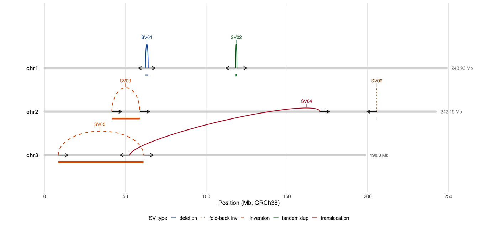

结构变异（SV）本身没有自己的坐标：它是两个基因组位置之间的一个**连接点**，可能位于不同染色体上，带有方向与拷贝数后果。这正是 SV 用弧线绘制的原因——breakend 是弧的端点，倒位是一条翻转的弧，易位是两条染色体之间的弧——也正因如此，只列出起点/终点坐标的 SV 图恰恰隐藏了最关键的信息。

本教程用 ggplot2 重建 **asgart**、**Ribbon**、**LINX** 与 **ReConPlot** 的弧线版式 \[1-4\]：染色体轨道、按 SV 类型着色并区分线型的弧、读段支持面板，以及跨样本的携带者矩阵。

## 示例

{fig-alt="结构变异图 DEMO" fig-align="center" width="85%"}

三条染色体（GRCh38，Mb）上的结构变异弧图：六个变异以断点间的弧表示，按 SV 类型着色，倒位画成虚线，染色体条上的箭头标出两个 breakend 方向（dir1/dir2）。易位是唯一跨越染色体轨道间隙的弧。按类型着色才能把端点相同、类型不同的倒位与重复区分开。

## Setup

-   系统要求：跨平台（Linux/MacOS/Windows）

-   编程语言：R

-   依赖包：`ggplot2`；`dplyr`；`tidyr`；`patchwork`；`scales`；`ggrepel`

```{r packages setup, message=FALSE, warning=FALSE, output=FALSE}
if (!requireNamespace("ggplot2", quietly = TRUE)) install.packages("ggplot2")
if (!requireNamespace("dplyr", quietly = TRUE)) install.packages("dplyr")
if (!requireNamespace("tidyr", quietly = TRUE)) install.packages("tidyr")
if (!requireNamespace("patchwork", quietly = TRUE)) install.packages("patchwork")
if (!requireNamespace("scales", quietly = TRUE)) install.packages("scales")
if (!requireNamespace("ggrepel", quietly = TRUE)) install.packages("ggrepel")

library(ggplot2)
library(dplyr)
library(tidyr)
library(patchwork)
library(scales)
library(ggrepel)
```

```{r}
sessioninfo::session_info("attached")
```

## 数据准备

模拟肿瘤基因组的 3 条染色体上共 6 个变异：缺失、串联重复、两个倒位（17 与 53 Mb）、染色体间易位，以及折返倒位。每个变异都是一条 VCF 风格的 BND/DEL/DUP/INV 记录，含两个 breakend、方向、读段支持与携带者列表——正是 `Manta`/`Delly`/`GRIDSS` 输出的列。

```{r load data, message=FALSE, warning=FALSE}
set.seed(4358)

chroms <- tibble(
  chr = c("chr1", "chr2", "chr3"),
  len = c(248.96, 242.19, 198.30)   # Mb, GRCh38
)

## Two breakends per SV. 'dir' is the breakend orientation (+/-), which is what
## distinguishes an inversion from a duplication with the same endpoints.
sv <- tribble(
  ~id, ~type, ~chr1, ~pos1, ~dir1, ~chr2, ~pos2, ~dir2, ~copies,
  "SV01", "deletion",       "chr1", 62.4,  "+", "chr1", 64.1, "-", 1,
  "SV02", "tandem dup",     "chr1", 118.2, "-", "chr1", 119.0, "+", 3,
  "SV03", "inversion",      "chr2", 41.6,  "+", "chr2", 58.9, "+", 2,
  "SV04", "translocation",  "chr2", 170.3, "+", "chr3", 52.7, "-", 2,
  "SV05", "inversion",      "chr3", 8.4,   "+", "chr3", 61.2, "+", 2,
  "SV06", "fold-back inv",  "chr2", 205.6, "-", "chr2", 205.68, "-", 4
)

## Read evidence: split reads and discordant pairs per variant, sampled with
## a realistic skew (well-supported deletions, weak fold-backs).
evidence <- sv |>
  transmute(id, type,
            split = c(38, 24, 31, 19, 12, 6),
            discordant = c(61, 47, 52, 44, 22, 11))

carriers <- expand.grid(sample = sprintf("T%02d", 1:12), id = sv$id,
                        stringsAsFactors = FALSE) |>
  as_tibble() |>
  left_join(sv |> select(id, type), by = "id") |>
  mutate(p = case_when(
    type %in% c("deletion", "translocation") ~ 0.55,
    type %in% c("tandem dup", "inversion") ~ 0.35,
    TRUE ~ 0.18
  )) |>
  mutate(carried = runif(n()) < p) |>
  select(-p)

evidence |> rowwise() |> mutate(total = split + discordant) |> ungroup()
```

## 可视化

### 1. 按 SV 类型绘制的染色体弧

弧线面板是核心：染色体置于水平轴上，每个 breakend 对一条弧。颜色与线型编码 SV 类型，染色体条上的箭头标出每个 breakend 的方向（表中的 dir1/dir2 两列），方向从箭头读出，而非由弧形暗示。

```{r}
#| label: fig-1.1SvArcs
#| fig-cap: "3 条染色体（GRCh38，Mb）上的结构变异弧线图：6 个变异画在各自 breakend 之间。弧按 SV 类型着色，倒位类型用虚线，染色体条上的箭头标出两个 breakend 方向（dir1/dir2）。易位是唯一跨越染色体轨道间隙的弧。"
#| out.width: "100%"
#| warning: false
#| message: false
#| fig-width: 10.5
#| fig-height: 4.8
#| fig-dpi: 300

type_cols <- c("deletion" = "#2166ac", "tandem dup" = "#1b7837",
               "inversion" = "#d95f02", "translocation" = "#b2182b",
               "fold-back inv" = "#8c510a")

chr_y <- c(chr1 = 3, chr2 = 2, chr3 = 1)

arc_points <- function(x0, x1, y0, y1, n = 60, height = 0.55) {
  t <- seq(0, pi, length.out = n)
  data.frame(x = x0 + (x1 - x0) * (1 - cos(t)) / 2,
             y = y0 + (y1 - y0) * (1 - cos(t)) / 2 + height * sin(t))
}

arcs <- bind_rows(lapply(seq_len(nrow(sv)), function(i) {
  s <- sv[i, ]
  # A translocation is drawn as a wider, flatter arc between chromosome tracks.
  h <- if (s$type == "translocation") 0.30 else 0.55
  arc_points(s$pos1, s$pos2 + if (s$chr1 == s$chr2) 0 else 0,
             chr_y[[s$chr1]], chr_y[[s$chr2]], height = h) |>
    mutate(id = s$id, type = s$type)
}))

p_arc <- ggplot() +
  ## Chromosome tracks, lengths to scale on a shared Mb axis.
  geom_segment(data = chroms, aes(x = 0, xend = len, y = chr_y[chr],
                                  yend = chr_y[chr]),
               linewidth = 1.6, colour = "#d9d9d9", lineend = "round") +
  geom_text(data = chroms, aes(x = -4, y = chr_y[chr], label = chr),
            hjust = 1, size = 3, fontface = "bold", colour = "#333333") +
  geom_text(data = chroms, aes(x = len + 3, y = chr_y[chr],
                               label = paste0(len, " Mb")),
            hjust = 0, size = 2.4, colour = "#777777") +
  ## Arcs.
  geom_path(data = arcs, aes(x, y, group = id, colour = type,
                             linetype = type), linewidth = 0.55) +
  ## Breakend direction: a 6 Mb arrowhead on the chromosome bar pointing in
  ## the dir1/dir2 direction, so orientation is drawn, not implied.
  geom_segment(data = sv |> pivot_longer(c(pos1, pos2), names_to = "endn",
                                         values_to = "pos") |>
                 mutate(chr = if_else(endn == "pos1", chr1, chr2),
                        dir = if_else(endn == "pos1", dir1, dir2)),
               aes(x = pos, xend = pos + 6 * if_else(dir == "+", 1, -1),
                   y = chr_y[chr], yend = chr_y[chr]),
               arrow = arrow(ends = "last", length = unit(1.8, "mm")),
               linewidth = 0.55, colour = "#333333") +
  ## Copy-number consequence: a bar under each breakend pair whose thickness
  ## scales with the predicted copy number.
  geom_segment(data = filter(sv, chr1 == chr2),
               aes(x = pos1, xend = pos2, y = chr_y[chr1] - 0.16,
                   yend = chr_y[chr1] - 0.16, colour = type, linewidth = copies),
               show.legend = FALSE) +
  scale_linewidth_continuous(range = c(0.5, 2.4), guide = "none") +
  ## Labels at the arc apex.
  geom_text_repel(data = arcs |> group_by(id, type) |>
                    slice_max(y, n = 1, with_ties = FALSE) |> ungroup(),
                  aes(x, y, label = id, colour = type), size = 2.4,
                  nudge_y = 0.16, seed = 1, min.segment.length = 0,
                  segment.size = 0.2, show.legend = FALSE) +
  scale_colour_manual(values = type_cols, name = "SV type") +
  scale_linetype_manual(values = c("deletion" = "solid", "tandem dup" = "solid",
                                   "inversion" = "dashed",
                                   "translocation" = "solid",
                                   "fold-back inv" = "dotted"),
                        name = "SV type") +
  scale_x_continuous(limits = c(-12, 265), breaks = seq(0, 250, 50),
                     labels = label_number(suffix = "")) +
  scale_y_continuous(limits = c(0.35, 4.3)) +
  labs(x = "Position (Mb, GRCh38)", y = NULL) +
  theme_minimal(base_size = 9) +
  theme(axis.text.y = element_blank(), panel.grid.major.y = element_blank(),
        panel.grid.minor = element_blank(),
        legend.position = "bottom", legend.box = "horizontal",
        legend.text = element_text(size = 7.6),
        legend.title = element_text(size = 8),
        legend.key.size = unit(0.34, "cm"))

p_arc
```

::: callout-tip
**Practice tips**

-   要显示方向，而不只是端点。缺失与串联重复可能共用两个 breakend 坐标，只有 breakend 方向能区分它们。
-   对真正倒位的类型再额外用一条通道（线型）编码，使图在灰度打印与色觉障碍读者下依然可读。
-   同一面板内的染色体应画在同一比例下；按染色体归一化会让 40 Mb 的倒位看起来比 15 Mb 的缺失更长。
-   把拷贝数后果画在染色体条上而非弧内：弧描述拓扑，条描述剂量，两者是不同的主张。
-   在轴标题中写明参考基因组版本（GRCh38）与单位（Mb），并声明坐标是调用器输出的 1-based breakpoint。
:::

### 2. 证据与携带者结构

仅凭弧线无法判断事件是否真实。第二个面板把读段支持与携带者矩阵并列：SV01 携带 38 条 split read 却只出现在 12 个肿瘤中的 5 个，而 SV06 只有 6 条 split read、出现在 2 个肿瘤中：读段支持与复发频率是两个不同的维度，图应让这一比较一目了然。

```{r}
#| label: fig-1.2SvEvidence
#| fig-cap: "变异证据与携带者结构：左为每个变异的 split read 与不一致配对支持数（按总支持排序）；右为 12 个样本的携带者矩阵，顺序与弧线面板一致。折返倒位（SV06）读段支持最弱，这在重复序列富集的位点是预期结果。"
#| out.width: "100%"
#| warning: false
#| message: false
#| fig-width: 10.5
#| fig-height: 4.2
#| fig-dpi: 300

p_ev <- evidence |>
  pivot_longer(c(split, discordant), names_to = "evidence", values_to = "n") |>
  mutate(evidence = factor(evidence, levels = c("split", "discordant"),
                           labels = c("split reads", "discordant pairs"))) |>
  ggplot(aes(x = reorder(id, n), y = n, fill = evidence)) +
  geom_col(position = position_dodge(width = 0.72), width = 0.66,
           colour = "white", linewidth = 0.3) +
  ## The bar labels must use the same dodge as the bars, and hjust must be
  ## opposite to the grow direction (the flipped axis runs upward).
  geom_text(aes(label = n, group = evidence),
            position = position_dodge2(width = 0.72, preserve = "single"),
            hjust = -0.25, size = 2.0, colour = "#444444") +
  coord_flip() +
  scale_fill_manual(values = c("split reads" = "#2166ac",
                               "discordant pairs" = "#9ecae1"),
                    name = NULL) +
  scale_y_continuous(limits = c(0, 72), expand = expansion(mult = c(0, 0.02)),
                     breaks = seq(0, 60, 20)) +
  labs(x = NULL, y = "supporting reads") +
  theme_minimal(base_size = 9) +
  theme(panel.grid.major.y = element_blank(),
        legend.position = "bottom", legend.text = element_text(size = 7.6),
        legend.key.size = unit(0.32, "cm"))

p_car <- carriers |>
  mutate(id = factor(id, levels = sv$id)) |>
  ggplot(aes(x = interaction(id), y = sample)) +
  geom_tile(aes(fill = carried), colour = "white", linewidth = 0.3,
            width = 0.92, height = 0.92) +
  scale_fill_manual(values = c(`TRUE` = "#b2182b", `FALSE` = "#f2f2f2"),
                    labels = c(`TRUE` = "carried", `FALSE` = "absent"),
                    name = NULL) +
  scale_x_discrete(labels = NULL) +
  labs(x = "variant (SV01-SV06, same order as the arc panel)",
       y = "tumour sample (n = 12)") +
  theme_minimal(base_size = 9) +
  theme(panel.grid = element_blank(),
        axis.text.x = element_blank(),
        axis.ticks.x = element_blank(),
        legend.position = "bottom", legend.text = element_text(size = 7.6),
        legend.key.size = unit(0.32, "cm"))

p_ev + p_car + plot_layout(widths = c(1, 0.95))
```

::: callout-tip
**Practice tips**

-   split read 与不一致配对要分开画；由 60 条不一致配对、零条 split read 支持的缺失，通常是重复区里的比对假象。
-   样本顺序应与临床表一致而非按字母序，便于审阅者扫视某个亚型块。
-   没有分母的携带者矩阵会误导：请把队列规模写在轴标题中。
-   当某个变异的证据数是其他变异的 5 倍时可用对数轴，但必须同时标出原始数值，避免对数轴掩盖量级。
:::

## 关于本页跳过的实现

本页的图由 ggplot2 直接绘制，而不安装这些被跳过的工具。在 issue-435 清单中归到 Omics/StructuralVariantPlot.qmd 的工具里，8 条被标记为**跳过**，仅作为版式参考、不作为依赖：7 条超过 5 年无运维更新（截止日 2021-11-07）、1 条依赖闭包过重，不值得为一张静态图引入。沿用这些工具，等于锁定已废弃的代码；安装另一批，则要把整套分析框架拖进文档构建。本页先把这些工具的图形约定读懂，再自行重画，以便逐行核验每个面板。

| 工具 | 最近提交 | 状态 | 跳过原因 |
| --- | --- | --- | --- |
| SVbyEye | 2026-04-13 | 依赖过重 | 框架级依赖闭包过重，不值得为一张静态图引入 |
| bigly | 2020-10-02 | 陈旧 | 超过 5 年无运维更新 |
| Delly-maze | 2021-10-11 | 陈旧 | 超过 5 年无运维更新 |
| Discoplot | 2015-09-02 | 陈旧 | 超过 5 年无运维更新 |
| spinteny | 2013-08-29 | 陈旧 | 超过 5 年无运维更新 |
| SVPV | 2017-07-19 | 陈旧 | 超过 5 年无运维更新 |
| svv | 2016-11-21 | 陈旧 | 超过 5 年无运维更新 |
| svviz | 2018-08-18 | 陈旧 | 超过 5 年无运维更新 |

## 应用

结构变异弧线图是肿瘤基因组报告（类扩增子结构与染色体碎裂结构）、临床 SV 验证与群体 SV 调查的标准插图。它是唯一既能表达拓扑（哪个 breakend 连到哪个）、又保持基因组位置可读的版式，这也是 LINX、Ribbon 与 ReConPlot 殊途同归的原因。

同一构造可处理任意成对的基因组区间：Hi-C 新发环（同一染色体上位点之间的弧）、增强子-启动子接触，以及 V(D)J 重排事件——只需把弧高改为编码接触频率而不是读段支持。

## 参考文献

\[1\] Delehelle F, Cussat-Blanc S, Alliot JM, Luga H, Balaresque P. ASGART: fast and parallel genome scale segmental duplications mapping. Bioinformatics. 2018;34(16):2708-2714. doi:10.1093/bioinformatics/bty172

\[2\] Nattestad M, Aboukhalil R, Chin CS, Schatz MC. Ribbon: intuitive visualization for complex genomic variation. Bioinformatics. 2021;37(3):413-415. doi:10.1093/bioinformatics/btaa680

\[3\] Shale C, Cameron DL, Baber J, et al. Unscrambling cancer genomes via integrated analysis of structural variation and copy number. Cell Genom. 2022;2(4):100112. doi:10.1016/j.xgen.2022.100112

\[4\] Espejo Valle-Inclán J, Cortés-Ciriano I. ReConPlot: an R package for the visualization and interpretation of genomic rearrangements. Bioinformatics. 2023;39(12):btad719. doi:10.1093/bioinformatics/btad719
