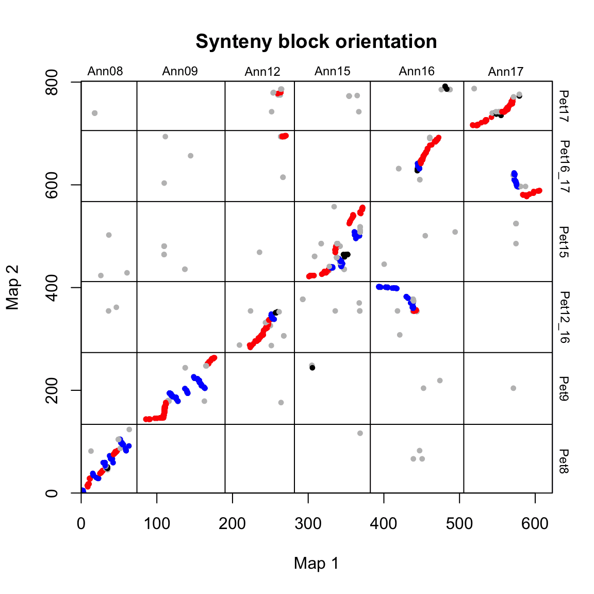
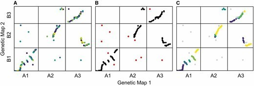

Collinearity is widely used in the study of complex genomes. This tutorial, based on the R package syntR, summarizes the identification of shared collinearity blocks between two genetic maps, chromosomal rearrangements, and their mapping.

## Example

{fig-alt="SyntenyBlocksPlot DEMO1" fig-align="center" width="60%"}

## Setup

-   System Requirements: Cross-platform (Linux/MacOS/Windows)

-   Programming language: R

-   Dependent packages: `syntR`, `ggplot2`, `patchwork`

```{r packages setup, message=FALSE, warning=FALSE, output=FALSE}
# Installing packages
if (!requireNamespace("syntR", quietly = TRUE)) {
  remotes::install_github("ksamuk/syntR")
}
if (!requireNamespace("ggplot2", quietly = TRUE)) {
  install.packages("ggplot2")
}
if (!requireNamespace("patchwork", quietly = TRUE)) {
  install.packages("patchwork")
}

# Load packages
library(syntR)
library(ggplot2)
library(patchwork)
```

```{r}
sessioninfo::session_info("attached")
```

## Data Preparation

syntR requires marker positions from two genetic maps (chromosome and map position for each marker). Before using syntR, the marker order must be inferred for each map. Before using syntR for mapping, positional data for individual markers (e.g., SNPs, microsatellites, etc.) from the two maps can be obtained using R/qtl, ASMap, and Lep-MAP. Alternatively, the alignment results can be converted to similar input files for analysis and mapping using minimap2.

```{r load data1, message=FALSE}
# load the example marker data
data(ann_pet_map)
head(ann_pet_map)
```

The data is organized into six columns:

- `map1_name`: A unique identifier for the marker. In this example, the marker is named based on its position in the reference genome (determined by aligning GBS reads).
- `map1_chr`: The chromosome number of the marker in the first map.
- `map1_pos`: The position of the marker in the first map (e.g., in centimeters).
- `map2_name`: Same as above, but for map 2. These names may or may not be the same as `map1_names`.
- `map2_chr`: The chromosome number of the marker in the second map.
- `map2_pos`: The position of the marker in the second map.

The example data is generated by comparing GBS data of two butterflies, *Helianthus petiolaris ssp. petiolaris* and *H. petiolaris ssp. fallax*. First, load the marker data (ann_pet_map) and the chromosome length list of map1 (ann_chr_lengths), and convert it into a list with three elements (marker data, the position of the chromosome break between map1 and map2) through the `make_one_map` function:

```{r load data2, message=FALSE}
# read in list of chromosome lengths for map1
# this is an optional file that defines the maximum 
# length of each chromosome (in cM) if this is known
# NB: this is useful when the markers being compared 
# do not cover the entire map
data(ann_chr_lengths)
ann_chr_lengths
```

```{r load data3, message=FALSE}
# make_one_map places all the markers on a single scale
# and adds padding between the chromosomes 
# to aid the algorithm and for visualization purposes
map_list <- make_one_map(ann_pet_map, map1_max_chr_lengths = ann_chr_lengths)
```

## Visualization

### 1. Adjust the order of the graphs

Use `plot_maps()` to create a basic bitmap of labeled data:

```{r}
#| label: fig-1.1AdjustOrder1
#| fig-cap: "Adjust the order of the graphs"
#| out.width: "95%"
#| warning: false
#| message: false
#| fig-width: 6
#| fig-height: 6

# Adjust the order of the graphs
plot_maps(map_df = map_list[[1]], map1_chrom_breaks = map_list[[2]], map2_chrom_breaks = map_list[[3]])
```

Chromosomes are labeled with species-specific names, and chromosome breaks are indicated by horizontal and vertical lines.

Because the chromosomes are ordered arbitrarily (chromosomes have no inherent order), these diagrams appear quite scattered. To improve readability, the order of the chromosomes of species 2 can be rearranged to align with that of species 1 (plotted along the x-axis). Any "completely upside-down" chromosomes can also be rotated so that they align along a 1:1 line (in terms of chromosomal proportions).

```{r}
#| label: fig-1.2AdjustOrder2
#| fig-cap: "Adjust the order of the graphs"
#| out.width: "95%"
#| warning: false
#| message: false
#| fig-width: 6
#| fig-height: 6

# Adjust the order of the graphs
map2_chr_order <- c("Pet8", "Pet9", "Pet12_16", "Pet15", "Pet16_17", "Pet17")
flip_chrs <- c("Pet9")
map_list <- make_one_map(ann_pet_map, map1_max_chr_lengths = ann_chr_lengths, map2_chr_order = map2_chr_order, flip_chrs = flip_chrs)
plot_maps(map_df = map_list[[1]], map1_chrom_breaks = map_list[[2]], map2_chrom_breaks = map_list[[3]])
```

### 2. Determining the optimal flipping parameters

The key tuning parameters for the syntR algorithm are `max_cluster_range (CR max)`, followed by `max_nn_dist (NN dist)`. `max_cluster_range` determines the maximum size of marker clusters that will be collapsed into a single point for further analysis. It defines the maximum distance that clustered markers can span. Larger values for `max_cluster_range` result in more markers clustered into a single point.

`max_nn_dist` determines which markers are considered outliers and removed from further analysis. Markers with no adjacent markers within the `max_nn_dist` range are considered outliers. Larger values for `max_nn_dist` result in fewer markers being removed.

A simple way to find the optimal combination of these two parameters is to fit a range of values for both parameters and choose the value that maximizes the coverage (the percentage of the map assigned to the same block) of both maps and minimizes the number of outliers ("Combined" in the figure below is the sum of the ratios of these metrics).

The method for selecting the best CR max and NN dist is: (1) run syntR with a range of parameter combinations; (2) save summary statistics about the genetic distance for each map represented in the homology block and the number of markers retained for each run; (3) find the parameter combination that maximizes the average weighted composite statistic of these three measures. In the case of multiple local maxima, the local maximum with the smallest CR max value is selected to reduce the number of potential false positives.

This step can be skipped by using the default values of `max_cluster_range = 2` and `max_nn_dist = 10`. This parameter is likely to be well suited for most genetic maps.

```{r}
#| label: fig-2.1BestParameter
#| fig-cap: "Determining the optimal flipping parameters"
#| out.width: "95%"
#| warning: false
#| message: false
#| fig-width: 6
#| fig-height: 6

# find best parameter combination
# run find_synteny_blocks with each parameter combination and collect summary statistics

parameter_data <- test_parameters(map_list, max_cluster_range_list = seq(1, 5, by = 0.5), max_nn_dist_list = seq(10, 50, by = 10))
plot_summary_stats(parameter_data[[1]], "composite")
```

In this example, choose max_cluster_range to be 2 and max_nn_dsit to be 10.

### 3. Find synteny blocks

After determining the two tuning parameters, we can run the main syntR function: `find_synteny_blocks`.
This function takes a set of labeled data (contained in the `map_list` object we created earlier) and runs it through the algorithm described by Ostevik et al. to perform error detection and homology block identification.
To run it:

```{r}
#| label: fig-3.1SyntenyBlocks1
#| fig-cap: "Find synteny blocks"
#| out.width: "95%"
#| warning: false
#| message: false
#| fig-width: 6
#| fig-height: 6

# Find synteny blocks
synt_blocks <- find_synteny_blocks(map_list, max_cluster_range = 2, max_nn_dist = 10, plots = TRUE)
```

When `plots=TRUE` is specified, the function generates three plots showing the algorithm's progress. In the first plot, the mapping errors are smoothed using a pre-clustering step. Next, outliers are labeled and removed. Finally, homologous blocks are identified using the syntR Friends clustering algorithm.

`find_synteny_blocks` outputs a list object containing five data frames:

```{r}
# print the contents of synt_blocks

lapply(synt_blocks, head)
```

These elements are:

1. `$marker_df`, a data frame containing the original list of markers and their homologous block assignments.

2. `$synteny_blocks_df`, a data frame summarizing the span of each homologous block in each map (in map units), and the inferred orientation (juxtaposed, inverted, etc.) of homologous blocks with sufficient evidence for orientation.

3. `$map1_breaks`, a data frame listing the breakpoints between synthetic blocks in map1.

4. `$map2_breaks`, a data frame listing the breakpoints between synthetic blocks in map2.

5. `$summary_stats`, a data frame summarizing the algorithm results (coverage, etc.)

The orientation of the blocks can be plotted as shown below:

```{r}
#| label: fig-3.2SyntenyBlocks2
#| fig-cap: "Plot synteny block orientations"
#| out.width: "95%"
#| warning: false
#| message: false
#| fig-width: 6
#| fig-height: 6

# Plot synteny block orientations
synt_blocks[[1]] %>%
    plot_maps(map_list[[2]], map_list[[3]], col = c("blue", "grey", "red", "black")[as.numeric(as.factor(.$orientation))], 
              main = "Synteny block orientation",  cex_val = 0.75)
```

In this case, blue = inverted, red = syntenic, and grey/black = unclassified.

### 4. Direction-Coded Ribbons

syntR's orientation table already classifies each block as syntenic, inverted or unclassified. The plot has to make that classification visible through redundant cues: colour for the class, crossing geometry for an inverted block, and an ASCII arrow inside each block (`>` or `<`) for strand. The distinction that matters is between an inversion, which produces a bow-tie ribbon, and a translocation, which shifts a ribbon without crossing it.

```{r}
#| label: fig-4DirectionRibbons
#| fig-cap: "Direction-coded synteny ribbon between two genetic maps: b04 and b08 are inverted (orange, crossing ribbons, '<' blocks) and b06-b07 are translocated (purple, swapped order); grey ribbons are syntenic"
#| out.width: "100%"
#| warning: false
#| message: false
#| fig-width: 9.0
#| fig-height: 3.6
#| fig-dpi: 300
set.seed(43532)
nb <- 10
ids <- sprintf("b%02d", 1:nb)
blen <- c(6.2, 5.1, 7.4, 4.8, 6.8, 5.6, 7.9, 4.4, 6.0, 5.3)
gap <- 0.22

map1_order <- 1:nb
map2_order <- c(1, 2, 3, 4, 5, 7, 6, 8, 9, 10)
## b04 and b08 are inverted in map 2; b06/b07 swap places.
map2_strand <- ifelse(ids %in% c("b04", "b08"), "-", "+")

layout <- function(order, strand) {
  len <- blen[order]
  x0 <- cumsum(c(0, len[-length(len)] + gap))
  data.frame(id = ids[order], len = len, x0 = x0, x1 = x0 + len,
             mid = x0 + len / 2,
             strand = strand[match(ids[order], ids)], stringsAsFactors = FALSE)
}
m1 <- layout(map1_order, rep("+", nb)); m1$y <- 1.00
m2 <- layout(map2_order, map2_strand); m2$y <- 0.10

cls <- setNames(rep("collinear", nb), ids)
cls[c("b04", "b08")] <- "inverted"
cls[c("b06", "b07")] <- "translocated"
col_cls <- c(collinear = "#9e9e9e", inverted = "#d95f02",
             translocated = "#7570b3")

y_top <- 0.86; y_bot <- 0.24
ribs <- do.call(rbind, lapply(ids, function(g) {
  a <- m1[m1$id == g, ]; b <- m2[m2$id == g, ]
  bx <- c(b$x0, b$x1); if (b$strand == "-") bx <- rev(bx)
  data.frame(grp = g, class = cls[[g]],
             x = c(a$x0, a$x1, bx[2], bx[1]),
             y = c(y_top, y_top, y_bot, y_bot))
}))
ribs$class <- factor(ribs$class, levels = names(col_cls))

trk <- rbind(m1, m2)
trk$class <- factor(cls[trk$id], levels = names(col_cls))
trk$lab <- paste0(trk$id, " ", ifelse(trk$strand == "+", ">", "<"))

ggplot() +
  geom_polygon(data = ribs, aes(x, y, group = grp, fill = class)) +
  geom_rect(data = trk, aes(xmin = x0, xmax = x1, ymin = y - 0.09,
                            ymax = y + 0.09, fill = class),
            colour = "white", linewidth = 0.5) +
  geom_text(data = trk, aes(mid, y, label = lab), size = 2.4, colour = "black") +
  annotate("text", x = -0.7, y = 1.00, label = "Map 1", fontface = "bold",
           size = 3.2, hjust = 1) +
  annotate("text", x = -0.7, y = 0.10, label = "Map 2", fontface = "bold",
           size = 3.2, hjust = 1) +
  scale_fill_manual(values = c(collinear = alpha("#9e9e9e", 0.34),
                               inverted = alpha("#d95f02", 0.55),
                               translocated = alpha("#7570b3", 0.46)),
                    breaks = names(col_cls),
                    labels = c("syntenic", "inverted", "translocated"),
                    name = NULL) +
  scale_x_continuous(breaks = seq(0, 60, 10), expand = c(0, 0)) +
  scale_y_continuous(expand = c(0, 0)) +
  coord_cartesian(xlim = c(-1.4, 61), ylim = c(0.01, 1.20), clip = "off") +
  labs(x = "Cumulative map position (cM)", y = NULL) +
  theme_minimal(base_size = 9) +
  theme(panel.grid = element_blank(),
        axis.text.y = element_blank(),
        axis.text = element_text(size = 7.5, colour = "grey25"),
        axis.title = element_text(size = 8.3),
        legend.position = "top", legend.justification = "left",
        legend.key.size = unit(0.6, "lines"),
        legend.text = element_text(size = 7.5),
        plot.margin = margin(4, 8, 4, 18))
```

### 5. Three Static Layouts from One Block Table

`syntenyPlotteR` exposes three static layouts. `draw.linear` joins two maps with ribbons; `draw.eh` draws an Evolution Highway with one row per species along a common reference axis; `draw.ideogram` paints target chromosomes in the colours of their reference chromosomes of origin. Panel A reuses the block table above, panel B needs four species, and panel C needs three target chromosomes, so each panel is built from the coordinate system its questions require.

```{r}
#| label: fig-5SyntenyLayouts
#| fig-cap: "Three static layouts from one block table: (A) linear ribbons between two maps, (B) Evolution Highway rows of four species along a common reference chromosome, and (C) chromosome painting of three target chromosomes by reference chromosome of origin"
#| out.width: "100%"
#| warning: false
#| message: false
#| fig-width: 10.0
#| fig-height: 8.4
#| fig-dpi: 300
## Panel A reuses ribs/trk/col_cls from the previous chunk.
pA <- ggplot() +
  geom_polygon(data = ribs, aes(x, y, group = grp, fill = class)) +
  geom_rect(data = trk, aes(xmin = x0, xmax = x1, ymin = y - 0.09,
                            ymax = y + 0.09, fill = class),
            colour = "white", linewidth = 0.5) +
  geom_text(data = trk, aes(mid, y, label = id), size = 2.1) +
  annotate("text", x = -0.7, y = 1.00, label = "Map 1", fontface = "bold",
           size = 2.7, hjust = 1) +
  annotate("text", x = -0.7, y = 0.10, label = "Map 2", fontface = "bold",
           size = 2.7, hjust = 1) +
  scale_fill_manual(values = c(collinear = alpha("#9e9e9e", 0.34),
                               inverted = alpha("#d95f02", 0.55),
                               translocated = alpha("#7570b3", 0.46)),
                    breaks = names(col_cls),
                    labels = c("syntenic", "inverted", "translocated"),
                    name = NULL) +
  scale_x_continuous(breaks = seq(0, 60, 20), expand = c(0, 0)) +
  scale_y_continuous(expand = c(0, 0)) +
  coord_cartesian(xlim = c(-1.4, 61), ylim = c(0.01, 1.2), clip = "off") +
  labs(x = "Cumulative map position (cM)", y = NULL,
       title = "Linear: two maps, ribbons") +
  theme_minimal(base_size = 9) +
  theme(panel.grid = element_blank(),
        axis.text.y = element_blank(),
        axis.text = element_text(size = 7, colour = "grey25"),
        axis.title = element_text(size = 7.8),
        plot.title = element_text(size = 8.6, face = "bold", hjust = 0),
        legend.position = "top", legend.justification = "left",
        legend.key.size = unit(0.55, "lines"),
        legend.text = element_text(size = 7),
        legend.margin = margin(0, 0, 0, 0),
        legend.box.margin = margin(0, 0, -4, 0),
        plot.margin = margin(4, 8, 2, 16))

## Evolution Highway: one row per species, common reference axis.
eh <- data.frame(
  species = rep(c("S1", "S2", "S3", "S4"), each = 5),
  x0 = c(0, 21, 45, 64, 84,   0, 20, 41, 63, 82,
         2, 27, 50, 73, 90,   0, 18, 40, 61, 86),
  x1 = c(20, 43, 62, 81, 100, 18, 38, 60, 79, 100,
         25, 48, 71, 88, 100, 15, 37, 58, 83, 100),
  state = c(rep("syntenic", 3), "inverted", "syntenic",
            "syntenic", "inverted", "syntenic", "syntenic", "inverted",
            "syntenic", "syntenic", "inverted", "syntenic", "syntenic",
            "inverted", "syntenic", "syntenic", "inverted", "syntenic"),
  stringsAsFactors = FALSE
)
eh$y <- 5 - as.integer(sub("S", "", eh$species))

pB <- ggplot(eh) +
  geom_rect(aes(xmin = x0, xmax = x1, ymin = y - 0.3, ymax = y + 0.3,
                fill = state), colour = "white", linewidth = 0.45) +
  scale_fill_manual(values = c(syntenic = "#4c78a8", inverted = "#d95f02"),
                    breaks = c("syntenic", "inverted"),
                    labels = c("syntenic", "inverted"), name = NULL) +
  scale_x_continuous(breaks = seq(0, 100, 25), limits = c(0, 100),
                     expand = c(0, 0)) +
  scale_y_continuous(breaks = 1:4, labels = paste0("S", 4:1),
                     limits = c(0.55, 4.45), expand = c(0, 0)) +
  labs(x = "Position along reference chromosome (%)", y = NULL,
       title = "Evolution Highway: species rows") +
  theme_minimal(base_size = 9) +
  theme(panel.grid.major.y = element_blank(),
        panel.grid.minor = element_blank(),
        panel.grid.major.x = element_line(colour = "grey93", linewidth = 0.25),
        axis.text = element_text(size = 7, colour = "grey25"),
        axis.title = element_text(size = 7.8),
        plot.title = element_text(size = 8.6, face = "bold", hjust = 0),
        legend.position = "top", legend.justification = "left",
        legend.key.size = unit(0.55, "lines"),
        legend.text = element_text(size = 7),
        legend.margin = margin(0, 0, 0, 0),
        legend.box.margin = margin(0, 0, -4, 0),
        plot.margin = margin(4, 8, 2, 4))

## Chromosome painting: target chromosomes coloured by reference origin.
paint <- data.frame(
  chr = rep(c("T1", "T2", "T3"), each = 4),
  x0 = c(0, 12, 24, 37,   0, 9, 18, 28,   0, 10, 22, 31),
  x1 = c(12, 24, 37, 50,  9, 18, 28, 38,  10, 22, 31, 44),
  ref = c("R1", "R2", "R3", "R4", "R1", "R4", "R2", "R3",
          "R3", "R1", "R4", "R2"),
  stringsAsFactors = FALSE
)
paint$y <- 4 - as.integer(sub("T", "", paint$chr))

pC <- ggplot(paint) +
  geom_rect(aes(xmin = x0, xmax = x1, ymin = y - 0.28, ymax = y + 0.28,
                fill = ref), colour = "white", linewidth = 0.5) +
  scale_fill_manual(values = c(R1 = "#4c78a8", R2 = "#59a14f",
                               R3 = "#b07aa1", R4 = "#a6761d"),
                    name = "reference\nchromosome") +
  scale_x_continuous(breaks = seq(0, 50, 10), expand = c(0, 0)) +
  scale_y_continuous(breaks = 3:1, labels = c("T1", "T2", "T3"),
                     limits = c(0.55, 3.45), expand = c(0, 0)) +
  labs(x = "Position along target chromosome (Mb)", y = NULL,
       title = "Chromosome painting: target bars") +
  coord_cartesian(xlim = c(0, 50), clip = "off") +
  theme_minimal(base_size = 9) +
  theme(panel.grid.major.y = element_blank(),
        panel.grid.minor = element_blank(),
        panel.grid.major.x = element_line(colour = "grey93", linewidth = 0.25),
        axis.text = element_text(size = 7, colour = "grey25"),
        axis.title = element_text(size = 7.8),
        plot.title = element_text(size = 8.6, face = "bold", hjust = 0),
        legend.position = "right",
        legend.key.size = unit(0.55, "lines"),
        legend.title = element_text(size = 7),
        legend.text = element_text(size = 6.8),
        plot.margin = margin(4, 6, 2, 18))

(pA / (pB | pC)) +
  plot_annotation(tag_levels = "A") &
  theme(plot.tag = element_text(size = 9, face = "bold"))
```

## Application

::: {#fig-UpsetApplications}
{fig-alt="SyntenyBlocksPlotApp1" fig-align="center" width="60%"}

Applications of Synteny Blocks Plot
:::

## Reference

\[1\] Ostevik, Kate L., Kieran Samuk, and Loren H. Rieseberg. "Ancestral reconstruction of karyotypes reveals an exceptional rate of nonrandom chromosomal evolution in sunflower." Genetics 214, no. 4 (2020): 1031-1045.

\[2\] Damas J, Quigley S, Larkin D, Farré M. syntenyPlotteR: an R package to draw synteny plots in three different styles. https://github.com/marta-fb/syntenyPlotteR
