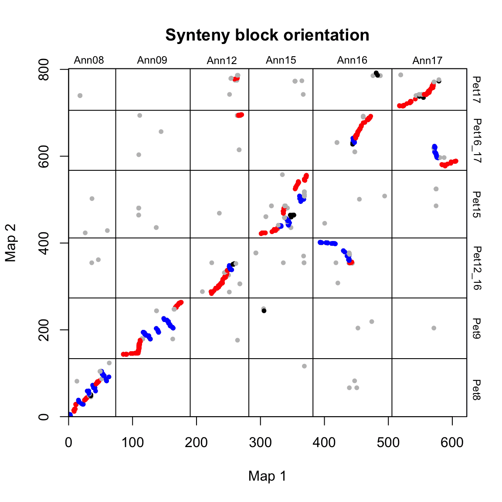
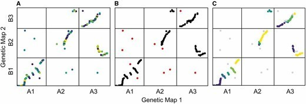

## 示例

{fig-alt="SyntenyBlocksPlot DEMO1" fig-align="center" width="60%"}

共线性被广泛应用于复杂基因组的研究。本教程将基于R包syntR，对识别两个遗传图谱之间共享的共线性区块、染色体重排和绘图进行总结。

## 环境配置

-   系统要求： 跨平台（Linux/MacOS/Windows）

-   编程语言：R

-   依赖包：`syntR`, `ggplot2`, `patchwork`;

```{r packages setup, message=FALSE, warning=FALSE, output=FALSE}
# 安装包
if (!requireNamespace("UpSetR", quietly = TRUE)) {
  remotes::install_github("ksamuk/syntR")
}
if (!requireNamespace("ggplot2", quietly = TRUE)) {
  install.packages("ggplot2")
}
if (!requireNamespace("patchwork", quietly = TRUE)) {
  install.packages("patchwork")
}

# 加载包
library(syntR)
library(ggplot2)
library(patchwork)
```

```{r}
sessioninfo::session_info("attached")
```

## 数据准备

syntR 需要两个遗传图谱中的标记位置（每个标记的染色体和图谱位置）。在使用 syntR 之前，需要分别推断两个图谱中的标记顺序。在使用 syntR 绘图，先使用R/qtl、ASMap 和 Lep-MAP获得两个不同图谱中单个标记（如 SNP、微卫星等）的位置数据。也可用minimap2的比对结果转换为为类似的输入文件用于分析和绘图。

```{r load data1, message=FALSE}
# 加载示例标记数据
data(ann_pet_map)
head(ann_pet_map)
```

数据分位六列：

- `map1_name`：标记的唯一标识符。在本例中，标记的命名是基于其在参考基因组中的位置（通过比对 GBS 读数确定）。
- `map1_chr`：第一个图谱中标记所在的染色体编号。
- `map1_pos`：第一个图谱中标记的位置（例如以 cM 为单位）。
- `map2_name`：同上，但用于图谱 2。这些名称可能与 map1_names 相同，也可能不相同。
- `map2_chr`：第二个图谱中标记所在的染色体编号。
- `map2_pos`：第二个图谱中的标记的位置。

示例数据是通过比较两种蝴蝶 *Helianthus petiolaris ssp. petiolaris* 和 *H. petiolaris ssp. fallax* 的GBS数据产生的。首先加载标记数据(ann_pet_map)和map1的染色体长度列表(ann_chr_lengths)，并通过`make_one_map` 函数将其转化为一个包含三个元素的列表(标记数据，map1和map2之间染色体中断的位置):

```{r load data2, message=FALSE}
# 读取 map1 的染色体长度列表
# 这是一个可选文件，用于定义最大长度
# 如果已知，则为每条染色体的长度（以 cM 为单位）
# 注意：当被比较的标记未覆盖整个图谱时，这很有用
data(ann_chr_lengths)
ann_chr_lengths
```

```{r load data3, message=FALSE}
# make_one_map 将所有标记放在一个尺度上
# 并在染色体之间添加填充
# 以辅助算法并实现可视化
map_list <- make_one_map(ann_pet_map, map1_max_chr_lengths = ann_chr_lengths)
```

## 可视化

### 1. 调整图谱顺序

使用 `plot_maps()` 创建标记数据的基本点阵图：

```{r}
#| label: fig-1.1AdjustOrder1
#| fig-cap: "调整图谱顺序"
#| out.width: "95%"
#| warning: false
#| message: false
#| fig-width: 6
#| fig-height: 6

# 调整图谱顺序
plot_maps(map_df = map_list[[1]], map1_chrom_breaks = map_list[[2]], map2_chrom_breaks = map_list[[3]])
```

染色体上标注了物种特有的名称，染色体断裂处用横竖线表示。

因为染色体是任意排序的(染色体没有固有顺序)，这些图看起来相当分散。为了提高可读性，可以重新排列物种 2 的染色体顺序，使其与物种 1 的顺序一致（沿 x 轴绘制）。还可以旋转任何 "完全颠倒 "的染色体，使它们（按染色体比例）沿 1:1 线排列。

```{r}
#| label: fig-1.2AdjustOrder2
#| fig-cap: "调整图谱顺序"
#| out.width: "95%"
#| warning: false
#| message: false
#| fig-width: 6
#| fig-height: 6

# 调整图谱顺序
map2_chr_order <- c("Pet8", "Pet9", "Pet12_16", "Pet15", "Pet16_17", "Pet17")
flip_chrs <- c("Pet9")
map_list <- make_one_map(ann_pet_map, map1_max_chr_lengths = ann_chr_lengths, map2_chr_order = map2_chr_order, flip_chrs = flip_chrs)
plot_maps(map_df = map_list[[1]], map1_chrom_breaks = map_list[[2]], map2_chrom_breaks = map_list[[3]])
```

### 2. 确定最佳翻转参数

syntR 算法的关键调整参数是 `max_cluster_range（CR max）`，其次是 `max_nn_dist（NN dist）`。`max_cluster_range` 决定了标记群的最大大小，这些标记群将被折叠成一个单点以便进一步分析。它定义了聚类标记所能跨越的最大距离。`max_cluster_range` 的值越大，将有越多的标记集结成一个点。

`max_nn_dist` 决定哪些标记被视为异常值，并从进一步分析中剔除。在 `max_nn_dist` 范围内没有相邻标记的标记被视为异常值。`max_nn_dist` 值越大，被移除的标记越少。
找到这两个参数最佳组合的简单方法是拟合这两个参数的取值范围，并选择能使两个图谱的覆盖率（分配给同源区块的图谱百分比）最大化和离群值数量最小化的取值（下图中的 "综合 "是这些指标的比例总和）。

选择最佳的CR max 和 NN dist 的方法：(1) 使用一系列参数组合运行 syntR；(2) 保存关于在同源区块中代表的每个图谱的遗传距离和每次运行保留的标记数的汇总统计；(3) 找到能最大化平均加权这三个测量值的复合统计的参数组合。在存在多个局部最大值的情况下，选择 CR max 值最小的局部最大值，以减少潜在假阳性的数量。

可以使用 `max_cluster_range = 2` 和 `max_nn_dist = 10` 的默认值跳过这一步。这一参数可能非常适合大多数遗传图谱。

```{r}
#| label: fig-2.1BestParameter
#| fig-cap: "确定最佳翻转参数"
#| out.width: "95%"
#| warning: false
#| message: false
#| fig-width: 6
#| fig-height: 6

# 寻找最佳参数组合
# 使用每个参数组合运行 find_synteny_blocks 并收集汇总统计数据

parameter_data <- test_parameters(map_list, max_cluster_range_list = seq(1, 5, by = 0.5), max_nn_dist_list = seq(10, 50, by = 10))
plot_summary_stats(parameter_data[[1]], "composite")
```

在本例中，选择 max_cluster_range 为 2， max_nn_dsit 为 10。

### 3. 识别同源区块

确定两个调整参数后，我们就可以运行 syntR 的主要功能：`find_synteny_blocks`。
该函数将一组标记数据（包含在我们之前创建的 `map_list` 对象中）通过 Ostevik 等人描述的算法进行错误检测和同源区块识别。
运行方法如下：

```{r}
#| label: fig-3.1SyntenyBlocks1
#| fig-cap: "识别同源区块"
#| out.width: "95%"
#| warning: false
#| message: false
#| fig-width: 6
#| fig-height: 6

# 识别同源区块
synt_blocks <- find_synteny_blocks(map_list, max_cluster_range = 2, max_nn_dist = 10, plots = TRUE)
```

当 `plots=TRUE` 时，函数会生成三幅图，显示算法的进展情况。在第一幅图中，映射误差通过预聚类步骤进行平滑处理。接下来，异常值会被标记和移除。最后，通过 syntR 之友聚类算法确定同源区块。

`find_synteny_blocks` 输出一个包含五个数据框的列表对象：

```{r}
# 打印 synt_blocks 的内容

lapply(synt_blocks, head)
```

这些要素是：

1. `$marker_df` 数据框，包括标记原始列表及其同源区块分配。

2. `$synteny_blocks_df` 一个数据框，概括了每张地图中每个同源区块的跨度（以地图单元为单位），以及具有充分方向性证据的同源区块的推断方向（并列、倒置等）。

3. `$map1_breaks` 一个数据框，列出了 map1 中合成组块之间的断点。

4. `$map2_breaks` 一个数据框，列出了 map2 中合成组块之间的断点。

5. `$summary_stats` 总结算法结果（覆盖率等）的数据框

可以如下图所示绘制出图块的方向：

```{r}
#| label: fig-3.2SyntenyBlocks2
#| fig-cap: "绘制出图块的方向"
#| out.width: "95%"
#| warning: false
#| message: false
#| fig-width: 6
#| fig-height: 6

# 绘制出图块的方向
synt_blocks[[1]] %>%
    plot_maps(map_list[[2]], map_list[[3]], col = c("blue", "grey", "red", "black")[as.numeric(as.factor(.$orientation))], 
              main = "Synteny block orientation",  cex_val = 0.75)
```

在这种情况下，蓝色 = 倒置，红色 = 同线，灰色/黑色 = 未分类。

### 4. 方向编码弧带

syntR 的输出表已经把每个区块分为同线、倒置或未分类。绘图必须用冗余线索让分类可见：颜色表示类别，交叉几何表示倒置，区块内的 ASCII 箭头（`>` 或 `<`）表示链方向。真正需要区分的是倒置与易位：倒置产生“领结”形交叉弧带，而易位只让弧带平移、不交叉。

```{r}
#| label: fig-4DirectionRibbons
#| fig-cap: "Direction-coded synteny ribbon between two genetic maps: b04 and b08 are inverted (orange, crossing ribbons, '<' blocks) and b06-b07 are translocated (purple, swapped order); grey ribbons are syntenic"
#| out.width: "100%"
#| warning: false
#| message: false
#| fig-width: 9.0
#| fig-height: 3.6
#| fig-dpi: 300
set.seed(43532)
nb <- 10
ids <- sprintf("b%02d", 1:nb)
blen <- c(6.2, 5.1, 7.4, 4.8, 6.8, 5.6, 7.9, 4.4, 6.0, 5.3)
gap <- 0.22

map1_order <- 1:nb
map2_order <- c(1, 2, 3, 4, 5, 7, 6, 8, 9, 10)
## b04 and b08 are inverted in map 2; b06/b07 swap places.
map2_strand <- ifelse(ids %in% c("b04", "b08"), "-", "+")

layout <- function(order, strand) {
  len <- blen[order]
  x0 <- cumsum(c(0, len[-length(len)] + gap))
  data.frame(id = ids[order], len = len, x0 = x0, x1 = x0 + len,
             mid = x0 + len / 2,
             strand = strand[match(ids[order], ids)], stringsAsFactors = FALSE)
}
m1 <- layout(map1_order, rep("+", nb)); m1$y <- 1.00
m2 <- layout(map2_order, map2_strand); m2$y <- 0.10

cls <- setNames(rep("collinear", nb), ids)
cls[c("b04", "b08")] <- "inverted"
cls[c("b06", "b07")] <- "translocated"
col_cls <- c(collinear = "#9e9e9e", inverted = "#d95f02",
             translocated = "#7570b3")

y_top <- 0.86; y_bot <- 0.24
ribs <- do.call(rbind, lapply(ids, function(g) {
  a <- m1[m1$id == g, ]; b <- m2[m2$id == g, ]
  bx <- c(b$x0, b$x1); if (b$strand == "-") bx <- rev(bx)
  data.frame(grp = g, class = cls[[g]],
             x = c(a$x0, a$x1, bx[2], bx[1]),
             y = c(y_top, y_top, y_bot, y_bot))
}))
ribs$class <- factor(ribs$class, levels = names(col_cls))

trk <- rbind(m1, m2)
trk$class <- factor(cls[trk$id], levels = names(col_cls))
trk$lab <- paste0(trk$id, " ", ifelse(trk$strand == "+", ">", "<"))

ggplot() +
  geom_polygon(data = ribs, aes(x, y, group = grp, fill = class)) +
  geom_rect(data = trk, aes(xmin = x0, xmax = x1, ymin = y - 0.09,
                            ymax = y + 0.09, fill = class),
            colour = "white", linewidth = 0.5) +
  geom_text(data = trk, aes(mid, y, label = lab), size = 2.4, colour = "black") +
  annotate("text", x = -0.7, y = 1.00, label = "Map 1", fontface = "bold",
           size = 3.2, hjust = 1) +
  annotate("text", x = -0.7, y = 0.10, label = "Map 2", fontface = "bold",
           size = 3.2, hjust = 1) +
  scale_fill_manual(values = c(collinear = alpha("#9e9e9e", 0.34),
                               inverted = alpha("#d95f02", 0.55),
                               translocated = alpha("#7570b3", 0.46)),
                    breaks = names(col_cls),
                    labels = c("syntenic", "inverted", "translocated"),
                    name = NULL) +
  scale_x_continuous(breaks = seq(0, 60, 10), expand = c(0, 0)) +
  scale_y_continuous(expand = c(0, 0)) +
  coord_cartesian(xlim = c(-1.4, 61), ylim = c(0.01, 1.20), clip = "off") +
  labs(x = "Cumulative map position (cM)", y = NULL) +
  theme_minimal(base_size = 9) +
  theme(panel.grid = element_blank(),
        axis.text.y = element_blank(),
        axis.text = element_text(size = 7.5, colour = "grey25"),
        axis.title = element_text(size = 8.3),
        legend.position = "top", legend.justification = "left",
        legend.key.size = unit(0.6, "lines"),
        legend.text = element_text(size = 7.5),
        plot.margin = margin(4, 8, 4, 18))
```

### 5. 同一区块表的三种静态版式

`syntenyPlotteR` 提供三种静态版式。`draw.linear` 用弧带连接两张图谱；`draw.eh` 绘制 Evolution Highway，每个物种一行、共享同一条参考轴；`draw.ideogram` 用参考染色体的颜色给目标染色体上色。面板 A 复用上方的区块表，面板 B 需要四个物种，面板 C 需要三条目标染色体，因此每个面板都按各自要回答的问题选择坐标系。

```{r}
#| label: fig-5SyntenyLayouts
#| fig-cap: "Three static layouts from one block table: (A) linear ribbons between two maps, (B) Evolution Highway rows of four species along a common reference chromosome, and (C) chromosome painting of three target chromosomes by reference chromosome of origin"
#| out.width: "100%"
#| warning: false
#| message: false
#| fig-width: 10.0
#| fig-height: 8.4
#| fig-dpi: 300
## Panel A reuses ribs/trk/col_cls from the previous chunk.
pA <- ggplot() +
  geom_polygon(data = ribs, aes(x, y, group = grp, fill = class)) +
  geom_rect(data = trk, aes(xmin = x0, xmax = x1, ymin = y - 0.09,
                            ymax = y + 0.09, fill = class),
            colour = "white", linewidth = 0.5) +
  geom_text(data = trk, aes(mid, y, label = id), size = 2.1) +
  annotate("text", x = -0.7, y = 1.00, label = "Map 1", fontface = "bold",
           size = 2.7, hjust = 1) +
  annotate("text", x = -0.7, y = 0.10, label = "Map 2", fontface = "bold",
           size = 2.7, hjust = 1) +
  scale_fill_manual(values = c(collinear = alpha("#9e9e9e", 0.34),
                               inverted = alpha("#d95f02", 0.55),
                               translocated = alpha("#7570b3", 0.46)),
                    breaks = names(col_cls),
                    labels = c("syntenic", "inverted", "translocated"),
                    name = NULL) +
  scale_x_continuous(breaks = seq(0, 60, 20), expand = c(0, 0)) +
  scale_y_continuous(expand = c(0, 0)) +
  coord_cartesian(xlim = c(-1.4, 61), ylim = c(0.01, 1.2), clip = "off") +
  labs(x = "Cumulative map position (cM)", y = NULL,
       title = "Linear: two maps, ribbons") +
  theme_minimal(base_size = 9) +
  theme(panel.grid = element_blank(),
        axis.text.y = element_blank(),
        axis.text = element_text(size = 7, colour = "grey25"),
        axis.title = element_text(size = 7.8),
        plot.title = element_text(size = 8.6, face = "bold", hjust = 0),
        legend.position = "top", legend.justification = "left",
        legend.key.size = unit(0.55, "lines"),
        legend.text = element_text(size = 7),
        legend.margin = margin(0, 0, 0, 0),
        legend.box.margin = margin(0, 0, -4, 0),
        plot.margin = margin(4, 8, 2, 16))

## Evolution Highway: one row per species, common reference axis.
eh <- data.frame(
  species = rep(c("S1", "S2", "S3", "S4"), each = 5),
  x0 = c(0, 21, 45, 64, 84,   0, 20, 41, 63, 82,
         2, 27, 50, 73, 90,   0, 18, 40, 61, 86),
  x1 = c(20, 43, 62, 81, 100, 18, 38, 60, 79, 100,
         25, 48, 71, 88, 100, 15, 37, 58, 83, 100),
  state = c(rep("syntenic", 3), "inverted", "syntenic",
            "syntenic", "inverted", "syntenic", "syntenic", "inverted",
            "syntenic", "syntenic", "inverted", "syntenic", "syntenic",
            "inverted", "syntenic", "syntenic", "inverted", "syntenic"),
  stringsAsFactors = FALSE
)
eh$y <- 5 - as.integer(sub("S", "", eh$species))

pB <- ggplot(eh) +
  geom_rect(aes(xmin = x0, xmax = x1, ymin = y - 0.3, ymax = y + 0.3,
                fill = state), colour = "white", linewidth = 0.45) +
  scale_fill_manual(values = c(syntenic = "#4c78a8", inverted = "#d95f02"),
                    breaks = c("syntenic", "inverted"),
                    labels = c("syntenic", "inverted"), name = NULL) +
  scale_x_continuous(breaks = seq(0, 100, 25), limits = c(0, 100),
                     expand = c(0, 0)) +
  scale_y_continuous(breaks = 1:4, labels = paste0("S", 4:1),
                     limits = c(0.55, 4.45), expand = c(0, 0)) +
  labs(x = "Position along reference chromosome (%)", y = NULL,
       title = "Evolution Highway: species rows") +
  theme_minimal(base_size = 9) +
  theme(panel.grid.major.y = element_blank(),
        panel.grid.minor = element_blank(),
        panel.grid.major.x = element_line(colour = "grey93", linewidth = 0.25),
        axis.text = element_text(size = 7, colour = "grey25"),
        axis.title = element_text(size = 7.8),
        plot.title = element_text(size = 8.6, face = "bold", hjust = 0),
        legend.position = "top", legend.justification = "left",
        legend.key.size = unit(0.55, "lines"),
        legend.text = element_text(size = 7),
        legend.margin = margin(0, 0, 0, 0),
        legend.box.margin = margin(0, 0, -4, 0),
        plot.margin = margin(4, 8, 2, 4))

## Chromosome painting: target chromosomes coloured by reference origin.
paint <- data.frame(
  chr = rep(c("T1", "T2", "T3"), each = 4),
  x0 = c(0, 12, 24, 37,   0, 9, 18, 28,   0, 10, 22, 31),
  x1 = c(12, 24, 37, 50,  9, 18, 28, 38,  10, 22, 31, 44),
  ref = c("R1", "R2", "R3", "R4", "R1", "R4", "R2", "R3",
          "R3", "R1", "R4", "R2"),
  stringsAsFactors = FALSE
)
paint$y <- 4 - as.integer(sub("T", "", paint$chr))

pC <- ggplot(paint) +
  geom_rect(aes(xmin = x0, xmax = x1, ymin = y - 0.28, ymax = y + 0.28,
                fill = ref), colour = "white", linewidth = 0.5) +
  scale_fill_manual(values = c(R1 = "#4c78a8", R2 = "#59a14f",
                               R3 = "#b07aa1", R4 = "#a6761d"),
                    name = "reference\nchromosome") +
  scale_x_continuous(breaks = seq(0, 50, 10), expand = c(0, 0)) +
  scale_y_continuous(breaks = 3:1, labels = c("T1", "T2", "T3"),
                     limits = c(0.55, 3.45), expand = c(0, 0)) +
  labs(x = "Position along target chromosome (Mb)", y = NULL,
       title = "Chromosome painting: target bars") +
  coord_cartesian(xlim = c(0, 50), clip = "off") +
  theme_minimal(base_size = 9) +
  theme(panel.grid.major.y = element_blank(),
        panel.grid.minor = element_blank(),
        panel.grid.major.x = element_line(colour = "grey93", linewidth = 0.25),
        axis.text = element_text(size = 7, colour = "grey25"),
        axis.title = element_text(size = 7.8),
        plot.title = element_text(size = 8.6, face = "bold", hjust = 0),
        legend.position = "right",
        legend.key.size = unit(0.55, "lines"),
        legend.title = element_text(size = 7),
        legend.text = element_text(size = 6.8),
        plot.margin = margin(4, 6, 2, 18))

(pA / (pB | pC)) +
  plot_annotation(tag_levels = "A") &
  theme(plot.tag = element_text(size = 9, face = "bold"))
```

## 关于本页跳过的实现

本页刻意只用本项目基础绘图栈自行绘制。在 issue-435 清单中归到 Omics/SyntenyBlocksPlot 的工具里，有 1 条被标记为**跳过**，仅作为版式参考、不作为依赖：该工具已超过 5 年无运维更新（截止日 2021-11-07）。沿用这套工具等于锁定已无法构建的代码。本页先把这些工具的图形约定读懂，再自行重画，以便逐行核验每个面板。

| 工具 | 最近提交 | 状态 | 跳过原因 |
| --- | --- | --- | --- |
| syntenyPlotByR | 2020-05-25 | 陈旧 | 超过 5 年无运维更新 |

## 应用场景

::: {#fig-UpsetApplications}
{fig-alt="SyntenyBlocksPlotApp1" fig-align="center" width="60%"}

共线性块图应用
:::

## 参考文献

\[1\] Ostevik, Kate L., Kieran Samuk, and Loren H. Rieseberg. "Ancestral reconstruction of karyotypes reveals an exceptional rate of nonrandom chromosomal evolution in sunflower." Genetics 214, no. 4 (2020): 1031-1045.

\[2\] Damas J, Quigley S, Larkin D, Farré M. syntenyPlotteR: an R package to draw synteny plots in three different styles. https://github.com/marta-fb/syntenyPlotteR

