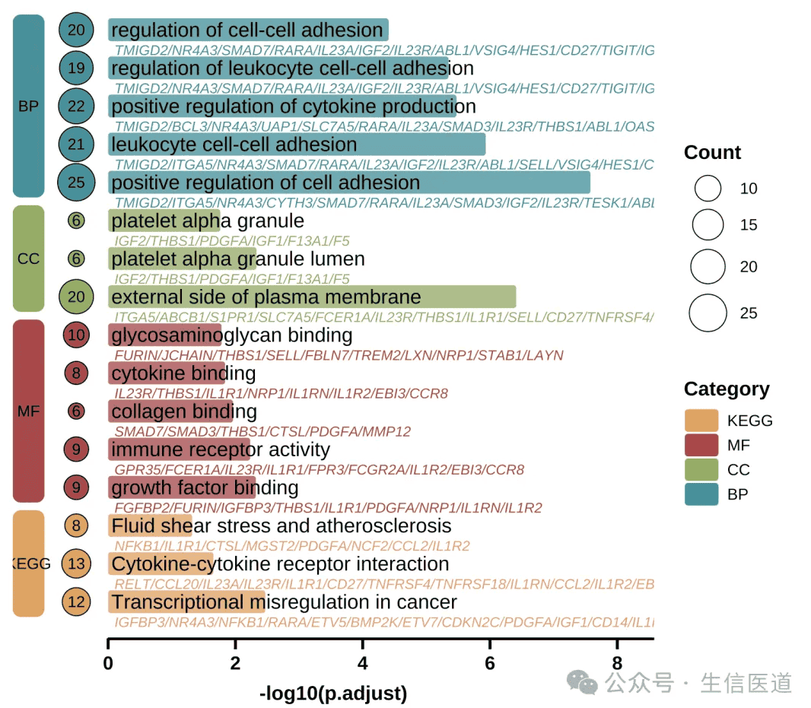

The Text-Overlaid Enrichment Barplot is a visualization tool designed for the high-density display of functional enrichment analysis results (e.g., GO, KEGG). It typically maps enrichment significance (adjusted p-value) to the length of rounded bars and utilizes the internal space of the graphics to directly overlay annotations of pathway names and core gene lists. Additionally, it uses colored blocks and bubbles on the left side to distinguish functional categories and gene counts.

This chart form alters the traditional layout where text and graphics are separated. It is particularly suitable for displaying functional annotations of marker genes in single-cell subpopulations, as well as other research scenarios requiring the simultaneous presentation of "pathway significance" and "specific driver genes." Its visual effect not only optimizes the utilization of drawing space but also facilitates researchers in quickly locking onto key gene characteristics leading to pathway enrichment while overviewing biological functions.

## Example

{fig-alt="TextEnrichmentBarplot DEMO" fig-align="center" width="60%"}

## Setup

-   System Requirements: Cross-platform (Linux/MacOS/Windows)

-   Programming Language: R

-   Dependencies: `tidyverse`, `ggprism`, `gground`

```{r packages setup, message=FALSE, warning=FALSE, output=FALSE}
# Install packages
if (!requireNamespace("tidyverse", quietly = TRUE)){
  install.packages("tidyverse")
} 
if (!requireNamespace("ggprism", quietly = TRUE)){
  install.packages("ggprism")
} 
if (!requireNamespace("gground", quietly = TRUE)) {
  remotes::install_github("dxsbiocc/gground")
}
# Load packages
library(tidyverse)
library(ggprism)
library(gground)
```

## Data Preparation

### 1. Upstream Enrichment Analysis Workflow (Reference)

In actual bioinformatics analysis, we typically use `clusterProfiler` for enrichment analysis.

::: callout-note
The following code is for demonstration of the upstream analysis workflow (obtaining raw data) only. This tutorial will directly use the example data provided below for plotting.
:::

```{r processing flow}
#| eval: false
#| echo: true

# 1. Environment Preparation
library(clusterProfiler)
library(org.Hs.eg.db)

# 2. Run Enrichment Analysis
# Assume gene_list is a vector of Entrez IDs for differentially expressed genes

# 2.1 GO Enrichment Analysis (Get BP/CC/MF simultaneously)
ego <- enrichGO(
  gene     = gene_list,
  OrgDb    = org.Hs.eg.db,
  ont      = "ALL",
  readable = TRUE  # Automatically convert IDs in results to Symbols
)

# 2.2 KEGG Enrichment Analysis
ekegg <- enrichKEGG(
  gene     = gene_list,
  organism = 'hsa'
)
# KEGG results default to Entrez ID; manually convert to Symbol to match plotting data format
ekegg <- setReadable(ekegg, OrgDb = org.Hs.eg.db, keyType = "ENTREZID")

# 3. Data Cleaning and Merging
# Extract GO results (Rename ONTOLOGY to Category)
df_go <- as.data.frame(ego) %>% 
  select(Category = ONTOLOGY, Description, p.adjust, Count, geneID)

# Extract KEGG results (Manually add Category column and assign as "KEGG")
df_kegg <- as.data.frame(ekegg) %>% 
  mutate(Category = "KEGG") %>% 
  select(Category, Description, p.adjust, Count, geneID)

# Merge all results -> Get raw_data for plotting
raw_data <- rbind(df_go, df_kegg)
```

### 2. Loading and Cleaning Example Data

To facilitate the tutorial, we import pathway enrichment data from network pharmacology annotation analysis using DAVID. This data includes enrichment results for GO (BP/CC/MF) and KEGG.

```{r load data 2, message=FALSE}
# 1. Read Data
raw_data <- read_tsv("https://bizard-1301043367.cos.ap-guangzhou.myqcloud.com/DAVID.txt")

# 2. Data Cleaning
# Convert DAVID format to the standard format required for plotting
raw_data <- raw_data %>%
  # 2.1 Extract Category Labels
  mutate(Category = case_when(
    grepl("BP_DIRECT", Category) ~ "BP",
    grepl("CC_DIRECT", Category) ~ "CC",
    grepl("MF_DIRECT", Category) ~ "MF",
    grepl("KEGG_PATHWAY", Category) ~ "KEGG",
    TRUE ~ "Other"
  )) %>%
  # Keep only GO and KEGG results
  filter(Category %in% c("BP", "CC", "MF", "KEGG")) %>%
  
  # 2.2 Clean Pathway Names (Remove IDs, e.g., "GO:001~Name" -> "Name")
  mutate(Description = sub("^.*~|.*:", "", Term)) %>%
  
  # 2.3 Rename Columns (Unified variable names for plotting code)
  # FDR -> p.adjust (Significance)
  # Genes -> geneID (Gene List)
  rename(
    p.adjust = FDR,
    geneID = Genes
  ) %>%
  
  # 2.4 Format Gene Lists (Replace commas with slashes)
  mutate(geneID = gsub(", ", "/", geneID))
```

### 3. Creating Plotting Data

```{r create plotdata, message=FALSE}
# 1. Select the Top 5 most significant pathways for each category
use_pathway <- raw_data %>%
  arrange(p.adjust) %>%
  group_by(Category) %>%
  slice_head(n = 5) %>%
  ungroup()

# 2. Construct Auxiliary Plotting Columns
use_pathway <- use_pathway %>%
  # Set factor levels: determines the vertical order of legend and plot (BP -> CC -> MF -> KEGG)
  mutate(Category = factor(Category, levels = rev(c('BP', 'CC', 'MF', 'KEGG')))) %>%
  # Secondary sorting
  arrange(Category, p.adjust) %>%
  # Fix Y-axis order
  mutate(Description = factor(Description, levels = Description)) %>%
  # Add index column as Y-axis coordinates
  tibble::rowid_to_column('index')

# 3. Construct Data for Left Category Blocks (rect.data)
# Layout parameters
width <- 0.5 
# Calculate max X-axis length for drawing the bottom line
xaxis_max <- max(-log10(use_pathway$p.adjust)) + 1

rect.data <- use_pathway %>%
  arrange(Category) %>%
  group_by(Category) %>%
  summarize(n = n(), .groups = "drop") %>%
  mutate(
    xmin = -3 * width,          # Block left boundary
    xmax = -2 * width,          # Block right boundary
    ymax = cumsum(n),           # Block top boundary (based on cumulative count)
    ymin = lag(ymax, default = 0) + 0.6, # Block bottom boundary (leave a small gap)
    ymax = ymax + 0.4           # Adjust top boundary
  )

# Check data structure
head(use_pathway)
```

## Visualization

### 1. Basic Plotting (Simplified Version)

This version mainly displays the core rounded bar chart and the left-side category blocks, removing excessive text information like gene lists. It is suitable for scenarios requiring a concise display.

```{r}
#| label: fig1.SimpleRound
#| fig-cap: "Basic Enrichment Analysis Barplot"
#| out.width: "95%"
#| warning: false
#| fig.width: 12
#| fig.height: 8

# Define color palette
pal <- c('#eaa052', '#b74147', '#90ad5b', '#23929c')

# Other recommended palettes
#pal <- c('#c3e1e6', '#f3dfb7', '#dcc6dc', '#96c38e')
#pal <- c('#7bc4e2', '#acd372', '#fbb05b', '#ed6ca4')

# Adjust position parameters for left blocks in the simplified version
rect.data.simple <- rect.data %>%
  mutate(
    xmin = -1.5 * width,
    xmax = -0.5 * width
  )

p1 <- ggplot(use_pathway, aes(-log10(p.adjust), y = index, fill = Category)) +
  # 1. Rounded Bar Chart Body
  geom_round_col(aes(y = Description), width = 0.6, alpha = 0.8) +
  
  # 2. Pathway Name Text
  geom_text(aes(x = 0.05, label = Description), hjust = 0, size = 4) +
  
  # 3. Left Category Blocks
  geom_round_rect(
    aes(xmin = xmin, xmax = xmax, ymin = ymin, ymax = ymax, fill = Category),
    data = rect.data.simple,
    radius = unit(2, 'mm'),
    inherit.aes = FALSE
  ) +
  
  # 4. Left Category Text
  geom_text(
    aes(x = (xmin + xmax) / 2, y = (ymin + ymax) / 2, label = Category),
    data = rect.data.simple,
    size = 3,
    inherit.aes = FALSE
  ) +
  
  # 5. Bottom Decorative Line
  geom_segment(
    aes(x = 0, y = 0, xend = xaxis_max, yend = 0),
    linewidth = 1,
    inherit.aes = FALSE
  ) +
  
  # 6. Style Adjustments
  labs(y = NULL, x = "-log10(p.adjust)") +
  scale_fill_manual(name = 'Category', values = pal) +
  scale_x_continuous(breaks = seq(0, xaxis_max, 2), expand = expansion(c(0, 0.1))) +
  theme_prism() +
  theme(
    axis.text.y = element_blank(),
    axis.line.y = element_blank(),
    axis.ticks.y = element_blank(),
    axis.line.x = element_blank(), # Hide default X-axis line, keeping only the one drawn by geom_segment
    legend.title = element_text(),
    legend.position = "right" 
  )

p1
```

### 2. Advanced Plotting (Detailed Version)

Based on the simplified version, this version adds:

-   Gene List: Displays the gene list below the pathway name (grey italics).

-   Count Bubbles: Displays the number of enriched genes on the left (bubble size).

-   Layout: Adjusts the position of the left blocks to make space for bubbles.

```{r}
#| label: fig2.ComplexRound
#| fig-cap: "Advanced Enrichment Analysis Barplot"
#| out.width: "95%"
#| warning: false
#| fig-width: 12
#| fig-height: 8

p2 <- ggplot(use_pathway, aes(-log10(p.adjust), y = index, fill = Category)) +
  # 1. Main Rounded Bars
  geom_round_col(aes(y = Description), width = 0.6, alpha = 0.8) +
  
  # 2. Pathway Name (Main Title)
  geom_text(aes(x = 0.05, label = Description), hjust = 0, size = 5) +
  
  # 3. Gene List (Subtitle) - Grey Italics
  geom_text(
    aes(x = 0.1, label = geneID, colour = Category),
    hjust = 0, vjust = 2.6, size = 3, fontface = 'italic',
    show.legend = FALSE
  ) +
  
  # 4. Left Gene Count Bubbles (Count)
  geom_point(aes(x = -width, size = Count, fill = Category), shape = 21, stroke = 1) +
  geom_text(aes(x = -width, label = Count), size = 3) +
  
  # 5. Left Category Blocks (Category Label)
  geom_round_rect(
    aes(xmin = xmin, xmax = xmax, ymin = ymin, ymax = ymax, fill = Category),
    data = rect.data,
    radius = unit(2, 'mm'),
    inherit.aes = FALSE
  ) +
  geom_text(
    aes(x = (xmin + xmax) / 2, y = (ymin + ymax) / 2, label = Category),
    data = rect.data,
    inherit.aes = FALSE,
    color = "black", fontface = "bold"
  ) +
  
  # 6. Bottom Line
  geom_segment(
    aes(x = 0, y = 0, xend = xaxis_max, yend = 0),
    linewidth = 1.5,
    inherit.aes = FALSE
  ) +
  
  # 7. Scales and Colors
  labs(y = NULL, x = "-log10(p.adjust)") +
  scale_fill_manual(name = 'Category', values = pal) +
  scale_colour_manual(values = pal) + 
  scale_size_continuous(name = 'Count', range = c(4, 10)) +
  scale_x_continuous(breaks = seq(0, xaxis_max, 2), expand = expansion(c(0, 0))) +
  
  # 8. Theme Customization
  theme_prism() +
  theme(
    axis.text.y = element_blank(),
    axis.line = element_blank(),
    axis.ticks.y = element_blank(),
    legend.title = element_text(),
    plot.margin = margin(l = 10, r = 10) 
  )

p2
```

### 3. Mirrored Up/Down Enrichment Dot Plot

When up- and down-regulated genes are tested in one run, the two enrichment arms can be mirrored around zero in a single dot plot: negate the `Count` of the down-regulated arm, share one factor axis, colour by FDR and size by gene count \[2\]. The `enrichplot::dotplot()` equivalent on real `enrichResult` objects works the same way.

```{r}
#| label: fig-3.1MirrorEnrichDot
#| fig-cap: "Mirrored enrichment dot plot: up-regulated terms to the right of the zero line, down-regulated to the left; dot size = gene count, colour = FDR on a log scale; the two panels scale independently."
#| out.width: "95%"
#| warning: false
#| message: false
#| fig-width: 8
#| fig-height: 6

set.seed(5201)
n_term <- 14
terms <- paste0("HALLMARK_", sprintf("%02d", 1:n_term))
mk_res <- function(direction) {
  data.frame(Category = direction, ID = terms,
             Description = paste0(terms, "_desc"),
             Count = abs(round(rnorm(n_term, 8, 4))) + 1,
             FDR = 10^runif(n_term, -5, -1.4), stringsAsFactors = FALSE)
}
up <- mk_res("Up")
dn <- mk_res("Down")
dn$Count <- -dn$Count          # negative Count draws the down arm to the left of zero
allr <- rbind(up, dn)

ggplot(allr, aes(Count, reorder(Description, Count), colour = FDR)) +
  geom_point(aes(size = abs(Count))) +
  scale_colour_gradient(low = "#B2182B", high = "#2874C5",
                        trans = "log10", name = "FDR") +
  scale_size_continuous(range = c(1.5, 5), guide = "none") +
  facet_grid(Category ~ ., scales = "free_y", space = "free_y") +
  geom_vline(xintercept = 0, colour = "grey50", linewidth = 0.4) +
  labs(x = "Over-representation gene count", y = NULL) +
  theme_classic(base_size = 11) +
  theme(panel.grid.major.y = element_blank(), legend.position = "right",
        strip.text = element_text(colour = "black", face = "bold", size = 9),
        strip.background = element_rect(fill = "grey92"))

stopifnot(sum(up$FDR < 0.05) + sum(dn$FDR < 0.05) >= 10)
```

::: callout-tip
**Practice tips**

-   The negative-`Count` trick keeps both arms on one scale so the eye compares arm lengths directly.
-   `facet_grid(..., scales = "free_y", space = "free_y")` lets each arm sort its own terms without empty padding rows.
-   With real results, build the two arms with `clusterProfiler::compareCluster()` and feed the merged frame to the same ggplot2 layers — no enrichplot dependency needed.
:::

### 4. Pathway-Activity DE Dot Plot Across Cell Types

The FigureYa318 layout \[2\] asks the two-group question **per cell type and per pathway at once**: rows = cell types, columns = pathways (grouped by a classification colour strip), dot size = FDR bins, dot colour = log2 fold change of the pathway activity score. The reference computes AUCell scores per cell and limma contrasts per cell type; here the same geometry is reproduced from simulated per-cell activity scores tested with Wilcoxon rank-sum and Bonferroni correction — swap in your own AUCell/GSVA score matrix for real data.

```{r}
#| label: fig-4.1PathwayDEDot
#| fig-cap: "Pathway-activity differential dot plot (12 pathways x 4 cell types): dot size = Bonferroni-FDR bins, colour = log2 fold change of the activity score; the bottom strip groups pathways into Immune / Metabolism / Signaling / Proliferation."
#| out.width: "100%"
#| warning: false
#| message: false
#| fig-width: 11
#| fig-height: 6

set.seed(3181)
paths <- c("HALLMARK_INTERFERON_GAMMA", "HALLMARK_TNFA_SIGNALING", "HALLMARK_COMPLEMENT",
           "HALLMARK_GLYCOLYSIS", "HALLMARK_OXIDATIVE_PHOSPH", "HALLMARK_FATTY_ACID",
           "HALLMARK_MAPK", "HALLMARK_PI3K", "HALLMARK_NOTCH",
           "HALLMARK_E2F", "HALLMARK_G2M", "HALLMARK_APOPTOSIS")
class.df <- data.frame(
  geneset = paths,
  Classification = c("Immune", "Immune", "Immune",
                     "Metabolism", "Metabolism", "Metabolism",
                     "Signaling", "Signaling", "Signaling",
                     "Proliferation", "Proliferation", "Proliferation"))
cts <- c("CD8 T", "Macro", "Fibro", "Cancer")
n_pc <- 40
path_mean <- setNames(c(0.55, 0.5, 0.45, 0.35, 0.4, 0.3, 0.25, 0.3, 0.2, 0.2, 0.25, 0.3), paths)
scores_ctl <- do.call(rbind, lapply(cts, function(ct) {
  m <- sapply(paths, function(pw) rnorm(n_pc, path_mean[pw], 0.12))
  data.frame(cell = ct, m, check.names = FALSE)
}))
scores_tr <- scores_ctl
immune_hit <- scores_tr$cell %in% c("CD8 T", "Macro")
scores_tr$HALLMARK_INTERFERON_GAMMA[immune_hit] <-
  scores_tr$HALLMARK_INTERFERON_GAMMA[immune_hit] + 0.28
scores_tr$HALLMARK_TNFA_SIGNALING[immune_hit] <-
  scores_tr$HALLMARK_TNFA_SIGNALING[immune_hit] + 0.32
scores_tr$HALLMARK_E2F[] <- scores_tr$HALLMARK_E2F[] - 0.22
## null pathways get small cell-type-specific offsets in the treated arm so
## their near-zero log2FC scatter stays visible on the white midpoint
set.seed(3182)
null_paths <- setdiff(paths, c("HALLMARK_INTERFERON_GAMMA", "HALLMARK_TNFA_SIGNALING", "HALLMARK_E2F"))
for (pw in null_paths) {
  off <- rnorm(length(cts), 0, 0.07); names(off) <- cts
  sel <- scores_tr$cell %in% cts
  scores_tr[sel, pw] <- scores_tr[sel, pw] + off[scores_tr$cell[sel]]
}

DP.list <- lapply(cts, function(ct) {
  do.call(rbind, lapply(paths, function(pw) {
    a <- scores_ctl$cell == ct; b <- scores_tr$cell == ct
    data.frame(Celltypes = ct, Pathway = pw,
               logFC = mean(scores_tr[[pw]][b]) - mean(scores_ctl[[pw]][a]),
               p.val = wilcox.test(scores_tr[[pw]][b], scores_ctl[[pw]][a])$p.value)
  }))
})
DPs <- do.call(rbind, DP.list)
DPs$adj.P.Val <- p.adjust(DPs$p.val, method = "bonferroni")

plot.data <- DPs
plot.data$FDR <- cut(plot.data$adj.P.Val, breaks = c(0, 1e-10, 1e-6, 1e-3, 1),
                     include.lowest = TRUE,
                     labels = c("<1e-10", "1e-10~1e-6", "1e-6~1e-3", ">1e-3"))
plot.data$FDR <- factor(as.character(plot.data$FDR),
                        levels = c("<1e-10", "1e-10~1e-6", "1e-6~1e-3", ">1e-3"))
plot.data$Pathway <- factor(sub("HALLMARK_", "", plot.data$Pathway),
                            levels = sub("HALLMARK_", "", class.df$geneset))
plot.data$Celltypes <- factor(plot.data$Celltypes, levels = rev(cts))

color <- c("#4682B4", "#FFFFFF", "#CD2626")
class.color <- c("Immune" = "#D58986", "Metabolism" = "#80554C",
                 "Signaling" = "#71AC7A", "Proliferation" = "#E8D4B4")
p1 <- ggplot(plot.data, aes(Pathway, Celltypes, color = logFC, size = FDR)) +
  geom_point() +
  scale_color_gradient2(low = color[1], mid = color[2], high = color[3],
                        limits = c(-0.35, 0.35), name = "log2FC (score)") +
  scale_size_manual(values = c("<1e-10" = 4.4, "1e-10~1e-6" = 3.6,
                               "1e-6~1e-3" = 2.8, ">1e-3" = 1.6),
                    name = "Bonferroni FDR", drop = FALSE) +
  geom_hline(yintercept = seq(0.5, length(cts) - 0.5, 1), colour = "grey80") +
  geom_vline(xintercept = seq(0.5, length(paths) - 0.5, 1), colour = "grey80") +
  theme_classic(base_size = 10) +
  theme(axis.text.x = element_text(angle = 90, hjust = 1, vjust = 0.5),
        axis.line = element_blank())
## the classification strip must share p1's column order: keep geneset as a
## factor with the same level order, never a bare character vector
class.df$geneset <- factor(sub("HALLMARK_", "", class.df$geneset),
                           levels = sub("HALLMARK_", "", paths))
p2 <- ggplot(class.df, aes(geneset, 1, fill = Classification)) +
  geom_tile() +
  scale_fill_manual(values = class.color, name = NULL) +
  theme_void(base_size = 10) +
  theme(legend.position = "bottom", legend.direction = "horizontal",
        legend.title = element_text(size = 8),
        legend.text = element_text(size = 7.5),
        legend.key.size = unit(3, "mm"),
        legend.margin = margin(0, 0, 0, 0))
cowplot::plot_grid(p1, p2, ncol = 1, align = "v", axis = "lr",
                   rel_heights = c(10, 1.9))
```

::: callout-tip
**Practice tips**

-   Keep the strip and the dot plot on the **same factor levels** — the strip's x axis is a plain character vector in most drafts, which silently re-sorts alphabetically and desynchronises the two panels.
-   Bonferroni over pathways x cell types is what the reference uses; with `rstatix` the same workflow is `group_by(Celltypes, Pathway) |> wilcox_test() |> adjust_pvalue(method = "bonferroni")`.
-   Dots at the white midpoint are invisible on a white panel: either plant real per-cell-type variability (as done here) or outline non-significant dots.
:::

## Reference

\[1\] 生信医道. 超好看的单细胞GO，KEGG富集分析图！确定不来看看吗？ \[Internet\]. 微信公众号: 生信医道. 2025 \[cited 2025 Dec 30\]. Available from: <https://mp.weixin.qq.com/s/pY1S0EJQAhdezvxeNt-SzA>

\[2\] Xiaofan Lu, et al. FigureYa: A Standardized Visualization Framework for Enhancing Biomedical Data Interpretation and Research Efficiency. iMetaMed. 2025. doi:10.1002/imm3.70005
