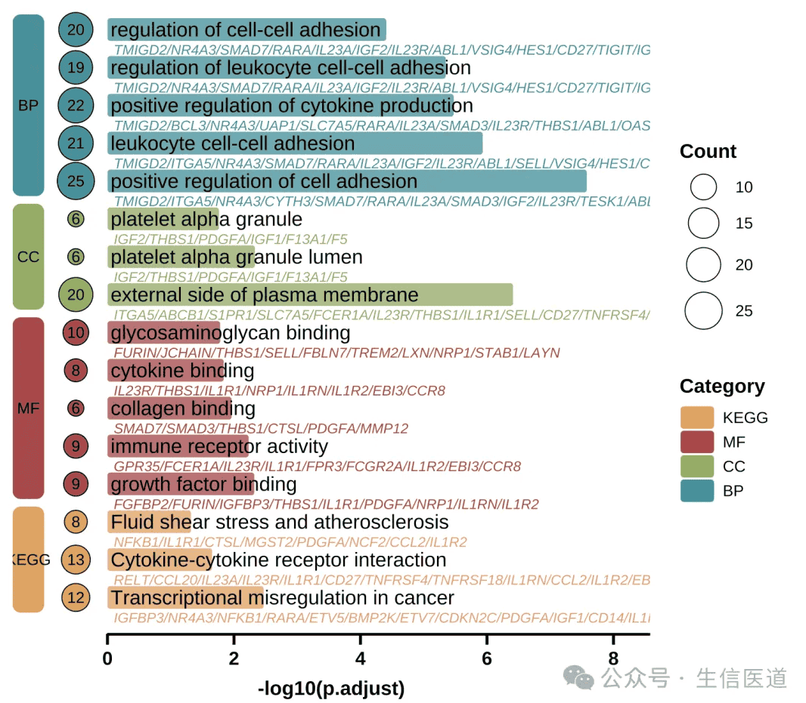

文字叠加富集柱状图是一种用于高密度展示功能富集分析结果（如 GO、KEGG）的可视化工具。它通常以圆角柱状图的长度映射富集显著性（adjust p value），并利用图形内部空间直接叠加标注通路名称与核心基因列表，同时辅以左侧色块与气泡来区分功能分类及基因数量。

这种图表形态改变了传统条形图文本与图形分离的布局，特别适用于单细胞亚群标记基因的功能注释展示，以及其他需要同时呈现“通路显著性”与“具体驱动基因”的研究场景。其可视化效果不仅优化了绘图空间利用率，还便于研究者在概览生物学功能的同时，快速锁定导致通路富集的关键基因特征。

## Example

{fig-alt="TextEnrichmentBarplot DEMO" fig-align="center" width="60%"}

## 环境配置

-   系统要求 跨平台（Linux/MacOS/Windows）

-   编程语言: R

-   依赖包: `tidyverse`, `ggprism`, `gground`

```{r packages setup, message=FALSE, warning=FALSE, output=FALSE}
# 安装包
if (!requireNamespace("tidyverse", quietly = TRUE)){
  install.packages("tidyverse")
} 
if (!requireNamespace("ggprism", quietly = TRUE)){
  install.packages("ggprism")
} 
if (!requireNamespace("gground", quietly = TRUE)) {
  remotes::install_github("dxsbiocc/gground")
}
# 加载包
library(tidyverse)
library(ggprism)
library(gground)
```

## 数据准备

### 1.上游富集分析流程 (参考)

在实际的生物信息学分析中，我们通常使用 `clusterProfiler` 进行富集分析。

::: callout-note
以下代码仅用于演示上游分析流程（获取原始数据），本教程绘图将直接使用下文的示例数据。
:::

```{r processing flow}
#| eval: false
#| echo: true
# 1. 环境准备
library(clusterProfiler)
library(org.Hs.eg.db)

#2. 运行富集分析
# 假设 gene_list 是差异基因的 Entrez ID 向量

# 2.1 GO 富集分析 (同时获取 BP/CC/MF)
ego <- enrichGO(
  gene     = gene_list,
  OrgDb    = org.Hs.eg.db,
  ont      = "ALL",
  readable = TRUE  # 自动将结果中的 ID 转换为 Symbol
)

# 2.2 KEGG 富集分析
ekegg <- enrichKEGG(
  gene     = gene_list,
  organism = 'hsa'
)
# KEGG 结果默认为 Entrez ID，需手动转为 Symbol 以匹配绘图数据格式
ekegg <- setReadable(ekegg, OrgDb = org.Hs.eg.db, keyType = "ENTREZID")

# 3. 数据清洗与合并
# 提取 GO 结果 (重命名 ONTOLOGY 为 Category)
df_go <- as.data.frame(ego) %>% 
  select(Category = ONTOLOGY, Description, p.adjust, Count, geneID)

# 提取 KEGG 结果 (手动添加 Category 列并赋值为 "KEGG")
df_kegg <- as.data.frame(ekegg) %>% 
  mutate(Category = "KEGG") %>% 
  select(Category, Description, p.adjust, Count, geneID)

# 合并所有结果 -> 得到最终用于绘图的 raw_data
raw_data <- rbind(df_go, df_kegg)

```

### 2.示例数据加载与清洗

为了方便教程运行，我们导入来自 [DAVID](https://github.com/user-attachments/files/20958956/DAVID.txt) 的网络药理学注释分析通路富集数据，该数据包含了 GO (BP/CC/MF) 和 KEGG 的富集结果。

```{r load data 2, message=FALSE}
#1.读取数据
raw_data <- read_tsv("https://bizard-1301043367.cos.ap-guangzhou.myqcloud.com/DAVID.txt")

# 2. 数据清洗
# 将 DAVID 的格式转换为绘图所需的标准格式
raw_data <- raw_data %>%
  # 2.1 提取分类标签
  mutate(Category = case_when(
    grepl("BP_DIRECT", Category) ~ "BP",
    grepl("CC_DIRECT", Category) ~ "CC",
    grepl("MF_DIRECT", Category) ~ "MF",
    grepl("KEGG_PATHWAY", Category) ~ "KEGG",
    TRUE ~ "Other"
  )) %>%
  # 只保留GO、KEGG结果
  filter(Category %in% c("BP", "CC", "MF", "KEGG")) %>%
  
  # 2.2 清洗通路名称 (去掉 ID)
  mutate(Description = sub("^.*~|.*:", "", Term)) %>%
  
  # 2.3 重命名列
  rename(
    p.adjust = FDR,
    geneID = Genes
  ) %>%
  
  # 2.4 格式化基因列表
  mutate(geneID = gsub(", ", "/", geneID)) 


```

### 3.创建绘图数据

```{r create plotdata, message=FALSE}

# 1.筛选每个分类下最显著的 Top 5 通路
use_pathway <- raw_data %>%
  arrange(p.adjust) %>%
  group_by(Category) %>%
  slice_head(n = 5) %>%
  ungroup()

# 2. 构造绘图辅助列
use_pathway <- use_pathway %>%
  # 设置因子水平：决定图例和绘图的垂直顺序
  mutate(Category = factor(Category, levels = rev(c('BP', 'CC', 'MF', 'KEGG')))) %>%
  # 二次排序
  arrange(Category, p.adjust) %>%
  # 固定 Y 轴顺序
  mutate(Description = factor(Description, levels = Description)) %>%
  # 添加 index 列作为 Y 轴坐标
  tibble::rowid_to_column('index')
# 3. 构造左侧分类色块的数据 (rect.data)
#布局参数
width <- 0.5 
# 计算 X 轴最大长度，用于绘制底部横线
xaxis_max <- max(-log10(use_pathway$p.adjust)) + 1

rect.data <- use_pathway %>%
  arrange(Category) %>%
  group_by(Category) %>%
  summarize(n = n(), .groups = "drop") %>%
  mutate(
    xmin = -3 * width,          
    xmax = -2 * width,         
    ymax = cumsum(n),          
    ymin = lag(ymax, default = 0) + 0.6, 
    ymax = ymax + 0.4          
  )

# 查看数据结构
head(use_pathway)

```

## 可视化

### 1. 基础绘图（简化版）

该版本主要展示了核心的圆角柱状图和左侧的分类色块，去除了基因列表等过多文本信息，适合需要简洁展示的场景。

```{r}
#| label: fig1.SimpleRound
#| fig-cap: "基础富集分析柱状图"
#| out.width: "95%"
#| warning: false
#| fig.width: 12
#| fig.height: 8

# 定义配色
pal <- c('#eaa052', '#b74147', '#90ad5b', '#23929c')

#其它推荐配色
#pal <- c('#c3e1e6', '#f3dfb7', '#dcc6dc', '#96c38e')
#pal <- c('#7bc4e2', '#acd372', '#fbb05b', '#ed6ca4')

# 调整简化版的左侧色块位置参数
rect.data.simple <- rect.data %>%
  mutate(
    xmin = -1.5 * width,
    xmax = -0.5 * width
  )

p1 <- ggplot(use_pathway, aes(-log10(p.adjust), y = index, fill = Category)) +
  # 1. 圆角柱状图主体
  geom_round_col(aes(y = Description), width = 0.6, alpha = 0.8) +
  
  # 2. 通路名称文本
  geom_text(aes(x = 0.05, label = Description), hjust = 0, size = 4) +
  
  # 3. 左侧分类色块
  geom_round_rect(
    aes(xmin = xmin, xmax = xmax, ymin = ymin, ymax = ymax, fill = Category),
    data = rect.data.simple,
    radius = unit(2, 'mm'),
    inherit.aes = FALSE
  ) +
  
  # 4. 左侧分类文字
  geom_text(
    aes(x = (xmin + xmax) / 2, y = (ymin + ymax) / 2, label = Category),
    data = rect.data.simple,
    size = 3,
    inherit.aes = FALSE
  ) +
  
  # 5. 底部装饰横线
  geom_segment(
    aes(x = 0, y = 0, xend = xaxis_max, yend = 0),
    linewidth = 1,
    inherit.aes = FALSE
  ) +
  
  # 6. 样式调整
  labs(y = NULL, x = "-log10(p.adjust)") +
  scale_fill_manual(name = 'Category', values = pal) +
  scale_x_continuous(breaks = seq(0, xaxis_max, 2), expand = expansion(c(0, 0.1))) +
  theme_prism() +
  theme(
    axis.text.y = element_blank(),
    axis.line.y = element_blank(),
    axis.ticks.y = element_blank(),
    axis.line.x = element_blank(), # 隐藏系统自带的 X 轴线，只保留我们用 geom_segment 画的那条
    legend.title = element_text(),
    legend.position = "right" 
  )

p1
```

### 2. 进阶绘图 (详细信息版)

该版本在简化版的基础上，增加了：

-   Gene List: 在通路名称下方显示基因列表（灰色斜体）。

-   Count Bubbles: 在左侧展示富集基因的数量（气泡大小）。

-   Layout: 调整了左侧色块的位置，为气泡留出空间。

```{r}
#| label: fig2.ComplexRound
#| fig-cap: "进阶富集分析柱状图"
#| out.width: "95%"
#| warning: false
#| fig-width: 12
#| fig-height: 8

p2 <- ggplot(use_pathway, aes(-log10(p.adjust), y = index, fill = Category)) +
  # 1. 主体圆角柱
  geom_round_col(aes(y = Description), width = 0.6, alpha = 0.8) +
  
  # 2. 通路名称 
  geom_text(aes(x = 0.05, label = Description), hjust = 0, size = 5) +
  
  # 3. 基因列表
  geom_text(
    aes(x = 0.1, label = geneID, colour = Category),
    hjust = 0, vjust = 2.6, size = 3, fontface = 'italic',
    show.legend = FALSE
  ) +
  
  # 4. 左侧基因计数气泡
  geom_point(aes(x = -width, size = Count,fill = Category), shape = 21, stroke = 1) +
  geom_text(aes(x = -width, label = Count), size = 3) +
  
  # 5. 左侧分类色块
  geom_round_rect(
    aes(xmin = xmin, xmax = xmax, ymin = ymin, ymax = ymax, fill = Category),
    data = rect.data,
    radius = unit(2, 'mm'),
    inherit.aes = FALSE
  ) +
  geom_text(
    aes(x = (xmin + xmax) / 2, y = (ymin + ymax) / 2, label = Category),
    data = rect.data,
    inherit.aes = FALSE,
    color = "black", fontface = "bold"
  ) +
  
  # 6. 底部横线
  geom_segment(
    aes(x = 0, y = 0, xend = xaxis_max, yend = 0),
    linewidth = 1.5,
    inherit.aes = FALSE
  ) +
  
  # 7. 标尺与配色
  labs(y = NULL, x = "-log10(p.adjust)") +
  scale_fill_manual(name = 'Category', values = pal) +
  scale_colour_manual(values = pal) + 
  scale_size_continuous(name = 'Count', range = c(4, 10)) +
  scale_x_continuous(breaks = seq(0, xaxis_max, 2), expand = expansion(c(0, 0))) +
  
  # 8. 主题美化
  theme_prism() +
  theme(
    axis.text.y = element_blank(),
    axis.line = element_blank(),
    axis.ticks.y = element_blank(),
    legend.title = element_text(),
    plot.margin = margin(l = 10, r = 10) 
  )

p2
```

### 3. 上下调镜像富集点图

当上、下调基因在同一次分析中检验时，两条富集臂可在同一张点图中以零为镜面对置：把下调臂的 `Count` 取负、共享同一因子坐标，按 FDR 着色、按基因数定大小 \[2\]。真实 `enrichResult` 对象上用 `enrichplot::dotplot()` 同理可得。

```{r}
#| label: fig-3.1MirrorEnrichDot
#| fig-cap: "镜像富集点图：上调 term 位于零线之右、下调位于之左；点大小 = 基因数，颜色 = FDR（对数标）；两面板独立缩放。"
#| out.width: "95%"
#| warning: false
#| message: false
#| fig-width: 8
#| fig-height: 6

set.seed(5201)
n_term <- 14
terms <- paste0("HALLMARK_", sprintf("%02d", 1:n_term))
mk_res <- function(direction) {
  data.frame(Category = direction, ID = terms,
             Description = paste0(terms, "_desc"),
             Count = abs(round(rnorm(n_term, 8, 4))) + 1,
             FDR = 10^runif(n_term, -5, -1.4), stringsAsFactors = FALSE)
}
up <- mk_res("Up")
dn <- mk_res("Down")
dn$Count <- -dn$Count          # 负 Count 使下调臂绘于零线之左
allr <- rbind(up, dn)

ggplot(allr, aes(Count, reorder(Description, Count), colour = FDR)) +
  geom_point(aes(size = abs(Count))) +
  scale_colour_gradient(low = "#B2182B", high = "#2874C5",
                        trans = "log10", name = "FDR") +
  scale_size_continuous(range = c(1.5, 5), guide = "none") +
  facet_grid(Category ~ ., scales = "free_y", space = "free_y") +
  geom_vline(xintercept = 0, colour = "grey50", linewidth = 0.4) +
  labs(x = "Over-representation gene count", y = NULL) +
  theme_classic(base_size = 11) +
  theme(panel.grid.major.y = element_blank(), legend.position = "right",
        strip.text = element_text(colour = "black", face = "bold", size = 9),
        strip.background = element_rect(fill = "grey92"))

stopifnot(sum(up$FDR < 0.05) + sum(dn$FDR < 0.05) >= 10)
```

::: callout-tip
**实践要点**

-   负 `Count` 手法使两臂同处一尺度，两臂长度可直读对比。
-   `facet_grid(..., scales = "free_y", space = "free_y")` 允许两臂各自排 term 而不产生空行。
-   真实结果用 `clusterProfiler::compareCluster()` 构建两臂后，直接喂给同一组 ggplot2 图层即可——无需依赖 enrichplot。
:::

### 4. 跨细胞类型的通路活性差异点图

FigureYa318 版式 \[2\] 同时问"每个细胞类型 × 每条通路"的两组问题：行 = 细胞类型，列 = 通路（按分类色条分组），点大小 = FDR 分档，点颜色 = 通路活性得分的 log2 倍数变化。参考流程对每个细胞逐条计算 AUCell 得分、按细胞类型做 limma 对比；此处用模拟的逐细胞活性得分 + Wilcoxon 秩和检验 + Bonferroni 校正复现同一几何结构——真实数据请替换为你自己的 AUCell/GSVA 得分矩阵。

```{r}
#| label: fig-4.1PathwayDEDot
#| fig-cap: "通路活性差异点图（12 通路 × 4 细胞类型）：点大小 = Bonferroni-FDR 分档，颜色 = 活性得分 log2 倍数变化；底部色条把通路分为 Immune / Metabolism / Signaling / Proliferation。"
#| out.width: "100%"
#| warning: false
#| message: false
#| fig-width: 11
#| fig-height: 6

set.seed(3181)
paths <- c("HALLMARK_INTERFERON_GAMMA", "HALLMARK_TNFA_SIGNALING", "HALLMARK_COMPLEMENT",
           "HALLMARK_GLYCOLYSIS", "HALLMARK_OXIDATIVE_PHOSPH", "HALLMARK_FATTY_ACID",
           "HALLMARK_MAPK", "HALLMARK_PI3K", "HALLMARK_NOTCH",
           "HALLMARK_E2F", "HALLMARK_G2M", "HALLMARK_APOPTOSIS")
class.df <- data.frame(
  geneset = paths,
  Classification = c("Immune", "Immune", "Immune",
                     "Metabolism", "Metabolism", "Metabolism",
                     "Signaling", "Signaling", "Signaling",
                     "Proliferation", "Proliferation", "Proliferation"))
cts <- c("CD8 T", "Macro", "Fibro", "Cancer")
n_pc <- 40
path_mean <- setNames(c(0.55, 0.5, 0.45, 0.35, 0.4, 0.3, 0.25, 0.3, 0.2, 0.2, 0.25, 0.3), paths)
scores_ctl <- do.call(rbind, lapply(cts, function(ct) {
  m <- sapply(paths, function(pw) rnorm(n_pc, path_mean[pw], 0.12))
  data.frame(cell = ct, m, check.names = FALSE)
}))
scores_tr <- scores_ctl
immune_hit <- scores_tr$cell %in% c("CD8 T", "Macro")
scores_tr$HALLMARK_INTERFERON_GAMMA[immune_hit] <-
  scores_tr$HALLMARK_INTERFERON_GAMMA[immune_hit] + 0.28
scores_tr$HALLMARK_TNFA_SIGNALING[immune_hit] <-
  scores_tr$HALLMARK_TNFA_SIGNALING[immune_hit] + 0.32
scores_tr$HALLMARK_E2F[] <- scores_tr$HALLMARK_E2F[] - 0.22
## 零效应通路在处理臂上加入小的细胞类型特异偏移，
## 使其接近 0 的 log2FC 散布在白色中点上仍然可见
set.seed(3182)
null_paths <- setdiff(paths, c("HALLMARK_INTERFERON_GAMMA", "HALLMARK_TNFA_SIGNALING", "HALLMARK_E2F"))
for (pw in null_paths) {
  off <- rnorm(length(cts), 0, 0.07); names(off) <- cts
  sel <- scores_tr$cell %in% cts
  scores_tr[sel, pw] <- scores_tr[sel, pw] + off[scores_tr$cell[sel]]
}

DP.list <- lapply(cts, function(ct) {
  do.call(rbind, lapply(paths, function(pw) {
    a <- scores_ctl$cell == ct; b <- scores_tr$cell == ct
    data.frame(Celltypes = ct, Pathway = pw,
               logFC = mean(scores_tr[[pw]][b]) - mean(scores_ctl[[pw]][a]),
               p.val = wilcox.test(scores_tr[[pw]][b], scores_ctl[[pw]][a])$p.value)
  }))
})
DPs <- do.call(rbind, DP.list)
DPs$adj.P.Val <- p.adjust(DPs$p.val, method = "bonferroni")

plot.data <- DPs
plot.data$FDR <- cut(plot.data$adj.P.Val, breaks = c(0, 1e-10, 1e-6, 1e-3, 1),
                     include.lowest = TRUE,
                     labels = c("<1e-10", "1e-10~1e-6", "1e-6~1e-3", ">1e-3"))
plot.data$FDR <- factor(as.character(plot.data$FDR),
                        levels = c("<1e-10", "1e-10~1e-6", "1e-6~1e-3", ">1e-3"))
plot.data$Pathway <- factor(sub("HALLMARK_", "", plot.data$Pathway),
                            levels = sub("HALLMARK_", "", class.df$geneset))
plot.data$Celltypes <- factor(plot.data$Celltypes, levels = rev(cts))

color <- c("#4682B4", "#FFFFFF", "#CD2626")
class.color <- c("Immune" = "#D58986", "Metabolism" = "#80554C",
                 "Signaling" = "#71AC7A", "Proliferation" = "#E8D4B4")
p1 <- ggplot(plot.data, aes(Pathway, Celltypes, color = logFC, size = FDR)) +
  geom_point() +
  scale_color_gradient2(low = color[1], mid = color[2], high = color[3],
                        limits = c(-0.35, 0.35), name = "log2FC (score)") +
  scale_size_manual(values = c("<1e-10" = 4.4, "1e-10~1e-6" = 3.6,
                               "1e-6~1e-3" = 2.8, ">1e-3" = 1.6),
                    name = "Bonferroni FDR", drop = FALSE) +
  geom_hline(yintercept = seq(0.5, length(cts) - 0.5, 1), colour = "grey80") +
  geom_vline(xintercept = seq(0.5, length(paths) - 0.5, 1), colour = "grey80") +
  theme_classic(base_size = 10) +
  theme(axis.text.x = element_text(angle = 90, hjust = 1, vjust = 0.5),
        axis.line = element_blank())
## 分类色条必须与点图共享同一套因子水平——草稿里它常是裸字符向量，
## 会被字母序静默重排，导致两面板列错位
class.df$geneset <- factor(sub("HALLMARK_", "", class.df$geneset),
                           levels = sub("HALLMARK_", "", paths))
p2 <- ggplot(class.df, aes(geneset, 1, fill = Classification)) +
  geom_tile() +
  scale_fill_manual(values = class.color, name = NULL) +
  theme_void(base_size = 10) +
  theme(legend.position = "bottom", legend.direction = "horizontal",
        legend.title = element_text(size = 8),
        legend.text = element_text(size = 7.5),
        legend.key.size = unit(3, "mm"),
        legend.margin = margin(0, 0, 0, 0))
cowplot::plot_grid(p1, p2, ncol = 1, align = "v", axis = "lr",
                   rel_heights = c(10, 1.9))
```

::: callout-tip
**实践要点**

-   色条与点图必须使用**同一套因子水平**——多数草稿里色条的 x 轴是裸字符向量，会被字母序静默重排，两面板列错位。
-   参考流程用通路 × 细胞类型上的 Bonferroni 校正；用 `rstatix` 可写成 `group_by(Celltypes, Pathway) |> wilcox_test() |> adjust_pvalue(method = "bonferroni")`。
-   白色中点上的点在白底面板里不可见：要么像本例这样植入真实的细胞类型间变异，要么给非显著的点加描边。
:::

### 5. 基因-概念环形网络（GOplot 风格）

FigureYa52 背后的 GOplot 包已从 CRAN 下架 \[2\]，但其招牌图——基因连到 top 富集通路、基因节点按 log2 倍数变化着色——正是 `enrichplot::cnetplot()` 在 `clusterProfiler::enrichGO()` 结果上带 `foldChange` 的输出。两步关键：先 `simplify()`（BP 通路冗余极重，不去重网络不可读），并传入带名字的 log2FC 向量让基因节点携带方向：

```{r}
#| label: fig-5.1GeneConceptNet
#| fig-cap: "3 个 top 富集 BP 通路的基因-概念网络（clusterProfiler + enrichplot）：通路枢纽节点大小 = 成员数，基因节点按 log2 倍数变化着色（蓝 = 上调、红 = 下调）；模拟的 IFN-γ 响应基因集。"
#| out.width: "80%"
#| warning: false
#| message: false
#| fig-width: 8.5
#| fig-height: 7

set.seed(5201)
de_genes <- data.frame(
  SYMBOL = c("IFNG", "TNF", "IL2", "STAT1", "CXCL9", "CXCL10", "IRF1", "GBP1",
             "CD8A", "GZMB", "PRF1", "LAG3", "PDCD1", "CTLA4", "ISG15", "MX1"),
  log2fc = c(1.6, 1.4, 1.2, 1.1, 1.5, 1.3, 1.0, 0.9, 1.2, 1.5, 1.1, -1.0, -0.9, -0.8, 1.0, 0.8))
## 先 simplify()：BP 通路冗余极重，不去重基因-概念网络不可读；
## clusterProfiler >= 4.x 中 cnetplot 的 `layout`/`circular` 参数已迁移，
## 这里使用默认布局
ego52 <- clusterProfiler::enrichGO(gene = de_genes$SYMBOL, OrgDb = "org.Hs.eg.db",
                                   keyType = "SYMBOL", ont = "BP",
                                   pvalueCutoff = 0.01, qvalueCutoff = 0.05,
                                   readable = TRUE)
ego52 <- clusterProfiler::simplify(ego52, cutoff = 0.6, by = "p.adjust")
geneList52 <- de_genes$log2fc; names(geneList52) = de_genes$SYMBOL
enrichplot::cnetplot(ego52, showCategory = 3, foldChange = geneList52,
                     color_edge = "grey") +
  theme_minimal(base_size = 11) +
  theme(legend.position = "bottom",
        panel.background = element_rect(fill = "white", colour = NA))
```

::: callout-tip
**实践要点**

-   任何基因-概念网络前先 `simplify()`（语义冗余去除）：不做时 16 个基因输入会产生数百个近乎相同的 BP 通路，展示的 3 条通路纯属任意。
-   `enrichGO()` 的 `readable = TRUE` 把 ENTREZ ID 映射回基因符号——网络只有在基因节点携带读者认识的符号时才有用。
-   clusterProfiler >= 4.x 中旧的 `circular = TRUE` / `colorEdge` 参数已移除（改为 `layout`/`color_edge`）——这类"签名静默变更"值得用 `args(clusterProfiler::cnetplot)` 核对。

-   **合并冗余 GO 词条（FigureYa80）**：除 `simplify()` 外，还可按语义相似度聚类词条——`GOSemSim::godata('org.Hs.eg.db', ont = "BP")` 后 `mgeneSim(termIDs, semData, measure = "Wang")`——再在 `hclust(dist(1 - sim))` 树上按相似度阈值切割（参考文档人工审读树状图后定簇）；每簇报告一个代表词条，聚类前先过滤基因数过大的词条（BgRatio 分子 > 300）。
:::-   **基因集 × 基因集重叠图（FigureYa83）**：对所有词条基因集两两做 Fisher 检验，画成只留上三角的热图——先跑一次 `corrplot(..., order = "hclust", hclust.method = "ward.D2")` 仅为取聚类顺序，清零 `lower.tri` 后用 `image()` 重画。三级星号来自 **q 值分位数切分**（而非固定 0.05/0.01）；精确 0 的 p 值在 `-log10` 下会出 `-Inf`，需 `p < 1e-150 = NA` 守卫；自比较的 OR 为 `Inf`，必须剔除。
:::

## 参考文献

\[1\] 生信医道. 超好看的单细胞GO，KEGG富集分析图！确定不来看看吗？ \[Internet\]. 微信公众号: 生信医道. 2025 \[cited 2025 Dec 30\]. Available from: <https://mp.weixin.qq.com/s/pY1S0EJQAhdezvxeNt-SzA>

\[2\] Xiaofan Lu, et al. FigureYa: A Standardized Visualization Framework for Enhancing Biomedical Data Interpretation and Research Efficiency. iMetaMed. 2025. doi:10.1002/imm3.70005
