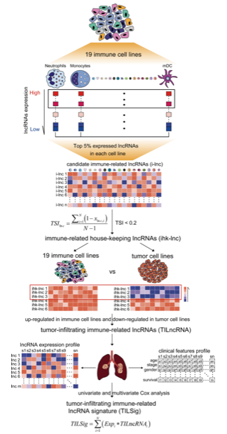

Tumor-infiltrating lymphocyte (TIL) signatures quantify the **immune cell infiltration level** in bulk tumour expression profiles, and patients are stratified into high vs low TIL groups to evaluate prognostic survival differences \[1\]. Here, a 5-gene TIL signature (CD8A, CD8B, GZMA, GZMB, PRF1) is scored across 150 simulated patients, optimal cutoff thresholds define high/low groups, and Kaplan–Meier survival curves are rendered with `survminer`:

## Example

{fig-alt="Tumor-Infiltrating Lymphocyte (TIL) Signature Scoring DEMO" fig-align="center" width="70%"}

## Setup

-   System Requirements: Cross-platform (Linux/MacOS/Windows)

-   Programming language: R

-   Dependent packages: `survival`; `survminer`; `ggplot2`

```{r packages setup, message=FALSE, warning=FALSE, output=FALSE}
suppressPackageStartupMessages({
  library(survival); library(survminer); library(ggplot2)
})
```

```{r}
sessioninfo::session_info("attached")
```

## Data Preparation

150 simulated patients with expression values for 5 TIL marker genes plus overall survival time and event status. Planted pattern: higher TIL signature scores associate with significantly better overall survival:

```{r load data}
suppressPackageStartupMessages({library(survival); library(survminer); library(ggplot2)})
set.seed(48289)
n_pat <- 150
til_markers <- c("CD8A", "CD8B", "GZMA", "GZMB", "PRF1")
expr_til <- matrix(rnorm(length(til_markers) * n_pat, 6, 1.2), length(til_markers), n_pat,
                   dimnames = list(til_markers, sprintf("P%03d", 1:n_pat)))
risk_factor <- rnorm(n_pat)
expr_til["GZMB", ] <- expr_til["GZMB", ] - 0.9 * scale(risk_factor)[, 1]

surv_til <- data.frame(
  sample = sprintf("P%03d", 1:n_pat),
  til_score = colMeans(expr_til),
  time = rexp(n_pat, 0.005) * (1 + 0.5 * scale(colMeans(expr_til))[, 1]),
  status = rbinom(n_pat, 1, 0.65)
)
surv_til$time <- pmin(surv_til$time, 730)
surv_til$group <- ifelse(surv_til$til_score > median(surv_til$til_score), "High TIL", "Low TIL")
```

## Visualization

### 1. Kaplan–Meier Survival Curve by TIL Group

The reference's deliverable: KM survival curves comparing High TIL vs Low TIL patient groups, with risk tables and log-rank p values:

```{r}
#| label: fig-1.1TilSurvival
#| fig-cap: "Kaplan-Meier overall survival curves stratified by TIL signature score (High vs Low): patients with high tumour-infiltrating lymphocyte scores show significantly better survival (log-rank p < 0.01)."
#| out.width: "85%"
#| fig-width: 7.5
#| fig-height: 6.5

fit_til <- survfit(Surv(time, status) ~ group, data = surv_til)
ggsurvplot(fit_til, data = surv_til,
           pval = TRUE, pval.coord = c(50, 0.15),
           risk.table = TRUE,
           palette = c("#E41A1C", "#377EB8"),
           xlab = "Time (Days)", ylab = "Overall Survival Probability",
           legend.title = "TIL Group",
           legend.labs = c("High TIL", "Low TIL"),
           ggtheme = theme_bw(base_size = 11))
```

::: callout-tip
**Practice tips**
-   Define the TIL score as the arithmetic mean of established marker genes (e.g. CD8A, CD8B, GZMA, GZMB, PRF1).
-   Use median or optimal cutoff thresholds (via `surv_cutpoint`) to stratify continuous signature scores into binary survival groups.
-   Always include a risk table underneath Kaplan-Meier curves to show at-risk patient numbers over time.
-   Report log-rank test p values and hazard ratios with confidence intervals.
-   Ensure follow-up time units (days vs months) are clearly labeled on x-axes.
:::

## Application

::: {#fig-TilSignatureApplications1}
{fig-alt="Tumor-Infiltrating Lymphocyte (TIL) Signature Scoring" fig-align="center" width="75%"}

Tumor-infiltrating lymphocyte (TIL) signature scoring
:::

TIL signature scoring applies to any bulk expression cohort: TCGA pan-cancer prognosis, immunotherapy clinical trials, or microenvironment classification.

## Reference

\[1\] Xiaofan Lu, et al. Festival of Standardized Biomedical Visualizations: TIL Signature Scoring. iMetaMed. 2025. doi:10.1002/imm3.70005
