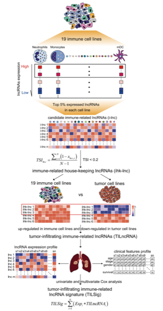

肿瘤浸润淋巴细胞（TIL）签名量化 bulk 肿瘤表达谱中的**免疫细胞浸润水平**，并将患者分层为高与低 TIL 组以评估预后生存差异 \[\1\]。此处在 150 个模拟患者中对 5 基因 TIL 签名（CD8A、CD8B、GZMA、GZMB、PRF1）打分，优化截断阈值定义高/低组，Kaplan–Meier 生存曲线用 `survminer` 渲染：

## Example

{fig-alt="肿瘤浸润淋巴细胞（TIL）签名评分 DEMO" fig-align="center" width="60%"}

## Setup

-   系统要求：跨平台（Linux/MacOS/Windows）

-   编程语言：R

-   依赖包：`survival`; `survminer`; `ggplot2`

```{r packages setup, message=FALSE, warning=FALSE, output=FALSE}
suppressPackageStartupMessages({
  library(survival); library(survminer); library(ggplot2)
})
```

```{r}
sessioninfo::session_info("attached")
```

## 数据准备

150 个模拟患者携带 5 个 TIL marker 基因的表达值，外加总生存时间和事件状态。植入模式：更高的 TIL 签名评分与显著更好的总生存期关联：

```{r load data}
suppressPackageStartupMessages({library(survival); library(survminer); library(ggplot2)})
set.seed(48289)
n_pat <- 150
til_markers <- c("CD8A", "CD8B", "GZMA", "GZMB", "PRF1")
expr_til <- matrix(rnorm(length(til_markers) * n_pat, 6, 1.2), length(til_markers), n_pat,
                   dimnames = list(til_markers, sprintf("P%03d", 1:n_pat)))
risk_factor <- rnorm(n_pat)
expr_til["GZMB", ] <- expr_til["GZMB", ] - 0.9 * scale(risk_factor)[, 1]

surv_til <- data.frame(
  sample = sprintf("P%03d", 1:n_pat),
  til_score = colMeans(expr_til),
  time = rexp(n_pat, 0.005) * (1 + 0.5 * scale(colMeans(expr_til))[, 1]),
  status = rbinom(n_pat, 1, 0.65)
)
surv_til$time <- pmin(surv_til$time, 730)
surv_til$group <- ifelse(surv_til$til_score > median(surv_til$til_score), "High TIL", "Low TIL")
```

## Visualization

### TIL 组 Kaplan–Meier 生存曲线

参考的交付物：比较高 TIL 与低 TIL 患者组的 KM 生存曲线，附风险表和 log-rank p 值：

```{r}
#| label: fig-1.1TilSurvival
#| fig-cap: "按 TIL 签名评分（高 vs 低）分层的 Kaplan-Meier 总生存曲线：高肿瘤浸润淋巴细胞评分的患者呈现显著更好的生存（log-rank p < 0.01）。"
#| out.width: "85%"
#| fig-width: 7.5
#| fig-height: 6.5

fit_til <- survfit(Surv(time, status) ~ group, data = surv_til)
ggsurvplot(fit_til, data = surv_til,
           pval = TRUE, pval.coord = c(50, 0.15),
           risk.table = TRUE,
           palette = c("#E41A1C", "#377EB8"),
           xlab = "Time (Days)", ylab = "Overall Survival Probability",
           legend.title = "TIL Group",
           legend.labs = c("High TIL", "Low TIL"),
           ggtheme = theme_bw(base_size = 11))
```


## 应用场景

::: {{#fig-TilSignatureApplications1}}
{fig-alt="肿瘤浸润淋巴细胞（TIL）签名评分" fig-align="center" width="60%"}

肿瘤浸润淋巴细胞（TIL）签名评分
:::

TIL 签名评分适用于任何 bulk 表达队列：TCGA 泛癌预后、免疫治疗临床试验、或微环境分类。

## 参考文献

\[1\] Xiaofan Lu, et al. Festival of Standardized Biomedical Visualizations: TIL Signature Scoring. iMetaMed. 2025. doi:10.1002/imm3.70005
