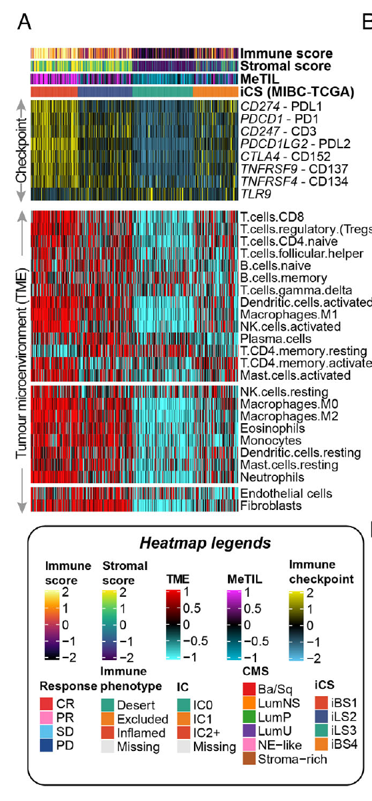

The reference assembles a tumour immune microenvironment (TIME) overview from **three deconvolution families** — a MeTIL PCA score, 22 CIBERSORT cell types and 2 MCP-counter stromal scores — stacked as one tall annotated heatmap with samples ordered by subtype so the immune-hot vs immune-cold axis runs across all three panels \[1\]. `MOVICS` orchestrates the reference; here the scores are simulated directly (GSVA, ComplexHeatmap, circlize and viridis — the rendering stack — are all in the lockfile) and the stacking/ordering logic, which is what makes the figure read, is reproduced exactly:

## Example

{fig-alt="Tumor Immune Microenvironment Overview DEMO" fig-align="center" width="70%"}

## Setup

-   System Requirements: Cross-platform (Linux/MacOS/Windows)

-   Programming language: R

-   Dependent packages: `ComplexHeatmap`; `circlize`; `viridis`; `RColorBrewer`

```{r packages setup, message=FALSE, warning=FALSE, output=FALSE}
suppressPackageStartupMessages({
  library(ComplexHeatmap); library(circlize); library(viridis); library(RColorBrewer)
})
```

```{r}
sessioninfo::session_info("attached")
```

## Data Preparation

120 samples in four subtypes (immune-hot `CS1`/`CS3` vs cold `CS2`/mixed `CS4`), each scored by three families: one MeTIL-like PCA score, 22 CIBERSORT-like fractions, and 2 MCP-counter-like stromal scores. Hot subtypes carry higher cytotoxic/antigen-presentation scores and lower fibroblast scores; samples are sorted by the MeTIL score so the gradient runs through every panel:

```{r load data}
suppressPackageStartupMessages({
  library(ComplexHeatmap); library(circlize); library(viridis); library(RColorBrewer)
})
set.seed(43255)
subtypes <- c("CS1", "CS2", "CS3", "CS4")
hot <- c(CS1 = 1, CS2 = -1, CS3 = 0.9, CS4 = 0.1)
n_per <- 30
sam_sub <- rep(subtypes, each = n_per)
names(sam_sub) <- sprintf("T%03d", 1:120)
meta_til <- sapply(sam_sub, function(st) hot[[st]] + rnorm(1, 0, 0.4))

cib_cells <- c("B cells naive", "B cells memory", "Plasma cells", "T cells CD8",
               "T cells CD4 memory", "Tregs", "NK cells resting", "NK cells activated",
               "Macrophages M0", "Macrophages M1", "Macrophages M2",
               "DCs resting", "DCs activated", "Mast cells", "Eosinophils", "Neutrophils")
## per-cell-type direction of the immune-hot gradient (hot subtypes: more
## cytotoxic/antigen-presentation, fewer naive/neutrophil fractions)
dir <- c(`B cells naive` = -0.02, `B cells memory` = 0.015,
         `Plasma cells` = 0.01, `T cells CD8` = 0.05,
         `T cells CD4 memory` = 0.03, Tregs = -0.01,
         `NK cells resting` = -0.005, `NK cells activated` = 0.02,
         `Macrophages M0` = -0.01, `Macrophages M1` = 0.015,
         `Macrophages M2` = -0.005, `DCs resting` = -0.005,
         `DCs activated` = 0.012, `Mast cells` = 0,
         Eosinophils = -0.004, Neutrophils = -0.02)
cib <- sapply(meta_til, function(m)
  pmax(runif(length(cib_cells), 0.005, 0.08) + m * dir[cib_cells], 0.001))
rownames(cib) <- cib_cells
cib <- cib + matrix(rexp(length(cib), 25), nrow(cib), ncol(cib)) * 0.04
cib <- cib / rep(colSums(cib), each = nrow(cib))

mcp <- rbind(Fibroblasts = sapply(meta_til, function(m) 0.5 - 0.3 * m + rnorm(120, 0, 0.08)),
             `Endothelial cells` = sapply(meta_til, function(m) 0.35 + rnorm(120, 0, 0.08)))

ord <- order(meta_til, decreasing = TRUE)
```

## Visualization

### 1. The Stacked Three-Family Overview

One `HeatmapList`: MeTIL score strip (one row), CIBERSORT 16-row block, MCP-counter 2-row block — all sharing the same column order (sorted by MeTIL), each with its own colour scale, connected with `%v%`:

```{r}
#| label: fig-1.1TimeOverview
#| fig-cap: "TIME overview across 120 samples sorted by MeTIL score: MeTIL strip (top), CIBERSORT 16 cell-type block (middle), MCP-counter 2 stromal scores (bottom) — the immune-hot/cold gradient runs left to right through all three panels."
#| out.width: "95%"
#| fig-width: 9.5
#| fig-height: 6.5

cib_ord <- cib[, ord]
cib_z <- t(scale(t(cib_ord)))
cib_z <- pmin(pmax(cib_z, -2), 2)
rownames(cib_z) <- sub("^([A-Za-z]+) cells", "\\1", rownames(cib_z))
ann <- data.frame(Subtype = factor(sam_sub[ord], levels = subtypes),
                  row.names = colnames(cib_z))
ha <- HeatmapAnnotation(Subtype = ann$Subtype, MeTIL = meta_til[ord],
                        col = list(Subtype = setNames(brewer.pal(4, "Set1"), subtypes),
                                   MeTIL = circlize::colorRamp2(c(-1.5, 0, 1.5),
                                                                c("#2166AC", "white", "#B2182B"))))
ht1 <- Heatmap(matrix(meta_til[ord], nrow = 1), name = "MeTIL",
               col = circlize::colorRamp2(c(-1.5, 0, 1.5), c("#2166AC", "white", "#B2182B")),
               cluster_columns = FALSE, show_column_names = FALSE,
               row_labels = "MeTIL (PCA)", row_names_side = "left",
               height = unit(1.1, "cm"))
ht2 <- Heatmap(cib_z, name = "CIBERSORT",
               col = viridis(64),
               cluster_columns = FALSE, cluster_rows = FALSE,
               show_column_names = FALSE, row_names_side = "left",
               row_names_gp = grid::gpar(fontsize = 7),
               top_annotation = ha,
               height = unit(10.5, "cm"),
               column_title = "CIBERSORT fractions (z, capped)")
ht3 <- Heatmap(t(scale(t(mcp[, ord]))), name = "MCP",
               col = colorRampPalette(c("#3B4CC0", "white", "#B40426"))(64),
               cluster_columns = FALSE, cluster_rows = FALSE,
               show_column_names = FALSE, row_names_side = "left",
               height = unit(1.5, "cm"),
               column_title = "MCP-counter stromal scores (z)")
draw(ht1 %v% ht2 %v% ht3, heatmap_legend_side = "right")
```

### 2. Per-Family Subtype Contrast

The overview condensed: mean ± SD of each CIBERSORT cell type per subtype (z-scale across types first), with the cytotoxic/antigen axis and the fibroblast contrast marked — the panel that justifies the subtype ordering used above:

```{r}
#| label: fig-2.1TimeSubtypeMeans
#| fig-cap: "Mean z-scored CIBERSORT fraction per subtype: cytotoxic T cells, activated NK and DCs are high in the hot subtypes (CS1/CS3), naive B cells and neutrophils in the cold CS2 — the contrast the overview heatmap visualizes."
#| out.width: "85%"
#| fig-width: 8
#| fig-height: 6

df <- do.call(rbind, lapply(rownames(cib_z), function(ct) {
  data.frame(cell = ct,
             subtype = subtypes,
             mean = sapply(subtypes, function(st)
               mean(cib_z[ct, names(sam_sub)[sam_sub == st], drop = FALSE]))[subtypes])
}))
df$cell <- factor(df$cell, levels = rev(rownames(cib_z)))
ggplot2::ggplot(df, ggplot2::aes(subtype, cell, fill = mean)) +
  ggplot2::geom_tile(colour = "white") +
  ggplot2::geom_text(ggplot2::aes(label = sprintf("%.1f", mean),
                                  colour = abs(mean) > 1.4),
                     size = 2.4, show.legend = FALSE) +
  ggplot2::scale_colour_manual(values = c(`TRUE` = "white", `FALSE` = "grey25")) +
  ggplot2::scale_fill_gradient2(low = "#3B4CC0", mid = "white", high = "#B40426",
                                midpoint = 0) +
  ggplot2::labs(x = NULL, y = NULL, fill = "z") +
  ggplot2::theme_bw(base_size = 9.5) +
  ggplot2::theme(axis.text.x = ggplot2::element_text(angle = 45, hjust = 1))
```

::: callout-tip
**Practice tips**

-   Sort samples by **one** anchor score (MeTIL here) and keep that order across every panel — per-panel clustering would scramble the gradient that ties the families together.
-   Normalize each family separately (z per row, capped ±2): CIBERSORT fractions sum to 1, MCP scores are arbitrary units, and MeTIL is a PCA projection — one shared scale would be meaningless.
-   CIBERSORT fractions are compositional: a hot cytotoxic fraction mechanically dilutes the others, so read the panel column-wise, not row-wise.
-   Stack families with `%v%` sharing one column order; the reference's MOVICS wrapper does exactly this plus consensus clustering on top.
-   The subtype strip on top is the hypothesis, the panels the evidence — if the strip colours do not line up with score gradients, the subtype labels and the deconvolution disagree, which is itself a finding.
:::

## Application

::: {#fig-TimeOverviewApplications1}
{fig-alt="Tumor Immune Microenvironment Overview" fig-align="center" width="70%"}

Tumor immune microenvironment overview
:::

The stacked multi-family layout generalizes to any multi-method scoring of one cohort: consensus clustering vs single-method subtypes, multi-omics signatures vs clinical covariates, or drug-sensitivity predictions vs pathway scores.

## Reference

\[1\] Xiaofan Lu, et al. FigureYa: A Standardized Visualization Framework for Enhancing Biomedical Data Interpretation and Research Efficiency. iMetaMed. 2025. doi:10.1002/imm3.70005
