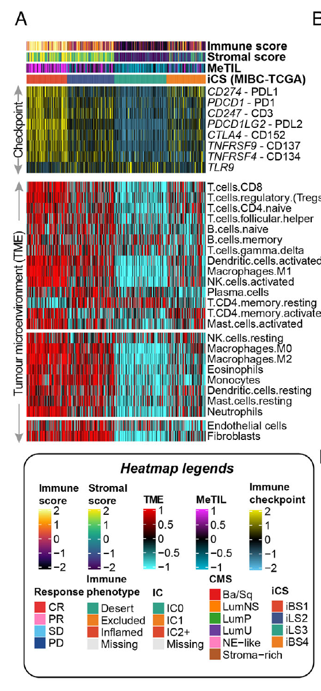

参考文档把肿瘤免疫微环境（TIME）总览从**三个去卷积家族**拼装起来——MeTIL PCA 评分、22 种 CIBERSORT 细胞类型、2 种 MCP-counter 基质评分——堆叠成一张按亚型排序的高注释热图，免疫热/冷的梯度贯穿全部三个面板 \[1\]。参考由 `MOVICS` 编排；此处直接模拟评分（GSVA、ComplexHeatmap、circlize、viridis——渲染栈——全部在 lockfile），并精确复现真正让图可读的堆叠与排序逻辑：

## Example

{fig-alt="肿瘤免疫微环境总览 DEMO" fig-align="center" width="60%"}

## Setup

-   系统要求：跨平台（Linux/MacOS/Windows）

-   编程语言：R

-   依赖包：`ComplexHeatmap`; `circlize`; `viridis`; `RColorBrewer`

```{r packages setup, message=FALSE, warning=FALSE, output=FALSE}
suppressPackageStartupMessages({
  library(ComplexHeatmap); library(circlize); library(viridis); library(RColorBrewer)
})
```

```{r}
sessioninfo::session_info("attached")
```

## 数据准备

120 个样本分四个亚型（免疫热的 `CS1`/`CS3` vs 冷的 `CS2`/混合 `CS4`），各按三个家族评分：一个 MeTIL 式 PCA 评分、16 种 CIBERSORT 式组分、2 种 MCP-counter 式基质评分。热亚型携带更高的细胞毒性/抗原呈递评分、更低的成纤维细胞评分；样本按 MeTIL 评分排序使梯度贯穿每个面板：

```{r load data}
suppressPackageStartupMessages({
  library(ComplexHeatmap); library(circlize); library(viridis); library(RColorBrewer)
})
set.seed(43255)
subtypes <- c("CS1", "CS2", "CS3", "CS4")
hot <- c(CS1 = 1, CS2 = -1, CS3 = 0.9, CS4 = 0.1)
n_per <- 30
sam_sub <- rep(subtypes, each = n_per)
names(sam_sub) <- sprintf("T%03d", 1:120)
meta_til <- sapply(sam_sub, function(st) hot[[st]] + rnorm(1, 0, 0.4))

cib_cells <- c("B cells naive", "B cells memory", "Plasma cells", "T cells CD8",
               "T cells CD4 memory", "Tregs", "NK cells resting", "NK cells activated",
               "Macrophages M0", "Macrophages M1", "Macrophages M2",
               "DCs resting", "DCs activated", "Mast cells", "Eosinophils", "Neutrophils")
## per-cell-type direction of the immune-hot gradient (hot subtypes: more
## cytotoxic/antigen-presentation, fewer naive/neutrophil fractions)
dir <- c(`B cells naive` = -0.02, `B cells memory` = 0.015,
         `Plasma cells` = 0.01, `T cells CD8` = 0.05,
         `T cells CD4 memory` = 0.03, Tregs = -0.01,
         `NK cells resting` = -0.005, `NK cells activated` = 0.02,
         `Macrophages M0` = -0.01, `Macrophages M1` = 0.015,
         `Macrophages M2` = -0.005, `DCs resting` = -0.005,
         `DCs activated` = 0.012, `Mast cells` = 0,
         Eosinophils = -0.004, Neutrophils = -0.02)
cib <- sapply(meta_til, function(m)
  pmax(runif(length(cib_cells), 0.005, 0.08) + m * dir[cib_cells], 0.001))
rownames(cib) <- cib_cells
cib <- cib + matrix(rexp(length(cib), 25), nrow(cib), ncol(cib)) * 0.04
cib <- cib / rep(colSums(cib), each = nrow(cib))

mcp <- rbind(Fibroblasts = sapply(meta_til, function(m) 0.5 - 0.3 * m + rnorm(120, 0, 0.08)),
             `Endothelial cells` = sapply(meta_til, function(m) 0.35 + rnorm(120, 0, 0.08)))

ord <- order(meta_til, decreasing = TRUE)
```

## Visualization

### 三家族堆叠总览

一个 `HeatmapList`：MeTIL 评分条（1 行）、CIBERSORT 16 行块、MCP-counter 2 行块——共享同一列序（按 MeTIL 排序）、各自配色、用 `%v%` 连接：

```{r}
#| label: fig-1.1TimeOverview
#| fig-cap: "120 个按 MeTIL 评分排序样本的 TIME 总览：MeTIL 条（顶）、CIBERSORT 16 细胞类型块（中）、MCP-counter 2 基质评分（底）——免疫热/冷梯度从左到右贯穿三个面板。"
#| out.width: "95%"
#| fig-width: 9.5
#| fig-height: 6.5

cib_ord <- cib[, ord]
cib_z <- t(scale(t(cib_ord)))
cib_z <- pmin(pmax(cib_z, -2), 2)
rownames(cib_z) <- sub("^([A-Za-z]+) cells", "\\1", rownames(cib_z))
ann <- data.frame(Subtype = factor(sam_sub[ord], levels = subtypes),
                  row.names = colnames(cib_z))
ha <- HeatmapAnnotation(Subtype = ann$Subtype, MeTIL = meta_til[ord],
                        col = list(Subtype = setNames(brewer.pal(4, "Set1"), subtypes),
                                   MeTIL = circlize::colorRamp2(c(-1.5, 0, 1.5),
                                                                c("#2166AC", "white", "#B2182B"))))
ht1 <- Heatmap(matrix(meta_til[ord], nrow = 1), name = "MeTIL",
               col = circlize::colorRamp2(c(-1.5, 0, 1.5), c("#2166AC", "white", "#B2182B")),
               cluster_columns = FALSE, show_column_names = FALSE,
               row_labels = "MeTIL (PCA)", row_names_side = "left",
               height = unit(1.1, "cm"))
ht2 <- Heatmap(cib_z, name = "CIBERSORT",
               col = viridis(64),
               cluster_columns = FALSE, cluster_rows = FALSE,
               show_column_names = FALSE, row_names_side = "left",
               row_names_gp = grid::gpar(fontsize = 7),
               top_annotation = ha,
               height = unit(10.5, "cm"),
               column_title = "CIBERSORT fractions (z, capped)")
ht3 <- Heatmap(t(scale(t(mcp[, ord]))), name = "MCP",
               col = colorRampPalette(c("#3B4CC0", "white", "#B40426"))(64),
               cluster_columns = FALSE, cluster_rows = FALSE,
               show_column_names = FALSE, row_names_side = "left",
               height = unit(1.5, "cm"),
               column_title = "MCP-counter stromal scores (z)")
draw(ht1 %v% ht2 %v% ht3, heatmap_legend_side = "right")
```

### 逐家族亚型对比

总览的浓缩：逐 CIBERSORT 细胞类型的均值 ± SD（先跨类型 z 标度），标记细胞毒性/抗原轴与成纤维细胞对比——即证明上述亚型排序的面板：

```{r}
#| label: fig-2.1TimeSubtypeMeans
#| fig-cap: "逐亚型的均值 z 标度 CIBERSORT 组分：细胞毒性 T 细胞、激活 NK 与 DC 在热亚型（CS1/CS3）中偏高、初始 B 与中性粒细胞在冷的 CS2 中偏高——即总览热图可视化的对比。"
#| out.width: "85%"
#| fig-width: 8
#| fig-height: 6

df <- do.call(rbind, lapply(rownames(cib_z), function(ct) {
  data.frame(cell = ct,
             subtype = subtypes,
             mean = sapply(subtypes, function(st)
               mean(cib_z[ct, names(sam_sub)[sam_sub == st], drop = FALSE]))[subtypes])
}))
df$cell <- factor(df$cell, levels = rev(rownames(cib_z)))
ggplot2::ggplot(df, ggplot2::aes(subtype, cell, fill = mean)) +
  ggplot2::geom_tile(colour = "white") +
  ggplot2::geom_text(ggplot2::aes(label = sprintf("%.1f", mean),
                                  colour = abs(mean) > 1.4),
                     size = 2.4, show.legend = FALSE) +
  ggplot2::scale_colour_manual(values = c(`TRUE` = "white", `FALSE` = "grey25")) +
  ggplot2::scale_fill_gradient2(low = "#3B4CC0", mid = "white", high = "#B40426",
                                midpoint = 0) +
  ggplot2::labs(x = NULL, y = NULL, fill = "z") +
  ggplot2::theme_bw(base_size = 9.5) +
  ggplot2::theme(axis.text.x = ggplot2::element_text(angle = 45, hjust = 1))
```


## 应用场景

::: {{#fig-TimeOverviewApplications1}}
{fig-alt="肿瘤免疫微环境总览" fig-align="center" width="60%"}

肿瘤免疫微环境总览
:::

堆叠多家族版式可推广到同一队列的任何多方法评分：共识聚类 vs 单方法亚型、多组学签名 vs 临床协变量、或药敏预测 vs 通路评分。

## 参考文献

\[1\] Xiaofan Lu, et al. FigureYa: A Standardized Visualization Framework for Enhancing Biomedical Data Interpretation and Research Efficiency. iMetaMed. 2025. doi:10.1002/imm3.70005
