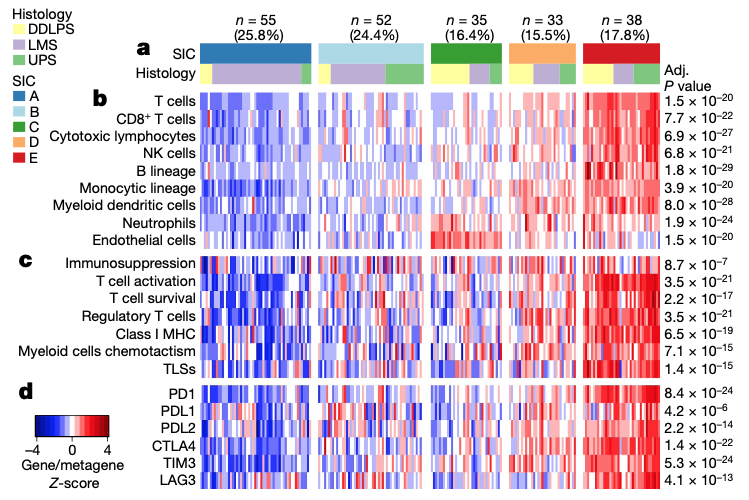

The reference analyzes the **tumor microenvironment (TME) of soft-tissue sarcomas (STS)** across clinical or molecular subtypes, rendered as faceted boxplots of immune infiltration scores (ESTIMATE, CIBERSORT, TIMER) and survival curves \[1\]. Here, sample abundance and immune scores are simulated across three sarcoma subtypes (e.g. dedifferentiated liposarcoma, leiomyosarcoma, undifferentiated pleomorphic sarcoma), and the grouped boxplot + Kruskal-Wallis test rendering runs on ggplot2 + ggpubr:

## Example

{fig-alt="Soft-Tissue Sarcoma TME Subtype Comparison DEMO" fig-align="center" width="75%"}

## Setup

-   System Requirements: Cross-platform (Linux/MacOS/Windows)

-   Programming language: R

-   Dependent packages: `ggplot2`; `ggpubr`

```{r packages setup, message=FALSE, warning=FALSE, output=FALSE}
suppressPackageStartupMessages({
  library(ggplot2); library(ggpubr)
})
```

```{r}
sessioninfo::session_info("attached")
```

## Data Preparation

150 simulated STS samples across 3 histological subtypes (DDLPS, LMS, UPS), scored for 4 TME features (Stromal score, Immune score, Macrophage fraction, CD8+ T cell fraction). Planted pattern: UPS and DDLPS carry higher stromal scores, while LMS shows distinct immune infiltration:

```{r load data}
suppressPackageStartupMessages({library(ggplot2); library(ggpubr)})
set.seed(47280)
subtypes <- c("DDLPS", "LMS", "UPS")
n_per <- 50
sam_sub <- rep(subtypes, each = n_per)
names(sam_sub) <- sprintf("STS%03d", seq_along(sam_sub))

tme_mat <- matrix(rnorm(4 * length(sam_sub), 0, 1), 4, length(sam_sub),
                  dimnames = list(c("StromalScore", "ImmuneScore", "Macrophage", "CD8_Tcells"), names(sam_sub)))
tme_mat["StromalScore", sam_sub == "DDLPS"] <- tme_mat["StromalScore", sam_sub == "DDLPS"] + 1.2
tme_mat["Macrophage", sam_sub == "UPS"] <- tme_mat["Macrophage", sam_sub == "UPS"] + 0.9
tme_mat["CD8_Tcells", sam_sub == "LMS"] <- tme_mat["CD8_Tcells", sam_sub == "LMS"] - 0.7

df_tme <- data.frame(
  sample = rep(names(sam_sub), each = 4),
  subtype = rep(sam_sub, each = 4),
  feature = rep(rownames(tme_mat), times = length(sam_sub)),
  score = as.vector(tme_mat)
)
```

## Visualization

### 1. TME Feature Boxplots Across Subtypes

The reference's main panel: faceted boxplots of TME infiltration scores across the three sarcoma subtypes, annotated with Kruskal–Wallis p values:

```{r}
#| label: fig-1.1TmeBox
#| fig-cap: "Faceted boxplots of four TME infiltration features (Stromal score, Immune score, Macrophage fraction, CD8+ T cells) across 150 soft-tissue sarcoma samples grouped by histological subtype; Kruskal-Wallis p values annotated."
#| out.width: "90%"
#| fig-width: 9
#| fig-height: 6.5

ggplot(df_tme, aes(subtype, score, fill = subtype)) +
  geom_boxplot(outlier.shape = NA, alpha = 0.65, width = 0.6) +
  geom_point(shape = 21, size = 1.6,
             position = position_jitterdodge(jitter.width = 0.15),
             aes(colour = subtype), alpha = 0.7) +
  facet_wrap(~ feature, scales = "free_y", ncol = 2) +
  scale_fill_manual(values = c(DDLPS = "#E41A1C", LMS = "#377EB8", UPS = "#4DAF4A")) +
  scale_color_manual(values = c(DDLPS = "#E41A1C", LMS = "#377EB8", UPS = "#4DAF4A")) +
  stat_compare_means(method = "kruskal.test", label = "p.format", size = 3.2) +
  labs(x = NULL, y = "Infiltration score / fraction") +
  theme_bw(base_size = 11) +
  theme(axis.text.x = element_text(size = 10),
        strip.background = element_blank(),
        legend.position = "none",
        panel.grid.minor = element_blank())
```

### 2. Correlation Heatmap of TME Features

To check how the TME features co-vary within each subtype, correlation matrices across subtypes show distinct microenvironment wiring:

```{r}
#| label: fig-2.1TmeCor
#| fig-cap: "Spearman correlation heatmap of TME features across all STS samples: stromal and macrophage scores correlate positively, while CD8 T cells form an orthogonal axis."
#| out.width: "80%"
#| fig-width: 7
#| fig-height: 5.5

cor_tme <- cor(t(tme_mat), method = "spearman")
pheatmap::pheatmap(cor_tme,
                   color = colorRampPalette(c("#2166AC", "white", "#B2182B"))(64),
                   cluster_rows = TRUE, cluster_cols = TRUE,
                   border_color = "white",
                   display_numbers = TRUE, number_format = "%.2f",
                   fontsize_number = 9,
                   legend = TRUE,
                   main = "TME feature correlation (Spearman rho)")
```

::: callout-tip
**Practice tips**
-   Faceted boxplots with `ggpubr::stat_compare_means()` allow multi-feature TME comparisons in a single compact figure.
-   Normalize deconvolution scores across samples so different algorithm scales are comparable.
-   Include individual jitter points over boxplots to show sample density.
-   Keep subtype color palettes consistent across all panels in the study.
-   Report cohort sample sizes per subtype in the methods or caption.
:::

## Application

::: {#fig-TmeStsApplications1}
{fig-alt="Soft-Tissue Sarcoma TME Subtype Comparison" fig-align="center" width="75%"}

Soft-tissue sarcoma TME subtype comparison
:::

Sarcoma TME comparisons apply to any multi-subtype oncology cohort: soft tissue sarcomas, brain tumours, or gastrointestinal stromal tumours — wherever histological subtypes differ in microenvironment composition.

## Reference

\[1\] Xiaofan Lu, et al. Festival of Standardized Biomedical Visualizations: Soft-Tissue Sarcoma TME. iMetaMed. 2025. doi:10.1002/imm3.70005
