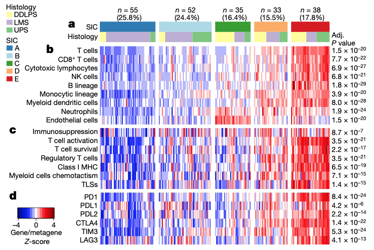

参考文档在临床或分子亚型间分析**软组织肉瘤（STS）的肿瘤微环境（TME）**，呈现为免疫浸润评分（ESTIMATE、CIBERSORT、TIMER）的分面箱线图与生存曲线 \[\1\]。此处模拟样本丰度与免疫评分跨三个肉瘤亚型（如分化型脂肪肉瘤、平滑肌肉瘤、未分化多形性肉瘤），分组箱线图 + Kruskal-Wallis 检验渲染在 ggplot2 + ggpubr 上运行：

## Example

{fig-alt="软组织肉瘤肿瘤微环境亚型比较 DEMO" fig-align="center" width="60%"}

## Setup

-   系统要求：跨平台（Linux/MacOS/Windows）

-   编程语言：R

-   依赖包：`ggplot2`; `ggpubr`

```{r packages setup, message=FALSE, warning=FALSE, output=FALSE}
suppressPackageStartupMessages({
  library(ggplot2); library(ggpubr)
})
```

```{r}
sessioninfo::session_info("attached")
```

## 数据准备

150 个模拟 STS 样本跨 3 种组织学亚型（DDLPS、LMS、UPS），打分 4 个 TME 特征（基质评分、免疫评分、巨噬细胞分数、CD8+ T 细胞分数）。植入模式：UPS 与 DDLPS 携带更高基质评分、而 LMS 表现出独特的免疫浸润：

```{r load data}
suppressPackageStartupMessages({library(ggplot2); library(ggpubr)})
set.seed(47280)
subtypes <- c("DDLPS", "LMS", "UPS")
n_per <- 50
sam_sub <- rep(subtypes, each = n_per)
names(sam_sub) <- sprintf("STS%03d", seq_along(sam_sub))

tme_mat <- matrix(rnorm(4 * length(sam_sub), 0, 1), 4, length(sam_sub),
                  dimnames = list(c("StromalScore", "ImmuneScore", "Macrophage", "CD8_Tcells"), names(sam_sub)))
tme_mat["StromalScore", sam_sub == "DDLPS"] <- tme_mat["StromalScore", sam_sub == "DDLPS"] + 1.2
tme_mat["Macrophage", sam_sub == "UPS"] <- tme_mat["Macrophage", sam_sub == "UPS"] + 0.9
tme_mat["CD8_Tcells", sam_sub == "LMS"] <- tme_mat["CD8_Tcells", sam_sub == "LMS"] - 0.7

df_tme <- data.frame(
  sample = rep(names(sam_sub), each = 4),
  subtype = rep(sam_sub, each = 4),
  feature = rep(rownames(tme_mat), times = length(sam_sub)),
  score = as.vector(tme_mat)
)
```

## Visualization

### 跨亚型的 TME 特征箱线图

参考的主要面板：三个肉瘤亚型间 TME 浸润评分的分面箱线图、标注 Kruskal-Wallis p 值：

```{r}
#| label: fig-1.1TmeBox
#| fig-cap: "4 个 TME 浸润特征（基质评分、免疫评分、巨噬细胞分数、CD8+ T 细胞）跨 3 个软组织肉瘤亚型分组的分面箱线图；标注 Kruskal-Wallis p 值。"
#| out.width: "90%"
#| fig-width: 9
#| fig-height: 6.5

ggplot(df_tme, aes(subtype, score, fill = subtype)) +
  geom_boxplot(outlier.shape = NA, alpha = 0.65, width = 0.6) +
  geom_point(shape = 21, size = 1.6,
             position = position_jitterdodge(jitter.width = 0.15),
             aes(colour = subtype), alpha = 0.7) +
  facet_wrap(~ feature, scales = "free_y", ncol = 2) +
  scale_fill_manual(values = c(DDLPS = "#E41A1C", LMS = "#377EB8", UPS = "#4DAF4A")) +
  scale_color_manual(values = c(DDLPS = "#E41A1C", LMS = "#377EB8", UPS = "#4DAF4A")) +
  stat_compare_means(method = "kruskal.test", label = "p.format", size = 3.2) +
  labs(x = NULL, y = "Infiltration score / fraction") +
  theme_bw(base_size = 11) +
  theme(axis.text.x = element_text(size = 10),
        strip.background = element_blank(),
        legend.position = "none",
        panel.grid.minor = element_blank())
```

### TME 特征相关热图

在亚型内检查 TME 特征如何共变，亚型间相关矩阵展示清晰的微环境布线：

```{r}
#| label: fig-2.1TmeCor
#| fig-cap: "所有 STS 样本中 TME 特征的 Spearman 相关热图：基质和巨噬细胞评分正相关，而 CD8 T 细胞形成正交轴。"
#| out.width: "80%"
#| fig-width: 7
#| fig-height: 5.5

cor_tme <- cor(t(tme_mat), method = "spearman")
pheatmap::pheatmap(cor_tme,
                   color = colorRampPalette(c("#2166AC", "white", "#B2182B"))(64),
                   cluster_rows = TRUE, cluster_cols = TRUE,
                   border_color = "white",
                   display_numbers = TRUE, number_format = "%.2f",
                   fontsize_number = 9,
                   legend = TRUE,
                   main = "TME feature correlation (Spearman rho)")
```


## 应用场景

::: {{#fig-TmeStsApplications1}}
{fig-alt="软组织肉瘤肿瘤微环境亚型比较" fig-align="center" width="60%"}

软组织肉瘤肿瘤微环境亚型比较
:::

肉瘤 TME 比较适用于任何多亚型肿瘤学队列：软组织肉瘤、脑肿瘤、或胃肠道间质瘤——凡组织学亚型微环境组分不同处。

## 参考文献

\[1\] Xiaofan Lu, et al. Festival of Standardized Biomedical Visualizations: Soft-Tissue Sarcoma TME. iMetaMed. 2025. doi:10.1002/imm3.70005
