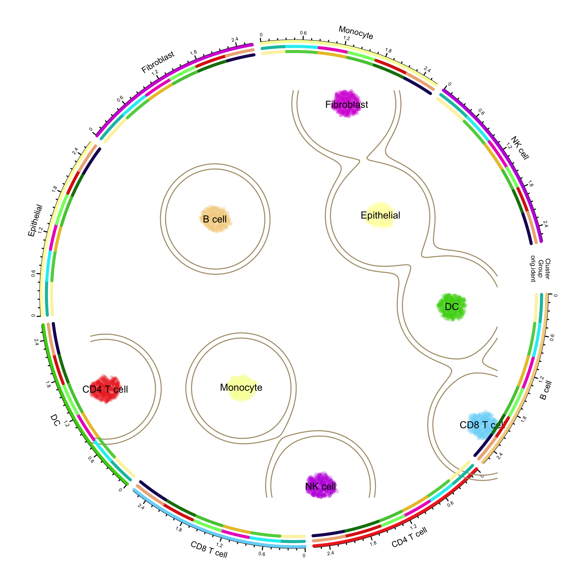

The scRNA-seq UMAP Circles Plot ("circles within circles") places a single-cell UMAP embedding at the centre of the figure and wraps it with concentric circular annotation tracks — an inner ring with one sector per cell type, plus additional rings for condition groups and original samples. The sector order of the outer rings follows the clusters of the central embedding, so readers can read the "continuous cell atlas plane" and the "discrete cluster-level annotations" from a single figure.

The design was popularised by the Linnarsson lab's Nature paper on the molecular architecture of the developing mouse brain, where a central t-SNE is surrounded by a radial dendrogram and colour rings annotating cluster classes, brain region, age, and cell cycle. The [plot1cell](https://github.com/TheHumphreysLab/plot1cell) R package turns this style into a few callable functions for any Seurat object, and it is routinely used for high-impact single-cell atlas figures.

In this tutorial we use **plot1cell** to draw the classic three-ring layout: a central UMAP coloured by cell type with density contours, a `Cluster` ring with per-cluster axes, and outer rings mapping disease/time-point groups and sequencing samples onto each cluster.

::: callout-note
**If you want to reproduce this tutorial locally**: all code chunks are set to `eval: false` because the plot1cell package is installed from GitHub and pulls several heavy dependencies (including a large human genome annotation package) that are not part of the Bizard build environment. The rendered figure above was produced by running exactly this code on a simulated dataset; simply copy the chunks into an R session where plot1cell is installed. The next section gives a fast, reproducible way to build that environment with **micromamba**.
:::

## Setup

-   System Requirements: Cross-platform (Linux/MacOS/Windows)

-   Programming Language: R

-   Dependent packages: `plot1cell`, `Seurat`, `circlize`, `randomcoloR`, `dplyr`, `ggplot2`

### Fast environment setup with micromamba (recommended)

plot1cell declares heavy `Imports`, and the standard `install.packages()` route compiles them all from source — the human gene annotation `EnsDb.Hsapiens.v86` alone is a ~2 GB build. [micromamba](https://mamba.readthedocs.io/en/latest/user_guide/micromamba.html) (a single-file, `sudo`-free package manager) resolves this from prebuilt conda binaries instead: the recipe below was verified end-to-end on a clean machine — the environment (R 4.5, `Seurat`, `circlize`, and the real `EnsDb.Hsapiens.v86`) installs in one transaction, and after adding the three GitHub-only packages the complete circlize pipeline of this tutorial runs without a single source compilation.

Save the following as `plot1cell-env.yml`:

```yaml
name: plot1cell
channels:
  - conda-forge
  - bioconda
dependencies:
  - r-base>=4.3
  - r-seurat
  - r-circlize
  - r-randomcoloR
  - r-ggplot2
  - r-dplyr
  - r-mass
  - r-scales
  - r-data.table
  - r-matrixstats
  - r-cowplot
  - r-plotly
  - r-progress
  - r-reshape2
  - r-ggbeeswarm
  - r-ggh4x
  - r-fields
  - r-itertools
  - r-hdf5r
  - r-complexupset
  - bioconductor-biomart
  - bioconductor-geoquery
  - r-wordcloud
  - bioconductor-ensdb.hsapiens.v86
  - bioconductor-genomeinfodb
  - bioconductor-genomicranges
  - r-remotes
  - r-rmarkdown
```

Then create the environment and add the four pieces conda cannot provide: three GitHub-only packages (`plot1cell`, `DoubletFinder`, `loomR`) and the lightweight CRAN/Bioconductor package `simplifyEnrichment` (its conda build currently has unresolvable constraints):

```{bash}
#| eval: false
# Download micromamba (single binary, no sudo needed); on macOS use
# osx-arm64 (Apple Silicon) or osx-64 instead of linux-64
curl -Ls https://micro.mamba.pm/api/micromamba/linux-64/latest | tar -xvj bin/micromamba

# Create the environment from the spec (prebuilt binaries)
./bin/micromamba create -n plot1cell -f plot1cell-env.yml -y

# Add the GitHub-only packages. Install them with `R CMD INSTALL` on git
# clones rather than remotes::install_github(): the latter can abort inside
# conda R on macOS (curl library clash). R_LIBS_USER is pinned to the env
# library so nothing leaks into (or from) your system R user library.
for repo in TheHumphreysLab/plot1cell chris-mcginnis-ucsf/DoubletFinder mojaveazure/loomR; do
  git clone --depth 1 "https://github.com/$repo.git"
done
./bin/micromamba run -n plot1cell bash -c '
export R_LIBS_USER=$CONDA_PREFIX/lib/R/library
Rscript -e "options(repos = c(CRAN = \"https://cloud.r-project.org\"));
            if (!requireNamespace(\"BiocManager\", quietly = TRUE)) install.packages(\"BiocManager\");
            BiocManager::install(c(\"simplifyEnrichment\"), update = FALSE, ask = FALSE)"
R CMD INSTALL --no-multiarch plot1cell DoubletFinder loomR
'

# Run R inside the environment the same way
./bin/micromamba run -n plot1cell bash -c 'export R_LIBS_USER=$CONDA_PREFIX/lib/R/library; Rscript -e "library(plot1cell)"'
```

Without conda, the plain-R route below still works — it just compiles everything from source.

```{r packages setup, message=FALSE, warning=FALSE, output=FALSE}
#| eval: false

# Install CRAN dependencies
if (!requireNamespace("Seurat", quietly = TRUE)) install.packages("Seurat")
if (!requireNamespace("circlize", quietly = TRUE)) install.packages("circlize")
if (!requireNamespace("randomcoloR", quietly = TRUE)) install.packages("randomcoloR")
if (!requireNamespace("dplyr", quietly = TRUE)) install.packages("dplyr")
if (!requireNamespace("ggplot2", quietly = TRUE)) install.packages("ggplot2")

# Install plot1cell from GitHub.
# Note: plot1cell declares heavy Imports (DoubletFinder, loomR, EnsDb.Hsapiens.v86,
# simplifyEnrichment, ...). The UMAP circles workflow below only needs its circlize
# functions, but a standard installation pulls all of them — allow extra time and
# disk space for EnsDb.Hsapiens.v86 (~2 GB), or use the micromamba recipe above.
if (!requireNamespace("remotes", quietly = TRUE)) install.packages("remotes")
remotes::install_github("TheHumphreysLab/plot1cell")

# Load packages
library(plot1cell)
library(Seurat)
library(circlize)
library(randomcoloR)
library(dplyr)
library(ggplot2)
```

## Example

{fig-alt="scRNA-seq UMAP Circles Plot DEMO" fig-align="center" width="70%"}

## Data Preparation

### Reference data: mouse acute kidney injury atlas

The plot1cell vignette ships an installer that downloads the mouse ischemia-reperfusion injury (IRI) single-cell dataset (GSE139107, published in PNAS 2020, "Cell profiling of mouse acute kidney injury reveals conserved cellular responses to injury"), integrates the six time-point samples with Seurat RPCA integration, and caches the result as an RDS file (more than 120,000 cells across 26 cell types):

```{r download example data, message=FALSE, warning=FALSE}
#| eval: false

library(plot1cell)
iri.integrated <- Install.example()

dir.create("data", showWarnings = FALSE)
saveRDS(iri.integrated, file = "data/iri.integrated.rds")
```

### Simulated PBMC-style data (used for the demo figure)

To keep the tutorial self-contained, the demo figure is drawn from a simulated PBMC-style dataset: 3,360 cells across 8 cell types with marker-gene block structure, 6 sample groups, and 3 tissue sites. If you already have an integrated Seurat object, skip this block and read your own `rds` file instead.

```{r simulate data, message=FALSE, warning=FALSE}
#| eval: false

library(Seurat)
set.seed(2026)

n_per_type <- 420
cell_types <- c("CD4 T cell", "CD8 T cell", "NK cell", "B cell",
                "Monocyte", "DC", "Fibroblast", "Epithelial")
n_type <- length(cell_types)
n_cell <- n_per_type * n_type
n_gene <- 1200
markers_per <- 40

gene_names <- paste0("Gene", 1:n_gene)
counts <- matrix(rnbinom(n_cell * n_gene, size = 4, prob = 0.25), n_gene, n_cell)
counts <- matrix(as.integer(pmin(counts, 30)), n_gene, n_cell)

# Add a marker block for each cell type
cell_idx <- rep(seq_len(n_type), each = n_per_type)
for (i in seq_len(n_type)) {
  block <- ((i - 1) * markers_per + 1):(i * markers_per)
  boost <- rnbinom(length(block) * sum(cell_idx == i), size = 8, prob = 0.2)
  counts[block, cell_idx == i] <- pmin(counts[block, cell_idx == i] + as.integer(boost), 120)
}
rownames(counts) <- gene_names
colnames(counts) <- paste0("Cell_", 1:n_cell)

# Sample-level metadata: 6 samples map to 6 injury time-point groups
groups <- c("Control", "4hours", "12hours", "2days", "14days", "6weeks")
site_lv <- c("Tumor", "Normal", "Margin")
orig.ident <- factor(sample(paste0("Sample_", 1:6), n_cell, TRUE))
lut <- setNames(rep(groups, length.out = 6), levels(orig.ident))
Group <- factor(lut[as.character(orig.ident)], levels = groups)
site <- factor(sample(site_lv, n_cell, TRUE), levels = site_lv)
celltype <- factor(rep(cell_types, each = n_per_type), levels = cell_types)

meta <- data.frame(
  celltype = celltype, Group = Group, orig.ident = orig.ident, site = site,
  row.names = colnames(counts)
)

sce <- CreateSeuratObject(counts = counts, meta.data = meta)
sce <- NormalizeData(sce, verbose = FALSE)
sce <- FindVariableFeatures(sce, nfeatures = 800, verbose = FALSE)
sce <- ScaleData(sce, verbose = FALSE)
sce <- RunPCA(sce, npcs = 20, verbose = FALSE)
sce <- RunUMAP(sce, dims = 1:15, verbose = FALSE)
Idents(sce) <- "celltype"

saveRDS(sce, "data/sce_sim.rds")
```

### Data requirements of the circles plot

Three properties of the Seurat object drive the figure:

1. **Cell identities (`Idents`)** define both the colour of the central UMAP and the sectors of the circular layout. Give the identity factor meaningful levels in a sensible order.
2. **Active identity levels** determine the number of sectors, gaps, and colour count — `prepare_circlize_data()` reads `levels(seu_obj)` directly.
3. **Metadata columns** for the outer tracks (`Group`, `orig.ident`, ...) must exist in `seu_obj@meta.data`; factors are recommended so that track segment colours map consistently.

```{r inspect object, message=FALSE, warning=FALSE}
#| eval: false

iri.integrated <- readRDS("data/iri.integrated.rds")
# Group needs to be a factor with meaningful level order
iri.integrated@meta.data$Group <- factor(
  iri.integrated@meta.data$Group,
  levels = c("Control", "4hours", "12hours", "2days", "14days", "6weeks")
)

dim(iri.integrated)
DefaultAssay(iri.integrated)
names(iri.integrated@reductions)
levels(iri.integrated)
levels(iri.integrated$Group)
colnames(iri.integrated@meta.data)
```

## Visualization

### Figure structure

-   **Centre**: the UMAP; each point is a cell, coloured by cell type, with KDE density contours separating major populations.
-   **Ring 1 (`Cluster`)**: a circular track with one sector per cell type; each cell is assigned to the sector of its cluster, ordered by polar coordinate, with per-sector axes.
-   **Outer rings (`add_track`)**: additional annotation rings (here `Group` and `orig.ident`) laid on top of ring 1, so every cluster arc is subdivided into condition/sample segments.

### Build the circlize data and draw the three-ring figure

```{r circlize plot, message=FALSE, warning=FALSE}
#| eval: false

library(plot1cell)
sce <- readRDS("data/sce_sim.rds")

# 1. Transform the Seurat object: extract metadata + UMAP coordinates and
#    map every cell to its polar position on the circle
circ_data <- prepare_circlize_data(sce, scale = 0.8)

# 2. Colors. Fix the random seed so the random palette is reproducible.
set.seed(1234)
cluster_colors <- rand_color(length(levels(sce)))
group_colors <- rand_color(length(names(table(sce$Group))))
rep_colors <- rand_color(length(names(table(sce$orig.ident))))

# 3. Draw into a 6-inch square PNG at 300 dpi
png(filename = "circlize_plot.png", width = 6, height = 6, units = "in", res = 300)

# Central UMAP: points + density contours + cluster labels
plot_circlize(
  circ_data,
  do.label = TRUE,
  pt.size = 0.4,
  col.use = cluster_colors,
  bg.color = "white",
  kde2d.n = 200,
  repel = TRUE,
  label.cex = 0.6
)

# Ring 2: injury/time-point group track; Ring 3: sample track
add_track(circ_data, group = "Group", colors = group_colors, track_num = 2)
add_track(circ_data, group = "orig.ident", colors = rep_colors, track_num = 3)

dev.off()
```

Key parameters worth tuning:

| Parameter | Where | Effect |
|-----------|-------|--------|
| `scale` | `prepare_circlize_data()` | Shrinks/expands the central UMAP relative to the rings (0.6–0.9 works well) |
| `pt.size` | `plot_circlize()` | Point size of the central UMAP; lower it for >50k cells |
| `kde2d.n` | `plot_circlize()` | Grid resolution of the density contours; raise for large atlases |
| `contour.levels` | `plot_circlize()` | Absolute density thresholds passed to `contour()` (default `c(0.2, 0.3)`; values in 0–1) |
| `bg.color` | `plot_circlize()` | Canvas colour; `"#F9F2E4"` gives the warm paper look of the original paper |
| `repel`, `label.cex` | `plot_circlize()` | Cluster label repelling and font size |
| `track_lwd` | `add_track()` | Thickness of each annotation ring segment |

## References

\[1\] Wu H. plot1cell: A package for single cell data visualization. <https://github.com/TheHumphreysLab/plot1cell>

\[2\] La Manno G, Siletti K, Furlan A, et al. Molecular architecture of the developing mouse brain. *Nature*. 2021;596(7870):92–96. <https://doi.org/10.1038/s41586-021-03775-x> (source of the circles-within-circles design)

\[3\] Kirita Y, Wu H, Uchimura K, Wilson PC, Humphreys BD. Cell profiling of mouse acute kidney injury reveals conserved cellular responses to injury. *PNAS*. 2020;117(27):15874–15883. <https://doi.org/10.1073/pnas.2005477117> (GSE139107 example data)

\[4\] 新叶910. plot1cell：绘制不一样的单细胞umap圈中圈. WeChat article. <https://mp.weixin.qq.com/s/IxwniDMSju02R2wGMC9EvQ>
