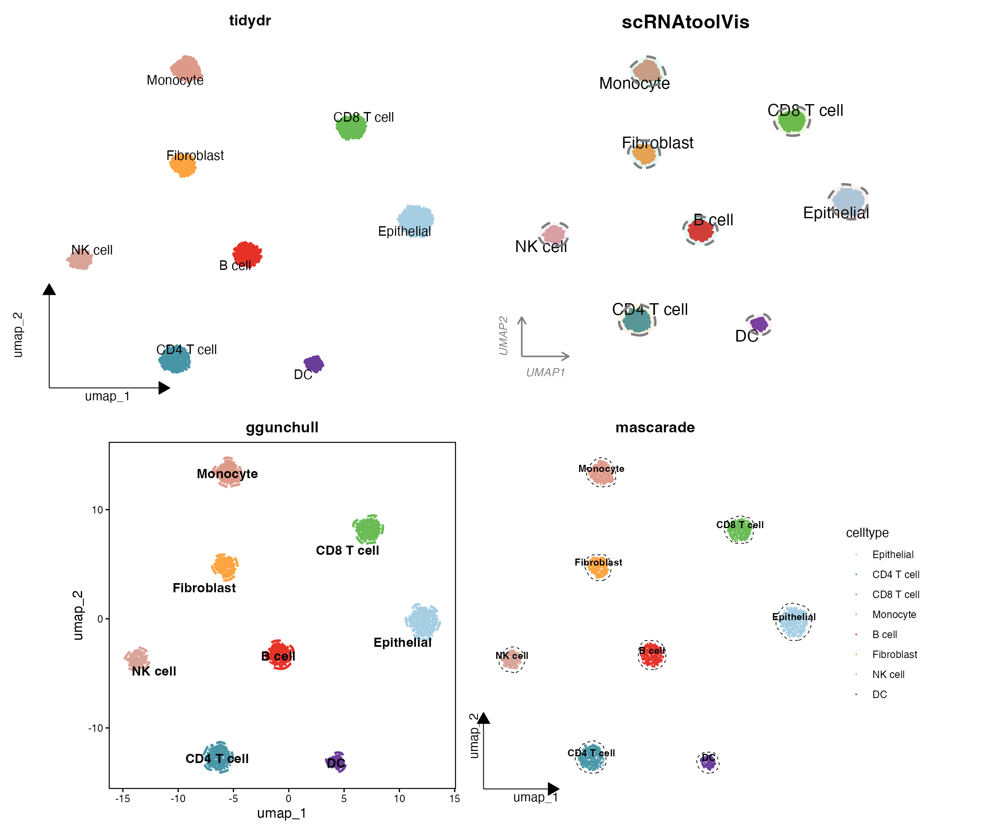

A plain `DimPlot` is rarely what a journal figure needs. Reviewers expect UMAP embeddings that carry precise cluster labels, consistent factor ordering, restrained axes, and — in the style of high-impact single-cell papers — soft outlines that wrap each cell population. This tutorial assembles a complete, publication-ready UMAP workflow for Seurat objects:

1. **Baseline panels**: labelled UMAP, faceted UMAP, and a patchwork composite with journal-style letter tags.
2. **Scheme 1 — tidydr arrow axes**: L-shaped arrow axes without grid lines; the safe, universal SCI style.
3. **Scheme 2 — cloud outlines** (`scRNAtoolVis::clusterCornerAxes`): corner axes plus translucent "cloud" halos around clusters; the popular CNS-sub-journal look.
4. **Scheme 3 — dashed hulls** (`ggunchull::stat_unchull`): crisp dashed non-convex hulls with centred bold labels; the polished review-article style.
5. **Scheme 4 — fine masks** (`mascarade::generateMask`): density-based contours that hug high-density embeddings; for high-resolution, large-atlas figures.
6. **Bonus — 3D density landscape**: an interactive three-dimensional kernel-density "terrain" of the embedding with `plotly`.

All four schemes draw from one simulated PBMC-style Seurat object, so every panel is fully reproducible in the browser.

## Example

{fig-alt="Publication-ready UMAP styles DEMO: tidydr, scRNAtoolVis, ggunchull, mascarade" fig-align="center" width="90%"}

## Setup

-   System Requirements: Cross-platform (Linux/MacOS/Windows)

-   Programming Language: R

-   Dependent packages: `Seurat`, `ggplot2`, `dplyr`, `stringr`, `patchwork`, `RColorBrewer`, `ggrepel`, `tidydr`, `scRNAtoolVis`, `ggunchull`, `mascarade`, `plotly`

```{r packages setup, message=FALSE, warning=FALSE, output=FALSE}
# CRAN dependencies
if (!requireNamespace("Seurat", quietly = TRUE)) install.packages("Seurat")
if (!requireNamespace("ggplot2", quietly = TRUE)) install.packages("ggplot2")
if (!requireNamespace("dplyr", quietly = TRUE)) install.packages("dplyr")
if (!requireNamespace("stringr", quietly = TRUE)) install.packages("stringr")
if (!requireNamespace("patchwork", quietly = TRUE)) install.packages("patchwork")
if (!requireNamespace("RColorBrewer", quietly = TRUE)) install.packages("RColorBrewer")
if (!requireNamespace("ggrepel", quietly = TRUE)) install.packages("ggrepel")
if (!requireNamespace("tidydr", quietly = TRUE)) install.packages("tidydr")
if (!requireNamespace("mascarade", quietly = TRUE)) install.packages("mascarade")
if (!requireNamespace("plotly", quietly = TRUE)) install.packages("plotly")

# GitHub dependencies
if (!requireNamespace("remotes", quietly = TRUE)) install.packages("remotes")
if (!requireNamespace("scRNAtoolVis", quietly = TRUE)) {
  remotes::install_github("junjunlab/scRNAtoolVis")
}
if (!requireNamespace("ggunchull", quietly = TRUE)) {
  remotes::install_github("sajuukLyu/ggunchull")
}

# Load packages
library(Seurat)
library(ggplot2)
library(dplyr)
library(stringr)
library(patchwork)
library(RColorBrewer)
library(ggrepel)
library(tidydr)
library(scRNAtoolVis)
library(ggunchull)
library(mascarade)
library(plotly)
```

```{r session info}
sessioninfo::session_info("attached")
```

## Data Preparation

### Simulated PBMC-style Seurat object

We simulate 3,360 cells across 8 cell types with unequal population sizes (200–660 cells each) and a marker-gene block structure, 6 sequencing samples mapped to 6 condition groups, and 3 tissue sites. Cell barcodes carry their sample name (`0001-1_Sample_3`), the way merged Seurat objects name cells. The same counts → normalization → PCA → UMAP/t-SNE chain you would run on a real object is executed so the embedding looks realistic.

```{r simulate data, message=FALSE, warning=FALSE}
set.seed(2026)

type_sizes <- c("CD4 T cell" = 500, "CD8 T cell" = 460, "NK cell" = 300,
                "B cell" = 420, "Monocyte" = 460, "DC" = 200,
                "Fibroblast" = 360, "Epithelial" = 660)
cell_types <- names(type_sizes)
n_type <- length(cell_types)
n_cell <- sum(type_sizes)
n_gene <- 1200
markers_per <- 40

gene_names <- paste0("Gene", 1:n_gene)
counts <- matrix(rnbinom(n_cell * n_gene, size = 4, prob = 0.25), n_gene, n_cell)
counts <- matrix(as.integer(pmin(counts, 30)), n_gene, n_cell)

# Add a marker block for each cell type
celltype <- factor(rep(cell_types, times = type_sizes), levels = cell_types)
for (i in seq_len(n_type)) {
  block <- ((i - 1) * markers_per + 1):(i * markers_per)
  idx_i <- which(celltype == cell_types[i])
  boost <- rnbinom(length(block) * length(idx_i), size = 8, prob = 0.2)
  counts[block, idx_i] <- pmin(counts[block, idx_i] + as.integer(boost), 120)
}
rownames(counts) <- gene_names

# Sample-level metadata: 6 samples map to 6 condition groups
groups <- c("Control", "4hours", "12hours", "2days", "14days", "6weeks")
site_lv <- c("Tumor", "Normal", "Margin")
orig.ident_raw <- sample(paste0("Sample_", 1:6), n_cell, TRUE)
lut <- setNames(rep(groups, length.out = 6), sort(unique(orig.ident_raw)))
Group <- factor(lut[orig.ident_raw], levels = groups)
site <- factor(sample(site_lv, n_cell, TRUE), levels = site_lv)

# Cell barcodes carry the sample name, as in merged Seurat objects
colnames(counts) <- paste0(sprintf("%04d", seq_len(n_cell)), "-1_", orig.ident_raw)

meta <- data.frame(
  celltype = celltype, Group = Group, orig.ident_raw = orig.ident_raw, site = site,
  row.names = colnames(counts)
)

sce <- CreateSeuratObject(counts = counts, meta.data = meta)
sce <- NormalizeData(sce, verbose = FALSE)
sce <- FindVariableFeatures(sce, nfeatures = 800, verbose = FALSE)
sce <- ScaleData(sce, verbose = FALSE)
sce <- RunPCA(sce, npcs = 20, verbose = FALSE)
sce <- RunUMAP(sce, dims = 1:15, verbose = FALSE)
sce <- RunTSNE(sce, dims = 1:15, verbose = FALSE)
Idents(sce) <- "celltype"
```

### Journal practice 1: order clusters by cell count

Figure aesthetics break when every panel orders cell types differently. Sort the identity factor by decreasing cell count once, and every downstream figure inherits the same order (a step from the source article's "data preprocessing" section). With the unequal populations simulated above, the reorder is visible: `Epithelial` (660 cells) comes first and `DC` (200 cells) last.

```{r order clusters}
# Order cell types from largest to smallest population
celltype_counts <- table(sce$celltype)
ord <- names(sort(celltype_counts, decreasing = TRUE))
sce$celltype <- factor(sce$celltype, levels = ord)
Idents(sce) <- "celltype"
celltype_counts
```

### Journal practice 2: fix `SeuratProject` sample labels

Cells that lost their identity during multi-dataset merging carry the default `SeuratProject` origin, which scrambles sample grouping. Recover the real sample name from the cell barcode with a regular expression, as in the source article:

```{r fix seuratproject labels}
# Inject the pathology for demonstration
idx_bad <- sample(seq_len(ncol(sce)), 60)
sce$orig.ident_raw[idx_bad] <- "SeuratProject"

idx_to_fix <- which(sce$orig.ident_raw == "SeuratProject")
if (length(idx_to_fix) > 0) {
  message(paste("Found", length(idx_to_fix), "cells with a SeuratProject label"))
  cell_names <- colnames(sce)[idx_to_fix]
  new_idents <- str_extract(cell_names, "[^_]+_[^_]+$")
  if (any(is.na(new_idents))) {
    new_idents[is.na(new_idents)] <- cell_names[is.na(new_idents)]
  }
  sce$orig.ident_raw[idx_to_fix] <- new_idents
}
table(sce$orig.ident_raw)
```

### A shared palette

```{r palette}
selCols <- colorRampPalette(brewer.pal(n = 10, name = "Paired"))(8)
names(selCols) <- levels(sce$celltype)
```

## Visualization

### Baseline panels

A labelled UMAP by cell type, the same embedding split by tissue site, and a patchwork composite combining cell-type and t-SNE views with journal letter tags (`tag_levels = "A"`). UMAP emphasizes local similarity between related populations; t-SNE separates distinct populations, so the two together make a stronger quality check.

```{r}
#| label: fig-umap-baseline
#| fig-cap: "Labelled UMAP coloured by cell type, split by tissue site"
#| out-width: "100%"
p_base <- DimPlot(sce, reduction = "umap", group.by = "celltype",
                  label = TRUE, label.size = 4, repel = TRUE, cols = selCols) +
  theme_dr() +
  theme(panel.grid = element_blank(),
        legend.text = element_text(size = 10, color = "black")) +
  guides(color = guide_legend(title = "", override.aes = list(size = 3, alpha = 1)))
p_split <- DimPlot(sce, reduction = "umap", split.by = "site", group.by = "celltype",
                   label = FALSE, cols = selCols, ncol = 3) +
  theme(panel.grid = element_blank(), legend.position = "none")
p_base + p_split + plot_layout(widths = c(1, 1.4))
```

```{r}
#| label: fig-umap-composite
#| fig-cap: "Patchwork composite: UMAP by cell type (A) and t-SNE (B) with journal letter tags"
#| out-width: "85%"
p1_umap <- DimPlot(sce, reduction = "umap", group.by = "celltype",
                   label = TRUE, label.size = 4, repel = TRUE, cols = selCols) +
  theme(panel.grid = element_blank())
p3_tsne <- DimPlot(sce, reduction = "tsne", group.by = "celltype",
                   label = TRUE, label.size = 4, repel = TRUE, cols = selCols) +
  theme(panel.grid = element_blank())
combined_plot <- p1_umap + p3_tsne +
  plot_annotation(tag_levels = "A") &
  theme(text = element_text(family = "Arial"),
        plot.tag = element_text(family = "Arial", size = 16, face = "bold"))
combined_plot
```

The composite is exported the standard way: `ggsave(combined_plot, filename = "combined_umap.pdf", width = 16, height = 9)`.

### Scheme 1: tidydr arrow axes — universal SCI style

`theme_dr()` replaces the grey grid with L-shaped arrow axes, strips the title, and keeps a single-column legend. High fault tolerance and suitable for main text figures in most SCI journals.

```{r}
#| label: fig-umap-tidydr
#| fig-cap: "UMAP with tidydr arrow axes"
#| out-width: "70%"
p_tidydr <- DimPlot(sce, reduction = "umap", group.by = "celltype",
                    label = TRUE, repel = TRUE, cols = selCols) +
  theme_dr() +
  theme(panel.grid = element_blank(),
        legend.text = element_text(size = 12, face = "plain", color = "black"),
        plot.title = element_blank()) +
  guides(color = guide_legend(title = "", override.aes = list(size = 4, alpha = 1), ncol = 1))
p_tidydr
```

### Scheme 2: scRNAtoolVis cloud outlines — CNS sub-journal style

`clusterCornerAxes()` draws corner axes plus translucent circular halos (`addCircle = TRUE`) around each cluster. Key parameters: `cicAlpha` (halo transparency), `cicDelta` (grid granularity of the halo), and `nbin` (resolution of the underlying density estimate).

```{r}
#| label: fig-umap-corneraxes
#| fig-cap: "UMAP with scRNAtoolVis corner axes and cloud outlines"
#| out-width: "70%"
p_corneraxes <- clusterCornerAxes(
  object = sce,
  reduction = "umap",
  clusterCol = "celltype",
  pSize = 0.3,
  arrowType = "open",
  lineTextcol = "grey50",
  cornerTextSize = 3.5,
  keySize = 1.5,
  show.legend = FALSE,
  cellLabel = TRUE,
  cellLabelSize = 5,
  noSplit = TRUE,
  addCircle = TRUE,
  cicAlpha = 0.1,
  cicDelta = 0.5,
  nbin = 200
) + scale_color_manual(values = selCols)
p_corneraxes
```

### Scheme 3: ggunchull dashed hulls — polished review style

`stat_unchull()` wraps each population in a smooth, non-convex dashed hull. Cell-type labels are placed at shifted medians with `geom_text_repel()`, keeping the plot tidy without a legend.

```{r}
#| label: fig-umap-unchull
#| fig-cap: "UMAP with ggunchull dashed hulls and centred labels"
#| out-width: "70%"
meta <- cbind(sce@meta.data, sce@reductions$umap@cell.embeddings)
main_type_med <- meta %>%
  group_by(celltype) %>%
  summarise(umap_1 = median(umap_1) - 1, umap_2 = median(umap_2) - 1, .groups = "drop")

p_unchull <- ggplot(meta, aes(x = umap_1, y = umap_2)) +
  stat_unchull(aes(fill = celltype, color = celltype),
               alpha = 0.05, size = 1, lty = 2, delta = 0.25, show.legend = FALSE) +
  geom_point(aes(color = celltype), size = 0.2, show.legend = FALSE) +
  scale_color_manual(values = selCols) +
  scale_fill_manual(values = selCols) +
  geom_text_repel(data = main_type_med, aes(label = celltype),
                  fontface = "bold", color = "black", size = 4,
                  show.legend = FALSE, seed = 42) +
  coord_equal() +
  theme_classic() +
  theme(aspect.ratio = 1,
        panel.border = element_rect(color = "black", fill = NA, linewidth = 0.8),
        axis.line = element_blank(),
        axis.ticks = element_line(color = "black"),
        axis.title = element_text(size = 12))
p_unchull
```

### Scheme 4: mascarade fine masks — high-density atlas style

`generateMask()` turns per-cluster kernel densities into contour masks that follow the cell distribution. The mask table adds a `group` column, so a single `geom_path(group = group)` layer draws every outline. Cell-type labels sit on the medians of each population.

```{r}
#| label: fig-umap-mascarade
#| fig-cap: "UMAP with mascarade fine contours and centroid labels"
#| out-width: "70%"
df <- FetchData(object = sce, vars = c("umap_1", "umap_2", "celltype"))
celltype_counts <- table(df$celltype)
valid_celltypes <- names(celltype_counts)[celltype_counts >= 2]
df_filtered <- df[df$celltype %in% valid_celltypes, ]
rownames(df_filtered) <- NULL

# Generate the fine contour masks
maskTable <- generateMask(
  dims = df_filtered[, 1:2],
  clusters = df_filtered$celltype
)

p <- ggplot(df, aes(x = umap_1, y = umap_2)) +
  geom_point(aes(color = celltype), size = 0.05) +
  geom_path(data = maskTable, aes(group = group), linewidth = 0.3, linetype = 2) +
  coord_fixed(ratio = 1) +
  theme_classic() +
  scale_color_manual(values = selCols) +
  theme_dr(xlength = 0.22, ylength = 0.22,
           arrow = grid::arrow(length = unit(0.15, "inches"), type = "closed")) +
  theme(panel.grid = element_blank())

centroids <- df %>%
  group_by(celltype) %>%
  summarise(centroid_x = median(umap_1, na.rm = TRUE),
            centroid_y = median(umap_2, na.rm = TRUE), .groups = "drop")

p_mascarade <- p + geom_text(data = centroids,
                             aes(label = celltype, x = centroid_x, y = centroid_y),
                             size = 3.5, vjust = -0.2, hjust = 0.5,
                             color = "black", fontface = "bold")
p_mascarade
```

::: callout-note
`generateMask()` changed its API across versions: older releases used `cluster =` and `minDensity =`, while the current CRAN version (≥ 0.4) uses `clusters =` and deprecates `minDensity`/`kernel`/`type` in favour of automatic bandwidth selection (`smoothSigma = NA` by default). The chunk above uses the current API.
:::

### Bonus: 3D density landscape

The viral "three-dimensional kernel-density landscape" stacks one density surface per cell type over the shared UMAP plane. It is an interactive `plotly` widget — drag to rotate and inspect; for static export install the Python `kaleido` package and use `plotly::save_image()`.

```{r plotly-3d-density, message=FALSE, warning=FALSE}
dens <- do.call(rbind, lapply(split(df, df$celltype), function(d) {
  kd <- MASS::kde2d(d$umap_1, d$umap_2, n = 60,
                    lims = c(range(df$umap_1), range(df$umap_2)))
  out <- expand.grid(x = kd$x, y = kd$y)
  out$z <- as.vector(kd$z)
  out$celltype <- d$celltype[1]
  out
}))

fig <- plot_ly(dens, x = ~x, y = ~y, z = ~z, color = ~celltype,
               type = "scatter3d", mode = "lines", line = list(width = 6),
               colors = selCols) %>%
  layout(scene = list(xaxis = list(title = "UMAP_1"),
                      yaxis = list(title = "UMAP_2"),
                      zaxis = list(title = "Density")))
fig
```

### Choosing among the schemes

| Scheme | Style | Best for |
|--------|-------|----------|
| tidydr | Arrow axes, no grid | Main-text figures in most SCI journals |
| scRNAtoolVis | Corner axes + cloud halos | High-impact original-research figures |
| ggunchull | Dashed hulls + bold labels | Review articles and polished main figures |
| mascarade | Density-fitted fine masks | High-density, large single-cell atlases |

## References

\[1\] Hao Y, Hao S, Andersen-Nissen E, et al. Integrated analysis of multimodal single-cell data. *Cell*. 2021;184(13):3573–3587. <https://doi.org/10.1016/j.cell.2021.04.048> (Seurat)

\[2\] Yu G. tidydr: an R package to create dimension reduction plots with styled axes. <https://cran.r-project.org/package=tidydr>

\[3\] Zhang J. scRNAtoolVis: Making single-cell RNA-seq visualization easier and better. <https://github.com/junjunlab/scRNAtoolVis>

\[4\] Lyu Y. ggunchull: A ggplot extension for drawing smooth non-convex circles around a set of points. <https://github.com/sajuukLyu/ggunchull>

\[5\] Sergushichev A. mascarade: Generating Cluster Masks for Single-Cell Dimensional Reduction Plots. <https://github.com/alserglab/mascarade>

\[6\] 罗小黑. AI分析单细胞+空转：umap大合集（三）. WeChat article. <https://mp.weixin.qq.com/s/ItyeGIJRhSFEaibw9KUbgw>
