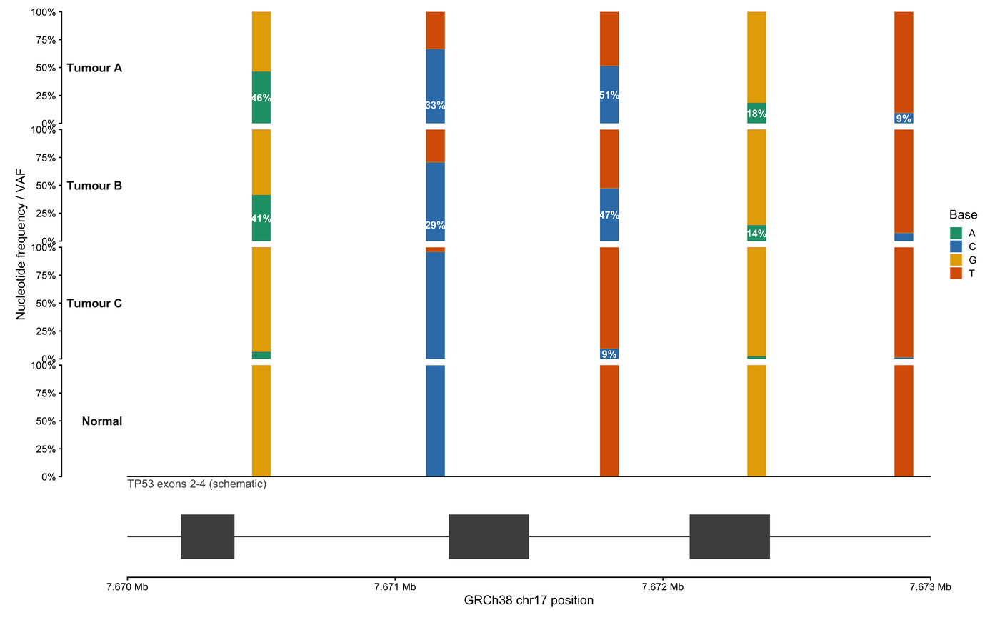

一个变异记录是「坐标 + 等位基因 + 对其功能的判断」。这两部分都无法以裸表格通过审稿：核苷酸频率轨说明该等位基因是否真实存在，单倍型定相说明它位于哪条同源染色体，功能后果矩阵说明它会破坏什么。本教程在 GRCh38 上，用透明的模拟数据沿基因组坐标重建这三种注释视图。

## 示例

{fig-alt="变异注释图 DEMO" fig-align="center" width="85%"}

沿 GRCh38 chr17（TP53 位点）的碱基频率与变异等位分数：三个肿瘤与一个正常样本的逐位点碱基组成堆叠，变异标签给出替代等位分数。正常样本几乎没有非参考碱基，这条对照说明肿瘤中的替换是体细胞突变而非生殖系变异。

## Setup

-   系统要求：跨平台（Linux/MacOS/Windows）

-   编程语言：R

-   依赖包：`ggplot2`; `dplyr`; `tidyr`; `patchwork`; `scales`
```{r packages setup, message=FALSE, warning=FALSE, output=FALSE}
if (!requireNamespace("ggplot2", quietly = TRUE)) install.packages("ggplot2")
if (!requireNamespace("dplyr", quietly = TRUE)) install.packages("dplyr")
if (!requireNamespace("tidyr", quietly = TRUE)) install.packages("tidyr")
if (!requireNamespace("patchwork", quietly = TRUE)) install.packages("patchwork")
if (!requireNamespace("scales", quietly = TRUE)) install.packages("scales")
library(ggplot2)
library(dplyr)
library(tidyr)
library(patchwork)
library(scales)
```

```{r}
sessioninfo::session_info("attached")
```

## Data Preparation

频率面板在 GRCh38 chr17 的 `TP53` 3 kb 窗口上模拟四个样本（三个肿瘤、一个正常），含五个位点，肿瘤 VAF 覆盖 1% 到 51%；标签显示所有不低于 9% 的 alt 等位比例。定相面板跨三个 phase block 模拟 read-backed 单倍型，其中一条读段的等位基因在两个单倍型间切换，因而保持未定相。功能后果面板是「基因 × 样本」的模拟变异效应矩阵，外加队列水平的密度剖面。
```{r load data, message=FALSE, warning=FALSE}
set.seed(4353)
bases <- c("A", "C", "G", "T")
base_colours <- c(A = "#1B9E77", C = "#377EB8", G = "#E6AB02", T = "#D95F02")
cons_colours <- c(missense = "#2166AC", synonymous = "#7F7F7F",
                  nonsense = "#B2182B", splice = "#E08214", inframe = "#5AAE61")
## ---- (1) nucleotide frequency at five sites over 3 kb ------------------
locus_start <- 7670000; locus_end <- 7673000
samples <- c("Tumour A", "Tumour B", "Tumour C", "Normal")
sites <- c(7670500, 7671150, 7671800, 7672350, 7672900)
site_ref <- c("G", "C", "T", "G", "T")
site_alt <- c("A", "T", "C", "A", "C")
vaf <- matrix(c(.46, .41, .06, 0,  .33, .29, .04, 0,  .51, .47, .09, 0,
                .18, .14, .02, 0,  .09, .07, .01, 0), ncol = 4, byrow = TRUE)
freq <- expand.grid(site = sites, sample = factor(samples, levels = samples),
                    base = bases, stringsAsFactors = FALSE) |>
  as_tibble() |>
  mutate(si = match(site, sites), k = match(sample, samples),
         ref = site_ref[si], alt = site_alt[si],
         alt_frac = vaf[cbind(si, k)],
         frac = if_else(as.character(base) == ref, 1 - alt_frac - 3 * 0.0025,
                        if_else(as.character(base) == alt, alt_frac, 0.0025)),
         base = factor(base, levels = rev(bases))) |>
  group_by(site, sample) |>
  mutate(frac = frac / sum(frac)) |>
  ungroup()
## Label y = centre of the ALT segment in the actual stack. position_stack()
## on the filtered rows alone would centre the label on the bottom frac/2 of
## the bar, which is the REFERENCE segment whenever the alt allele stacks on
## top of it.
stack_order <- freq |>
  mutate(base = factor(base, levels = bases)) |>
  arrange(site, sample, base) |>
  group_by(site, sample) |>
  mutate(seg_top = cumsum(frac)) |>
  ungroup()
vaf_labels <- stack_order |>
  filter(as.character(base) == site_alt[si], frac >= 0.09) |>
  mutate(label = percent(frac, accuracy = 1),
         seg_y = seg_top - frac / 2)
exons <- tibble(xmin = c(7670200, 7671200, 7672100, 7673000),
                xmax = c(7670400, 7671500, 7672400, 7673020))
## ---- (2) read-backed phasing over three blocks -------------------------
n_sites <- 14
site_pos <- sort(sample(seq(7670000, 7684000, by = 50), n_sites))
blocks <- c(rep(1, 5), rep(2, 5), rep(3, 4))
h1 <- sample(bases, n_sites, replace = TRUE)
h2 <- ifelse(h1 == "A", "G", ifelse(h1 == "C", "T",
              ifelse(h1 == "G", "A", "C")))
reads <- tibble(read = 1:11,
                hap = c(1, 2, 1, 2, 1, 2, 1, 2, 1, 2, 0),
                start = c(1, 2, 1, 3, 2, 5, 7, 9, 10, 11, 4),
                end = c(6, 7, 5, 8, 6, 10, 12, 13, 14, 13, 9))
read_sites <- bind_rows(lapply(seq_len(nrow(reads)), function(i) {
  tibble(read = reads$read[i], hap = as.character(reads$hap[i]),
         site = reads$start[i]:reads$end[i])
})) |>
  mutate(pos = site_pos[site], y = 12 - read, block = blocks[site],
         allele = if_else(hap == "1", h1[site],
                          if_else(hap == "2", h2[site],
                                  if_else(runif(n()) < 0.5, h1[site], h2[site]))))
hap_rows <- tibble(site = rep(seq_len(n_sites), 2),
                   hap = rep(c("1", "2"), each = n_sites),
                   pos = rep(site_pos, 2),
                   y = rep(c(13.6, 12.6), each = n_sites),
                   allele = c(h1, h2))
## ---- (3) consequence matrix and cohort density -------------------------
genes <- c("TP53", "EGFR", "KRAS", "BRAF", "PIK3CA", "PTEN",
           "APC", "RB1", "NF1", "SMAD4", "ARID1A", "ATM")
patients <- c("P01", "P02", "P03", "P04", "P05")
consequences <- c("missense", "synonymous", "nonsense", "splice", "inframe")
variants <- expand.grid(gene = genes, patient = patients) |>
  as_tibble() |>
  filter(runif(n()) < 0.45) |>
  mutate(consequence = sample(consequences, n(), replace = TRUE,
                              prob = c(.5, .25, .1, .08, .07)),
         vaf = round(runif(n(), .03, .55), 2))
chroms <- c(paste0("chr", 1:22), "chrX")
chrom_len <- c(249, 243, 199, 191, 181, 171, 159, 146, 138, 134, 135, 133,
               114, 107, 102, 90, 83, 80, 59, 64, 47, 51, 156)
density <- tibble(chrom = chroms, len_mb = chrom_len,
                  per_mb = round(len_mb * runif(23, 4, 18) / len_mb, 1))
head(freq, 3)
```

## Visualization

### 1. 沿位点的核苷酸频率与 VAF

这是 **NucFreq** 与 **snpit** 推广的紧凑轨道：每个变异位点一根堆叠组成柱、每个样本一个分面、共享基因组横轴。参考碱基保持为高柱段、alt 碱基为低柱段，读者即可一眼估计 VAF（变异等位基因比例，0–100%）；肿瘤/正常对照则把体细胞事件与胚系或假象区分开。
```{r}
#| label: fig-1.1NucleotideFrequency
#| fig-cap: "模拟的 TP53 样 chr17 位点（合成坐标）上的核苷酸频率与 VAF：三个肿瘤与一个正常样本的逐位点堆叠碱基组成；对达到或超过 9% 的每个格标注 alt 等位基因比例，低于该阈值的格仅由堆叠高度体现。"
#| warning: false
#| message: false
#| fig-width: 10
#| fig-height: 6.2
#| fig-dpi: 300
p_freq <- ggplot(freq, aes(site, frac)) +
  geom_col(aes(fill = base), width = 70) +
  geom_text(data = vaf_labels, aes(site, seg_y, label = label),
            colour = "white", fontface = "bold", size = 2.6) +
  facet_wrap(~sample, ncol = 1, strip.position = "left") +
  scale_fill_manual(values = base_colours, name = "Base", breaks = bases) +
  scale_y_continuous(labels = percent_format(accuracy = 1),
                     breaks = seq(0, 1, 0.25), expand = c(0, 0)) +
  scale_x_continuous(limits = c(locus_start, locus_end), expand = c(0, 0),
                     labels = label_number(scale = 1e-6, suffix = " Mb",
                                           accuracy = 0.001)) +
  labs(x = NULL, y = "Nucleotide frequency / VAF") +
  theme_classic(base_size = 9) +
  theme(strip.background = element_blank(),
        strip.text.y.left = element_text(angle = 0, hjust = 1, face = "bold",
                                         size = 8.5),
        axis.text.x = element_blank(), axis.ticks.x = element_blank(),
        axis.line = element_line(linewidth = 0.3),
        legend.position = "right", legend.key.size = unit(3.4, "mm"),
        plot.margin = margin(3, 6, 0, 6))
p_exon <- ggplot() +
  geom_segment(aes(x = locus_start, xend = locus_end, y = 0.5, yend = 0.5),
               colour = "#4D4D4D", linewidth = 0.4) +
  geom_rect(data = exons, aes(xmin = xmin, xmax = xmax, ymin = 0.2, ymax = 0.8),
            fill = "#4D4D4D") +
  scale_x_continuous(limits = c(locus_start, locus_end), expand = c(0, 0),
                     labels = label_number(scale = 1e-6, suffix = " Mb",
                                           accuracy = 0.001)) +
  scale_y_continuous(limits = c(0, 1)) +
  labs(x = "Simulated locus position (TP53-like, synthetic)", y = NULL,
       subtitle = "TP53 exons 2-4 (schematic)") +
  theme_classic(base_size = 9) +
  theme(axis.text.y = element_blank(), axis.ticks.y = element_blank(),
        axis.line.y = element_blank(),
        plot.subtitle = element_text(size = 8, colour = "#555555"),
        plot.margin = margin(2, 6, 4, 6))
p_freq / p_exon + plot_layout(heights = c(4, 0.7))
```

### 2. Read-backed 单倍型定相

**Phasius** 把 phase set 画成一个区块加其下读段；**SNPitty** 与 **snpit** 以交互方式提供同一条「读段—单倍型」链路。顶部两行单倍型定义等位基因；下方每条读段按其所支持的单倍型着色；灰色读段跨越区块边界且等位基因相互矛盾，因而保持未定相。相位区块（而非染色体坐标）才是可信度的单位。
```{r}
#| label: fig-1.2HaplotypePhasing
#| fig-cap: "模拟 chr17 位点上跨三个 phase block 的 read-backed 单倍型定相；一条灰色读段携带切换，保持未定相。"
#| warning: false
#| message: false
#| fig-width: 10
#| fig-height: 5.4
#| fig-dpi: 300
hap_colours <- c(`1` = "#2166AC", `2` = "#D6604D", `0` = "#7F7F7F")
block_bounds <- c(site_pos[6] - 300, site_pos[11] - 300)
ggplot() +
  geom_vline(xintercept = block_bounds, linetype = "22", colour = "#999999",
             linewidth = 0.3) +
  geom_line(data = read_sites, aes(pos, y, group = read), colour = "#BBBBBB",
            linewidth = 0.3) +
  geom_point(data = read_sites, aes(pos, y, colour = hap), size = 2.6) +
  geom_text(data = read_sites, aes(pos, y, label = allele), colour = "white",
            size = 1.9, fontface = "bold") +
  geom_tile(data = hap_rows, aes(pos, y, fill = hap), width = 350, height = 0.7,
            colour = "white", linewidth = 0.2) +
  geom_text(data = hap_rows, aes(pos, y, label = allele), colour = "white",
            size = 2.2, fontface = "bold") +
  annotate("text", x = site_pos[3], y = 14.6, label = "phase block 1",
           size = 2.8, colour = "#555555") +
  annotate("text", x = site_pos[8], y = 14.6, label = "phase block 2",
           size = 2.8, colour = "#555555") +
  annotate("text", x = site_pos[12], y = 14.6, label = "phase block 3",
           size = 2.8, colour = "#555555") +
  scale_colour_manual(values = hap_colours, name = "Haplotype",
                      breaks = c("1", "2", "0"),
                      labels = c("H1", "H2", "unphased")) +
  scale_fill_manual(values = hap_colours, guide = "none") +
  scale_y_continuous(breaks = c(13.6, 12.6, 11:1),
                     labels = c("H1", "H2", paste0("read_", sprintf("%02d", 1:11))),
                     limits = c(0.4, 15), expand = c(0, 0)) +
  scale_x_continuous(breaks = c(7670000, 7675000, 7680000, 7684000),
                     labels = label_number(scale = 1e-6, suffix = " Mb",
                                           accuracy = 0.001)) +
  labs(x = "Simulated locus position (TP53-like, synthetic)", y = NULL,
       subtitle = "Alleles are phased per read; read_11 spans the block 1/2 boundary with contradictory alleles and stays grey (unphased)") +
  theme_classic(base_size = 9.5) +
  theme(axis.text.y = element_text(size = 7.4),
        axis.line = element_line(linewidth = 0.3),
        legend.position = "right", legend.key.size = unit(3.4, "mm"),
        plot.subtitle = element_text(size = 8.2, colour = "#555555"),
        plot.margin = margin(4, 6, 4, 6))
```

### 3. 功能后果矩阵与队列密度

**vcfPlotein**、**VIVA** 与 **XVCF** 对编码效应回答同一个问题：哪个基因、在哪个样本、通过何种机制。左图以颜色编码功能后果、以点大小编码 VAF；右图把队列放回染色体图谱。二者合起来，就是 `bcftools annotate`/`vcfR` 只能以文本给出、却无法在视觉上排序的注释摘要。
```{r}
#| label: fig-1.3ConsequenceMatrix
#| fig-cap: "逐基因、逐样本的变异功能后果（颜色 = 效应，大小 = VAF），以及 GRCh38 各染色体的队列变异密度。"
#| warning: false
#| message: false
#| fig-width: 10.5
#| fig-height: 4.6
#| fig-dpi: 300
variants$gene <- factor(variants$gene, levels = rev(genes))
variants$patient <- factor(variants$patient, levels = patients)
density$chrom <- factor(density$chrom, levels = rev(chroms))
p_matrix <- ggplot(variants, aes(patient, gene)) +
  geom_point(aes(size = vaf, colour = consequence), alpha = 0.9) +
  scale_size_continuous(range = c(1.2, 4.2), name = "VAF",
                        breaks = c(0.1, 0.3, 0.5), limits = c(0, 0.6)) +
  scale_colour_manual(values = cons_colours, name = "Consequence") +
  labs(x = NULL, y = NULL, subtitle = "Variant consequence per gene and sample") +
  theme_classic(base_size = 9) +
  theme(axis.line = element_line(linewidth = 0.3),
        panel.grid.major = element_line(colour = "#EEEEEE", linewidth = 0.2),
        plot.subtitle = element_text(size = 8.4, colour = "#555555"),
        legend.key.size = unit(3.4, "mm"),
        plot.margin = margin(4, 4, 4, 4))
p_density <- ggplot(density, aes(per_mb, chrom)) +
  geom_segment(aes(x = 0, xend = per_mb, y = chrom, yend = chrom),
               colour = "#BBBBBB", linewidth = 0.4) +
  geom_point(size = 1.9, colour = "#B2182B") +
  scale_x_continuous(expand = c(0, 0.2)) +
  labs(x = "Variants per Mb", y = NULL,
       subtitle = "Cohort variant density along GRCh38 chromosomes") +
  theme_classic(base_size = 8.5) +
  theme(axis.line.y = element_blank(), axis.ticks.y = element_blank(),
        axis.text.y = element_text(size = 7),
        axis.line.x = element_line(linewidth = 0.3),
        plot.subtitle = element_text(size = 8.4, colour = "#555555"),
        plot.margin = margin(4, 6, 4, 6))
p_matrix + p_density + plot_layout(widths = c(1.5, 1))
```
::: callout-tip
**实践要点**

-   务必在坐标轴标签或副标题中写出参考基因组版本。缺少 `GRCh38`/`GRCh37` 的坐标不可复现，且不同版本的转录本注释并不一致。
-   各样本的 VAF 轴应固定为 0–100%；自动缩放会让 5% 的假象看起来像克隆性事件。
-   在 `NucFreq`/`snpit` 式轨道中，参考碱基应作为主堆叠段保持可见，读者才能区分真实替换与比对假象。
-   phase block 才是可信度单位，而非单个变异：在声称单倍型前，应报告区块长度以及连接每对位点的读段数。
-   绘图前用 `bcftools norm`/`bcftools annotate` 与 `vcfR` 校验坐标与功能后果；图形无法修复发生移位的 indel。
-   VAF 的点大小必须配带数值刻度的图例，否则同一面板在屏幕与印刷品上会被读成不同含义。
:::

## Application

注释图是变异集与决策之间的桥梁。频率轨在多样本间区分克隆性与亚克隆事件；定相显示两个变异是顺式还是反式——这决定一个基因是携带一个敲除等位基因还是两次打击；功能后果矩阵则回答队列中哪些通路被命中。工具同样沿这一分工展开：**NucFreq** 与 **snpit** 用于核苷酸级审查，**phasius** 与 **SNPitty** 用于定相，**vcfPlotein**、**VIVA** 与 **XVCF** 用于交互式注释审查，**vcfR** 与 **bcftools** 负责任何绘图之前必须完成的解析、规范化与过滤。

## 关于本页跳过的实现

本页的图由 ggplot2 直接绘制，而不安装这些被跳过的工具。在 issue-435 清单中归到 Omics/VariantAnnotationPlot.qmd 的工具里，2 条被标记为**跳过**，仅作为版式参考、不作为依赖：2 条依赖闭包过重，不值得为一张静态图引入。本页先把这些工具的图形约定读懂，再自行重画，以便逐行核验每个面板。

| 工具 | 最近提交 | 状态 | 跳过原因 |
| --- | --- | --- | --- |
| VIVA | — | 依赖过重 | 框架级依赖闭包过重，不值得为一张静态图引入 |
| XVCF | 2026-04-21 | 依赖过重 | 框架级依赖闭包过重，不值得为一张静态图引入 |

## Reference

\[1\] Danecek P, Auton A, Abecasis G, et al. The variant call format and VCFtools. Bioinformatics. 2011;27(15):2156-2158. doi:10.1093/bioinformatics/btr330

\[2\] McLaren W, Gil L, Hunt SE, et al. The Ensembl Variant Effect Predictor. Genome Biol. 2016;17:122. doi:10.1186/s13059-016-0974-4

\[3\] Danecek P, Bonfield JK, Liddle J, et al. Twelve years of SAMtools and BCFtools. GigaScience. 2021;10(2):giab008. doi:10.1093/gigascience/giab008
