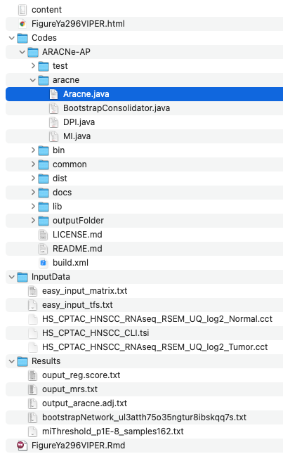

VIPER infers **transcription-factor activity** from the expression of each TF's target regulon: rank the targets' expression, compute an enrichment statistic per sample, and normalise it to a z-score — so an active TF is one whose targets move together even when its own mRNA barely changes \[1\]. `viper` and `dorothea` are not in this repository's lockfile; the two key pieces are re-implemented in-page: the **regulon signature construction** (a signed target list per TF) and the **rank-enrichment z-score** (mean target rank scaled by its null SD), then differential activity between tumour and normal is tested:

## Example

{fig-alt="Transcription Factor Activity Inference DEMO" fig-align="center" width="75%"}

## Setup

-   System Requirements: Cross-platform (Linux/MacOS/Windows)

-   Programming language: R

-   Dependent packages: `ggplot2`; `pheatmap`

```{r packages setup, message=FALSE, warning=FALSE, output=FALSE}
suppressPackageStartupMessages({
  library(ggplot2); library(pheatmap)
})
```

```{r}
sessioninfo::session_info("attached")
```

## Data Preparation

120 samples (60 tumour / 60 normal) × 400 genes, with 12 TF regulons of 25-40 signed targets each (a DoRothEA-style medium-confidence set). Planted biology: four TFs are strongly activated in tumours, three are repressed, the rest unchanged — the differential-activity screen must recover exactly this layout:

```{r load data}
suppressPackageStartupMessages({library(ggplot2); library(pheatmap)})
set.seed(49296)
n_tum <- 60; n_nor <- 60; n_gene <- 400
genes <- sprintf("G%03d", 1:n_gene)
tfs <- c("STAT3", "MYC", "NFKB1", "HIF1A", "TP53", "FOXO1",
         "E2F1", "SMAD3", "CTNNB1", "JUN", "SP1", "IRF1")

## regulons: signed target lists (mode of regulation)
regulon <- lapply(tfs, function(tf) {
  tg <- sample(genes, sample(25:40, 1))
  setNames(sample(c(1, -1), length(tg), TRUE), tg)
})
names(regulon) <- tfs

expr <- matrix(rnorm(n_gene * (n_tum + n_nor), 6, 1), n_gene, n_tum + n_nor,
               dimnames = list(genes, c(sprintf("T%02d", 1:n_tum),
                                        sprintf("N%02d", 1:n_nor))))
## planted: activated TFs push their positive targets up in tumours
activated <- c("STAT3", "MYC", "NFKB1", "HIF1A")
repressed <- c("TP53", "FOXO1", "IRF1")
for (tf in c(activated, repressed)) {
  sgn <- if (tf %in% activated) 1.1 else -1.0
  tg <- names(regulon[[tf]])
  expr[tg, 1:n_tum] <- expr[tg, 1:n_tum] + sgn * regulon[[tf]][tg]
}
```

## Visualization

### 1. Regulon Activity Scores (VIPER-Style z)

The in-page VIPER core: for each sample, rank all genes, average the ranks of the regulon's positive targets minus its negative targets, and divide by the null SD of that average — giving a per-sample activity z. The tumour/normal split is then tested per TF with a t-test and BH correction:

```{r}
#| label: fig-1.1ViperHeatmap
#| fig-cap: "Regulon activity z-scores (VIPER-style rank enrichment) for 12 TFs across 60 tumour and 60 normal samples: the four planted activators (STAT3, MYC, NFKB1, HIF1A) show a clear tumour-high block, the three repressed TFs a tumour-low block."
#| out.width: "95%"
#| fig-width: 9
#| fig-height: 5.6

activity <- sapply(seq_len(ncol(expr)), function(j) {
  rk <- rank(expr[, j])
  sapply(tfs, function(tf) {
    pos <- rk[names(regulon[[tf]])[regulon[[tf]] > 0]]
    neg <- rk[names(regulon[[tf]])[regulon[[tf]] < 0]]
    stat <- mean(c(pos, neg)) - (length(rk) + 1) / 2
    stat / (sd(rk) * sqrt(length(c(pos, neg))))
  })
})
activity <- -activity   # top-ranked targets = active = negative mean rank
colnames(activity) <- colnames(expr)

is_tum <- grepl("^T", colnames(activity))
de_tab <- do.call(rbind, lapply(tfs, function(tf) {
  tt <- t.test(activity[tf, is_tum], activity[tf, !is_tum])
  data.frame(tf = tf, diff = mean(activity[tf, is_tum]) - mean(activity[tf, !is_tum]),
             p = tt$p.value)
}))
de_tab$padj <- p.adjust(de_tab$p, method = "BH")
de_tab <- de_tab[order(de_tab$padj), ]
head(de_tab, 5)

ord <- order(!is_tum)   # tumours first, then normals
mat <- activity[de_tab$tf, ord]
mat <- pmin(pmax(mat, -3), 3)
pheatmap::pheatmap(mat,
                   color = colorRampPalette(c("#2166AC", "white", "#B2182B"))(64),
                   cluster_rows = FALSE, cluster_cols = FALSE,
                   annotation_col = data.frame(
                     Group = factor(ifelse(is_tum[ord], "Tumour", "Normal"),
                                    levels = c("Tumour", "Normal")),
                     row.names = colnames(mat), stringsAsFactors = FALSE),
                   annotation_colors = list(Group = c(Tumour = "#B2182B", Normal = "#2166AC")),
                   gaps_col = sum(is_tum), border_color = NA,
                   show_colnames = FALSE, fontsize_row = 8,
                   main = "TF regulon activity (z)")
```

### 2. The Differential-Activity Ranking

The reference's statistical readout: per-TF tumour-minus-normal activity difference, coloured by BH-adjusted significance — the recovery of the planted activators and repressors in one panel:

```{r}
#| label: fig-2.1ViperDE
#| fig-cap: "Differential regulon activity (tumour minus normal) per TF with BH-adjusted p values: the four planted activators rank positive and significant, the three repressors negative and significant, the remaining five near zero."
#| out.width: "80%"
#| fig-width: 7
#| fig-height: 5.2

de_tab$tf <- factor(de_tab$tf, levels = de_tab$tf[order(de_tab$diff)])
ggplot(de_tab, aes(tf, diff, fill = padj < 0.05)) +
  geom_col(width = 0.7) +
  scale_fill_manual(values = c(`TRUE` = "#B2182B", `FALSE` = "grey75"),
                    labels = c(`TRUE` = "BH padj < 0.05", `FALSE` = "ns"),
                    name = NULL) +
  geom_hline(yintercept = 0, colour = "grey30") +
  coord_flip() +
  labs(x = NULL, y = "Activity difference (tumour - normal)") +
  theme_bw(base_size = 11) +
  theme(panel.grid.minor = element_blank(),
        legend.position = "top")
```

::: callout-tip
**Practice tips**

-   The activity score uses **target ranks, not target expression**: a TF whose mRNA is flat still scores high if its targets move together — that is the whole point of VIPER over reading the TF's own logFC.
-   Sign the regulon: DoRothEA modes of regulation (+1/−1) must be carried into the statistic, or an activator and a repressor with the same targets become indistinguishable.
-   Use medium-confidence regulons by default; high-confidence sets are too small for stable enrichment, low-confidence ones add false targets.
-   Test differential activity with BH correction across TFs — with 12-300 TFs, uncorrected p values nominate dozens of spurious regulators.
-   Cross-check a top TF against its targets' expression heatmap: activity without coherent target expression usually flags a regulon-definition problem, not biology.
:::

## Application

::: {#fig-ViperApplications1}
{fig-alt="Transcription Factor Activity Inference" fig-align="center" width="75%"}

Transcription factor activity inference
:::

Regulon-activity inference applies wherever TF *activity* rather than TF *abundance* is the question: tumour-vs-normal regulatory rewiring, subtype-specific master regulators, or drug-induced TF shutdown.

## Reference

\[1\] Xiaofan Lu, et al. FigureYa: A Standardized Visualization Framework for Enhancing Biomedical Data Interpretation and Research Efficiency. iMetaMed. 2025. doi:10.1002/imm3.70005
