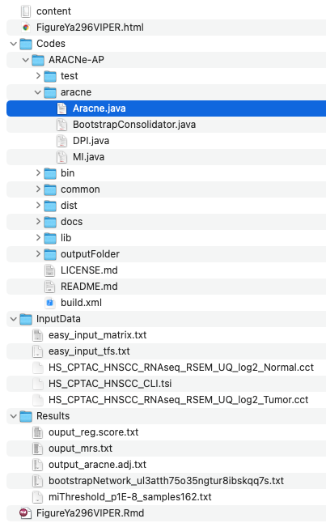

VIPER 从每个 TF 靶基因 regulon 的表达**推断转录因子活性**：对靶基因表达排名、逐样本计算富集统计量、归一化为 z 分数——因此"活跃"的 TF 是靶基因协同变化的那种，即使其自身 mRNA 几乎不变 \[\1\]。`viper` 与 `dorothea` 不在本仓库 lockfile；两个关键部分在页内重实现：**regulon 签名构建**（每个 TF 一个带符号靶基因列表）与**秩富集 z 分数**（平均靶基因秩按零分布 SD 缩放），随后检验肿瘤/正常间的活性差异：

## Example

{fig-alt="转录因子活性推断 DEMO" fig-align="center" width="60%"}

## Setup

-   系统要求：跨平台（Linux/MacOS/Windows）

-   编程语言：R

-   依赖包：`ggplot2`; `pheatmap`

```{r packages setup, message=FALSE, warning=FALSE, output=FALSE}
suppressPackageStartupMessages({
  library(ggplot2); library(pheatmap)
})
```

```{r}
sessioninfo::session_info("attached")
```

## 数据准备

120 个样本（60 肿瘤 / 60 正常）× 400 个基因、12 个 25-40 个带符号靶基因的 TF regulon（DoRothEA 式中等置信度集）。植入生物学：四个 TF 在肿瘤中强激活、三个被抑制、其余不变——差异活性筛查须精确恢复该布局：

```{r load data}
suppressPackageStartupMessages({library(ggplot2); library(pheatmap)})
set.seed(49296)
n_tum <- 60; n_nor <- 60; n_gene <- 400
genes <- sprintf("G%03d", 1:n_gene)
tfs <- c("STAT3", "MYC", "NFKB1", "HIF1A", "TP53", "FOXO1",
         "E2F1", "SMAD3", "CTNNB1", "JUN", "SP1", "IRF1")

## regulons: signed target lists (mode of regulation)
regulon <- lapply(tfs, function(tf) {
  tg <- sample(genes, sample(25:40, 1))
  setNames(sample(c(1, -1), length(tg), TRUE), tg)
})
names(regulon) <- tfs

expr <- matrix(rnorm(n_gene * (n_tum + n_nor), 6, 1), n_gene, n_tum + n_nor,
               dimnames = list(genes, c(sprintf("T%02d", 1:n_tum),
                                        sprintf("N%02d", 1:n_nor))))
## planted: activated TFs push their positive targets up in tumours
activated <- c("STAT3", "MYC", "NFKB1", "HIF1A")
repressed <- c("TP53", "FOXO1", "IRF1")
for (tf in c(activated, repressed)) {
  sgn <- if (tf %in% activated) 1.1 else -1.0
  tg <- names(regulon[[tf]])
  expr[tg, 1:n_tum] <- expr[tg, 1:n_tum] + sgn * regulon[[tf]][tg]
}
```

## Visualization

### Regulon 活性评分（VIPER 式 z）

页内 VIPER 内核：对每样本全部基因排名、求 regulon 正靶基因平均秩减负靶基因平均秩、除以该均值的零分布 SD——得到逐样本活性 z。随后用 t 检验 + BH 校正检验每个 TF 的肿瘤/正常分裂：

```{r}
#| label: fig-1.1ViperHeatmap
#| fig-cap: "12 个 TF 在 60 肿瘤与 60 正常样本中的 regulon 活性 z 分数（VIPER 式秩富集）：四个植入激活子（STAT3、MYC、NFKB1、HIF1A）呈现清晰的肿瘤高表达块、三个抑制 TF 呈肿瘤低表达块。"
#| out.width: "95%"
#| fig-width: 9
#| fig-height: 5.6

activity <- sapply(seq_len(ncol(expr)), function(j) {
  rk <- rank(expr[, j])
  sapply(tfs, function(tf) {
    pos <- rk[names(regulon[[tf]])[regulon[[tf]] > 0]]
    neg <- rk[names(regulon[[tf]])[regulon[[tf]] < 0]]
    stat <- mean(c(pos, neg)) - (length(rk) + 1) / 2
    stat / (sd(rk) * sqrt(length(c(pos, neg))))
  })
})
activity <- -activity   # top-ranked targets = active = negative mean rank
colnames(activity) <- colnames(expr)

is_tum <- grepl("^T", colnames(activity))
de_tab <- do.call(rbind, lapply(tfs, function(tf) {
  tt <- t.test(activity[tf, is_tum], activity[tf, !is_tum])
  data.frame(tf = tf, diff = mean(activity[tf, is_tum]) - mean(activity[tf, !is_tum]),
             p = tt$p.value)
}))
de_tab$padj <- p.adjust(de_tab$p, method = "BH")
de_tab <- de_tab[order(de_tab$padj), ]
head(de_tab, 5)

ord <- order(!is_tum)   # tumours first, then normals
mat <- activity[de_tab$tf, ord]
mat <- pmin(pmax(mat, -3), 3)
pheatmap::pheatmap(mat,
                   color = colorRampPalette(c("#2166AC", "white", "#B2182B"))(64),
                   cluster_rows = FALSE, cluster_cols = FALSE,
                   annotation_col = data.frame(
                     Group = factor(ifelse(is_tum[ord], "Tumour", "Normal"),
                                    levels = c("Tumour", "Normal")),
                     row.names = colnames(mat), stringsAsFactors = FALSE),
                   annotation_colors = list(Group = c(Tumour = "#B2182B", Normal = "#2166AC")),
                   gaps_col = sum(is_tum), border_color = NA,
                   show_colnames = FALSE, fontsize_row = 8,
                   main = "TF regulon activity (z)")
```

### 差异活性排序

参考的统计读数：逐 TF 的肿瘤减正常活性差、按 BH 校正显著性着色——一张面板内恢复植入的激活子与抑制子：

```{r}
#| label: fig-2.1ViperDE
#| fig-cap: "逐 TF 的差异 regulon 活性（肿瘤减正常）与 BH 校正 p 值：四个植入激活子排名正且显著、三个抑制子负且显著、其余五个近零。"
#| out.width: "80%"
#| fig-width: 7
#| fig-height: 5.2

de_tab$tf <- factor(de_tab$tf, levels = de_tab$tf[order(de_tab$diff)])
ggplot(de_tab, aes(tf, diff, fill = padj < 0.05)) +
  geom_col(width = 0.7) +
  scale_fill_manual(values = c(`TRUE` = "#B2182B", `FALSE` = "grey75"),
                    labels = c(`TRUE` = "BH padj < 0.05", `FALSE` = "ns"),
                    name = NULL) +
  geom_hline(yintercept = 0, colour = "grey30") +
  coord_flip() +
  labs(x = NULL, y = "Activity difference (tumour - normal)") +
  theme_bw(base_size = 11) +
  theme(panel.grid.minor = element_blank(),
        legend.position = "top")
```


## 应用场景

::: {{#fig-ViperApplications1}}
{fig-alt="转录因子活性推断" fig-align="center" width="60%"}

转录因子活性推断
:::

Regulon 活性推断适用于任何关注 TF *活性*而非 TF *丰度*的问题：肿瘤/正常调控重连、亚型特异主调控子、或药物诱导的 TF 关闭。

## 参考文献

\[1\] Xiaofan Lu, et al. FigureYa: A Standardized Visualization Framework for Enhancing Biomedical Data Interpretation and Research Efficiency. iMetaMed. 2025. doi:10.1002/imm3.70005
