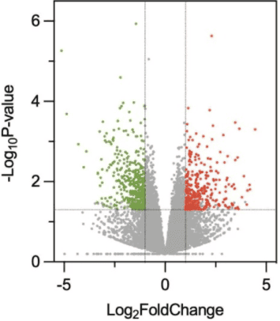

The volcano plot is used to compare the two groups and obtain the up-regulation/down-regulation between the two groups. The screening basis is the p value and FC value, which are converted to -logP value and log2(FC) value. The imported data can be the OTU table or ASV table of the microbiome, the table of transcriptome gene expression, or the features table of metabolomics and other multi-omics data.

## Example

{fig-alt="NetworkPlot DEMO" fig-align="center" width="60%"}

## Setup

-   System Requirements: Cross-platform (Linux/MacOS/Windows)

-   Programming language: R

-   Dependent packages: `tidyverse`; `readxl`; `ggrepel`; `cowplot`

```{r packages setup, message=FALSE, warning=FALSE, output=FALSE}
# Installing necessary packages
if (!requireNamespace("tidyverse", quietly = TRUE)) {
  install.packages("tidyverse")
}
if (!requireNamespace("readxl", quietly = TRUE)) {
  install.packages("readxl")
}
if (!requireNamespace("ggrepel", quietly = TRUE)) {
  install.packages("ggrepel")
}
if (!requireNamespace("cowplot", quietly = TRUE)) {
  install.packages("cowplot")
}

# Load packages
library(tidyverse)
library(readxl)
library(ggrepel)
library(cowplot)
```

```{r}
sessioninfo::session_info("attached")
```

## Data Preparation

We import the volcano plot example data from [omicshare](https://www.omicshare.com/tools/home/report/reportvolcano.html).

```{r load data, message=FALSE, warning=FALSE}
# Load excel data
data <- read_excel("files/volcano.eg.xlsx")

# Rename column names (handle special characters)
data <- data %>%
  rename(log2FC = "log2 Ratio(WT0/LOG)", Pvalue = "Pvalue")
# Handle the case where the p-value is 0 (avoid calculating -Inf)
data <- data %>%
  mutate(log10P = -log10(Pvalue + 1e-300)) # Make sure to handle the case where P=0
# Convert to numeric type and handle values that fail to convert (such as invalid characters)
data <- data %>%
  mutate(
    log2FC = as.numeric(log2FC) # Values that fail the conversion become NA
  )

# Find the original value that caused the conversion to fail
data %>%
  filter(is.na(log2FC)) %>%
  select(log2FC) # View the raw log2FC values for these lines
# Repair the data as needed (e.g. replace or remove outliers)
# Example: Replace "Inf" with an actual value or filter out
data <- data %>%
  mutate(
    log2FC = ifelse(log2FC == "Inf", 100, log2FC), # Adjust according to needs
    log2FC = as.numeric(log2FC)
    ) %>%
  filter(!is.na(log2FC)) # Delete the rows that cannot be repaired

# Defining significance (satisfying both P value < 0.05 and |log2FC| > 1)
# Define significance categories (upregulated, downregulated, not significant)
data <- data %>%
  mutate(
    significant = case_when(
      Pvalue < 0.05 & log2FC > 2 ~ "Upregulated", # Up (red)
      Pvalue < 0.05 & log2FC < -2 ~ "Downregulated", # Down (green)
      TRUE ~ "Not significant" # Not significant (grey)
    )
  )

# View data structure
head(data, 5)
```

## Visualization

### 1. Basic volcano plot

```{r}
#| label: fig-1.1BasicVolcano
#| fig-cap: "Basic volcano plot"
#| out.width: "95%"
#| warning: false

# Basic volcano plot
p <- 
  ggplot(data, aes(x = log2FC, y = -log10(Pvalue))) + # Plot preliminary volcano
  # Plot scatter points, colored by significant categories
  geom_point(aes(color = significant), alpha = 0.6, size = 1.5) + 
  # Set color mapping (up: red, down: green, no significant: gray)
  scale_color_manual(
    values = c("Upregulated" = "red", "Downregulated" = "green", "Not significant" = "gray"),
    name = "Significance" # Legend Title
    ) +
  # Adding a filter threshold line
  geom_vline(xintercept = c(-2, 2), linetype = "dashed", color = "green", linewidth = 0.5) + # log2FC threshold line
  geom_hline(yintercept = -log10(0.05), linetype = "dashed", color = "blue", linewidth = 0.5) + # p-value threshold line
  # Adjust axes and titles
  labs(x = "log2(Fold Change)", y = "-log10(P-value)",
       title = "Volcano Plot with Thresholds") +
  theme_minimal() +
  theme(plot.title = element_text(hjust = 0.5, face = "bold"), # Title centered bold
        legend.position = "right") # Legend position

p
```

### 2. Labeled volcano plot

```{r}
#| label: fig-1.1LabelVolcano
#| fig-cap: "Labeled volcano plot"
#| out.width: "95%"
#| warning: false
#| message: false

# Add Label
# Step 1: Screening genes to be annotated
label_data <- data %>%
  filter(Pvalue < 0.05) %>% # Screening of significant genes
  group_by(significant) %>% # Group by up and down
  top_n(10, abs(log2FC)) %>% # Take the 10 with the largest absolute values of log2FC
  ungroup()
# Step 2: Define label colors (light red and light green)
label_colors <- c(
  "Upregulated" = "#FF9999",
  "Downregulated" = "#99FF99"
  )
# Step 3: Draw a labeled volcano plot
p <- 
  ggplot(data, aes(x = log2FC, y = -log10(Pvalue))) +
  geom_point(aes(color = significant), alpha = 0.6, size = 1.5) +
  # Add gene tags (only target genes are marked)
  geom_text_repel(
    data = label_data,
    aes(label = GeneID, color = significant), # Assume that the gene name column is named OTU ID
    size = 3,
    box.padding = 0.5, # Label padding
    max.overlaps = 50, # Maximum overlap allowed
    segment.color = "grey50", # Connection line color
    show.legend = FALSE
    ) +
  # Set color mapping (original color + label color)
  scale_color_manual(
    values = c("Upregulated" = "red", "Downregulated" = "green", "Not significant" = "gray"),
    guide = guide_legend(override.aes = list(
      color = c("red", "green", "gray"), # Legend color remains original
      label = "" # No text is displayed in the legend
      ))) +
  # Control label color (light red and light green)
  scale_color_manual(
    values = label_colors,
    guide = "none" # Hide additional legend
    ) +
  # Keep the original threshold line and title
  geom_vline(xintercept = c(-2, 2), linetype = "dashed", color = "black") +
  geom_hline(yintercept = -log10(0.05), linetype = "dashed", color = "black") +
  labs(title = "Volcano Plot with Top 20 Labels") +
  theme_minimal()

p
```


### 3. Volcano Plot with Marginal Annotation Panels

Publication volcanos often carry **summary information around the scatter**: the top strip reports the percentage of up- vs down-regulated features, the right strip shows how the significant features distribute across an annotation class (genomic region, gene type, pathway) \[1\]. The trick is to build three ggplots that share the scatter's x/y ranges and assemble them with cowplot's axis-insertion grobs, using `expand = c(0, 0)` so the panels touch.

```{r}
#| label: fig-3.1MarginalVolcano
#| fig-cap: "Volcano plot with a top strip (up/down percentages) and a right strip (counts per feature class)."
#| out.width: "95%"
#| warning: false
#| message: false
#| fig-width: 9
#| fig-height: 6

set.seed(2026)
# Attach a simulated annotation class (gene type) to the tutorial's DE table
data$feature <- sample(c("Protein-coding", "lncRNA", "Pseudogene", "Intergenic"),
                       nrow(data), replace = TRUE,
                       prob = c(0.5, 0.25, 0.1, 0.15))
feat_colors <- c("Protein-coding" = "#445EAD", "lncRNA" = "#70C17A",
                 "Pseudogene" = "#F7C07C", "Intergenic" = "#BEBEBE")

xr <- grDevices::extendrange(data$log2FC, f = 0.05)  # shared x range (center panel + top strip)
y_cap <- 12                                          # cap extreme -log10(P) so the panel stays readable
data$log10P_cap <- pmin(data$log10P, y_cap)

## Center: volcano colored by feature class
p1 <- ggplot(data, aes(x = log2FC, y = log10P_cap)) +
  geom_point(aes(color = feature), size = 0.8, alpha = 0.6) +
  geom_vline(xintercept = c(-2, 2), linetype = "dashed", colour = "grey40") +
  geom_hline(yintercept = -log10(0.05), linetype = "dashed", colour = "grey40") +
  scale_colour_manual(values = feat_colors) +
  coord_cartesian(xlim = xr, ylim = c(0, y_cap * 1.05), expand = c(0, 0)) +
  scale_y_continuous(breaks = seq(0, y_cap, 3)) +
  labs(x = "log2 fold change", y = expression(-log[10](P))) +
  theme_classic(base_size = 11) +
  theme(legend.position = "bottom", legend.key.size = unit(3, "mm"),
        legend.title = element_blank(), legend.text = element_text(size = 8),
        legend.margin = margin(t = 2))

## Top: percentage of up- vs down-regulated significant features
sig <- data %>% filter(significant != "Not significant")
pct <- sig %>% count(significant) %>% mutate(p = n / sum(n))
# Explicit segment geometry keeps bar and labels in register; rows are in
# count() order (alphabetical), so the first row fills the TOP segment
pct$ymax <- 1 - cumsum(pct$p)
pct$ymin <- pct$ymax + pct$p
pct$ymid <- (pct$ymin + pct$ymax) / 2
p3 <- ggplot() +
  geom_rect(data = pct, inherit.aes = FALSE,
            aes(xmin = xr[1], xmax = xr[2],
                ymin = ymin, ymax = ymax, fill = significant),
            alpha = 0.8, colour = "white", linewidth = 0.4) +
  geom_text(data = pct, inherit.aes = FALSE,
            aes(x = (xr[1] + xr[2]) / 2, y = ymid,
                label = paste0(significant, ": ", sprintf("%.1f", 100 * p), "%")),
            size = 3.2) +
  scale_fill_manual(values = c(Upregulated = "#B2182B", Downregulated = "#2166AC")) +
  scale_x_continuous(limits = xr, expand = c(0, 0)) +
  scale_y_continuous(limits = c(0, 1), expand = c(0, 0)) +
  theme_void()

## Right: significant features per annotation class (shares feature colors)
rsig <- sig %>% count(feature)
yr <- c(0, max(rsig$n) * 1.15)
p2 <- ggplot(rsig, aes(x = n, y = feature, fill = feature)) +
  geom_col(width = 0.7, show.legend = FALSE) +
  geom_text(aes(label = n), hjust = -0.2, size = 3) +
  scale_fill_manual(values = feat_colors) +
  scale_x_continuous(limits = yr, expand = c(0, 0)) +
  labs(x = "Significant features") +
  theme_classic(base_size = 10) +
  theme(axis.text.y = element_text(size = 9), axis.ticks.y = element_blank(),
        axis.line.y = element_blank(), axis.title.y = element_blank(),
        plot.margin = margin(0, 5, 0, 2))

## Assemble: top strip above, right strip beside — panels touch (expand = 0)
combined <- insert_xaxis_grob(p1, p3, position = "top", height = unit(0.35, "in"))
combined <- insert_yaxis_grob(combined, p2, position = "right", width = unit(1.7, "in"))
ggdraw(combined)
```

::: callout-tip
**Practice tips**

- Cap the y axis (`pmin(-log10(P), cap)`): a few ultra-significant hits would otherwise compress every other point into a thin bottom band.
- `grDevices::extendrange()` gives the scatter's x limits once and reuses them in the top strip, so the stacked bar spans exactly the volcano's width.
- The two `expand = c(0, 0)` scale settings (center and strips) are what make the panels touch; with the default expansion the strips drift out of register.
- `insert_xaxis_grob()` / `insert_yaxis_grob()` come from cowplot and keep the main panel's size; the alternative is `patchwork::plot_layout` with `design` — both need aligned limits.
:::

### 4. Size-Encoded Volcano for Small-Effect Screens (PDUI Style)

Alternative-polyadenylation screens (the TC3A PDUI analysis behind FigureYa321 \[1\]) produce **small effect sizes** — a meaningful 3'UTR-usage shift is ΔPDUI ≈ 0.1, not 1 — so the usual |log2FC| ≥ 1 gates do nothing. The reference's encoding: y = −log10 adjusted P, x = ΔPDUI with relaxed ±0.05 gates, and **dot size = |ΔPDUI × −log10 P|** so effect-and-significance jointly drive prominence. The block below runs the same `limma` pipeline the reference uses on a simulated PDUI matrix:

```{r}
#| label: fig-4.1PduiVolcano
#| fig-cap: "Size-encoded volcano of simulated 3'UTR-usage (PDUI) events between vital-status groups: colour = direction gate (|delta PDUI| > 0.05 and adjusted P < 0.1), dot size = |delta PDUI x -log10 P|; the strongest shift on each side is labeled."
#| out.width: "75%"
#| warning: false
#| message: false
#| fig-width: 6.8
#| fig-height: 5.6

set.seed(3211)
n_ev <- 400; n_s <- 60
PDUI <- matrix(runif(n_ev * n_s, 0.2, 0.8), n_ev, n_s)
rownames(PDUI) <- paste0("chr", sample(1:22, n_ev, replace = TRUE), "_",
                         sample(1:9, n_ev, replace = TRUE), "|EV", 1:n_ev, "|")
grp <- factor(rep(c("LIVING", "DEAD"), each = n_s / 2), levels = c("LIVING", "DEAD"))
hit <- sample(n_ev, 18)
PDUI[hit[1:9], grp == "DEAD"] <- pmin(1, PDUI[hit[1:9], grp == "DEAD"] + 0.2)   # 3'UTR shortening
PDUI[hit[10:18], grp == "DEAD"] <- pmax(0, PDUI[hit[10:18], grp == "DEAD"] - 0.2)

design <- model.matrix(~0 + grp); colnames(design) <- levels(grp)
fit <- limma::lmFit(PDUI, design)
fit2 <- limma::contrasts.fit(fit, limma::makeContrasts(DEAD - LIVING, levels = design))
fit2 <- limma::eBayes(fit2)
DEGs <- limma::topTable(fit2, coef = 1, n = Inf)
DEGs$SYMBOL <- gsub(".+\\|(EV[0-9]+)\\|.*", "\\1", rownames(DEGs))

plot.data <- DEGs
plot.data$logPadj <- -log(plot.data$adj.P.Val)
plotgene <- rownames(plot.data)[c(which.max(plot.data$logFC), which.min(plot.data$logFC))]
plot.data$label <- ifelse(rownames(plot.data) %in% plotgene, plot.data$SYMBOL, NA)
plot.data$status <- "NoSig"
plot.data$status[plot.data$logFC < -0.05 & plot.data$logPadj > 1] <- "Down"
plot.data$status[plot.data$logFC > 0.05 & plot.data$logPadj > 1] <- "Up"
plot.data$status <- factor(plot.data$status, levels = c("Up", "Down", "NoSig"))
plot.data$size_v <- abs(plot.data$logFC * plot.data$logPadj)
palette_volcano <- c(Up = "#D93F3C", Down = "#184A8C", NoSig = "#B3B3B3")

ggplot(plot.data, aes(logFC, logPadj, color = status)) +
  geom_point(alpha = 0.9, aes(size = size_v)) +
  scale_size_continuous(range = c(1, 7), guide = "none") +
  scale_color_manual(values = palette_volcano, drop = FALSE, name = NULL) +
  geom_label_repel(data = subset(plot.data, !is.na(label)),
                   aes(label = label), size = 3.4, fontface = "bold",
                   box.padding = 0.5, show.legend = FALSE) +
  geom_point(data = subset(plot.data, !is.na(label)), shape = 1,
             stroke = 0.6, color = "black", size = 2.6) +
  geom_vline(xintercept = c(-0.05, 0.05), colour = "grey40", linetype = "longdash", lwd = 0.25) +
  geom_hline(yintercept = 1, colour = "grey40", linetype = "longdash", lwd = 0.25) +
  labs(x = "delta PDUI (DEAD - LIVING)", y = "-log10 adjusted P",
       title = "3'UTR usage shift by vital status (simulated TC3A-style PDUI)") +
  theme_bw(base_size = 11) +
  theme(panel.grid = element_blank(), legend.position = "top")
```

::: callout-tip
**Practice tips**

-   When effects are small, the size channel carries the headline: `|effect x -log10(P)|` grows quadratically in evidence, which pulls the doubly-strong events out of a crowded centre — say so in the caption, because readers assume size is a third variable.
-   Thresholds must match the assay's scale: ΔPDUI gates live at ±0.05 (usage fractions live in [0, 1]); recycling a transcriptomics volcano's ±1 gate empties the plot.
-   Keep the two labeled events as the reading anchors — one per direction — and let colour do the rest.
:::

### 5. The Tiered "Cool" Volcano (FigureYa59volcanoV2)

When a screen feeds downstream validation, the reference's advanced volcano \[2\] encodes **three significance tiers at once**: point colour darkens through nested gates (|logFC| > 1.5 & P < 0.05, then > 2.5 & P < 1e-4, then > 5 & P < 1e-5), point size grows with the tier, and the handful of genes chosen for functional validation are recoloured by pathway, circled black and labeled. The gates are data-driven, so the plot survives huge dynamic ranges without axis clipping:

```{r}
#| label: fig-5.1TieredVolcano
#| fig-cap: "Tiered volcano of 900 simulated events: nested gates at |logFC| = 1.5/2.5/5 and adjusted P = 0.05/1e-4/1e-5 drive colour darkness and point size; pathway-coloured, black-circled and labeled points are the validation picks."
#| out.width: "85%"
#| warning: false
#| message: false
#| fig-width: 8.5
#| fig-height: 6.2

set.seed(5901)
n_v2 <- 900
v2 <- data.frame(
  gsym = paste0("G", 1:n_v2),
  logFC = rnorm(n_v2, 0, 1.4),
  adjP = 10^(-rexp(n_v2, 0.9)))
v2$adjP <- pmin(1, v2$adjP)
sel <- sample(n_v2, 10)
v2$adjP[sel[1:6]] <- 10^(-runif(6, 5, 12)); v2$logFC[sel[1:4]] <- rnorm(4, 4.5, 0.7)
v2$adjP[sel[7:10]] <- 10^(-runif(4, 5, 10)); v2$logFC[sel[7:10]] <- rnorm(4, -4.5, 0.7)
v2$pathway <- sample(c("Pathway A", "Pathway B", "Pathway C"), n_v2, TRUE,
                     prob = c(0.05, 0.05, 0.9))
v2$pathway[sel] <- rep(c("Pathway A", "Pathway B"), c(6, 4))
selected <- v2[sel, ]
selected$pathway <- factor(selected$pathway, levels = c("Pathway A", "Pathway B"))

logFCcut <- 1.5; pvalCut <- 0.05
logFCcut2 <- 2.5; pvalCut2 <- 1e-4
logFCcut3 <- 5; pvalCut3 <- 1e-5
pathcol <- c("Pathway A" = "darkgreen", "Pathway B" = "chocolate4", "Pathway C" = "blueviolet")

v2$y <- -log10(v2$adjP)
v2$tier <- 1
v2$tier[abs(v2$logFC) > logFCcut & v2$adjP < pvalCut] <- 2
v2$tier[abs(v2$logFC) > logFCcut2 & v2$adjP < pvalCut2] <- 3
v2$tier[abs(v2$logFC) > logFCcut3 & v2$adjP < pvalCut3] <- 4
v2$col <- "grey75"
v2$col[v2$tier == 2] <- "grey45"
v2$col[v2$tier == 3 & v2$logFC > 0] <- "#F49A9A"
v2$col[v2$tier == 3 & v2$logFC < 0] <- "#8FB2E0"
v2$col[v2$tier == 4 & v2$logFC > 0] <- "#D93F3C"
v2$col[v2$tier == 4 & v2$logFC < 0] <- "#184A8C"
v2$col[sel] <- pathcol[v2$pathway[sel]]
v2$size <- c(1, 1.6, 2.2, 3)[v2$tier]
lab_df <- selected
lab_df$y <- -log10(lab_df$adjP)

ggplot(v2, aes(logFC, y)) +
  geom_point(colour = v2$col, size = v2$size, alpha = 0.9) +
  geom_vline(xintercept = c(-logFCcut, logFCcut), linetype = "dashed", colour = "grey40") +
  geom_hline(yintercept = -log10(pvalCut), linetype = "dashed", colour = "grey40") +
  geom_point(data = lab_df, aes(logFC, y), shape = 21, colour = "black",
             size = 3.4, fill = NA, stroke = 0.8, inherit.aes = FALSE) +
  geom_label_repel(data = lab_df, aes(label = gsym, colour = pathway),
                   size = 3.2, fontface = "bold", box.padding = 0.5,
                   show.legend = FALSE, max.overlaps = 20) +
  scale_colour_manual(values = pathcol, name = "Selected pathway") +
  labs(x = "log2 fold change", y = "-log10 adjusted P",
       title = "Tiered volcano: thresholds at 1.5/2.5/5 and 0.05/1e-4/1e-5") +
  theme_bw(base_size = 11) + theme(panel.grid = element_blank())
```

::: callout-tip
**Practice tips**

-   Write the tier assignment as an **explicit ordered table** (`tier <- 1; tier[gate2] <- 2; ...`) — one gate per line is auditable; a chain of `ifelse()` over four thresholds is not.
-   Validation picks get *three* encodings (pathway colour, black circle, label) — the circle is what survives when the label is repelled away, so keep both.
-   Say the gates in the caption exactly as coded; "more significant" invites readers to invent thresholds you did not use.
:::

### 6. Bubble Volcano on the Enrichment-Score Axis (FigureYa75bubble_volcano)

FigureYa75's volcano swaps the usual logFC x axis for the **enrichment score** of pathway terms, and — the signature move — **bubbles grow only for the selected pathways** (A/C/H/E here): the other terms stay size-1 grey so the eye lands on the picks. Terms above the p = 0.05 dashed line and outside the |score| = 1.5 gates get their term-ID label; the y axis is already −log10(P) in the input, so no transformation is needed:

```{r}
#| label: fig-6.1BubbleVolcano
#| fig-cap: "Bubble volcano of 40 simulated enrichment terms: x = enrichment score, y = -log10(P); bubbles sized only for the four selected pathways (coloured), grey size-1 points for the rest; dashed gates at p = 0.05 and |score| = 1.5; selected terms above the gates labeled."
#| out.width: "85%"
#| warning: false
#| message: false
#| fig-width: 8
#| fig-height: 5.8

## freeze:auto re-executes only new chunks in a fresh session — re-attach here
suppressPackageStartupMessages({library(ggplot2)})
set.seed(7501)
n_bv <- 40
bv <- data.frame(
  ID = paste0("Term", sprintf("%02d", 1:n_bv)),
  score = rnorm(n_bv, 0, 1.2),
  `-log10P` = rexp(n_bv, 0.45) + 0.3,   # already -log10(P) scale, like the reference input
  size = sample(4:14, n_bv, TRUE),
  check.names = FALSE)   # keep the "-log10P" column name verbatim
sel <- c("PathwayA", "PathwayC", "PathwayH", "PathwayE")
bv$group <- sample(c(sel, paste0("Other", 1:4)), n_bv, TRUE,
                   prob = c(0.15, 0.15, 0.15, 0.15, 0.1, 0.1, 0.1, 0.1))
cols.code <- setNames(c("#1B9E77", "#D95F02", "#7570B3", "#E7298A",
                        rep("grey65", 4)), c(sel, paste0("Other", 1:4)))
bv$size[!bv$group %in% sel] <- 1.4
bv$`-log10P` <- pmax(bv$`-log10P`, 0.5)

ggplot(bv, aes(score, `-log10P`)) +
  geom_point(aes(colour = group, size = size), alpha = 0.75) +
  geom_hline(yintercept = -log10(0.05), linetype = 2, linewidth = 0.5) +
  geom_vline(xintercept = c(-1.5, 1.5), linetype = 2, linewidth = 0.5) +
  geom_text(data = subset(bv, group %in% sel & `-log10P` > 2),
            aes(label = ID, colour = group), size = 2.8, vjust = -0.9,
            show.legend = FALSE) +
  scale_colour_manual(values = cols.code, name = NULL) +
  scale_size_continuous(range = c(1.5, 9), guide = "none") +
  scale_y_continuous(breaks = seq(0, 15, 3), expand = expansion(mult = c(0, 0.06))) +
  labs(x = "Enrichment score", y = bquote(~-Log[10] ~ "P value"),
       title = "Bubble volcano: bubbles sized only for the selected pathways",
       colour = NULL) +
  theme_bw(base_size = 11) + theme(panel.grid = element_blank())
```

::: callout-tip
**Practice tips**

-   The input's `-log10P` column is **already transformed** — putting it on a log y scale flattens everything; keep linear y and break at integer multiples.
-   Size-as-selection is the whole trick: growing every bubble by its gene count makes the 40 grey circles compete with the four picks; here only the picks have `size > 1.4`.
-   The column name `-log10P` starts with a dash — create the data frame with `check.names = FALSE` or every later `$`-access silently returns NULL.
:::

## Reference

\[1\] Xiaofan Lu, et al. FigureYa: A Standardized Visualization Framework for Enhancing Biomedical Data Interpretation and Research Efficiency. iMetaMed. 2025. doi:10.1002/imm3.70005

\[3\] Xiaofan Lu, et al. FigureYa: A Standardized Visualization Framework for Enhancing Biomedical Data Interpretation and Research Efficiency. iMetaMed. 2025. doi:10.1002/imm3.70005
