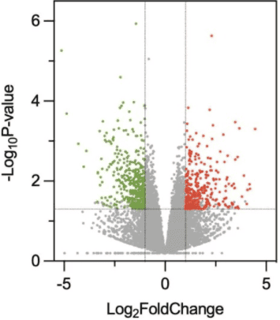

火山图用于两组之间的比较，得到两组之间的上调/下调，筛选依据为 p 值和 FC 值，转换为 -logP 值和 log2(FC) 值。导入数据可以是微生物组的 OTU 表格或 ASV 表格，或者转录组基因表达的表格，或者是代谢组学的 features 表格等多组学数据。

## 示例

{fig-alt="NetworkPlot DEMO" fig-align="center" width="60%"}

## 环境配置

-   系统要求： 跨平台（Linux/MacOS/Windows）

-   编程语言：R

-   依赖包：`tidyverse`; `readxl`; `ggrepel`; `cowplot`

```{r packages setup, message=FALSE, warning=FALSE, output=FALSE}
# 安装包
if (!requireNamespace("tidyverse", quietly = TRUE)) {
  install.packages("tidyverse")
}
if (!requireNamespace("readxl", quietly = TRUE)) {
  install.packages("readxl")
}
if (!requireNamespace("ggrepel", quietly = TRUE)) {
  install.packages("ggrepel")
}
if (!requireNamespace("cowplot", quietly = TRUE)) {
  install.packages("cowplot")
}

# 加载包
library(tidyverse)
library(readxl)
library(ggrepel)
library(cowplot)
```

```{r}
sessioninfo::session_info("attached")
```

## 数据准备

我们导入来自 [omicshare](https://www.omicshare.com/tools/home/report/reportvolcano.html) 的火山图示例数据。

```{r load data, message=FALSE, warning=FALSE}
# 读取Excel数据
data <- read_excel("files/volcano.eg.xlsx")

# 重命名列名（处理特殊字符）
data <- data %>%
  rename(log2FC = "log2 Ratio(WT0/LOG)", Pvalue = "Pvalue")
# 处理 p-value 为 0 的情况（避免计算-Inf）
data <- data %>%
  mutate(log10P = -log10(Pvalue + 1e-300)) # 确保处理了 P=0 的情况
# 转为数值型，并处理转换失败的值（如无效字符）
data <- data %>%
  mutate(
    log2FC = as.numeric(log2FC) # 转换失败的值会变为 NA
  )

# 查找导致转换失败的原始值
data %>%
  filter(is.na(log2FC)) %>%
  select(log2FC) # 查看这些行的 log2FC 原始值
# 根据实际情况修复数据（例如替换或删除异常值）
# 示例：将"Inf"替换为实际数值或过滤掉
data <- data %>%
  mutate(
    log2FC = ifelse(log2FC == "Inf", 100, log2FC), # 根据需求调整
    log2FC = as.numeric(log2FC)
    ) %>%
  filter(!is.na(log2FC)) # 删除无法修复的行

# 定义显著性（同时满足P值<0.05且|log2FC|>1）
# 定义显著性分类（上调、下调、无显著）
data <- data %>%
  mutate(
    significant = case_when(
      Pvalue < 0.05 & log2FC > 2 ~ "Upregulated", # 上调（红色）
      Pvalue < 0.05 & log2FC < -2 ~ "Downregulated", # 下调（绿色）
      TRUE ~ "Not significant" # 无显著（灰色）
    )
  )

# 查看数据结构
head(data, 5)
```

## 可视化

### 1. 基础火山图

```{r}
#| label: fig-1.1BasicVolcano
#| fig-cap: "基础火山图"
#| out.width: "95%"
#| warning: false

# 基础火山图
p <- 
  ggplot(data, aes(x = log2FC, y = -log10(Pvalue))) + # 初步绘制火山图
  # 绘制散点，按显著分类着色
  geom_point(aes(color = significant), alpha = 0.6, size = 1.5) + 
  # 设置颜色映射（上调红，下调绿，无显著灰）
  scale_color_manual(
    values = c("Upregulated" = "red", "Downregulated" = "green", "Not significant" = "gray"),
    name = "Significance" # 图例标题
    ) +
  # 添加筛选阈值线
  geom_vline(xintercept = c(-2, 2), linetype = "dashed", color = "green", linewidth = 0.5) + # log2FC阈值线
  geom_hline(yintercept = -log10(0.05), linetype = "dashed", color = "blue", linewidth = 0.5) + # p值阈值线
  # 调整坐标轴和标题
  labs(x = "log2(Fold Change)", y = "-log10(P-value)",
       title = "Volcano Plot with Thresholds") +
  theme_minimal() +
  theme(plot.title = element_text(hjust = 0.5, face = "bold"), # 标题居中加粗
        legend.position = "right") # 图例位置

p
```

### 2. 带标签火山图

```{r}
#| label: fig-1.1LabelVolcano
#| fig-cap: "带标签火山图"
#| out.width: "95%"
#| warning: false
#| message: false

# 添加标签
# 步骤1：筛选需标注的基因
label_data <- data %>%
  filter(Pvalue < 0.05) %>% # 筛选显著基因
  group_by(significant) %>% # 按上下调控分组
  top_n(10, abs(log2FC)) %>% # 取 log2FC 绝对值最大的 10 个
  ungroup()
# 步骤2：定义标签颜色（浅红和浅绿）
label_colors <- c(
  "Upregulated" = "#FF9999", # 浅红色
  "Downregulated" = "#99FF99" # 浅绿色
  )
# 步骤3：绘制带标签的火山图
p <- 
  ggplot(data, aes(x = log2FC, y = -log10(Pvalue))) +
  geom_point(aes(color = significant), alpha = 0.6, size = 1.5) +
  # 添加基因标签（仅标注目标基因）
  geom_text_repel(
    data = label_data,
    aes(label = GeneID, color = significant), # 假设基因名列名为 OTU ID
    size = 3,
    box.padding = 0.5, # 标签间距
    max.overlaps = 50, # 允许最大重叠
    segment.color = "grey50", # 连接线颜色
    show.legend = FALSE
    ) +
  # 设置颜色映射（原颜色+标签颜色）
  scale_color_manual(
    values = c("Upregulated" = "red", "Downregulated" = "green", "Not significant" = "gray"),
    guide = guide_legend(override.aes = list(
      color = c("red", "green", "gray"), # 图例颜色保持原色
      label = "" # 图例中不显示文字
      ))) +
  # 控制标签颜色（浅红和浅绿）
  scale_color_manual(
    values = label_colors,
    guide = "none" # 隐藏额外图例
    ) +
  # 保留原有阈值线和标题
  geom_vline(xintercept = c(-2, 2), linetype = "dashed", color = "black") +
  geom_hline(yintercept = -log10(0.05), linetype = "dashed", color = "black") +
  labs(title = "Volcano Plot with Top 20 Labels") +
  theme_minimal()

p
```


### 3. 带边缘注释面板的火山图

发表级火山图常在散点四周携带**汇总信息**：顶部条带报告上调/下调特征的百分比，右侧条带展示显著特征在某个注释类别（基因组区域、基因类型、通路）上的分布 \[1\]。技巧是把三张 ggplot 图共享散点的 x/y 范围，再用 cowplot 的轴插入 grob 组装，并用 `expand = c(0, 0)` 让面板相互贴合。

```{r}
#| label: fig-3.1MarginalVolcano
#| fig-cap: "带顶部条带（上调/下调百分比）与右侧条带（各特征类计数）的火山图。"
#| out.width: "95%"
#| warning: false
#| message: false
#| fig-width: 9
#| fig-height: 6

set.seed(2026)
# 为本教程的差异分析表附加一个模拟注释类别（基因类型）
data$feature <- sample(c("Protein-coding", "lncRNA", "Pseudogene", "Intergenic"),
                       nrow(data), replace = TRUE,
                       prob = c(0.5, 0.25, 0.1, 0.15))
feat_colors <- c("Protein-coding" = "#445EAD", "lncRNA" = "#70C17A",
                 "Pseudogene" = "#F7C07C", "Intergenic" = "#BEBEBE")

xr <- grDevices::extendrange(data$log2FC, f = 0.05)  # 共享 x 范围（中央图 + 顶部条带）
y_cap <- 12                                          # 封顶极端的 -log10(P)，保持面板可读
data$log10P_cap <- pmin(data$log10P, y_cap)

## 中央：按特征类别着色的火山图
p1 <- ggplot(data, aes(x = log2FC, y = log10P_cap)) +
  geom_point(aes(color = feature), size = 0.8, alpha = 0.6) +
  geom_vline(xintercept = c(-2, 2), linetype = "dashed", colour = "grey40") +
  geom_hline(yintercept = -log10(0.05), linetype = "dashed", colour = "grey40") +
  scale_colour_manual(values = feat_colors) +
  coord_cartesian(xlim = xr, ylim = c(0, y_cap * 1.05), expand = c(0, 0)) +
  scale_y_continuous(breaks = seq(0, y_cap, 3)) +
  labs(x = "log2 fold change", y = expression(-log[10](P))) +
  theme_classic(base_size = 11) +
  theme(legend.position = "bottom", legend.key.size = unit(3, "mm"),
        legend.title = element_blank(), legend.text = element_text(size = 8),
        legend.margin = margin(t = 2))

## 顶部：显著特征中上调 vs 下调的百分比
sig <- data %>% filter(significant != "Not significant")
pct <- sig %>% count(significant) %>% mutate(p = n / sum(n))
# 显式分段几何，保证条带与标签对齐（不使用 position_stack）
pct$ymax <- 1 - cumsum(pct$p)
pct$ymin <- pct$ymax + pct$p
pct$ymid <- (pct$ymin + pct$ymax) / 2
p3 <- ggplot() +
  geom_rect(data = pct, inherit.aes = FALSE,
            aes(xmin = xr[1], xmax = xr[2],
                ymin = ymin, ymax = ymax, fill = significant),
            alpha = 0.8, colour = "white", linewidth = 0.4) +
  geom_text(data = pct, inherit.aes = FALSE,
            aes(x = (xr[1] + xr[2]) / 2, y = ymid,
                label = paste0(significant, ": ", sprintf("%.1f", 100 * p), "%")),
            size = 3.2) +
  scale_fill_manual(values = c(Upregulated = "#B2182B", Downregulated = "#2166AC")) +
  scale_x_continuous(limits = xr, expand = c(0, 0)) +
  scale_y_continuous(limits = c(0, 1), expand = c(0, 0)) +
  theme_void()

## 右侧：每个注释类别的显著特征数（共享特征配色）
rsig <- sig %>% count(feature)
yr <- c(0, max(rsig$n) * 1.15)
p2 <- ggplot(rsig, aes(x = n, y = feature, fill = feature)) +
  geom_col(width = 0.7, show.legend = FALSE) +
  geom_text(aes(label = n), hjust = -0.2, size = 3) +
  scale_fill_manual(values = feat_colors) +
  scale_x_continuous(limits = yr, expand = c(0, 0)) +
  labs(x = "Significant features") +
  theme_classic(base_size = 10) +
  theme(axis.text.y = element_text(size = 9), axis.ticks.y = element_blank(),
        axis.line.y = element_blank(), axis.title.y = element_blank(),
        plot.margin = margin(0, 5, 0, 2))

## 组装：顶部条带在上、右侧条带在旁——面板贴合（expand = 0）
combined <- insert_xaxis_grob(p1, p3, position = "top", height = unit(0.35, "in"))
combined <- insert_yaxis_grob(combined, p2, position = "right", width = unit(1.7, "in"))
ggdraw(combined)
```

::: callout-tip
**实践要点**

- y 轴封顶（`pmin(-log10(P), cap)`）：否则几个极端显著的点会把其余所有点压成底部一条细带。
- `grDevices::extendrange()` 一次性给出散点的 x 上下限并在顶部条带复用，堆叠条才能恰好铺满火山图宽度。
- 中央图与两个条带的 `expand = c(0, 0)` 设置是面板贴合的关键；使用默认扩展时条带会错位。
- `insert_xaxis_grob()` / `insert_yaxis_grob()` 来自 cowplot，且保持主面板尺寸；等价做法是 `patchwork::plot_layout` 配合 `design`——两者都需要对齐坐标范围。
:::

### 4. 小效应量筛选的尺寸编码火山图（PDUI 风格）

可变多聚腺苷化筛选（FigureYa321 背后的 TC3A PDUI 分析 \[1\]）产生的**效应量很小**——有意义的 3'UTR 使用偏移是 ΔPDUI ≈ 0.1 而不是 1——常规的 |log2FC| ≥ 1 阈值完全不起作用。参考编码方式：y = −log10 校正 P，x = ΔPDUI（放宽到 ±0.05 阈值），**点大小 = |ΔPDUI × −log10 P|**，让效应与显著性共同决定视觉权重。下块在与参考一致的 `limma` 流程上运行模拟 PDUI 矩阵：

```{r}
#| label: fig-4.1PduiVolcano
#| fig-cap: "模拟 3'UTR 使用（PDUI）事件的尺寸编码火山图：颜色 = 方向阈值（|ΔPDUI| > 0.05 且校正 P < 0.1），点大小 = |ΔPDUI × -log10 P|；两侧最强的偏移事件带标签。"
#| out.width: "75%"
#| warning: false
#| message: false
#| fig-width: 6.8
#| fig-height: 5.6

set.seed(3211)
n_ev <- 400; n_s <- 60
PDUI <- matrix(runif(n_ev * n_s, 0.2, 0.8), n_ev, n_s)
rownames(PDUI) <- paste0("chr", sample(1:22, n_ev, replace = TRUE), "_",
                         sample(1:9, n_ev, replace = TRUE), "|EV", 1:n_ev, "|")
grp <- factor(rep(c("LIVING", "DEAD"), each = n_s / 2), levels = c("LIVING", "DEAD"))
hit <- sample(n_ev, 18)
PDUI[hit[1:9], grp == "DEAD"] <- pmin(1, PDUI[hit[1:9], grp == "DEAD"] + 0.2)   # 3'UTR 缩短
PDUI[hit[10:18], grp == "DEAD"] <- pmax(0, PDUI[hit[10:18], grp == "DEAD"] - 0.2)

design <- model.matrix(~0 + grp); colnames(design) <- levels(grp)
fit <- limma::lmFit(PDUI, design)
fit2 <- limma::contrasts.fit(fit, limma::makeContrasts(DEAD - LIVING, levels = design))
fit2 <- limma::eBayes(fit2)
DEGs <- limma::topTable(fit2, coef = 1, n = Inf)
DEGs$SYMBOL <- gsub(".+\\|(EV[0-9]+)\\|.*", "\\1", rownames(DEGs))

plot.data <- DEGs
plot.data$logPadj <- -log(plot.data$adj.P.Val)
plotgene <- rownames(plot.data)[c(which.max(plot.data$logFC), which.min(plot.data$logFC))]
plot.data$label <- ifelse(rownames(plot.data) %in% plotgene, plot.data$SYMBOL, NA)
plot.data$status <- "NoSig"
plot.data$status[plot.data$logFC < -0.05 & plot.data$logPadj > 1] <- "Down"
plot.data$status[plot.data$logFC > 0.05 & plot.data$logPadj > 1] <- "Up"
plot.data$status <- factor(plot.data$status, levels = c("Up", "Down", "NoSig"))
plot.data$size_v <- abs(plot.data$logFC * plot.data$logPadj)
palette_volcano <- c(Up = "#D93F3C", Down = "#184A8C", NoSig = "#B3B3B3")

ggplot(plot.data, aes(logFC, logPadj, color = status)) +
  geom_point(alpha = 0.9, aes(size = size_v)) +
  scale_size_continuous(range = c(1, 7), guide = "none") +
  scale_color_manual(values = palette_volcano, drop = FALSE, name = NULL) +
  geom_label_repel(data = subset(plot.data, !is.na(label)),
                   aes(label = label), size = 3.4, fontface = "bold",
                   box.padding = 0.5, show.legend = FALSE) +
  geom_point(data = subset(plot.data, !is.na(label)), shape = 1,
             stroke = 0.6, color = "black", size = 2.6) +
  geom_vline(xintercept = c(-0.05, 0.05), colour = "grey40", linetype = "longdash", lwd = 0.25) +
  geom_hline(yintercept = 1, colour = "grey40", linetype = "longdash", lwd = 0.25) +
  labs(x = "delta PDUI (DEAD - LIVING)", y = "-log10 adjusted P",
       title = "3'UTR usage shift by vital status (simulated TC3A-style PDUI)") +
  theme_bw(base_size = 11) +
  theme(panel.grid = element_blank(), legend.position = "top")
```

::: callout-tip
**实践要点**

-   效应量小时，尺寸通道承担主要信息：`|效应 × -log10(P)|` 随证据二次增长，能把双重强的事件从拥挤的中心拉出来——请在图注中说明，否则读者会以为 size 是第三个变量。
-   阈值必须匹配量表尺度：ΔPDUI 的阈值在 ±0.05（使用比例取值 [0, 1]）；照抄转录组火山图的 ±1 阈值会把图清空。
-   两个带标签的事件作为阅读锚点——每个方向一个——其余交给颜色。
:::

## 参考文献

\[1\] Xiaofan Lu, et al. FigureYa: A Standardized Visualization Framework for Enhancing Biomedical Data Interpretation and Research Efficiency. iMetaMed. 2025. doi:10.1002/imm3.70005
