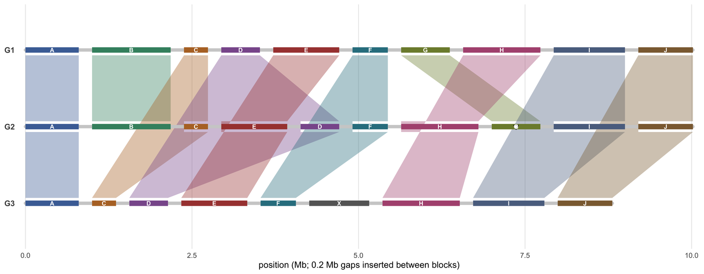

A whole-genome alignment figure answers one question that a table of alignment coordinates cannot: **in which order do homologous blocks lie, and how did that order change**. Mauve, progressiveMauve, the comparative assembly hubs and the pixel overview tools (SequenceSurveyor, DNASkittle, FluentDNA) all visualise the same object — a set of locally collinear blocks (LCBs) per genome — and differ only in whether they draw it as linked backbones, as a block-order matrix, as a dot plot, or as one coloured pixel per fixed number of bases.

This tutorial builds three of those views from a single hand-specified block table so the encodings can be checked by eye: a **Mauve-style linked backbone**, a **block-order matrix**, and a **dot plot with orientation**. A fourth panel shows the pixel-level genome overview and says explicitly where it stops being informative.

## Example

{fig-alt="Whole Genome Alignment Plot DEMO" fig-align="center" width="85%"}

A Mauve-style whole-genome alignment of three genomes: homologous blocks drawn to scale on each backbone and connected by ribbons between consecutive genomes (G1-G2, G2-G3). G2 carries a transposition (E before D), an inversion (hollow triangle on block G) and a swap (H before G); G3 has lost blocks B and G and gained the foreign block X.

## Setup

-   System Requirements: Cross-platform (Linux/MacOS/Windows)

-   Programming language: R

-   Dependent packages: `ggplot2`; `dplyr`; `tidyr`; `patchwork`

```{r packages setup, message=FALSE, warning=FALSE, output=FALSE}
if (!requireNamespace("ggplot2", quietly = TRUE)) install.packages("ggplot2")
if (!requireNamespace("dplyr", quietly = TRUE)) install.packages("dplyr")
if (!requireNamespace("tidyr", quietly = TRUE)) install.packages("tidyr")
if (!requireNamespace("patchwork", quietly = TRUE)) install.packages("patchwork")

library(ggplot2)
library(dplyr)
library(tidyr)
library(patchwork)
```

```{r}
sessioninfo::session_info("attached")
```

## Data Preparation

Three genomes are described as ordered block lists — the output of any LCB caller. Genome G2 carries a **transposition** (E before D), an **inversion** (G flipped) and a **swap** (H before G); G3 has lost blocks B and G and gained a block X that is absent from the two others. Each block carries its own length, because block width must encode length: a graph drawn with equal-width blocks hides which rearrangement actually moved more sequence.

```{r load data, message=FALSE, warning=FALSE}
set.seed(43515)

## Three genomes as ordered lists of homologous blocks (Mauve LCBs).
blocks <- c("A", "B", "C", "D", "E", "F", "G", "H", "I", "J")
block_len <- setNames(round(runif(10, 0.35, 1.2), 2), blocks)   # Mb

genomes <- list(
  G1 = data.frame(block = blocks, orientation = "+", stringsAsFactors = FALSE),
  G2 = data.frame(block = c("A", "B", "C", "E", "D", "F", "H", "G", "I", "J"),
                  orientation = c(rep("+", 6), "+", "-", "+", "+"),
                  stringsAsFactors = FALSE),
  G3 = data.frame(block = c("A", "C", "D", "E", "F", "X", "H", "I", "J"),
                  orientation = rep("+", 9),
                  stringsAsFactors = FALSE)
)
block_len["X"] <- 0.9

## Cumulative block coordinates per genome, with a 0.2 Mb gap between blocks so
## adjacent blocks never read as one feature.
orders <- do.call(rbind, lapply(names(genomes), function(g) {
  d <- genomes[[g]]
  d$len <- unname(block_len[d$block])
  d$start <- cumsum(c(0, head(d$len + 0.2, -1)))
  d$end <- d$start + d$len
  d$genome <- g
  d
}))

## Ribbon edges between consecutive genomes: one quadrilateral per shared
## block, from genome i to genome i+1.
ribbon <- function(from, to, y0, y1, n = 40) {
  s <- seq(0, 1, length.out = n)
  do.call(rbind, lapply(intersect(from$block, to$block), function(b) {
    f <- from[from$block == b, ]
    t <- to[to$block == b, ]
    data.frame(block = b,
               x = c(f$start + s * (f$end - f$start),
                     rev(t$start + s * (t$end - t$start))),
               y = c(rep(y0, n), rep(y1, n)))
  }))
}

g <- split(orders, orders$genome)
```

## Visualization

### 1. Mauve-Style Linked Backbones

The canonical overview: one backbone per genome, homologous blocks drawn to scale and connected by translucent ribbons. The ribbons are what make the figure work — they carry the correspondence, so the reader follows a block from genome to genome instead of matching colours.

```{r}
#| label: fig-1.1WgaBackbones
#| fig-cap: "Mauve-style whole-genome alignment of three genomes: homologous blocks drawn to scale on each backbone and connected by ribbons between consecutive genomes (G1-G2, G2-G3). G2 carries a transposition (E before D), an inversion (hollow triangle on block G) and a swap (H before G); G3 has lost blocks B and G and gained the foreign block X."
#| out.width: "100%"
#| warning: false
#| message: false
#| fig-width: 10
#| fig-height: 3.9
#| fig-dpi: 300

ypos <- c(G1 = 3, G2 = 2, G3 = 1)
orders$y <- ypos[orders$genome]

block_cols <- setNames(
  c("#4a6fa5", "#3f8f6f", "#b5732e", "#8a5a9b", "#a8433f",
    "#2f7f8f", "#7d8b3a", "#b0557f", "#5b6f8f", "#8c6b3f", "#666666"),
  c(blocks, "X")
)

ribbons <- rbind(
  ribbon(g$G1, g$G2, ypos[["G1"]] - 0.07, ypos[["G2"]] + 0.07),
  ribbon(g$G2, g$G3, ypos[["G2"]] - 0.07, ypos[["G3"]] + 0.07)
)

p1 <- ggplot() +
  ## ribbons first, so the backbones sit on top
  geom_polygon(data = ribbons, aes(x, y, group = block, fill = block),
               alpha = 0.38, colour = NA) +
  ## backbones
  geom_segment(data = orders |> group_by(genome) |>
                 summarise(x0 = min(start), x1 = max(end),
                           y = first(ypos[genome]), .groups = "drop"),
               aes(x = x0, xend = x1, y = y, yend = y),
               linewidth = 1.6, colour = "#cfcfcf", lineend = "round") +
  ## blocks, in genome order
  geom_segment(data = orders, aes(x = start, xend = end, y = y, yend = y,
                                  colour = block),
               linewidth = 2.6, lineend = "butt") +
  ## inverted blocks carry a hollow down-triangle, as Mauve does
  geom_point(data = filter(orders, orientation == "-"),
             aes(x = (start + end) / 2, y = y), shape = 25, size = 1.6,
             fill = "white", colour = "#252525", stroke = 0.4) +
  ## every block is labelled, including the short ones: an unlabelled block
  ## leaves its ribbon unreadable, since the ribbon carries no label itself
  geom_text(data = orders,
            aes(x = (start + end) / 2, y = y, label = block),
            size = 2.2, colour = "white", fontface = "bold") +
  scale_colour_manual(values = block_cols, guide = "none") +
  scale_fill_manual(values = block_cols, guide = "none") +
  scale_y_continuous(limits = c(0.55, 3.45), breaks = ypos,
                     labels = names(ypos)) +
  scale_x_continuous(expand = c(0.01, 0)) +
  labs(x = "position (Mb; 0.2 Mb gaps inserted between blocks)", y = NULL) +
  theme_minimal(base_size = 9) +
  theme(panel.grid.minor = element_blank(),
        panel.grid.major.y = element_blank(),
        axis.text.y = element_text(size = 8, face = "bold"))

p1
```

::: callout-tip
**Practice tips**

-   Draw ribbons between *consecutive* genomes rather than from a designated reference: a reference-centric layout silently makes every genome look rearranged relative to G1, even where G2 and G3 agree.
-   Encode block length in block width and orientation in a shape (the hollow triangle here). A layout with equal-width blocks cannot support any claim about which rearrangement moved more sequence.
-   Keep one colour per block identity and *never* reuse a colour for a different block; the ribbons already carry the correspondence, so the colour is a memory aid, not the primary encoding.
-   Insert a visible gap between blocks. Without it the last bases of one block and the first of the next read as a single feature, and the boundary — which is the point — disappears.
-   Say what an unlinked block means: absent from that genome, or simply not aligned. They are different findings and the figure alone cannot distinguish them.
:::

### 2. Block-Order Matrix

The same data as a rank matrix — the AccuSyn consensus view. Backbone ribbons show *where* blocks are; the rank matrix shows *in what order*, at the cost of the coordinate scale. The two are complementary, so a figure pair is often stronger than either alone.

```{r}
#| label: fig-1.2WgaBlockOrder
#| fig-cap: "Block-order matrix for the three genomes: x is the rank of the block within its genome, fill is block identity, and a hollow triangle marks the inverted block. The transposition (E before D), the swap (H before G) and the two deletions in G3 are readable without any coordinate axis; the foreign block X occupies a rank but has no counterpart."
#| out.width: "85%"
#| warning: false
#| message: false
#| fig-width: 8
#| fig-height: 2.8
#| fig-dpi: 300

rank_mat <- orders |>
  group_by(genome) |>
  mutate(rank = row_number()) |>
  ungroup()

p2 <- ggplot(rank_mat, aes(rank, genome)) +
  geom_tile(aes(fill = block), colour = "white", linewidth = 0.5,
            width = 0.94, height = 0.72) +
  geom_point(data = filter(rank_mat, orientation == "-"),
             aes(rank, genome), shape = 25, size = 1.7, fill = "white",
             colour = "#252525", stroke = 0.4) +
  geom_text(aes(label = block), size = 2.3, colour = "white",
            fontface = "bold") +
  scale_fill_manual(values = block_cols, guide = "none") +
  scale_y_discrete(limits = rev(names(ypos))) +
  scale_x_continuous(breaks = seq_len(10), expand = c(0.02, 0.02)) +
  labs(x = "block order (rank within the genome)", y = "genome") +
  theme_minimal(base_size = 9) +
  theme(panel.grid = element_blank(),
        axis.text.y = element_text(size = 8, face = "bold"))

p2
```

::: callout-tip
**Practice tips**

-   Use rank, not physical position, on the matrix axis: the matrix exists to make *order* comparable, and physical coordinates would reintroduce the length differences the backbone view already shows.
-   Leave a blank cell where a block is absent instead of compressing the row — the gap is the deletion, and it should stay visible as a gap.
-   Mark inverted blocks with a separate glyph; in a rank matrix the orientation is the only piece of information a tile cannot carry, so it must be added explicitly.
-   Print the ranks. "Between rank 7 and 8" is a citation; "in the middle" is not.
:::

### 3. Dot Plot with Orientation

The pairwise view — XMatchView, SyntenyPair, mummerplot. Forward matches sit on the diagonal, inverted matches on an anti-diagonal, translocations off the diagonal entirely. It is the fastest way to confirm that a rearrangement is real rather than a block-caller artefact.

```{r}
#| label: fig-1.3WgaDotPlot
#| fig-cap: "Dot plot of G1 against G2 at block resolution: each block is one point at its midpoint, coloured by its orientation in G2. Forward blocks lie on the dotted diagonal, the transposition (D, E) shifts two points off it symmetrically, and the inverted block G appears as the only red point, mirrored across the diagonal."
#| out.width: "55%"
#| warning: false
#| message: false
#| fig-width: 5
#| fig-height: 4.8
#| fig-dpi: 300

dot <- merge(
  orders |> filter(genome == "G1") |> select(block, xe = start, xee = end),
  orders |> filter(genome == "G2") |> select(block, ye = start, yee = end),
  by = "block"
) |>
  left_join(orders |> filter(genome == "G2") |> select(block, orientation),
            by = "block") |>
  mutate(cx = (xe + xee) / 2, cy = (ye + yee) / 2)

p3 <- ggplot(dot, aes(cx, cy)) +
  geom_abline(linetype = "dotted", colour = "#bbbbbb", linewidth = 0.3) +
  geom_point(aes(colour = orientation), size = 3) +
  geom_text(aes(label = block), size = 1.7, colour = "white") +
  scale_colour_manual(values = c(`+` = "#2166ac", `-` = "#b2182b"),
                      name = "orientation in G2") +
  coord_fixed() +
  labs(x = "G1 position (Mb)", y = "G2 position (Mb)") +
  theme_minimal(base_size = 9) +
  theme(panel.grid.minor = element_blank(),
        legend.position = "bottom",
        legend.key.size = unit(0.3, "cm"),
        legend.text = element_text(size = 7))

p3
```

::: callout-tip
**Practice tips**

-   Plot the *whole* matching interval, not just its midpoint, whenever the alignment has more than a few dozen blocks: a block whose ends disagree with its middle (a nested inversion) is invisible at one point per block.
-   Use the diagonal as a reference rule and say so in the caption; readers will otherwise assume the diagonal is a fitted line.
-   Colour by orientation only if orientation is the question. If the question is "which block", colour by block and put orientation into a second glyph, as in the matrix panel.
-   Keep the axes square (`coord_fixed()`). A stretched dot plot invents slope changes that look like duplications.
:::

### 4. Where the Pixel Overview Helps, and Where It Stops

SequenceSurveyor, DNASkittle and FluentDNA go one level further: one pixel (or one column) per fixed number of bases, coloured by a sequence property such as GC content. This compresses a chromosome into a readable band and is genuinely useful for spotting compositional domains. It is *not* an alignment — the coloured strip carries no homology — so it belongs under the alignment, not instead of it.

```{r}
#| label: fig-1.4WgaPixel
#| fig-cap: "Pixel-level genome overview under the backbone panel (SequenceSurveyor / DNASkittle idea): one column per 10 kb, coloured by GC content, with a GC-rich domain planted at 4.2-5.4 Mb. The strip shows compositional structure at a glance but carries no homology information, which is why it is stacked under an alignment panel rather than replacing it."
#| out.width: "100%"
#| warning: false
#| message: false
#| fig-width: 10
#| fig-height: 5
#| fig-dpi: 300

win <- data.frame(pos = seq(0, 9.9, by = 0.01)) |>
  mutate(
    gc = 0.41 + 0.09 * sin(pos * 2.1) + 0.05 * cos(pos * 7.3) +
      rnorm(n(), 0, 0.025),
    gc = pmin(0.75, pmax(0.2, ifelse(pos > 4.2 & pos < 5.4, gc + 0.16, gc)))
  )

p4 <- ggplot(win, aes(pos, 1, fill = gc)) +
  geom_tile(width = 0.0102, height = 0.7) +
  scale_fill_gradientn("GC", colours = c("#2c7bb6", "#abd9e9", "#ffffbf",
                                         "#fdae61", "#d7191c"),
                       limits = c(0.2, 0.75)) +
  scale_x_continuous(expand = c(0, 0), breaks = seq(0, 9, 1)) +
  scale_y_continuous(expand = c(0, 0)) +
  labs(x = "genome position (Mb; 1 column = 10 kb)", y = NULL) +
  theme_minimal(base_size = 9) +
  theme(panel.grid = element_blank(),
        axis.text.y = element_blank(),
        axis.text.x = element_text(size = 6.8),
        legend.key.height = unit(0.5, "cm"),
        legend.text = element_text(size = 6.6),
        legend.title = element_text(size = 7))

p1 / p4 + plot_layout(heights = c(1, 0.22))
```

::: callout-tip
**Practice tips**

-   State the pixel size ("1 column = 10 kb") in the axis title. A pixel view without a stated resolution is unfalsifiable: any pattern could come from any scale.
-   Do not put an alignment claim on a pixel strip. The strip has no homology information, so a "conserved region" read from it is an artefact of the colour scale.
-   Use a diverging or two-tone scale around a meaningful midpoint (GC 0.5 for DNA) rather than a rainbow, so that a compositional domain reads as a shift in direction.
-   Rasterise rather than vectorise at this density; a 10 kb-per-column strip becomes a multi-megabyte PDF and renders slowly in every viewer.
-   Stack the pixel strip *under* the alignment, sharing the x axis: it then answers "what is inside these blocks", which is the only question it can answer.
:::

## Application

Whole-genome alignment overviews are the opening figure of every comparative genomics paper: bacterial genome rearrangements in outbreak isolates, plant genome evolution, and the structural differences between a new assembly and its predecessor. The three views answer three different reviewer questions — "what moved", "in what order", "is it reciprocal" — and a paper usually needs at least two of them.

The same block tables drive pan-genome graphs (each block becomes a node) and synteny-based scaffolding (linkage of contigs across assemblies), so the figure and the downstream analysis should come from one table, not two.

## Reference

\[1\] Darling ACE, Mau B, Blattner FR, Perna NT. Mauve: multiple alignment of conserved genomic sequence with rearrangements. Genome Res. 2004;14(7):1394-1403. doi:10.1101/gr.2289704

\[2\] Darling AE, Mau B, Perna NT. progressiveMauve: multiple genome alignment with gene gain, loss and rearrangement. PLoS One. 2010;5(6):e11147. doi:10.1371/journal.pone.0011147

\[3\] Angiuoli SV, Salzberg SL. Mugsy: fast multiple alignment of closely related whole genomes. Bioinformatics. 2011;27(3):334-342. doi:10.1093/bioinformatics/btq665

\[4\] Rasmussen DA, Korkmaz FS, Nool K, et al. A-liner: a comparative visualization tool for alignment and genome annotation. Bioinformatics. 2026;btag408. doi:10.1093/bioinformatics/btag408

\[5\] Alcock BP, Raphael BJ. Visualising large-scale genomic rearrangements. Brief Bioinform. 2019;20(4):1184-1195. doi:10.1093/bib/bby011

\[6\] Nielsen CB, Yamasaki S, Nielsen IS, et al. SequenceSurveyor: leveraging overview+detail for pan-scalar sequence visualization. IEEE Trans Vis Comput Graph. 2011;17(12):2445-2454. doi:10.1109/TVCG.2011.232

\[7\] Stephens ZD, Lee SY, Faghri F, et al. Big Data: Astronomical or Genomical? PLoS Biol. 2015;13(7):e1002195. doi:10.1371/journal.pbio.1002195
