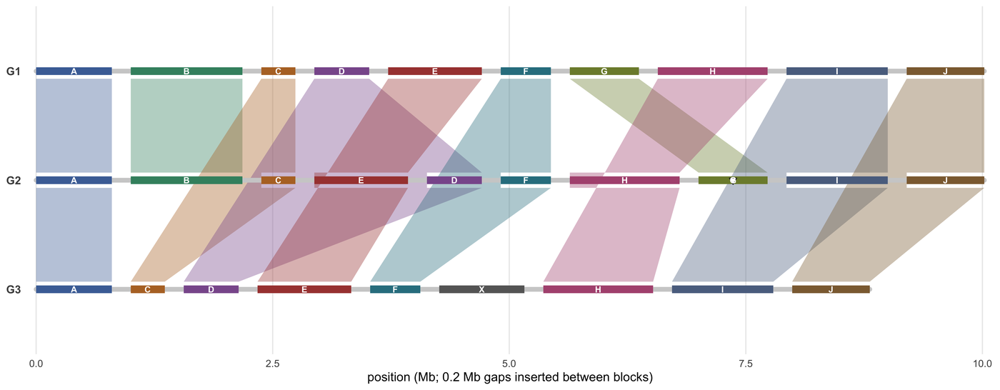

全基因组比对图回答的是对齐坐标表无法回答的问题：**同源块以什么顺序排列、这个顺序又是如何改变的**。Mauve、progressiveMauve、比较组装 hub，以及像素级概览工具（SequenceSurveyor、DNASkittle、FluentDNA）都在可视化同一个对象——每个基因组的一组局部共线块（LCB）——只是分别把它画成相连的骨架、块序矩阵、点阵图，或"每个固定 bp 数一个彩色像素"。

本教程用同一张手工指定的块表构建其中三种视图，使编码规则可以逐个用眼睛核对：**Mauve 式相连骨架**、**块序矩阵**，以及**带方向的点阵图**。再加一个像素级基因组概览面板，并明确说明它在哪里开始失去信息量。

## 示例

{fig-alt="全基因组比对图 DEMO" fig-align="center" width="85%"}

三个基因组的 Mauve 风格全基因组比对：同源区块按比例画在各自的骨架上，并在相邻基因组之间用色带连接（G1-G2、G2-G3）。G2 携带一次转座（E 移到 D 之前）、一次倒位（区块 G 上的空心三角）和一次互换（H 移到 G 之前）；G3 丢失了 B、G 两个区块，并获得了外源区块 X。

## Setup

-   System Requirements: Cross-platform (Linux/MacOS/Windows)

-   Programming language: R

-   Dependent packages: `ggplot2`; `dplyr`; `tidyr`; `patchwork`

```{r packages setup, message=FALSE, warning=FALSE, output=FALSE}
if (!requireNamespace("ggplot2", quietly = TRUE)) install.packages("ggplot2")
if (!requireNamespace("dplyr", quietly = TRUE)) install.packages("dplyr")
if (!requireNamespace("tidyr", quietly = TRUE)) install.packages("tidyr")
if (!requireNamespace("patchwork", quietly = TRUE)) install.packages("patchwork")

library(ggplot2)
library(dplyr)
library(tidyr)
library(patchwork)
```

```{r}
sessioninfo::session_info("attached")
```

## Data Preparation

三个基因组以有序块表描述——即任何 LCB 调用器的输出形式。基因组 G2 带一个**转座**（E 在 D 之前）、一个**倒位**（G 翻转）和一个**互换**（H 在 G 之前）；G3 丢失了块 B 与 G，并获得一个另外两个基因组都没有的块 X。每个块带自己的长度，因为块宽必须编码长度：等宽画法会掩盖哪个重排实际搬动了更多序列。

```{r load data, message=FALSE, warning=FALSE}
set.seed(43515)

## 三个基因组，以同源块（Mauve LCB）的有序列表描述。
blocks <- c("A", "B", "C", "D", "E", "F", "G", "H", "I", "J")
block_len <- setNames(round(runif(10, 0.35, 1.2), 2), blocks)   # Mb

genomes <- list(
  G1 = data.frame(block = blocks, orientation = "+", stringsAsFactors = FALSE),
  G2 = data.frame(block = c("A", "B", "C", "E", "D", "F", "H", "G", "I", "J"),
                  orientation = c(rep("+", 6), "+", "-", "+", "+"),
                  stringsAsFactors = FALSE),
  G3 = data.frame(block = c("A", "C", "D", "E", "F", "X", "H", "I", "J"),
                  orientation = rep("+", 9),
                  stringsAsFactors = FALSE)
)
block_len["X"] <- 0.9

## 每个基因组的累积块坐标，块间留 0.2 Mb 间隔，避免相邻块被读成一个特征。
orders <- do.call(rbind, lapply(names(genomes), function(g) {
  d <- genomes[[g]]
  d$len <- unname(block_len[d$block])
  d$start <- cumsum(c(0, head(d$len + 0.2, -1)))
  d$end <- d$start + d$len
  d$genome <- g
  d
}))

## 相邻基因组之间的带状连线：每个共享块一个四边形。
ribbon <- function(from, to, y0, y1, n = 40) {
  s <- seq(0, 1, length.out = n)
  do.call(rbind, lapply(intersect(from$block, to$block), function(b) {
    f <- from[from$block == b, ]
    t <- to[to$block == b, ]
    data.frame(block = b,
               x = c(f$start + s * (f$end - f$start),
                     rev(t$start + s * (t$end - t$start))),
               y = c(rep(y0, n), rep(y1, n)))
  }))
}

g <- split(orders, orders$genome)
```

## Visualization

### 1. Mauve 式相连骨架

最经典的概览：每个基因组一条骨架，同源块按比例绘制并用半透明带状连线相连。真正让图成立的是这些连线——它们承载"对应关系"，读者因此可以沿一个块从基因组走到基因组，而不必去比对颜色。

```{r}
#| label: fig-1.1WgaBackbones
#| fig-cap: "三个基因组的 Mauve 式全基因组比对：同源块按比例画在各自骨架上，并在相邻基因组（G1-G2、G2-G3）之间用带状连线相连。G2 携带一个转座（E 在 D 之前）、一个倒位（块 G 上的空心三角形）和一个互换（H 在 G 之前）；G3 丢失块 B 与 G，并获得外来块 X。"
#| out.width: "100%"
#| warning: false
#| message: false
#| fig-width: 10
#| fig-height: 3.9
#| fig-dpi: 300

ypos <- c(G1 = 3, G2 = 2, G3 = 1)
orders$y <- ypos[orders$genome]

block_cols <- setNames(
  c("#4a6fa5", "#3f8f6f", "#b5732e", "#8a5a9b", "#a8433f",
    "#2f7f8f", "#7d8b3a", "#b0557f", "#5b6f8f", "#8c6b3f", "#666666"),
  c(blocks, "X")
)

ribbons <- rbind(
  ribbon(g$G1, g$G2, ypos[["G1"]] - 0.07, ypos[["G2"]] + 0.07),
  ribbon(g$G2, g$G3, ypos[["G2"]] - 0.07, ypos[["G3"]] + 0.07)
)

p1 <- ggplot() +
  ## 先画连线，让骨架压在它们之上
  geom_polygon(data = ribbons, aes(x, y, group = block, fill = block),
               alpha = 0.38, colour = NA) +
  ## 骨架
  geom_segment(data = orders |> group_by(genome) |>
                 summarise(x0 = min(start), x1 = max(end),
                           y = first(ypos[genome]), .groups = "drop"),
               aes(x = x0, xend = x1, y = y, yend = y),
               linewidth = 1.6, colour = "#cfcfcf", lineend = "round") +
  ## 块，按基因组顺序
  geom_segment(data = orders, aes(x = start, xend = end, y = y, yend = y,
                                  colour = block),
               linewidth = 2.6, lineend = "butt") +
  ## 倒位块用空心倒三角标记，与 Mauve 一致
  geom_point(data = filter(orders, orientation == "-"),
             aes(x = (start + end) / 2, y = y), shape = 25, size = 1.6,
             fill = "white", colour = "#252525", stroke = 0.4) +
  ## every block is labelled, including the short ones: an unlabelled block
  ## leaves its ribbon unreadable, since the ribbon carries no label itself
  geom_text(data = orders,
            aes(x = (start + end) / 2, y = y, label = block),
            size = 2.2, colour = "white", fontface = "bold") +
  scale_colour_manual(values = block_cols, guide = "none") +
  scale_fill_manual(values = block_cols, guide = "none") +
  scale_y_continuous(limits = c(0.55, 3.45), breaks = ypos,
                     labels = names(ypos)) +
  scale_x_continuous(expand = c(0.01, 0)) +
  labs(x = "位置（Mb；块间插入 0.2 Mb 间隔）", y = NULL) +
  theme_minimal(base_size = 9) +
  theme(panel.grid.minor = element_blank(),
        panel.grid.major.y = element_blank(),
        axis.text.y = element_text(size = 8, face = "bold"))

p1
```

::: callout-tip
**实践要点**

-   连线要在**相邻**基因组之间画，而不是从一个指定参考画起：以参考为中心的版式会让每个基因组相对 G1 都显得"被重排"，哪怕 G2 与 G3 其实一致。
-   用块宽编码长度、用形状（此处是空心三角）编码方向。等宽布局无法支撑任何关于"哪个重排搬动了更多序列"的结论。
-   每个块的身份只用一个颜色，且绝不复用颜色表示别的块；连线已经承载了对应关系，颜色只是记忆辅助，不是主编码。
-   块之间要有可见间隔。没有间隔时，一个块的末端几个碱基会和下一个块的起点被读成一个特征，而边界——正是重点——就消失了。
-   要说明"没有连线的块"是什么意思：在该基因组中缺失，还是仅仅没有比对到。这是两种不同的发现，仅凭图无法区分。
:::

### 2. 块序矩阵

同一份数据画成秩矩阵——AccuSyn 的一致性视图。骨架连线回答"块在哪里"，秩矩阵回答"以什么顺序"，代价是丢掉坐标尺度。两者互补，成对出现往往比单独一张更强。

```{r}
#| label: fig-1.2WgaBlockOrder
#| fig-cap: "三个基因组的块序矩阵：x 为块在各自基因组中的名次，填充色为块身份，空心三角形标记倒位块。转座（E 在 D 之前）、互换（H 在 G 之前）以及 G3 的两个缺失在没有坐标轴的情况下也清晰可读；外来块 X 占据一个名次但没有对应块。"
#| out.width: "85%"
#| warning: false
#| message: false
#| fig-width: 8
#| fig-height: 2.8
#| fig-dpi: 300

rank_mat <- orders |>
  group_by(genome) |>
  mutate(rank = row_number()) |>
  ungroup()

p2 <- ggplot(rank_mat, aes(rank, genome)) +
  geom_tile(aes(fill = block), colour = "white", linewidth = 0.5,
            width = 0.94, height = 0.72) +
  geom_point(data = filter(rank_mat, orientation == "-"),
             aes(rank, genome), shape = 25, size = 1.7, fill = "white",
             colour = "#252525", stroke = 0.4) +
  geom_text(aes(label = block), size = 2.3, colour = "white",
            fontface = "bold") +
  scale_fill_manual(values = block_cols, guide = "none") +
  scale_y_discrete(limits = rev(names(ypos))) +
  scale_x_continuous(breaks = seq_len(10), expand = c(0.02, 0.02)) +
  labs(x = "块序（在基因组内的名次）", y = "genome") +
  theme_minimal(base_size = 9) +
  theme(panel.grid = element_blank(),
        axis.text.y = element_text(size = 8, face = "bold"))

p2
```

::: callout-tip
**实践要点**

-   矩阵轴用名次而非物理位置：矩阵存在的意义是让*顺序*可比；用物理坐标会把骨架视图已经展示过的长度差异重新引入。
-   块缺失处留空格，不要压缩行——空档就是缺失，应保持可见。
-   倒位块用独立符号标出；在秩矩阵中方向是格子唯一无法承载的信息，必须显式补充。
-   打印名次。"在第 7 与第 8 名次之间"是可以引用的说法，"在中间"不是。
:::

### 3. 带方向的点阵图

两两视图——XMatchView、SyntenyPair、mummerplot。正向匹配落在对角线上，倒位匹配落在反对角线上，易位则完全离开对角线。它是确认某个重排是真实存在、而非块调用器假象的最快办法。

```{r}
#| label: fig-1.3WgaDotPlot
#| fig-cap: "G1 对 G2 的块级点阵图：每个块是其中心的一个点，按它在 G2 中的方向着色。正向块落在虚线的对角线上；转座（D、E）把两个点对称地推离对角线；倒位块 G 是唯一的红点，并沿对角线镜像。"
#| out.width: "55%"
#| warning: false
#| message: false
#| fig-width: 5
#| fig-height: 4.8
#| fig-dpi: 300

dot <- merge(
  orders |> filter(genome == "G1") |> select(block, xe = start, xee = end),
  orders |> filter(genome == "G2") |> select(block, ye = start, yee = end),
  by = "block"
) |>
  left_join(orders |> filter(genome == "G2") |> select(block, orientation),
            by = "block") |>
  mutate(cx = (xe + xee) / 2, cy = (ye + yee) / 2)

p3 <- ggplot(dot, aes(cx, cy)) +
  geom_abline(linetype = "dotted", colour = "#bbbbbb", linewidth = 0.3) +
  geom_point(aes(colour = orientation), size = 3) +
  geom_text(aes(label = block), size = 1.7, colour = "white") +
  scale_colour_manual(values = c(`+` = "#2166ac", `-` = "#b2182b"),
                      name = "在 G2 中的方向") +
  coord_fixed() +
  labs(x = "G1 位置（Mb）", y = "G2 位置（Mb）") +
  theme_minimal(base_size = 9) +
  theme(panel.grid.minor = element_blank(),
        legend.position = "bottom",
        legend.key.size = unit(0.3, "cm"),
        legend.text = element_text(size = 7))

p3
```

::: callout-tip
**实践要点**

-   当比对块多于几十个时，要画**整个**匹配区间而不是只画中点：端点与中点不一致的块（嵌套倒位）在一个点里是看不见的。
-   把对角线作为参考线并在标题中说明；否则读者会以为那是一条拟合线。
-   只有当"方向"本身是问题时才用颜色编码方向。若问题变成"是哪个块"，就按块着色、把方向放进第二个符号，如矩阵面板的做法。
-   保持坐标轴为正方形（`coord_fixed()`）。被拉伸的点阵图会凭空制造出看起来像重复的斜率变化。
:::

### 4. 像素级概览能做什么、不能做什么

SequenceSurveyor、DNASkittle 与 FluentDNA 再往下一层：每个固定碱基数一个像素（或一列），按某个序列属性（如 GC 含量）着色。它把一条染色体压成可读的色带，在寻找组成结构域时确有价值。但它**不是**比对——色带里没有任何同源信息——因此它应该放在比对视图**之下**，而不是取代比对视图。

```{r}
#| label: fig-1.4WgaPixel
#| fig-cap: "骨架面板之下的像素级基因组概览（SequenceSurveyor / DNASkittle 思路）：每 10 kb 一列，按 GC 含量着色，并在 4.2-5.4 Mb 处植入一个 GC 富集域。色带一眼可见组成结构，却不含任何同源信息，这就是它被叠在比对面板之下、而不是替代它的原因。"
#| out.width: "100%"
#| warning: false
#| message: false
#| fig-width: 10
#| fig-height: 5
#| fig-dpi: 300

win <- data.frame(pos = seq(0, 9.9, by = 0.01)) |>
  mutate(
    gc = 0.41 + 0.09 * sin(pos * 2.1) + 0.05 * cos(pos * 7.3) +
      rnorm(n(), 0, 0.025),
    gc = pmin(0.75, pmax(0.2, ifelse(pos > 4.2 & pos < 5.4, gc + 0.16, gc)))
  )

p4 <- ggplot(win, aes(pos, 1, fill = gc)) +
  geom_tile(width = 0.0102, height = 0.7) +
  scale_fill_gradientn("GC", colours = c("#2c7bb6", "#abd9e9", "#ffffbf",
                                         "#fdae61", "#d7191c"),
                       limits = c(0.2, 0.75)) +
  scale_x_continuous(expand = c(0, 0), breaks = seq(0, 9, 1)) +
  scale_y_continuous(expand = c(0, 0)) +
  labs(x = "基因组位置（Mb；1 列 = 10 kb）", y = NULL) +
  theme_minimal(base_size = 9) +
  theme(panel.grid = element_blank(),
        axis.text.y = element_blank(),
        axis.text.x = element_text(size = 6.8),
        legend.key.height = unit(0.5, "cm"),
        legend.text = element_text(size = 6.6),
        legend.title = element_text(size = 7))

p1 / p4 + plot_layout(heights = c(1, 0.22))
```

::: callout-tip
**实践要点**

-   把像素大小（"1 列 = 10 kb"）写进轴标题。没有声明分辨率的像素图无法被证伪：任何图案都可能来自任何尺度。
-   不要把"比对结论"压在像素色带上。色带没有同源信息，从它读出的"保守区"只是色标的假象。
-   用以有意义中点（DNA 的 GC 0.5）为中心的双向或两段色标，而非彩虹色，这样组成结构域才会表现为方向的改变。
-   这个密度下要栅格化而非矢量输出；每列 10 kb 的色带一旦编成 PDF 就是几 MB，并在每个阅读器里渲染缓慢。
-   把像素带叠在比对**之下**并共享 x 轴：这样它回答的是"这些块里面是什么"，也是它唯一能回答的问题。
:::

## Application

全基因组比对总览是比较基因组学论文的开篇插图：暴发分离株的细菌基因组重排、植物基因组演化，以及新组装版本与前一版本之间的结构差异。三种视图分别回答审稿人的三个问题——"什么搬动了"、"以什么顺序"、"是否互为印证"——一篇论文通常至少需要其中两种。

同一批块表也驱动泛基因组图（每个块成为一个节点）和基于共线性的 scaffold（跨组装的 contig 连接），因此图与下游分析应来自同一张表，而不是两张。

## Reference

\[1\] Darling ACE, Mau B, Blattner FR, Perna NT. Mauve: multiple alignment of conserved genomic sequence with rearrangements. Genome Res. 2004;14(7):1394-1403. doi:10.1101/gr.2289704

\[2\] Darling AE, Mau B, Perna NT. progressiveMauve: multiple genome alignment with gene gain, loss and rearrangement. PLoS One. 2010;5(6):e11147. doi:10.1371/journal.pone.0011147

\[3\] Angiuoli SV, Salzberg SL. Mugsy: fast multiple alignment of closely related whole genomes. Bioinformatics. 2011;27(3):334-342. doi:10.1093/bioinformatics/btq665

\[4\] Rasmussen DA, Korkmaz FS, Nool K, et al. A-liner: a comparative visualization tool for alignment and genome annotation. Bioinformatics. 2026;btag408. doi:10.1093/bioinformatics/btag408

\[5\] Alcock BP, Raphael BJ. Visualising large-scale genomic rearrangements. Brief Bioinform. 2019;20(4):1184-1195. doi:10.1093/bib/bby011

\[6\] Nielsen CB, Yamasaki S, Nielsen IS, et al. SequenceSurveyor: leveraging overview+detail for pan-scalar sequence visualization. IEEE Trans Vis Comput Graph. 2011;17(12):2445-2454. doi:10.1109/TVCG.2011.232

\[7\] Stephens ZD, Lee SY, Faghri F, et al. Big Data: Astronomical or Genomical? PLoS Biol. 2015;13(7):e2195. doi:10.1371/journal.pbio.1002195
